# Quickstart — macOS and Linux

Two UNIX accounts, a configured host, a proven sweeper, an enrolled user and
agent, and a secret delivered to a child process — first as a sealed copy, then
through a signed grant with no copy at all. Eight steps, each with the commands, a
diagram and the output to expect.

**The commands are the same on both platforms.** This page was written and run
on macOS (aarch64); every step also runs on Linux, and the handful of places
where the two differ are marked with a **Linux** note and collected in
[Where Linux differs](#where-linux-differs). Outputs are verbatim except where a
key, fingerprint or path is elided as `…`.

**This page is the shortest path to a working deployment.** The reasoning
behind each step — why the sweeper gate exists, what the exit codes mean, how
the audit log is structured, what each platform cannot prove — is in
[`docs/keyspout-design-spec.md`](docs/keyspout-design-spec.md), not here.

## What you are building

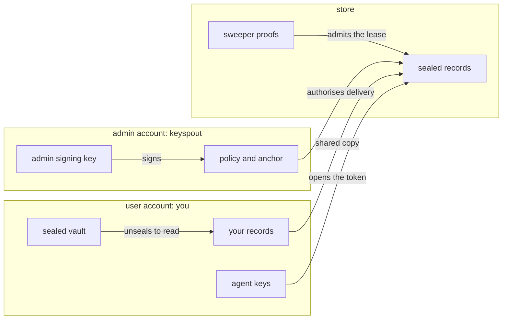

The admin account holds the signing key and the policy. The user account holds
the vault, its records and its agents. `store` holds the sealed copies, and a
sweep proof is what allows a lease to exist at all.

## Before you start

```bash
ksp version
id -un
```

```
ksp 0.1.0
bruj0
```

If `ksp` is not found, see [Build and install](#install) at the end.

Set the deployment home and a helper for running commands as the admin
account. The deployment lives in the **admin** account's home, because that is
the account that owns the signing key:

```bash
# The admin account's home. macOS puts users under /Users; Linux under /home.
export KSP_ADMIN_HOME=/Users/keyspout
export KSP_HOME="$KSP_ADMIN_HOME/.ksp"
export KSP="$(command -v ksp)"
asadmin() { sudo -u keyspout -H env KSP_HOME="$KSP_HOME" LC_ALL=C "$KSP" "$@"; }
```

> **Linux note:** set `KSP_ADMIN_HOME=/home/keyspout` on the first line and every
> later command follows. `$KSP_ADMIN_HOME` is used wherever a path is needed, so
> there is one value to change rather than fifteen.

`asadmin` is a shell function, not part of `ksp`. It exists because the admin
commands must run as the `keyspout` account while your terminal is your own —
`sudo -u` alone would reset `PATH`, so `env` passes the absolute binary path
through.

**Which account runs what** follows from step 4's handover. The admin account
keeps the signing key and the policy; the user account gets the vault, its
agent keys and its own level. So `admin …` commands run as `keyspout` and
`secret …` / `agent …` commands run as you:

| Command group | Account | Why |
|---|---|---|
| `admin init`, `admin policy`, `admin put`, `admin list` | `keyspout` | needs the admin signing key, mode `0700` |
| `secret set`, `secret get`, `agent enroll`, `secret share` | you | needs the vault and `agent/`, handed to you in step 4 |
| `status`, `audit verify`, `backend list` | either | reads public material and your own roots |

Everything below runs in **one shell**. Keep it open: `$KSP_HOME`, `$KSP`,
`$USER_ID` and `$AGENT` are carried between steps.

---

## 1. Create the two accounts

A Keyspout deployment always has an admin account and a user account, and the
boundary between them is filesystem permissions — so they must be different
UNIX accounts.

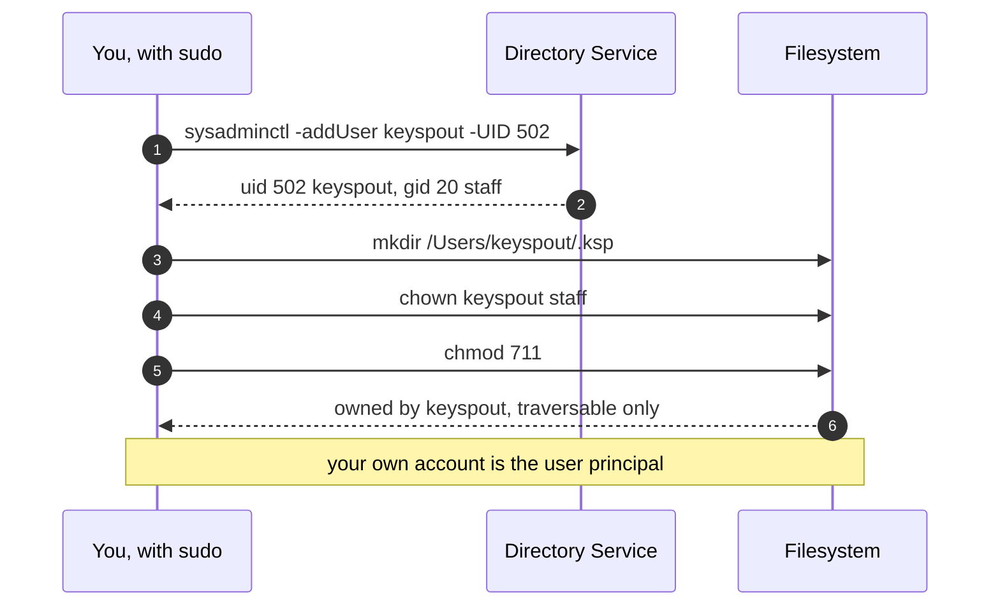

Create the admin account. `sysadminctl` is Apple's supported tool; it sets every
attribute and provisions the home directory.

```bash
ls -ld /Users/keyspout 2>/dev/null && sudo rm -rf /Users/keyspout
sudo sysadminctl -addUser keyspout \
  -UID 502 -GID 20 -shell /bin/zsh -home /Users/keyspout
```

```
2026-11-12 19:22:04.829 sysadminctl[97803]: Creating user keyspout...
2026-11-12 19:22:05.112 sysadminctl[97803]: User keyspout created
```

Verify it resolves by name. A record with no `UniqueID` does not, and that is
the failure `chown` reports as `illegal user name`:

```bash
id keyspout
```

```
uid=502(keyspout) gid=20(staff) groups=20(staff),12(everyone),61(localaccounts),…
```

Give it a home for the deployment, with the mode the layout expects:

```bash
sudo mkdir -p "$KSP_HOME"
sudo chown -R keyspout:staff "$KSP_HOME"
sudo chmod 711 "$KSP_HOME"
```

`0711` lets another principal traverse a known path without enumerating it.
`mkdir` gives `0755`, which `ksp status` reports as drift.

**The two accounts must share a group, and `-GID 20` is what does it.** The store
holds files at `0640` and directories at `0750` in that group: a publication's
token, the ledgers and the store's level roots are readable by the group and by
nobody else. On macOS every ordinary account is in `staff` (gid 20), so the two
accounts share it without anything further. On Linux a `useradd` that gives the
admin its own group leaves the user outside it, and the failure is confusing: the
admin publishes a token, and the user's `secret share --policy` reports that no
token was ever issued.

> **Use `sysadminctl`, not `dscl`, to create an account.** `dscl` takes one
> attribute per call, so several attributes in one `-create` collapse into the
> *value* of the first, leaving the account with no `UniqueID`.

> **Linux note:** the three commands above become one `useradd`, and the home is
> created by the next block either way:
>
> ```bash
> sudo useradd -M -N -s /bin/sh -g "$(id -gn)" \
>   -K SUB_UID_COUNT=0 -K SUB_GID_COUNT=0 keyspout
> id keyspout
> ```
>
> `-g "$(id -gn)"` is the Linux counterpart of `-GID 20`: it puts the admin in the
> **user's** group, which is the group the store is then created in. Leave it out
> and `useradd` gives the admin a group of its own, the two accounts share nothing,
> and the user cannot read the publication token her agent needs.
>
> `id` must print a uid before you go on, exactly as on a Mac. The rest of this
> step uses the same group name, so `chown -R keyspout:"$(id -gn)" "$KSP_HOME"`
> replaces the `keyspout:staff` above. `staff` does not exist on most Linux hosts,
> and `chown` to a group that does not exist fails, leaving the home owned by root.

---

## 2. Configure the host

`ksp init` probes the machine and writes the strongest capability configuration
it can satisfy. **On macOS this step is mandatory**: without it the secret
commands refuse with exit `7`.

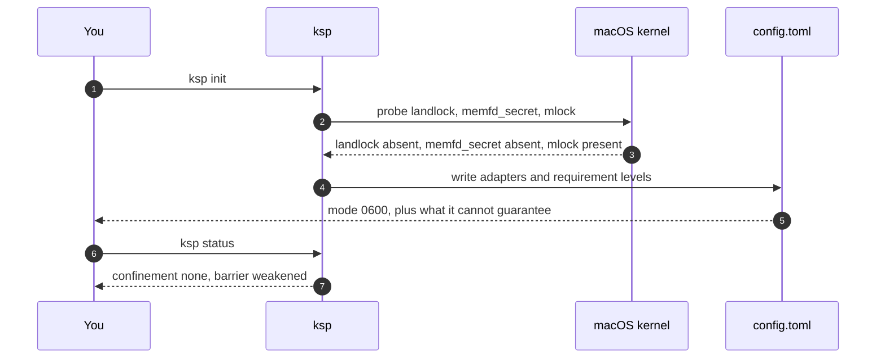

```bash
asadmin init
```

```
wrote /Users/keyspout/.ksp/config.toml with mode 0600

# Keyspout capability configuration.
#
# Each capability names an ordered preference list. The first adapter this host
# provides is the one that runs. The requirement level says whether a run
# refuses when the capability cannot be established.

[confinement]
adapters = [
    "landlock",
    "portable_confinement",
]
requirement = "optional"

[memory_barrier]
adapters = [
    "memfd_secret",
    "sealed_memfd",
    "mlock",
]
requirement = "required"

what this configuration does not guarantee:
  path confinement: not established on this host (landlock: this host has no Landlock: the mechanism is Linux-only and this kernel does not provide it). The level written is optional, so a run continues without it.
  memory barrier: weakened, established by mlock. The run proceeds with a smaller guarantee than the capability names (memfd_secret: this host does not provide memfd_secret(2): the mechanism is Linux-only; sealed_memfd: this host does not provide memfd_create(2): the mechanism is Linux-only).
```

Confirm what the host actually established:

```bash
asadmin status | grep -E '^(confinement|barrier|platform):'
```

```
confinement: confinement unavailable (landlock not implemented by this kernel; SoftRequirement); adapter portable_confinement (none)
barrier:     barrier mlock (LimitMEMLOCK=infinity); adapter mlock (weakened)
platform:    macos
```

Two facts to carry forward, and they are the whole macOS story:

- **`none`** — a Mac has no Landlock, so a child process runs **unconfined**.
- **`weakened`** — `mlock` keeps key pages out of swap, but not out of the
  process's address space the way `memfd_secret` does.

> **Linux note:** both lines read differently there, because the mechanisms
> exist. `confinement` reports `enforced (landlock available (abi N))` and the
> file says `requirement = "required"` for it; `barrier` names `memfd_secret`
> rather than `mlock`. The command is the same; only the measurement differs.
> See [Where Linux differs](#2-the-requirement-level-ksp-init-writes).

**Widen the configuration so the second principal can read it:**

```bash
sudo chmod 0644 "$KSP_HOME/config.toml"
```

`ksp init` writes `0600`, which is right when one account runs everything. With
two accounts it is not: the user's `secret set`, `agent enroll` and `run` all read
this file, and she cannot open a `0600` file the admin owns. The guard objects to a
file another principal can **write** — that is the path that lowers the requirement
level — and not to one she can read, so `0644` is the shape the two-account
session is built on. The directory above it is `0711` and only the admin can write
that, which is what keeps the file the admin's.

Leave it at `0600` and the user's first command fails with
`the capability configuration … could not be read: Permission denied`.

A second `ksp init` changes nothing and exits `0`. Re-probing is
`ksp config init --force`.

### Where the store goes — and why you set no variable

The store is **inside the home**, at `$KSP_HOME/store`, created by `ksp` itself
on the first command that needs it. There is nothing to configure and no second
copy to keep in sync.

`KSP_STORE` still exists and still works, but **do not set it**. A configured
store root is *opened, never created*: point it at a directory that is not there
and the command refuses instead of quietly making an empty store that reads as
"no records". Measured:

```
ksp: the configured store root at /tmp/example is not a readable directory:
     create or mount it, or unset KSP_STORE to use this home's own store
ksp: refused (exit 7: the backend or the host layout cannot admit this lease)
```

Leave it unset and the store follows the home, which is what both steps 7 and 8
assume.

One more reason to leave it alone: a suite or a script that inherits an exported
`KSP_STORE` writes its records into whichever store that names. A run that
suddenly fails with paths escaping the root, or with `permission denied` on a
directory nobody in this session created, is usually this variable arriving from
a shell profile.

```bash
echo "${KSP_STORE:-unset}"     # must print `unset` before you go on
```

---

## 3. Initialise the deployment

This creates the admin signing key and names the vault. It runs as the admin
account, so the key belongs to the account that will use it.

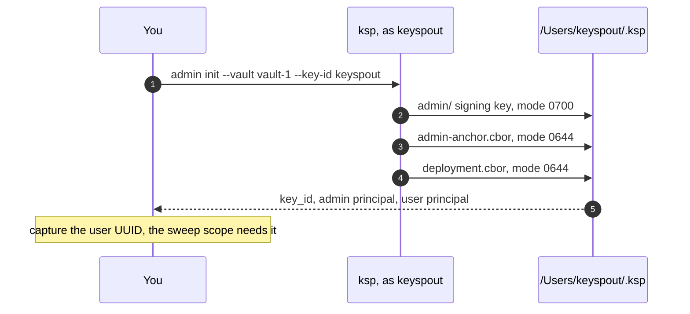

```bash
asadmin admin init --vault vault-1 --user "$USER" --key-id keyspout
```

```
admin  key_id=keyspout  signing_key=c05784eb…c732ee  principal=736e3c4f-7543-4f62-9438-051cc313ba47  user=a1716261-f3c8-4f70-be0b-7f2f5081c559
```

Two UUIDs are printed and they are different things: `principal=` is the
**admin**, `user=` is the **user principal**. Capture the user one — step 5
builds the sweep scope from it:

```bash
USER_ID=a1716261-f3c8-4f70-be0b-7f2f5081c559
```

> Replace that with the UUID *your* run printed. `--user "$USER"` is a display
> name only: it is stored in `deployment.cbor` and never printed again. The
> identity is the UUID. `--key-id` names the admin signing key, which appears
> in the anchor and in every audit chain head.

---

## 4. Enrol the user

Enrolment writes the sealed vault, signs the policy naming the user's keys, and
binds the vault to the user's UNIX account.

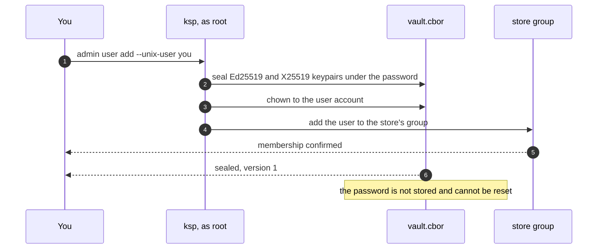

The password arrives on **stdin**, never in argv. This step needs **root**:
it hands the vault to another account and edits a group.

```bash
# Your copy, in your home, 0600 and yours.
printf 'correct horse battery staple' > "$HOME/.ksp-password"
chmod 600 "$HOME/.ksp-password"

# The admin's copy of the same password. `admin seal-vault` and
# `admin policy create` open the admin vault, and they run as the admin account.
sudo env KSP_HOME="$KSP_HOME" sh -c \
  "cp '$HOME/.ksp-password' '$KSP_HOME/pw'; chown keyspout '$KSP_HOME/pw'; chmod 600 '$KSP_HOME/pw'"

sudo env KSP_HOME="$KSP_HOME" "$KSP" admin user add \
  --unix-user "$USER" \
  --signing-key-id "$USER-ed25519-1" \
  --recipient-key-id "$USER-x25519-1" \
  --passphrase-file "$HOME/.ksp-password"
```

```
admin user add: principal=a1716261-f3c8-4f70-be0b-7f2f5081c559
```

> **One password, one file per account that needs it.** Keyspout never stores
> the password; it reads it from the file you name. Your commands run as you and
> read `$HOME/.ksp-password`; the two admin commands that unseal the admin vault
> run as `keyspout` and read their own copy at `$KSP_HOME/pw`. Pointing the
> user's commands at the admin's copy fails with
> `the passphrase file … could not be opened: check the path`, because a `0600`
> file in another account's home is exactly that — unopenable.

> The `--signing-key-id` and `--recipient-key-id` flags replace the CLI defaults
> `alice-ed25519-1` and `alice-x25519-1`, which are **not** derived from
> `--user`. They are labels that appear in the policy, in `token inspect` and in
> the audit chain head.

**The principal printed here is the one to keep.** For the *first* enrolment it
equals the `user=` UUID step 3 printed — `admin user add` adopts the provisional
principal rather than minting a second one, which is why the two match in the
run above. Every enrolment after the first gets a **new** principal, and the
deployment record keeps naming the first one, so `admin init`'s value is right
only until a second principal exists.

Either way the rule is the same: take the UUID from **this** command, and use it
wherever a grant or a scope names the user. Passing a principal the deployment
does not hold is refused by name:

```
ksp: the policy edge names user <uuid>, which this deployment does not hold: enrol her first
ksp: refused (exit 2: policy denied the operation)
```

Check it — the binding is what makes the two accounts real:

```bash
asadmin status | grep -E '^(binding|permissions):'
```

```
binding:     bruj0 (uid 501)
permissions: 16 protected roots match the layout
```

`binding:` names the user account that owns the vault. Without it the line
reads `none — the vault belongs to whoever created it`, which is the
single-account shape.

`sealed`, not `unlocked`: no session exists, and every read needs the password
again.

---

## 5. Set up the sweeper

A lease is a promise about when a copy stops being fetchable, so this build
refuses a lease until something has **proven** a cleanup runs. This step turns
that gate on, and it is the step people skip.

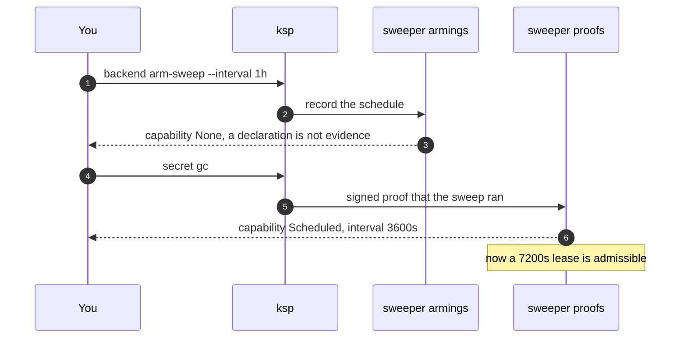

First, see the gate closed:

```bash
asadmin backend list
```

```
backend=file  capability=None  mechanism=no sweep proof has been written; a declaration is not evidence  cadence=none  retention=unknown
selectable: file, valkey (selected: file)
```

Record the schedule. The scope is built from the user UUID from step 3:

```bash
asadmin backend arm-sweep --interval 1h \
  --scope "p/vault-1/$USER_ID/agent-*" \
  --credential ksp-sweep --grant "delete:p/vault-1/$USER_ID/agent-*" \
  --identifier ksp-sweep.service --kind systemd
```

```
arming: backend=file  kind=systemd  identifier=ksp-sweep  interval=3600s  scope=p/vault-1/…/agent-*  credential=ksp-sweep  rights=delete:p/vault-1/…/agent-*  principal=…  recorded_at=1794924305  id=…

[Unit]
Description=Keyspout lease sweep (file, ksp-sweep)
After=network.target

[Service]
Type=oneshot
User=ksp-admin
# The armed job uses only this credential (FR-034): ksp-sweep
ExecStart=/usr/local/bin/ksp secret gc

[Timer]
OnUnitActiveSec=3600s
AccuracySec=1s

[Install]
WantedBy=timers.target
```

Naming `--kind systemd` prints the unit the schedule describes — that is the
"nothing was installed" note made concrete: you are handed the artifact, not a
running job. Omit `--kind` and the host's own default applies, which is `systemd`
on Linux and `launchd` on macOS; on macOS that means a property list rather than
the unit above.


Run the sweep once. **This is what writes the proof:**

```bash
asadmin secret gc
```

```
capability=Scheduled { interval: 3600s }  selected=0  removed=0  already_absent=0  not_yet_due=0  bound_reached=false  backlog=0
removed 0 of 0 expired lease(s) on this host; 0 were already absent; no armed record on this host has passed its deadline, which is not evidence that the store cleaned anything
```

It removed nothing because nothing was due. The proof says *the schedule ran*,
not *the store cleaned up*.

```bash
asadmin status | grep -E '^(capability|cadence|proven|minimum):'
```

```
capability:  Scheduled { interval: 3600s }
cadence:     3600s (declared)
proven:      3600s (proof age 0s)
minimum:     7200s (2 x the proven interval; MVP admission policy, not a timing promise)
```

`7200s` is the floor: `2 ×` the proven interval. It is admission policy, not a
promise that a copy dies at 7200 seconds.

> **`--kind systemd` on a Mac is correct.** The `file` backend's form of a
> periodic job is a systemd unit, so the *record* looks the same on both
> platforms. Nothing is installed: `ksp` prints the unit and says so twice.
>
> **Linux note:** `--kind systemd` is also Linux's *default*, so dropping the
> flag changes nothing there. On a Mac the default is `launchd`, which is why
> this step passes the flag explicitly. See
> [Where Linux differs](#1-the-scheduler-the-default-names).

### Or let the user run her own sweep

The admin's sweep needs a proof because it admits a lease. A **user's** sweep
bounds only her own copies, so it needs no proof and no admin key.

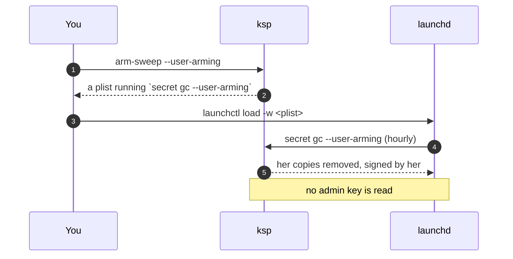

Record it, signed by your own key:

```bash
ksp backend arm-sweep --interval 1h \
  --scope "p/vault-1/$USER_ID/agent-*" \
  --credential ksp-user-sweep \
  --grant "delete:p/vault-1/$USER_ID/agent-*" \
  --identifier com.keyspout.user-sweep \
  --user-arming --passphrase-file "$HOME/.ksp-password"
```

The plist it prints names your sweep, not the admin's:

```
  <key>ProgramArguments</key>
  <array>
    <string>/usr/local/bin/ksp</string>
    <string>secret</string>
    <string>gc</string>
    <string>--user-arming</string>
    <string>--passphrase-file</string>
    <string>/Users/keyspout/.ksp/sweep.passphrase</string>
  </array>
```

`--user-arming` makes the run sign as you; `--passphrase-file` is what lets it
run with no terminal. Put the vault password there and install the plist:

```bash
cp "$HOME/.ksp-password" "$KSP_HOME/sweep.passphrase"
chmod 600 "$KSP_HOME/sweep.passphrase"
# save the printed plist, then:
launchctl load -w ~/Library/LaunchAgents/com.keyspout.user-sweep.plist
```

It runs with no admin key present — verified by deleting `admin/*.cbor` and
watching it remove a due copy anyway.

---

## 6. Enrol the agent and store a secret

An agent gets two independent keypairs of its own — it is not a copy of the
user's.

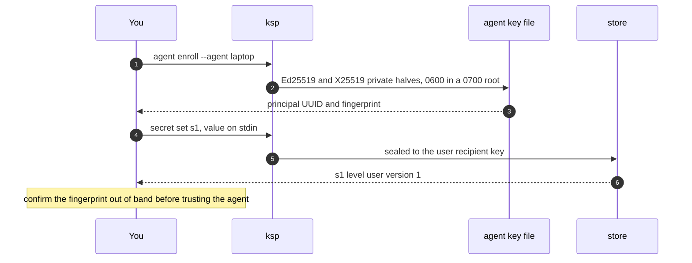

```bash
AGENT=$(ksp agent enroll --agent "$USER-laptop" | sed -n 's/^agent:\([0-9a-f-]*\).*/\1/p')
echo "$AGENT"
```

```
agent:7975116e-1677-466d-8997-ea11b8ab87cd  signing_key_id=7975116e-…-ed25519-1  signing_key=e0db84ff…d060  recipient_key_id=7975116e-…-x25519-1  recipient_key=e0db84ff…c834  fingerprint=e5f6c426…b1ec2
7975116e-1677-466d-8997-ea11b8ab87cd
```

The display name is metadata; the **UUID** is the identity, and every later
command takes it. The **fingerprint** is what you confirm out of band.

Store a secret. The value arrives on stdin, the password from a file — neither
is ever in argv:

```bash
printf 's3cr3t-value-1' > "$KSP_HOME/value"
ksp secret set s1 --name db_password --passphrase-file "$HOME/.ksp-password" < "$KSP_HOME/value"
ksp secret get s1 --reveal --passphrase-file "$HOME/.ksp-password"
```

```
s1  level=user  version=1
db_password	s3cr3t-value-1
```

`get` without `--reveal` prints `db_password	••••`.

---

## 7. Share it and run it

`share` copies the record to the agent's level and seals it to that agent's
recipient key. `run` hands the value to a child through its environment.

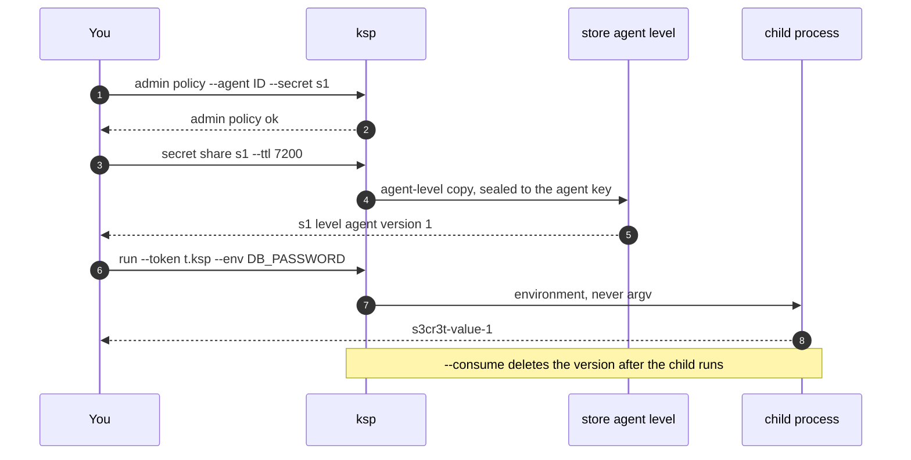

Grant the agent permission first — a grant is a policy statement, not a
delivery:

```bash
asadmin admin policy --agent "$AGENT" --secret s1
```

```
policy:      revision=2  merged
added:       agents=7975116e-…  secrets=s1
removed:     agents=none  secrets=none
grants not named here were kept; pass --replace to withdraw them
```

The report is the read-back: a write **merges** by default and says what it
added. `--replace` writes the whole set and withdraws every grant the call does
not name, which is the only way to drop several at once. To drop one and keep the
decision on record, use `admin revoke` — or, for a grant made by the policy-scoped
surface in step 8, `admin policy delete`.

Now the share. `7200` is admitted because step 5 proved a `3600s` cadence:

```bash
ksp secret share s1 --agent "$AGENT" --name db_password \
  --out "$KSP_HOME/token.ksp" --ttl 7200 --passphrase-file "$HOME/.ksp-password"
```

```
s1  level=agent-7975116e-1677-466d-8997-ea11b8ab87cd  version=1
```

Inspect it — no key and no value, only the scope, the expiry and the key IDs:

```bash
ksp token inspect --token "$KSP_HOME/token.ksp"
```

```
jti=s1-7975116e-…-1  agent=7975116e-…  level=agent-7975116e-…  expires_at=1794516301
issuer=bruj0-ed25519-1  agent_signing_key=7975116e-…-ed25519-1  agent_recipient_key=7975116e-…-x25519-1
s1  level=agent-7975116e-…  version=1
```

Run it:

```bash
ksp run --token "$KSP_HOME/token.ksp" --env DB_PASSWORD -- /usr/bin/printenv DB_PASSWORD
```

```
ksp: no path confinement is enforced on this host: the path confinement capability is `optional` and nothing could be established, so the child runs unconfined
s3cr3t-value-1
```

That first line is the macOS disclosure from step 2, printed on **stderr**
before the child starts. It is not a warning to ignore; it is the guarantee the
host could not give.

`--consume` adds the deletion: retrieve, decrypt, hand to the child, delete the
exact version, report.

```bash
ksp run --consume --token "$KSP_HOME/token.ksp" --env DB_PASSWORD -- /usr/bin/printenv DB_PASSWORD
asadmin admin list
ksp run --token "$KSP_HOME/token.ksp" --env DB_PASSWORD -- /usr/bin/printenv DB_PASSWORD
```

```
s3cr3t-value-1
s1  level=user  version=1
ksp: refused (exit 6: key material is missing or unreadable)
```

Only the user's own copy is left, so the second run cannot find the version.
A copy taken before the consume still opens — the system cannot recall it, and
nothing above claims otherwise.

Finally, check the log each step appended to:

```bash
asadmin audit verify
```

```
audit verify: segments=3  records=4  valid=4  revoked=0  unpinned=0  mismatch=0  invalid=0  unreadable=1  chain=unbroken
head 736e3c4f-…/keyspout=3945dba9…
head a1716261-…/7975116e-…-ed25519-1=3c6b6caf…
head a1716261-…/bruj0-ed25519-1=c49a74e6…
note: could not read audit/a1716261-…: the audit segment could not be read: …/audit/a1716261-…
note: completeness unknown: no head digest was supplied from outside the log, so a deleted tail verifies exactly like a whole one
note: 1 entr(ies) could not be read, so this run did not check every record
ksp: refused (exit 12: the audit log did not verify; the report names the finding)
```

One head per writer. **`unreadable=1` is the other account's chain**, and in a
two-account deployment it is expected: each principal's chain directory is `0700`
and belongs to that principal, so the admin can read its own segment and not the
user's. `chain=unbroken` is the verdict on what it could read.

The exit code is `12` because a segment it could not read means it did not check
every record. Run it as the other account and the count moves with you; neither
run is a global verdict, and both say so. Completeness stays unknown either way,
because no head arrived from outside the log.

**Each principal verifies its own chains.** `asadmin audit verify` covers the
admin's; `ksp audit verify` run as the user covers hers and reports the admin's as
unreadable. Read `valid` beside `unreadable`: a non-zero `unreadable` with
`invalid=0` means "not mine to read", not "corrupt".

---

## 8. Deliver through a signed grant, with no copy

Steps 6 and 7 made a **copy**: an agent-level record sealed to that agent's key.
This step delivers a value with no copy at all. The admin publishes one sealed
entry, signs a grant, and mints the token the grant authorises; the user exports
that token without a password; the agent opens the publication with its own key.

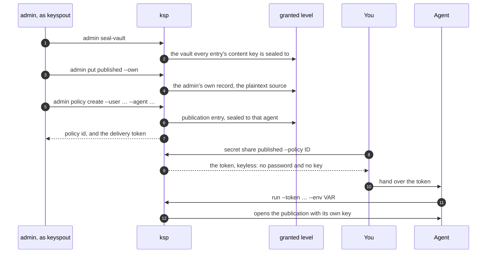

The admin's vault is what every publication entry's content key is sealed to, so it
comes first, and there is one per deployment:

```bash
asadmin admin seal-vault --passphrase-file "$KSP_HOME/pw"
```
```
admin seal-vault: principal=736e3c4f-7543-4f62-9438-051cc313ba47
```

Then the record the publication is made from. `--own` seals it at the **admin's**
own principal, to her own vault. A record sealed to the user cannot be opened by the
admin, so a policy whose only source was that record has no plaintext to publish.
`--own` needs no password at all: the value arrives on stdin, and the record is
sealed to the admin's *public* recipient key.

```bash
printf 'value-the-admin-publishes' | \
  sudo -u keyspout -H env KSP_HOME="$KSP_HOME" "$KSP" admin put published --name published --own
```
```
admin/published  level=admin  version=1
```

Sign one grant. This step does open the admin vault, because the publication
entry's content key is sealed to it:

```bash
asadmin admin policy create --user "$USER_ID" --secret published --version 1 \
  --agent "$AGENT" --passphrase-file "$KSP_HOME/pw" --json
```
```
{"agents":[{"identity":"7975116e-…","fingerprint":"e5f6c426…"}],"id":"a0e6819fb4dbad6a2924a76ab63d9c67","kind":"policy_edge","not_after":1797516483,"publication":"p/vault-1/736e3c4f-…/granted/published/1","revision":1,"state":"active","target":"agent:7975116e-…","tokens":[{"jti":"a0e6819f…-1","state":"live"}],"user":"a1716261-…","verified":true,"version":1}
{"kind":"confirmation","operation":"delivery token written to …/policies/a0e6819fb4dbad6a2924a76ab63d9c67.token"}
```

Capture the identifier it printed:

```bash
POLICY=a0e6819fb4dbad6a2924a76ab63d9c67
```

Export it as the user. **No password**, and nothing is decrypted: the token carries
a publication reference and no content key, so there is nothing for the user to
unlock.

```bash
ksp secret share published --policy "$POLICY" --out "$HOME/policy-token.ksp"
```
```
secret share published --policy a0e6819fb4dbad6a2924a76ab63d9c67 wrote /Users/you/policy-token.ksp: ok
```

`--policy` takes none of `--name`, `--uses`, `--ttl` or `--passphrase-file`. The
grant already fixed the secret, the agent and the window; there is no copy to lease
and no vault to open. Each refusal names the flag and the accepted form.

The agent runs it like any other token:

```bash
ksp run --token "$HOME/policy-token.ksp" --env KSP_POLICY_VALUE -- /usr/bin/printenv KSP_POLICY_VALUE
```
```
value-the-admin-publishes
```

`--consume` is refused here, and names the reason: a policy delivery has no
agent-level copy to delete. The publication stays, and the grant's window is the
only control.

Read the grant back:

```bash
asadmin admin policy show "$POLICY"
asadmin admin policy list
```
```
policy:      a0e6819fb4dbad6a2924a76ab63d9c67
revision:    1
user:        a1716261-f3c8-4f70-be0b-7f2f5081c559
secret:      published@1
target:      agent:7975116e-1677-466d-8997-ea11b8ab87cd (cryptographic)
state:       active
validity:    1794924483..1797516483
issuer:      verified against the pinned anchor
publication: p/vault-1/736e3c4f-…/granted/published/1
agent:       7975116e-…  name=<you>-laptop  signing=7975116e-…-ed25519-1  recipient=7975116e-…-x25519-1  fingerprint=e5f6c426…
token:       jti=a0e6819f…-1  expires_at=1797516483  state=live  remaining_uses=-
withdrawn:   no -- this policy is not recorded as withdrawn
last change: 1794924483
```
```
a0e6819fb4dbad6a2924a76ab63d9c67  user=a1716261-…  secret=published@1  mode=cryptographic  state=active  revision=1  tokens=1
1 of 1
```

`state` is the join, not a flag. The five values `list --state` accepts are
`active`, `expired`, `withdrawn`, `dangling` and `unverified`. `dangling` means a
link the grant names is gone — the publication, the agent's index entry or the
record version — and `state_reason` names which one. A grant whose publication is
missing reads `dangling`, never `active`: a grant that cannot deliver is not a
healthy grant. `unverified` is the one to look at twice: the edge is there, and
this host could not check the admin's signature over it.

`list` also tells you what it could not attribute. A row is a policy; an issuance
record that names a revision but no policy identifier cannot be counted against
one, and the note under the table says how many of those there are.

Three more verbs, once a grant exists:

```bash
asadmin admin policy update "$POLICY" --expires-at 1797519999   # move the window, no password
asadmin admin policy delete "$POLICY"                           # withdraw, remove, record
asadmin admin policy list --state active --limit 20             # filtered and bounded
```

`update` prints the same joined view at the next revision — `revision: 2` above —
so the read-back is the confirmation. `list` is bounded at `50` by default and
filters on `--user`, `--secret` and `--state`.

`--expires-at` needs no password because the entry is already sealed — the update
writes a token and a ledger row, not a new publication.

`delete` is the withdrawal, and it records the decision before it removes the
artifact, so an operator can tell a withdrawn grant from one that never existed:

```bash
asadmin admin policy delete "$POLICY"
```
```
policy:      a0e6819fb4dbad6a2924a76ab63d9c67
revision:    2
state:       withdrawn
issuer:      NOT verified against the pinned anchor: nothing below is evidence
reason:      the ledger records this withdrawal and the artifact is gone, which is what
             a withdrawal leaves behind: the decision stands, and the target it named is
             not in the record
withdrawn:   revision=2  actor=736e3c4f-…  at=1794925673
```

The read-back is honest about what is left: the edge is gone, so there is no
target to verify and no token to name. `list` keeps the row with
`state=withdrawn`, which is the difference between a grant that was withdrawn and
one that never existed. The next run refuses:

```
ksp: this host holds no grant with that policy id: it was never published here, or it has been withdrawn
ksp: refused (exit 2: policy denied the operation)
```

> **This is the flow that has no hidden copy.** Step 7's token carries a content
> key and a copy at the agent's level, and `--consume` deletes that copy. This
> token carries neither: the agent opens one entry, and the value stays available
> for as long as the grant's window and the publication both exist. Withdrawal stops
> the next run; it does not recall a value the agent already read.

---

## Everything else that does work

```bash
ksp secret rm s3cr3t-id-1 --passphrase-file "$HOME/.ksp-password"   # one version
ksp secret purge-expired --limit 100                       # one batch, at most 100
ksp secret gc                                              # repeat until nothing is left
ksp admin list                                             # record paths, all levels
ksp admin audit                                            # acknowledgements and signed reports
printf 'hunter2' | ksp admin put s3cr3t-9 --name injected  # sealed to the user, no password
ksp agent rotate --agent "$AGENT" \
  --signing-key-id "$USER-laptop-ed25519-2" --recipient-key-id "$USER-laptop-x25519-2"
ksp vault rekey --threshold 2 --shares 3                   # new recovery phrase, password unchanged
ksp token list                                             # what this host minted
```

Two of these print their own limits, and both are worth reading once:

```
$ ksp secret purge-expired --limit 100
capability=Scheduled { interval: 3600s }  selected=0  removed=0  already_absent=0  not_yet_due=1  bound_reached=false  backlog=0
removed 0 of 0 expired lease(s) on this host; 0 were already absent
```

`capability` reads `Scheduled { interval: 3600s }` here because step 5 armed a
schedule; on a host that never armed one it reads `None` and the second line
explains that no sweep can remove anything. Either way the command reports what
it did — nothing — instead of claiming a cleanup, and exits `0` because the
command ran, not because anything expired.

`ksp token list` carries the same kind of limit:

```
$ ksp token list
s3cr3t-id-1-e5d83dfa-…-1  agent=e5d83dfa-…  secret=s3cr3t-id-1  version=1  deadline=1794104868  policy_rev=1  live
1 token(s) minted on this host; a token minted elsewhere is unknown here
```

It knows what this host wrote, and says so rather than implying a global view.

`ksp vault rekey` prints the phrase **after** the re-sealed vault is on disk, and
prints it once. Write it down before you close the terminal: the command replaces
the previous phrase, and it changes nothing about the password.

---

## Exit codes

| Code | Meaning |
|---|---|
| `0` | Success |
| `1` | Unexpected internal failure |
| `2` | Policy denied the operation |
| `6` | Key material is missing or unreadable — also a wrong password |
| `7` | The backend's capability or admission floor refused the lease |
| `8` | The proof of possession was invalid or missing |
| `9` | The delete failed; the record may still be present, a retry may help |
| `10` | The child ran after the record was removed; it is gone, retrying cannot help |
| `11` | A compliant run was refused because the backend requires consumption |
| `12` | The audit log did not verify |
| `13` | The invocation was malformed; the message names the accepted form |

`9` and `10` are separate on purpose: one says *try again*, the other says *ask
for a new delivery*. `13` is separate from `1` and `2` for the same reason: a
typo, a crash and a policy decision need three different responses from a caller,
and one integer cannot say all three.

---

## Where your state lives

```
$KSP_HOME/
├── vault.cbor            the user's sealed vault — needs the password (0600)
├── admin-vault.cbor      the admin's vault: what a publication entry's
│                         content key is sealed to (0600)
├── policy.cbor           the admin-signed grant set, for the leased path
├── admin-anchor.cbor     the admin public key this host pins      (0644)
├── deployment.cbor       the vault and principal identifiers, and public keys (0644)
├── config.toml           this host's capability configuration (0644, two accounts)
├── admin/                the admin signing key          (0700, owner-only)
├── agent/                enrolled agent key bundles     (0700, owner-only)
├── enrolments/           signed enrolment records, one per agent (0755)
├── store/
│   └── p/<vault>/<principal>/
│       ├── principals.cbor      the registry: who is in this deployment (0644)
│       ├── policy-events.jsonl  the admin's grant decisions             (0640)
│       ├── user/                the principal's own records            (0700)
│       ├── agent-<id>/          a leased copy, sealed to that agent    (0700)
│       ├── granted/             the publication a grant delivers from  (0750)
│       └── policies/            the token a grant minted               (0755)
├── store/intents/        arm records, and each copy's use counter (1770, sticky)
├── sweeper/proofs/       sweep proofs, readable by any principal (0755)
├── sweeper/armings/      armed schedules, one per backend+scope   (0755)
├── journal/              deletion acknowledgements            (0700)
├── audit/                one writer segment per principal      (0711)
├── layout.cbor           which uid owns which root, recorded at creation
├── issuance.jsonl        what this host minted (written on the first lease)
└── pw                    the admin's copy of the password — Keyspout never
                          writes this; you do, for the two commands that unseal
                          the admin vault
```

Every row above has one mode in one table, and `ksp status` measures the disk
against it. Inside `store/`, each principal's root is `0711` and the level
directories under it are `0700`: a principal that can *name* a level traverses
into it, and one that cannot name it cannot list the siblings it might guess.

`granted/` is `0750` and `policies/` is `0755`, both in the store's **group**.
That is the group from step 1, and it is why the two accounts have to share one:
the user exports the token the admin wrote, and a group neither account is in
leaves her reading "no delivery token was issued" about a file that exists.

Back up `vault.cbor`, `admin-anchor.cbor`, `admin/` and `agent/`: they are the
identities, and replacing them changes who can read what. Losing the password
loses the vault; the recovery phrase restores the sealed file, not the password.

---

## Reading the audit log

`ksp audit` prints the log's projection, scoped to whoever proves a pinned key:
the tenant by opening its vault, the admin by loading the key its anchor pins.

```bash
ksp audit --admin
```
```
audit: scope=complete  segments=3  records=4  unknown=0  malformed=0  unreadable=0  withheld=0
note: this view has not checked signatures or chain links; `ksp audit verify` checks them
note: records are grouped by chain (writer); the order between chains is each writer's timestamp claim, not a sequence this host can prove
record: actor=…  signer=admin-2026  component=sweeper  operation=sweep  outcome=success  code=0  at=1794097663  segment=audit/…/segment-admin-2026.cbor  index=0
record: actor=…  signer=admin-2026  component=sweeper  operation=sweep  outcome=success  code=0  at=1794097672  segment=audit/…/segment-admin-2026.cbor  index=1
record: actor=…  signer=<you>-ed25519-1  component=cli  operation=put  target=vault-1/user/s1/1  outcome=success  code=0  at=1794097656  segment=audit/…/segment-<you>-ed25519-1.cbor  index=0
record: actor=…  signer=…-ed25519-1  component=agent  operation=deliver  target=vault-1/agent-…/s1/1  outcome=success  code=0  at=1794097668  segment=audit/…/segment-…-ed25519-1.cbor  index=0
```

The second note is the one that explains the ordering: records are grouped by
chain, and the order *between* chains is each writer's own timestamp claim. The
admin's two sweep records therefore appear before the user's `put` even though the
`put` happened first — that is not a bug in the view, it is the view declining to
claim a global sequence it cannot prove.

Read the header as a list of what was *counted*, not as a verdict:

- `records` counts what this build could decode and attribute. `unknown` counts
  records whose kind this build does not know — they are printed with their field
  names and the *shape* of each value, never its text or bytes, because a writer
  this build does not know has not agreed to the no-secret rule. `malformed`
  counts records that would not decode; they are printed as findings, and the
  walk continues past them.
- `withheld` counts unknown records a narrowed view (`--principal`) can see but
  not attribute. Counting without printing is deliberate: the count says the log
  is not fully rendered, the refusal says whose record it is not.
- Nothing here says the log is complete or valid. It has not checked a signature,
  a chain link or a head, and it says so. `ksp audit verify` is the command that
  checks them — and it too reports `completeness unknown` unless a head digest
  arrives from outside the log.
- `--json` emits one object per record in record order, with a `kind` tag, from
  the *same* decoded value the human view renders. A record this build cannot
  classify is emitted as `unknown-record` with its raw fields; one that will not
  decode is emitted as `malformed` with a reason. Neither is dropped.

### The shape of `--json`, and how to bound the read

**`--json` on the scoped view is JSONL, not one object.** It is the only command
that behaves this way, and the reason is that a log grows without limit: one
object per record lets a consumer read a record at a time instead of buffering the
whole log. The first line is a header, and every later line is a record:

```
$ ksp --json audit --passphrase-file "$HOME/.ksp-password"
{"kind":"log","records":2,"total":2,"segments":2,...}
{"kind":"audit-record","actor":"…","component":"agent","operation":"deliver",...}
{"kind":"audit-record","actor":"…","component":"cli","operation":"put",...}
```

A consumer reads the whole output as one JSON document and fails with
`Extra data: line 2 column 1`. Split on newlines and branch on `kind`.

**The tenant view needs the vault password.** Supply it with
`--passphrase-file`, or pipe it on stdin. A caller that leaves stdin open and
never writes to it is refused with exit `6` rather than left waiting: an open pipe
never delivers, and a hang produces no exit code and no message.

`audit verify` and `admin audit` read no vault and need no password. `audit
--admin` reads the **admin signing key**, so it runs as the admin account and
needs no password there — run as the user it is refused with exit `6`, because the
key is `0700` and belongs to the admin. In a two-account deployment the cheapest
read is `asadmin audit --admin`.

**The read is bounded by default.** `--limit` caps the record lines emitted, and
`--limit 0` reads without a bound. The header reports `records` (what this
invocation emitted) beside `total` (what the scope holds), so a truncated view is
never mistaken for a complete one:

```
$ ksp --json audit --limit 1 --passphrase-file "$HOME/.ksp-password"
{"kind":"log","records":1,"total":3,"limit":1,...}
```

**`--since` filters by each record's own timestamp**, as `<n><s|m|h|d>`:

```bash
ksp audit --since 1h --limit 50 --passphrase-file "$HOME/.ksp-password"
```

A duration that will not parse is a usage error (exit `13`) naming the accepted
forms, rather than a window nobody asked for.

---

## If `status` reports a drifted root

```bash
ksp status
# permissions: 2 of 16 protected roots drifted
#   drift:     /Users/keyspout/.ksp is mode 0755 owned by uid 502; expected directory mode 0711 owned by unrecorded
#   drift:     /Users/keyspout/.ksp/admin is mode 0775 owned by uid 502; expected directory mode 0700 owned by uid 502
```

The first of those two is the one step 1's `chmod 0711` prevents: `mkdir -p`
creates the home `0755`, and the layout expects `0711`. The second is a widened
key root.

Until those lines are gone, `ksp run` and `ksp admin put` refuse with exit `7`:

```
ksp: a protected root has drifted, so no record will be read or written: /Users/keyspout/.ksp/admin is mode 0775 owned by uid 502; expected directory mode 0700 owned by uid 502
ksp: refused (exit 7: the backend or the host layout cannot admit this lease)
```

The boundary is the mode, so a widened key root is not a root Keyspout will read
through. Keyspout does **not** repair it for you — silently tightening a
directory would erase the drift, and the operator is the one who has to know.
Fix it by hand, then re-measure:

```bash
chmod 0711 "$KSP_HOME"           # the home, if it is the one that drifted
chmod 0700 "$KSP_HOME/admin"     # the mode the message names
ksp status                        # permissions: … match the layout
```

A mode *narrower* than the table (say `0700` where it says `0755`) is reported
as `narrowed` and does not refuse: it grants less, so it is a problem for
whoever must write there, never a weaker boundary.

---

## Rules this build will not bend

- **No secret in argv.** Values go in on stdin; passwords from `--passphrase-file`.
- **`--reveal` writes to stdout**, which a shell redirects, a terminal scrolls
  back and a paste buffer keeps. `ksp run --token …` is the surface that hands a
  value to a child through its environment, never its argv. On `file` a token is
  minted only once a sweep proof exists, so an unproven host refuses at the mint
  step, not at the hand-off.
- **A refusal is not a bug.** When something exits `7`, read `ksp status`: the
  host told you in advance what it cannot hold.
- **Rotation and revocation change the future, not the past.** An old artifact
  still opens with the archived key, and a withdrawn grant does not recall a copy
  already taken — nor a value the agent read through step 8's publication.
- **A policy write merges; `--replace` is the destructive one.** `admin policy
  --agent … --secret …` adds the grants you name and keeps the ones you did not.
  `--replace` writes the named grants as the whole set and withdraws every other,
  and its report lists what it withdrew. Neither is a no-op you can undo: an
  un-named grant that `--replace` withdrew is gone.
- **Deletion is best effort.** No sweep, expiry or revoke here can recall a copy
  someone already saved — a saved key and ciphertext pair stays decryptable.

---

## Where you are now

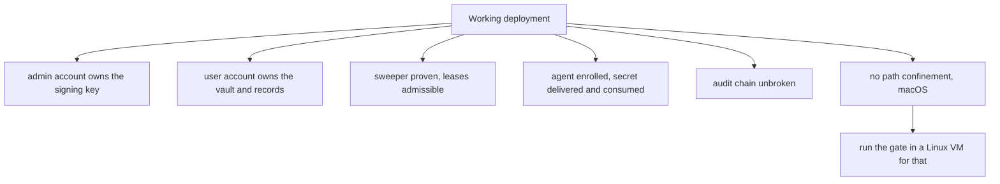

## Where Linux differs

The commands are the same on Linux. Six things differ, and each is a property of
the host rather than of the workflow — the first two change what you type, and the
rest change only what you read back.

### 1. The scheduler the default names

`arm-sweep` with no `--kind` picks the platform's own scheduler:

| Host | Default `--kind` | Artifact it prints |
|---|---|---|
| macOS | `launchd` | a property list |
| Linux | `systemd` | a unit plus timer |

`--kind systemd` is accepted on a Mac and `--kind launchd` on Linux, because an
operator may be writing an artifact for the other machine. Step 5 passes
`--kind systemd` explicitly, which is why its output reads the same on both.

**Linux note:** drop the flag and you get a systemd unit. Install it with
`systemctl link` and `systemctl enable --now`, as the printed template says.

### 2. The requirement level `ksp init` writes

`ksp init` probes the host and records what it can establish. The level follows
the measurement, so the two platforms write different files:

| Capability | Linux | macOS |
|---|---|---|
| Path confinement | `requirement = "required"` — Landlock is available | `requirement = "optional"` — no Landlock, so a run continues |
| Memory barrier | `requirement = "required"` — `memfd_secret` | `requirement = "required"` — `mlock`, reported `weakened` |

**Linux note:** your `config.toml` will say `required` for confinement, and
`ksp status` will report `confinement enforced (landlock available …)` instead
of the `none` in step 2. That is the stronger guarantee, not a difference in the
commands.

### 3. What each platform cannot prove

| What | macOS | Linux |
|---|---|---|
| **Path confinement** | `none` — no Landlock; the child runs unconfined | `landlock` enforces a real ruleset |
| **Memory barrier** | `weakened` — `mlock` only | `memfd_secret` / `sealed_memfd` |
| **Two-account binding** | works — `dscacheutil` + `dseditgroup` | works — `getent` + `usermod` |

Both are *capability* limits that every run discloses, not gaps in the workflow.
The two-account binding in step 4 works on both platforms; it resolves the
store's group with the host's own tool.

To see the enforced confinement, run the gate's Linux half:

```bash
colima start
colima ssh -- bash -lc '
  export PATH="$HOME/.cargo/bin:$PATH"
  sudo -n rm -rf /tmp/ksp-gate-root-target
  cd "$PWD" &&
  CARGO_TARGET_DIR=/tmp/ksp-gate bash scripts/ksp-gate.sh vm < /dev/null'
```

```
== vm part passed
```

### 4. The shell

macOS defaults to `zsh`; most Linux distributions default to `bash`. Every block
on this page parses and runs under both. The one place it matters is the `PATH`
line in [Build and install](#install), which belongs in `~/.zshrc` on a
Mac and `~/.bashrc` on Linux.

### 5. Creating the `keyspout` account

`asadmin` uses `sudo -u keyspout -H env …`, which works on both. The account has
to exist first, and the tool that creates it differs:

```bash
# macOS — -GID 20 is `staff`, the group every ordinary macOS account is in
sudo sysadminctl -addUser keyspout -UID 502 -GID 20 -shell /bin/zsh -home /Users/keyspout

# Linux — -g puts the admin in *your* group, which is the group the store uses
sudo useradd -M -N -s /bin/sh -g "$(id -gn)" \
  -K SUB_UID_COUNT=0 -K SUB_GID_COUNT=0 keyspout
```

Step 1 covers the macOS form in full. On Linux, `-K SUB_UID_COUNT=0 -K
SUB_GID_COUNT=0` avoids drawing from a shared subordinate-ID pool, which fails on
hosts that have none spare; it has nothing to do with what the deployment needs.

**Linux note:** use `useradd`, not `dscl`. And on either platform, check the
account is resolvable before the next step: `id keyspout` must print a uid.

### 6. The group the two accounts share

This is the difference that fails quietly, so it gets its own entry.

The store holds its shared material at `0640` and `0750` in **one group**: the
publication a grant delivers from, the token the grant mints, `policy-events.jsonl`
and the registry. Both accounts have to be in it.

On macOS they already are: `-GID 20` puts the admin in `staff`, and so is every
ordinary account. On Linux the two have no group in common unless you say so, and
`-g "$(id -gn)"` in step 1 is the way to say it.

Leaving it out does not fail at creation. It fails later, in two places that do not
name the group:

```
$ ksp secret share published --policy a0e6819f…
ksp: no delivery token was issued for policy a0e6819f…; expected it at …/policies/a0e6819f….token
ksp: refused (exit 2: policy denied the operation)
```

The file is there. The user cannot read it, and the message reports the absence it
observed. `sudo ls -l` on the `policies/` directory shows a `0640` file in a group
she is not in, which is the whole diagnosis.

Check it before you need it:

```bash
id -gn keyspout           # the admin's group
id -Gn                    # yours, as a list
```

---

## Install

Only needed if `ksp version` failed at the top. Pick the row for your platform.

| Platform | Command |
|---|---|
| macOS (Homebrew) | `brew install bruj0/tap/ksp` |
| macOS or Linux, any | `curl --proto '=https' --tlsv1.2 -LsSf https://github.com/bruj0/keyspout/releases/latest/download/ksp-installer.sh \| sh` |
| Debian / Ubuntu | [download the `.deb`](https://github.com/bruj0/keyspout/releases/latest), then `sudo apt install ./ksp_*_amd64.deb` |
| Fedora / RHEL / Rocky / Alma / openSUSE | [download the `.rpm`](https://github.com/bruj0/keyspout/releases/latest), then `sudo dnf install ./ksp-*.rpm` |
| Any, with Rust | `cargo install --git https://github.com/bruj0/keyspout ksp` |

```
ksp 0.1.0
```

**The tap is `bruj0/tap`, not homebrew-core.** The command is longer than
`brew install ksp` for that reason, and it is not a typo.

**The `.deb` and `.rpm` do not update themselves.** They come from the release
page, not from a package repository, so `apt upgrade` will not move them. Download
the next version when you want it.

**macOS, downloaded in a browser:** the binaries are unsigned, so Gatekeeper
refuses one that Safari quarantined. Homebrew and `curl` installs are unaffected.
Clear the attribute once:

```bash
xattr -d com.apple.quarantine ./ksp
```

### Agent skills

Seven skills teach an agent to drive `ksp` — set it up, report status, store and
share secrets, enrol agents, switch backends, recover, and read the audit log.

```bash
npx skills add bruj0/keyspout
```

`npx skills` needs Node 22.20 or later. It installs for every agent it detects and
keeps one canonical copy under `~/.agents/skills/`. **Verify the install** rather
than trusting the exit code — the CLI symlinks into `~/.claude/skills/` for Claude
Code and there are open issues where that symlink is never created:

```bash
npx skills list -g
ls ~/.agents/skills/keyspout-quickstart/SKILL.md
```

If the canonical copy is there and Claude Code still cannot see the skill, install
through its own plugin system instead:

```
/plugin marketplace add bruj0/keyspout
```

See [`skills/README.md`](skills/README.md) for the manual `cp -r` fallback.

### Build from source

Only if you want to modify the code. The workspace builds natively on both
platforms; the Linux-only adapters are target-gated, so a Mac build simply lacks
them.

```bash
git clone https://github.com/bruj0/keyspout.git && cd keyspout
cargo build -p ksp

mkdir -p ~/.local/bin
ln -sf "$(pwd)/target/debug/ksp" ~/.local/bin/ksp
grep -q '.local/bin' ~/.zshrc || echo 'export PATH="$HOME/.local/bin:$PATH"' >> ~/.zshrc
source ~/.zshrc
```

> **Linux note:** write the `PATH` line into `~/.bashrc` instead of `~/.zshrc`
> if `bash` is your shell — `grep -q '.local/bin' ~/.bashrc || echo …`. The
> rest is identical.

The toolchain is pinned by `rust-toolchain.toml`. `cargo clean` breaks the
symlink — `ksp version` then says `no such file or directory`, which means the
build was cleaned, not that the `PATH` is wrong.

---

## Going further

Everything deliberately left out of this page:

- **[`docs/keyspout-design-spec.md`](docs/keyspout-design-spec.md)** — the
  normative design. §0 wins over every other section.
- **[`DEVELOPMENT.md`](DEVELOPMENT.md)** — toolchain, the Valkey/RustFS/Garage
  services, and where the plan's API differs from the real one.
- **`ksp status`** — the full capability matrix for this host, and every
  configuration refusal it can report.
