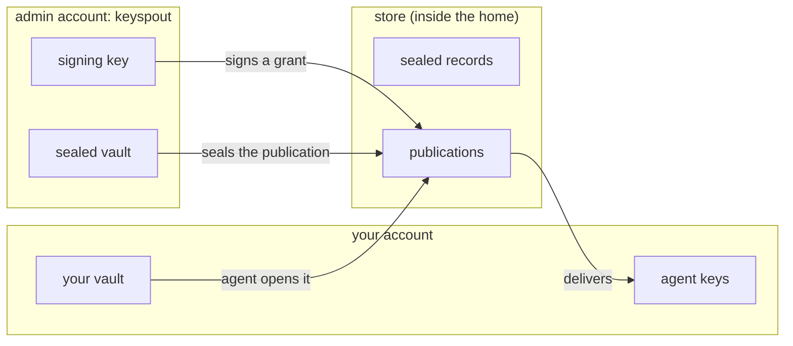

# Quickstart — `ksp-op`

Seven commands, a working two-account deployment. `ksp-op` wraps `ksp` so you do
not have to remember which command runs as which account, which `chmod` the
layout needs, or what order the deployment has to be built in.

It ships as a binary. A shell script of the same name does the same thing for an
install that predates it; both take the same verbs and print the same `home`
block, so the commands below work with either.

The long version — every command, the output it produced, and why each step
exists — is [`USER_MANUAL.md`](USER_MANUAL.md). Read this page first; go there
when something refuses and you need to know why.

## What you are building



Two UNIX accounts and one store. The boundary between them is filesystem
permissions, which is why the script sets modes rather than asking you to.

## 1. Get the tool

Two binaries are needed. Check both:

```bash
ksp version
ksp-op help
```

```
ksp 1.2.0
ksp-op — deployment orchestration for a two-account Keyspout host
```

If either fails, install first — see [Install](USER_MANUAL.md#install). Every
installer ships both, but a tarball from `v1.2.0` or earlier contains `ksp`
alone; `ksp-op` first shipped after that tag.

`ksp-op` takes a verb and the verb's own flags:

```
ksp-op setup [--vault NAME] [--admin-account NAME] [--dry-run]
ksp-op status [--dry-run]
ksp-op reset [--yes] [--dry-run] [--purge-account]
ksp-op ksp <args…>             # run ksp as you
ksp-op asadmin <args…>         # run ksp as the admin account
ksp-op home                    # print the three paths a caller needs
```

**From a checkout, before a release ships it,** the legacy shell script still
works for this walkthrough:

```bash
git clone https://github.com/bruj0/keyspout.git
cd keyspout
./scripts/ksp-op.sh help
```

**Prefer the binary.** The shell script is what `ksp-op` replaced, and the binary
is where every fix since has landed — D8, D9 and D10 all live in Rust code the
script does not share. The script still runs this walkthrough; it is not where new
work goes, and a checkout should use `target/debug/ksp-op` or an installed
`ksp-op`.

## 2. Set up

```bash
ksp-op setup
```

**Run it with `sudo`.** It needs root to create the administrator's home, and the
steps that follow run as `keyspout` — so the tool hands the tree over to that
account before anything writes inside it. Run as yourself, it refuses at **step
1**, before anything is created:

```
1. create the administrator account, if it does not exist ... refused

ksp-op: step 1 refused: the account keyspout has home /Users/keyspout, which does
not contain the deployment path … Pass --admin-account for the account that owns
it, or set KSP_HOME under that account's home.
```

That sentence names both fixes, which is why it is worth reading rather than
skipping past: `sudo`, or an `--admin-account` whose home you own.

**It asks for your vault password twice** when you run it at a terminal: once for
the admin's vault (step 7), once to seal yours (step 8). A terminal is asked twice
on purpose, so a mistyped confirmation is caught at the step that needs it — not
replayed into both.

**From a script, supply it once on stdin.** Two sealed steps and one read is the
case that used to fail; it is fixed. Steps 7 and 8 share the first value a pipe
delivers:

```bash
sudo ksp-op setup < /path/to/passphrase     # 0600, never argv
```

Never on the command line: argv is visible in `ps`, and there is no flag for it —
measured, `--passphrase-file` is refused. Then it does eleven things:

| Step | Runs as | What it does |
| --- | --- | --- |
| 1 | root | Creates the `keyspout` account if it is missing |
| 2 | — | Creates `~keyspout/.ksp` at `0711` |
| 3 | — | Provisions the layout: key root, enrolments, sweeper, store |
| 4 | root | Gives the tree to `keyspout`, so the steps below can write |
| 5 | `keyspout` | Runs `ksp init` — the capability config |
| 6 | `keyspout` | Runs `ksp admin init` — the signing key, mode `0700` |
| 7 | `keyspout` | Runs `ksp admin seal-vault` — the key publications are sealed to |
| 8 | root | Runs `ksp admin user add` — **the handover**: your keys, your vault |
| 9 | `keyspout` | Runs `chmod 0644 config.toml` — your commands read it |
| 10 | you | Runs `ksp agent enroll` — the key that opens a publication |
| 11 | `keyspout` | Reports the deployment |

**Step 8 is the one that makes it two-account.** It creates your Ed25519 and
X25519 keys, seals `vault.cbor` to them and chowns it to your account. Skip it —
or let it fail — and `ksp status` reports `binding: none`, which means the
deployment belongs to whoever created it and your commands cannot read it.

**Step 4 is not optional.** Steps 2 and 3 create the tree as whoever invoked the
tool, which under `sudo` is root. Without the handover, step 5 fails with
`the configuration … could not be written: Permission denied` — the deployment
would be owned by root and unreadable to the account that has to use it.

A missing credential is a **readable refusal** rather than a prompt mid-run:

```
error: this step needs root and sudo would prompt.
  Run it by hand:  sudo ksp-op setup
  Or pre-authorise: sudo -v   # then re-run within the timeout
```

Pre-authorise with `sudo -v` and re-run, or run the whole thing under `sudo`.
Either way you type the password once.

Expected finish:

```
== done

== status
  binding:     bruj0 (uid 501)
  permissions: 16 protected roots match the layout
  confinement: confinement unavailable (…); adapter portable_confinement (none)
  barrier:     barrier mlock (…); adapter mlock (weakened)
  platform:    macos
```

`binding:` naming **you** is the proof the two-account handover worked. If it
reads `none`, step 6 did not run and you have a single-account deployment.

## 3. Look at it

```bash
ksp-op status
```

Prints the binding, the permission verdicts, the capability posture, the grants
and the records. It is the same `ksp status` you would run by hand, filtered to
the lines worth reading.

```bash
ksp-op home
```

```
KSP_HOME=/Users/keyspout/.ksp
KSP=/opt/homebrew/bin/ksp
KSP_ADMIN_HOME=/Users/keyspout
```

Three `KEY=value` lines, so a script can parse them —
`$(ksp-op home | sed -n 's/^KSP_HOME=//p')` is the deployment path, and the later
steps use it. The shell script prints the identical block.

Two things to notice: the deployment lives in the **admin's** home, and the store
is inside it at `$KSP_HOME/store`. There is no separate store path to configure.

**The home comes from the admin account, not from `$HOME`.** `ksp` alone falls
back to the caller's own home, which is right for a single-account deployment and
wrong here: it would build a two-account store inside your tree while naming
`keyspout` as its owner. If the admin account does not exist yet, `home` refuses
and says so rather than guessing.

## 4. Store a value

Values go in on stdin, never in argv. `admin put --own` needs **no password** —
it seals to the admin's public key — so this is the cheapest way to get a value
in:

```bash
printf 'my-secret-value' | ksp-op asadmin admin put my_secret --name my_secret --own
```

```
admin/my_secret  level=admin  version=1
```

Running a second time writes **version 2** and leaves version 1 in place.
Versions are never overwritten.

## 5. Grant it

A record is not a delivery. Granting it needs the two identifiers the deployment
made, and the passphrase, because `create` is the only step that mints a
publication:

```bash
ksp-op asadmin admin policy create \
  --user "$(ksp-op asadmin status --json | python3 -c 'import json,sys; print(json.load(sys.stdin)["binding"]["uid"])')" \
  --secret my_secret --version 1 \
  --agent "$(ksp-op asadmin agent list --json | python3 -c 'import json,sys; print(json.load(sys.stdin)["agents"][0]["identity"].replace("agent:",""))')"
```

That is unwieldy, and it is the one place the wrapper does not help yet. Set the
two values once in your shell and reuse them:

```bash
export AGENT=$(ksp-op asadmin agent list --json |
  python3 -c 'import json,sys; print(json.load(sys.stdin)["agents"][0]["identity"].replace("agent:",""))')
export USER_ID=$(sudo -n -u keyspout find "$(ksp-op home | sed -n 's/^KSP_HOME=//p')/store/p/vault-1" \
  -maxdepth 1 -user "$(id -un)" 2>/dev/null | sed 's|.*/||')

ksp-op asadmin admin policy create \
  --user "$USER_ID" --secret my_secret --version 1 --agent "$AGENT" --json
```

```
{"kind":"policy_edge","id":"a0e6819f…","secret":"my_secret","state":"active",…}
{"kind":"confirmation","operation":"delivery token written to …"}
```

**Two JSON objects print, and only the first carries the `id`.** Take `head -1`
if you are parsing it. A refusal prints no JSON at all, so guard the parse.

Granting the same `(user, secret, version, agent)` twice is refused — that is
what tells you it already exists:

```
ksp: the tuple is already granted by policy <id>: withdraw that edge before
     granting the same access again
```

## 6. Read it back

Export the token — no password, because the grant is already signed:

```bash
ksp-op ksp secret share my_secret --policy <POLICY_ID> \
  --out ~/.ksp-tokens/my_secret.token
```

Then hand it to a child through its environment:

```bash
ksp-op ksp run --token ~/.ksp-tokens/my_secret.token \
  --env MY_VALUE -- /bin/sh -c 'printf "len=%s\n" "${#MY_VALUE}"'
```

```
ksp: no path confinement is enforced on this host: … the child runs unconfined
len=15
```

`len=<n>` matching your value's length is the whole path proven: sealed, published,
exported, opened. The first line is the macOS disclosure from setup — it is the
guarantee the host could not give, not an error.

## 7. Start over

```bash
ksp-op reset
```

It refuses without `--yes`, and the refusal says why:

```
error: refusing without --yes. This deletes every sealed value in
  /Users/keyspout/.ksp/admin-vault.cbor, and nothing brings them back
```

Then:

```bash
ksp-op reset --dry-run    # what it would remove, and nothing else
ksp-op reset --yes        # remove the deployment and your tokens
ksp-op reset --yes --purge-account   # … and the admin account too
```

`reset` removes `$KSP_HOME`, `~/.ksp-tokens` and any loaded keyspout launchd job.
It does **not** touch a `KSP_STORE` export in your profile — that is yours to
remove, and the manual explains why it matters.

## Try it without a real host

`ksp-op` creates accounts and takes root, so trying it on the machine you use is
the wrong first step. A disposable macOS guest gives you the real thing — the
same `sysadminctl`, `dscl` and `launchctl` the product uses — and throws the
result away.

```bash
scripts/ksp-macos-vm.sh status      # is tart installed, is the guest up
scripts/ksp-macos-vm.sh provision   # clone, boot, and wait until it answers
scripts/ksp-macos-vm.sh copy-in     # git archive HEAD -> the guest's own disk
scripts/ksp-macos-vm.sh destroy     # throw the guest away; the image is cached
```

Then run the walkthrough, which asserts what it sees rather than printing a
transcript:

```bash
scripts/ksp-macos-vm.sh exec -- bash -lc \
  'export PATH=/Users/admin/bin:$PATH KSP_OP_BINARY=/Users/admin/bin/ksp-op; \
   cd /Users/admin/src/keyspout && ./scripts/ksp-op-walkthrough.sh --apply'
```

**`PATH` is not optional.** `ksp-op` runs `ksp` by name, and `sudo` resets `PATH`
for the steps it elevates, so a run without the guest's binary directory on
`PATH` refuses at step 5 with `env: ksp: No such file or directory` — a message
about the child, three steps after the cause. `scripts/ksp-macos-vm.sh exec`
takes no command of its own to fix this; the export has to be in the command.

Measured 2026-11-27 in a macOS 27.2 guest: **19 assertions across both halves —
11 read-only, 8 privileged — 0 failures.**
[`docs/ksp-op-walkthrough.md`](docs/ksp-op-walkthrough.md) records what each one
checks.

Three things about the guest are worth knowing before you start, because each
one reads as a different problem:

- **The image must be macOS 27.** `--provisioning-opts` needs a 27 *guest* as well
  as a 27 host. An older one accepts the flags, ignores them, and boots into
  Setup Assistant with no account — the symptom is that SSH never answers, with an
  empty log.
- **The account is `admin`, with `NOPASSWD`.** The stock image ships it and the
  provisioning API does not replace it.
- **The tree is copied in, never shared.** `chown` on a shared folder returns 0 and
  the reported owner does not change, so `ksp-op`'s post-`chown` check fails on a
  share — correctly, and against the wrong cause.

The Linux half is the existing VM: `scripts/ksp-guest-scratch.sh --apply` lays out
scratch on guest disk and prints the four variables, and `scripts/ksp-guest.sh`
exports them. `DEVELOPMENT.md` §2.4 says why.

## Which account runs what

The script exists mostly so you do not have to remember this table:

| You want | Verb | Runs as |
| --- | --- | --- |
| anything `admin …` | `asadmin` | `keyspout` |
| anything `secret …` / `agent …` | `ksp` | you |
| `status`, `audit verify`, `backend list` | either | whoever you are |

`ksp-op asadmin …` is `sudo -n -u keyspout …`, which never prompts.
If it refuses with `sudo: a password is required`, the admin half needs
authorising, or a root-only verb does — see the note under setup.

## Where the state lives

```
~keyspout/.ksp/            0711  the deployment root, both accounts read through it
├── config.toml            0644  capability config
├── admin/                 0700  the admin signing key
├── admin-vault.cbor       0600  what every publication is sealed to
├── vault.cbor             0600  yours, handed over in step 6
├── agent/                 0775  yours — the agent's key bundles
├── enrolments/            0775  yours — one signed record per agent
└── store/                 0755  the store, inside the home
    └── p/vault-1/<principal>/…
```

**`KSP_STORE` is never set.** The store is `$KSP_HOME/store`; a configured root is
opened and never created, and pointing it elsewhere splits one deployment across
two paths. The script refuses to run with it set.

## Where to go next

- **Something refused.** [`USER_MANUAL.md`](USER_MANUAL.md) has the exit-code
  table and the reason behind each step.
- **You want the sweeper.** The manual's step 5 arms it. It is optional here
  because a policy grant does not need a sweep proof; only a **lease** does.
- **You want to know what the host cannot do.** `ksp-op status`
  reports the confinement and memory-barrier verdicts, and the manual says what
  each one means on macOS.
