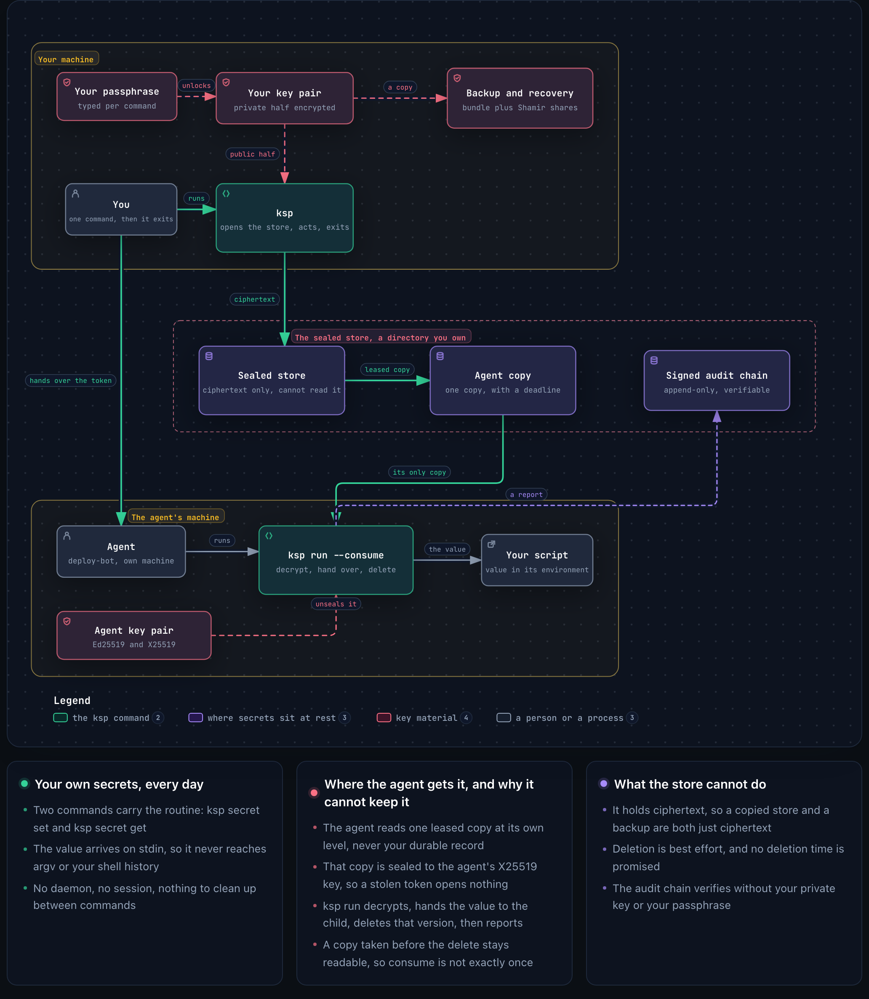
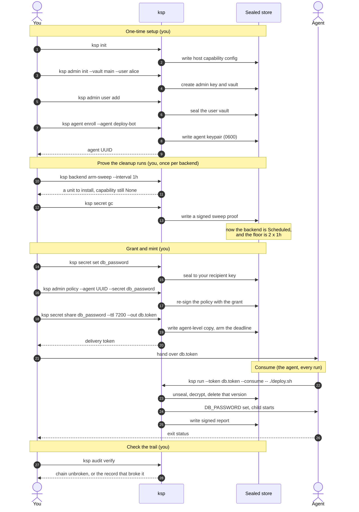

<p align="center">
  
</p>

<p align="center"><strong>A secret manager for one operator or a team, with no server to run.</strong></p>

<p align="center">
  <a href="https://github.com/bruj0/keyspout/releases/latest"></a>
  <a href="LICENSE"></a>
  <a href="https://github.com/bruj0/keyspout/actions/workflows/release.yml?query=branch%3Amain"></a>
  <a href="#verify-a-download"></a>
  <a href="https://bruj0.github.io/keyspout/"></a>
  
</p>

<p align="center">
  <a href="#install">Install</a> &middot;
  <a href="#how-the-parts-fit-together">How it fits</a> &middot;
  <a href="#day-to-day-use">Day-to-day</a> &middot;
  <a href="#features">Features</a> &middot;
  <a href="#documentation">Docs</a> &middot;
  <a href="#build-from-source">Build</a> &middot;
  <a href="#status">Status</a>
</p>

# Keyspout

Secrets live in a sealed store you own. Your agents get a short-lived, sealed
copy instead of a long-lived credential. Nothing phones home, and there is no
Keyspout service in the trust path.

## Not sure yet? Read the docs

The full documentation is published at
**<https://bruj0.github.io/keyspout/>** — the architecture, the workflow
walkthroughs, a deep dive per crate, and this repository's own design
documents, rendered and searchable.

## Install

| Platform | Command |
|---|---|
| macOS (Homebrew) | `brew trust bruj0/tap && brew install bruj0/tap/ksp` |
| macOS or Linux, any | `curl --proto '=https' --tlsv1.2 -LsSf https://github.com/bruj0/keyspout/releases/latest/download/ksp-installer.sh \| sh` |
| Debian / Ubuntu | [download the `.deb`](https://github.com/bruj0/keyspout/releases/latest), then `sudo apt install ./ksp_*_amd64.deb` |
| Fedora / RHEL / Rocky / Alma / openSUSE | [download the `.rpm`](https://github.com/bruj0/keyspout/releases/latest), then `sudo dnf install ./ksp-*.rpm` |
| Any, with Rust | `cargo install --git https://github.com/bruj0/keyspout ksp` |

Then set up a deployment:

```bash
ksp init
```

The tap is `bruj0/tap`, not homebrew-core, which is why the Homebrew command is
longer than usual. Homebrew 7 refuses a formula from a third-party tap until you
trust it, so `brew trust bruj0/tap` runs first; without it the install fails with
`Refusing to load formula ... from untrusted tap`.

The `.deb` and `.rpm` come from the release page rather than a package
repository, so they do not update themselves; re-download to upgrade.

**Where the store goes.** `ksp init` creates `$HOME/.ksp` unless `KSP_HOME` names
another absolute path. The store is a directory, not a service: back it up, and
keep it out of a git checkout.

**macOS, downloaded in a browser:** the binaries are unsigned, so Gatekeeper
refuses one that Safari quarantined. Homebrew and `curl` installs are unaffected.
Clear the attribute once:

```bash
xattr -d com.apple.quarantine ./ksp
```

---

## How the parts fit together

Three zones, and nothing else. 
* **Your machine** holds your passphrase, your key pair and the `ksp` command. 
* **The sealed store** is a directory or a network backend you own, holding:
  * ciphertext, 
  * the per-agent copies and 
  * the signed audit chain. 
* **The agent's machine or process** holds the agent's own key pair and runs `ksp run --consume` to
turn one leased copy into a real value.

The line that matters is the short one from **Agent copy** down into
`ksp run --consume`. That is the only place an agent reads a secret, it reads
only its own leased copy rather than your durable record, and the copy opens
only with the agent's private key.

<p align="center">
  <a href="https://docs-diagrams.bruj0.net/keyspout-architecture/overview/" target="_blank" rel="noopener noreferrer">
    
  </a>
</p>

<a href="https://docs-diagrams.bruj0.net/keyspout-architecture/overview/" target="_blank" rel="noopener noreferrer">Open the diagram full size</a>
for pan, zoom, light and dark themes, and the notes on each zone. A copy also
ships in this repository at [`assets/keyspout-architecture.html`](assets/keyspout-architecture.html),
which works offline.

---

## Verify a download

Every platform tarball — `ksp-<target>.tar.xz` — carries a build-provenance
attestation recording which repository, which workflow and which commit produced
the bytes. The attestation covers each file whose name carries a target: the
tarball, its `.sha256`, and from the release after v1.0.2 its CycloneDX SBOM.
`sha256.sum`, `source.tar.gz`, `source.tar.gz.sha256`, `ksp-installer.sh`,
`ksp.rb` and `dist-manifest.json` are not attested, so verify them against a
tarball that is.

```bash
gh attestation verify ksp-x86_64-unknown-linux-musl.tar.xz \
  --repo bruj0/keyspout \
  --signer-workflow bruj0/keyspout/.github/workflows/attest.yml
```

That proves the binary came from this repository's release workflow at a specific
commit. It does **not** prove the commit is safe — a backdoor merged to `main`
would produce a valid attestation. [`SECURITY.md`](SECURITY.md) states the full
claim, what it does not cover, and the attack surface with each control.

## Agent skills

Seven skills teach an agent to drive `ksp` — set it up, report status, store and
share secrets, enrol agents, switch backends, recover, and read the audit log.

```bash
npx skills add bruj0/keyspout
```

They are plain `SKILL.md` folders in the open
[agentskills.io](https://agentskills.io) format, read by Claude Code, GitHub
Copilot, Cursor, OpenAI Codex and Gemini CLI. See
[`skills/README.md`](skills/README.md) for per-agent install and how to verify it
worked.

## Why not just a `.env` file?

A `.env` file is a plaintext file that every process on your machine can read,
that ends up in a backup, a screen share, a container image and a crash dump,
and that never expires. It is the right tool for a local dev server and the
wrong one for a credential that can move money.

Keyspout is not "`.env` with encryption". It changes four things:

| | `.env` file | Keyspout |
|---|---|---|
| **At rest** | Plaintext. Readable by anything running as you. | Sealed with HPKE to a recipient key. The store holds ciphertext. |
| **Who can read it** | Every process, every backup, every `cat`. | Only a process that can unseal the vault, in the foreground, with the phrase. |
| **Agent access** | You copy the value in. It stays forever. | The agent gets a sealed copy with a deadline and a use count. |
| **What you can prove** | Nothing. You do not know who read it. | A signed audit chain, and an honest statement of what each backend cannot prove. |

The honest version of the last row matters more than the first three. Keyspout
tells you what it *cannot* do, which most secret managers do not.

---

## What you get

**A secret store you own.** One directory. No daemon, no database, no network
listener, no cloud account. `ksp` is a foreground command that opens the store,
does one thing, and exits.

**Sealed records.** Every value is encrypted with HPKE (RFC 9180) to a recipient
key. The store holds ciphertext and cannot read what it holds. A backup of the
store is a backup of ciphertext.

**Agent access that expires.** Instead of pasting a token into an agent's
environment and hoping, you mint a sealed delivery: a separate encrypted copy,
sealed to that agent's X25519 key, with a deadline and an optional use count.
The agent's independent Ed25519 key authenticates the invocation.

**A real audit trail.** Every operation writes a signed, append-only record.
`ksp audit verify` checks the chain against pinned public keys, read-only, with
no password and no private key.

**Honest posture.** `ksp status` reports what this host can actually enforce and
what it cannot. Where a control is missing, it says so and names the fallback it
used instead of quietly claiming the stronger one.

**Recovery that survives a lost laptop.** A Shamir `k`-of-`n` split of the
sealed key bundle. Store the shares separately from the backup.

---

## What it protects, and what it does not

This section is the reason to trust the rest of the file. Every claim below is
paired with its limit.

### It protects

| Threat | How |
|---|---|
| **Reading the store** | Values are sealed with HPKE. Ciphertext alone is not enough; you need the recipient private key and the vault phrase. |
| **Reading a backup** | Same. A copied store directory is a copied ciphertext. |
| **A stolen delivery token** | The token carries no raw content key. It is sealed to the agent's X25519 key, and its signature is bound to the agent's Ed25519 key. |
| **Replaying a captured proof** | Proof of possession is bound to a nonce and a timestamp. |
| **A sibling agent reading another agent's level** | Each agent has its own directory with its own mode bits, and on Linux, Landlock confines the child to that one subtree. |
| **Silent log tampering** | The audit chain is signed and append-only. `ksp audit verify` detects a changed record or a removed tail. |
| **A silently weaker host** | `ksp status` reports the mechanism it actually got. A missing control is reported as missing, never as the stronger one. |

### It does not protect against

Read these before you rely on it.

| Limit | Why |
|---|---|
| **A holder who saved the key and the ciphertext** | If someone has both inputs and can run arbitrary computation, no token clock stops decryption. Deleting the store's copy does not recall their copy. This is arithmetic, not a missing feature. |
| **Erasure** | Deletion is best effort. There is no erasure guarantee and no deletion-time guarantee. A versioned bucket or a snapshot can keep a copy you asked to remove. |
| **Exactly-once consumption** | Consume retrieves, decrypts, hands the value to the child, deletes, then reports. A copy taken before the delete stays readable. Only *later fresh fetches* are prevented. |
| **Revoking an offline copy** | Rotating a key changes future issuance. An old private key still opens an old artifact. Revoke the upstream credential separately. |
| **A compromised host while you are unsealing** | Any process that can read your memory while the vault is open can read the plaintext. |
| **Same-UID processes on macOS** | macOS enforces no path confinement. The child runs unconfined and the barrier is `mlock`, reported as `weakened`. |
| **A lost recovery phrase** | Shamir restores the sealed bundle. It does not recover a phrase you did not write down. |

**The one-sentence version:** Keyspout shrinks the window a secret is exposed
and tells you honestly how far it got. It does not make a saved copy disappear.

---

## Day-to-day use

Set up once. After that, the loop is short.

```bash
# Once, on a new machine. You run all of this.
ksp init
ksp admin init --vault main --user alice
ksp admin user add
AGENT=$(ksp agent enroll --agent deploy-bot | sed -n 's/^agent:\([0-9a-f-]*\).*/\1/p')

# Every day: store a secret, read it back. You run these.
ksp secret set db_password --name "database password" --passphrase-file .ksp/pw < value.txt
ksp secret get db_password --reveal --passphrase-file .ksp/pw

# Check the trail. You run this.
ksp audit verify
```

That is the whole surface you need for your own secrets. There is no daemon to
start, no session to keep open, and no state to clean up between commands —
each one opens the store, does its job and exits.

The value goes in on stdin, so it never appears in `argv` or your shell
history. The vault password comes from `--passphrase-file` for the same reason:
if it came from stdin it would be competing with the value. The store lives in
`.ksp` under the working directory unless you set `KSP_HOME`.

An agent is addressed by the UUID that `agent enroll` prints, not by the label
you gave it — the label is a convenience, the UUID is the identity every policy
and pin refers to.

### Handing a secret to an agent

This is the one flow with two actors, and the split matters: **you** mint and
grant, **the agent** consumes. The agent never holds your vault password, and
you never hold the agent's private key.

**You run these, once per secret-and-agent pair:**

```bash
# 1. Grant the agent a delivery of this secret. Admin authority.
ksp admin policy --agent "$AGENT" --secret db_password

# 2. Mint the sealed copy and write the token. Your authority.
ksp secret share db_password --agent "$AGENT" --name "db" \
    --ttl 7200 --uses 1 --out db.token --passphrase-file .ksp/pw
```

Then you hand `db.token` to the agent over whatever channel you trust. The token
is sealed to the agent's X25519 key, so a copy in transit opens for that agent
and nobody else.

**The agent runs this, every time it needs the value:**

```bash
ksp run --token db.token --consume --env DB_PASSWORD -- ./deploy.sh
```

`--consume` retrieves the value, decrypts it, hands it to the child on
`DB_PASSWORD`, deletes that exact version, and writes a signed report. The value
never touches `argv`, the agent's shell history or a file on disk.

Two things make this flow refuse rather than silently weaken:

- **No sweep proof means no lease.** `file` has no timer, so a lease needs a
  scheduled job that has run at least once and signed a proof. Arm it with
  `ksp backend arm-sweep`, install the unit it prints, and let it fire.
- **The lease must clear the floor.** `--ttl` has to be at least `2 ×` the
  proven sweep interval. A one-hour sweep makes `--ttl 7200` the shortest
  admissible lease; `--ttl 1200` is refused with exit `7`. Ask first with
  `ksp backend test --ttl 1200`.

Both refusals name what would change the answer. Nothing is downgraded quietly.

### Delivering with no copy

The flow above makes a copy: an agent-level record sealed to that agent's key, with
a TTL and a use count. When the secret belongs to the **admin** and an agent needs
it, there is a second shape with no copy at all — one publication, one grant, one
token that carries a reference instead of a key.

```bash
# Once per deployment: the vault every publication entry is sealed to.
ksp admin seal-vault --passphrase-file admin.pw

# The admin's own copy of the secret — the plaintext a publication is made from.
printf 'value' | ksp admin put published --name published --own

# One grant: the edge, the publication entry sealed to the agent, and the token.
ksp admin policy create --user "$USER_ID" --secret published --version 1 \
    --agent "$AGENT" --passphrase-file admin.pw

# The user exports it. No password: the token has no content key to unlock.
ksp secret share published --policy "$POLICY" --out pub.token

# The agent opens the publication with its own key.
ksp run --token pub.token --env KSP_POLICY_VALUE -- ./deploy.sh
```

The difference is what the token can do. A leased token carries a content key, so
the agent's copy is real and `--consume` deletes it. A policy token carries a
publication reference, so `--consume` is refused: there is nothing to delete, and
withdrawing the grant stops the next run without recalling a value the agent
already read.

The diagram below shows the same flow with the actors separated.



The two commands you will type most are `ksp secret set` and `ksp secret get`.
The one that matters is `ksp run --consume`: it is the only path that hands a
value to a process without putting it in `argv`, in your shell history or in an
environment you have to clean up afterwards.

**[`USER_MANUAL.md`](USER_MANUAL.md) walks through every step with the real
output**, including the two refusals above and what each one asks you to do.

---

## Features

Everything below exists in the merged tree today. Where a feature is partial,
the entry says which part.

### Secrets

- `ksp secret set` — seal a value. Read from stdin, never from `argv`.
- `ksp secret get` — read a value. Redacted unless you pass `--reveal`.
- `ksp secret ls` — list records.
- `ksp secret rm` — remove one version.
- Versioned records: every write is a new immutable version, and a reader never
  sees a partial one.

### Agents and delivery

- `ksp agent enroll` — generate an independent Ed25519 and X25519 keypair per
  agent, written to a `0600` file.
- `ksp agent pubkey` — print the public halves and their fingerprint.
- `ksp agent rotate` — rotate both keys, retaining the previous bundle.
- `ksp secret share` / `ksp token mint` — a sealed agent-level copy with a TTL
  and an optional use count.
- `ksp secret share --policy` — the same export with no copy: the agent opens the
  admin's publication entry with its own key, and there is nothing to consume.
- `ksp token inspect` — scope, issuer and expiry. Never a key, never a value.
- `ksp token list` / `ksp token revoke` — the tokens this host minted.
- `ksp run --token … --consume` — deliver, delete, report, in one foreground
  invocation.

### Vault and recovery

- `ksp admin init` — create the admin signing key and the vault.
- `ksp admin user add` — enrol the user: seal her vault and sign a policy naming
  her keys. Without this, `secret set` refuses with exit `6`.
- `ksp vault status` — the vault's state.
- `ksp vault rekey` — re-share the sealed bundle with a new phrase. The password
  does not change; the old phrase stops working.
- Shamir `k`-of-`n` over the sealed key bundle.

### Policy

- `ksp admin policy` — re-sign the policy with the grants you name. A write
  **merges**: grants you do not name are kept. `--replace` writes the whole set
  and withdraws the rest, and its report lists what it withdrew.
- `ksp admin revoke` — withdraw one grant and record the decision.
- `ksp admin policy create` — sign one grant as its own edge: a publication, a
  sealed entry for the agent, and the token the user later exports. No copy of the
  secret is made.
- `ksp admin policy update` — re-sign one grant at the next revision, moving the
  window without a password because the entry is already sealed; a target change
  re-publishes.
- `ksp admin policy delete` — withdraw one grant: record the decision, remove the
  artifact, release the publication entry.
- `ksp admin policy list` / `show` — every policy, and one policy joined with its
  artifact, its verification, its tokens, the agent's keys, the publication and the
  withdrawal. A grant whose publication is missing reads `dangling`, not `active`.
- `ksp admin seal-vault` — the admin's own vault, which every publication entry's
  content key is sealed to. One per deployment.
- `ksp admin put --own` — write the admin's own copy of a secret, sealed to that
  vault: the plaintext a publication is made from. Without `--own` it is the
  transfer to the user, which the admin cannot read.
- `ksp secret share --policy` — export the token a grant already authorised. No
  password, no key, and the token carries a publication reference instead of a
  content key.
- Grants are admin-signed, so an agent can verify what it was allowed to do
  without trusting the store.

### Audit

- `ksp audit` — your own scoped view.
- `ksp audit --admin` — the complete view, as the admin key holder.
- `ksp audit verify` — check every record against pinned public material.
  Read-only, no password, no private key.
- `ksp admin audit` — the acknowledgement journal and the signed reports.

### Storage and cleanup

- Three backends: `file` (default, zero install), `valkey`/`redis`, `s3`.
- `ksp backend list` — the selectable backends and the selected one.
- `ksp backend test --ttl <seconds>` — whether the selected backend admits a
  lease of that length, and why not if it does not.
- `ksp backend arm-sweep` — record a cleanup schedule and print the unit to
  install. Without `--install` it writes no unit, no property list, no crontab
  entry and runs no privileged helper.
- `ksp backend arm-sweep --install` — also write the `launchd` property list
  under your own `~/Library/LaunchAgents` at mode `0600` and load it. It never
  writes a system-wide `LaunchDaemon` and never escalates: a request for one is
  refused. An install is a declaration, not evidence, so the capability stays
  `None` until a run writes a proof.
- The arming scope must be the `agent-*` prefix
  (`p/<vault>/<user>/agent-*`), because that is the shape admission compares
  against. Arming a single `agent-<uuid>` is **refused** with exit `2` and a
  message naming the accepted shape.
- `ksp secret gc` — run the sweep. **This is what writes the signed proof** that
  turns a recorded schedule into an admitted lease.
- `ksp secret purge-expired` — remove versions past their deadline, bounded.
- `ksp secret gc --user-arming` — the same sweep signed with your own key, for
  copies you shared yourself.

### Host posture

- `ksp init` — probe this host and write its capability configuration. It never
  replaces a configuration that already exists.
- `ksp config init` — the same, with `--force` to replace.
- `ksp status` — what this host can and cannot enforce, and which adapter it
  selected.

### Platform

- **Linux:** Landlock path confinement, `memfd_secret` memory barrier.
- **macOS:** builds and runs; no path confinement, `mlock` barrier reported as
  `weakened`. The difference is disclosed, never hidden.
- **Not implemented:** the optional local session agent, log forwarding to a
  remote sink, Secure Enclave or Keychain as a key protector, and the `sftp`,
  `sql` and `webdav` backends.

---

## Tech stack

| Layer | Choice | Why |
|---|---|---|
| Language | Rust, edition 2024 | Memory safety without a garbage collector, and a type system that can carry the invariants. |
| Sealing | HPKE (RFC 9180) via `hpke-rs` | A standard, not a construction of our own. Pinned past RUSTSEC-2026-0072. |
| Signing | Ed25519 (`ed25519-dalek`) | Small keys, fast verification, no parameter choices to get wrong. |
| Key agreement | X25519 (`x25519-dalek`) | One recipient key per agent, no conversion between key types. |
| Vault KDF | Argon2id | Memory-hard, so a stolen vault file is expensive to attack. |
| Symmetric | ChaCha20-Poly1305 | AEAD, constant-time in software, no table lookups. |
| Recovery | Shamir over GF(256) | A secret-sharing scheme, not a primitive. |
| Encoding | CBOR (`ciborium`) | Deterministic encoding, so a signature covers exact bytes. |
| Path confinement | Landlock (Linux) | Kernel-enforced, no daemon, no privileges. |
| Memory barrier | `memfd_secret` / `mlock` | Keep key material out of swap and core dumps where the kernel allows it. |
| Backends | Local filesystem, Redis protocol, S3 API | One contract, three implementations, each admitted on evidence. |
| CLI | `clap` | Derive-based parsing, so the surface is one definition. |
| Errors | `thiserror` | Typed errors, no string matching. |

**No async runtime on the secret path.** Every operation is a foreground
invocation that opens, acts and exits. A daemon that holds your key on your
behalf is the thing this design removes.

---

## Build from source

The install commands above are the supported path. Build from source only if you
want to modify the code.

```bash
git clone https://github.com/bruj0/keyspout.git
cd keyspout
cargo build --release
install -m 0755 target/release/ksp ~/.local/bin/ksp
```

The toolchain is pinned by `rust-toolchain.toml`. `Cargo.toml` uses
`resolver = "3"` and `edition = "2024"`, so an older `cargo` fails before it
compiles anything.

**macOS and Linux both build.** On macOS you get the smaller guarantee described
above, and every run discloses it.

---

## Documentation

| Document | What it is |
|---|---|
| [The documentation site](https://bruj0.github.io/keyspout/) | All of the below, plus the architecture and a deep dive per crate, rendered and searchable. |
| [`USER_MANUAL.md`](USER_MANUAL.md) | Every step from nothing to a delivered secret, with real output. |
| [`docs/keyspout-design-spec.md`](docs/keyspout-design-spec.md) | The design. Normative, and it wins over anything you infer from the code. |
| [`DEVELOPMENT.md`](DEVELOPMENT.md) | Toolchain, services, and the platform facts that cost time to learn. |
| [`CONTRIBUTING.md`](CONTRIBUTING.md) | How to build, test, and the rules that are not stylistic. |

---

## Status

**MVP. The design is settled; the implementation is not complete.**

`ksp` builds, stores, reads and removes sealed records, enrols users and agents,
arms and verifies sweep schedules, delivers a leased secret to a child process,
reads its own audit log, and discloses its posture — including the parts it
cannot claim.

**A delivery on `file` needs a proven sweep first.** The `file` backend is a
directory, so it has no timer of its own; the cleanup it promises comes from a
scheduled job you install. Until one run has written a signed sweep proof, the
backend classifies as `None` and every lease is refused with exit `7`. Record
the schedule with `ksp backend arm-sweep`, install the unit it prints, and let
it fire once — then `file` reports `Scheduled` and a lease above the floor is
admitted.

The floor is `2 ×` the proven interval, and that is admission policy rather than
a promise about when a copy dies. With a one-hour sweep the shortest admissible
lease is two hours, so a fifteen-minute lease is refused by design. Run
`ksp backend test --ttl <seconds>` to ask before you mint.

[`USER_MANUAL.md`](USER_MANUAL.md) walks the whole chain with the real output,
including the refusal you get before the first proof.

---

## License

MIT. See [`LICENSE`](LICENSE).
