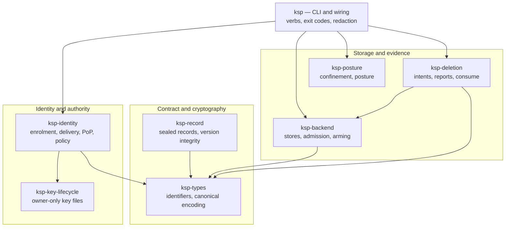

# Project Overview

## What is Keyspout?

A serverless, contract-based secret manager for agents. One endpoint, sealed
records, recipient-encrypted tokens and best-effort lease cleanup, with no central
Keyspout service.

There is no vault server to run and no Keyspout process listening on a port. A
deployment is a directory tree whose permissions *are* the boundary between an
admin and a user, plus sealed files that only the right private key can open. The
same tree can live on a laptop, an S3 bucket or a Valkey instance, because the
backend is an admission decision rather than an architecture.

## Core Purpose

**An agent should be able to use a secret without being able to keep it.**

That sentence is the whole design. Everything else follows from how far it can be
honoured:

- a value is sealed to a recipient key, so a stolen record without that key is
  ciphertext;
- a delivery is authorised by a signed grant the admin issued, with a window;
- a copy that went to an agent carries a deadline, and cleanup is attempted;
- **deletion is best effort, never a guarantee** — a value already read cannot be
  recalled, and every document says so rather than implying otherwise.

The product's distinguishing choice is that it **discloses what it cannot do**.
`ksp status` reports `confinement: none` on macOS rather than staying quiet. A
grant whose publication is missing reads `dangling`, not `active`. `ksp audit`
prints `completeness unknown` unless a head digest arrived from outside the log.

## Technology Stack

| Layer | Choice |
|---|---|
| Language | Rust, edition 2024, resolver 3, toolchain `1.99.1` pinned by `rust-toolchain.toml` |
| Cryptography | `hpke-rs`, `ed25519-dalek`, `x25519-dalek`, `argon2`, `chacha20poly1305`, `sha2`, `subtle`, `zeroize` |
| Serialization | CBOR via `ciborium`; `serde_json` for the surfaces that emit JSON |
| CLI | `clap` with derive; typed errors with `thiserror` |
| Backends | filesystem (`file`), `redis` for Valkey, `aws-sdk-s3` for S3 |
| Confinement | `landlock` and `memfd` on Linux; `libc` for calls std does not expose |
| Async | `tokio`, only where a backend needs it |
| Tests | the built-in `cargo test` harness; no third-party test framework |

The only cryptographic construction written in this repository is Shamir over
GF(256), which is a secret-sharing scheme rather than a primitive.

## Key Features

- **Sealed records with bound context.** A record's path, version and metadata are
  associated data, so a record moved to another path, or presented as another
  version, fails to open rather than opening as the wrong thing.
- **Two delivery mechanisms.** A *leased copy* is a record at the agent's level
  sealed to that agent, with a deadline. A *policy grant* publishes one entry the
  agent opens with its own key, and issues a keyless token — there is no copy to
  lease and none to delete.
- **Provenance by level.** `admin put` writes at `admin`; `secret set` writes at
  `user`. An `admin`-sourced delivery re-checks the policy before decryption; a
  `user`-sourced one reads no policy, because the user's signature is its
  authority.
- **Evidence-based backend admission.** A backend is admitted only when it can
  prove a cleanup mechanism. `file` refuses a lease until a sweep has run and
  written a proof; hiding is not erasing, so a versioned bucket stays `None`.
- **A per-writer audit chain.** One chain per signing key, each verifiable against
  a pinned anchor, with the honest admission that completeness is unknown without
  an external head digest.
- **A posture report** that measures the host and states what it established,
  including `none` and `weakened`.

## Project Structure

```
crates/ksp-types/         identifiers, levels, signature domains, canonical encoding
crates/ksp-record/        HPKE envelope, bound metadata, version integrity
crates/ksp-identity/      enrolment, delivery, PoP, policy verification, fingerprints
crates/ksp-backend/       file / valkey / s3 stores, admission, arming, sweeping
crates/ksp-deletion/      deletion intents, reports, observations, consume outcome
crates/ksp-posture/       confinement adapters, key-material posture
crates/ksp-key-lifecycle/ owner-only key files, crash-safe replacement
crates/ksp/               the CLI: verbs, exit codes, redaction, wiring
docs/                     design spec, ADRs, research, defect list
site/                     the MkDocs site (source pages)
specs/                    spec-bridge feature artifacts (not published)
scripts/                  the gate, the VM harness, the public sync
```

Line counts, source only: `ksp` 27 358, `ksp-identity` 8 929, `ksp-backend`
7 161, `ksp-posture` 6 156, `ksp-deletion` 3 628, `ksp-types` 2 871,
`ksp-record` 2 037, `ksp-key-lifecycle` 821.

## Getting Started

```bash
cargo build -p ksp
./target/debug/ksp version
./target/debug/ksp status --json
```

For a working two-account deployment with a delivered secret, follow
[`QUICKSTART.md`](../QUICKSTART.md). It runs on macOS and Linux with the same
commands, and it says where the two platforms differ.

## Architecture Summary

Eight crates in one workspace, layered so that the CLI is the only place they are
wired together:



Each crate carries a `CONTEXT.md` defining its vocabulary, and
[`CONTEXT-MAP.md`](../CONTEXT-MAP.md) records which context owns which term. A
term is defined in exactly one place, because two definitions of "level" is how a
boundary rots.

Detailed in [2. Architecture Overview](2.%20Architecture%20Overview.md).
