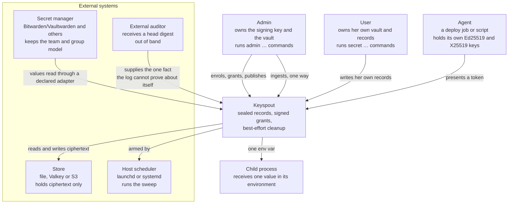
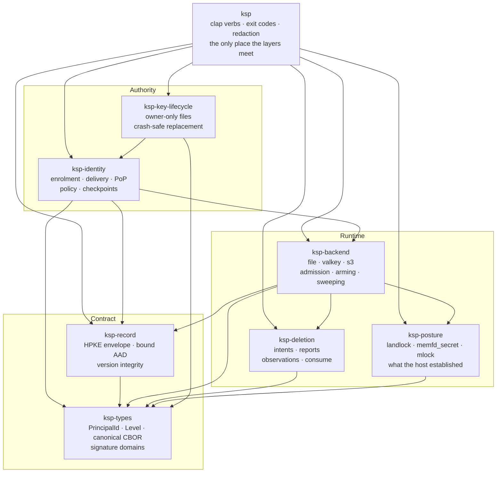
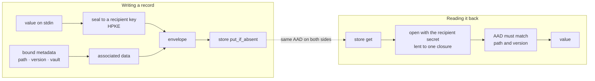
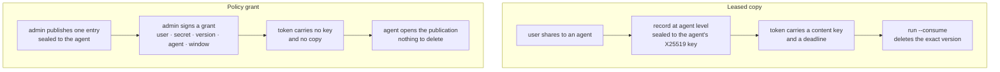
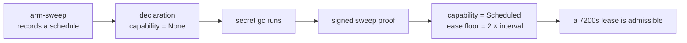
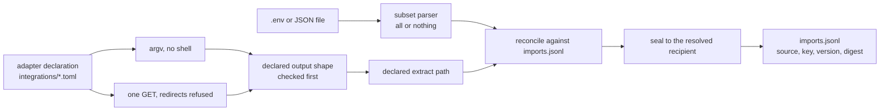
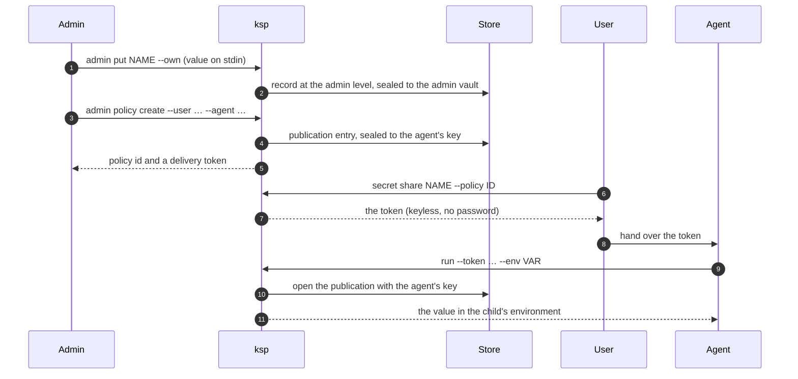
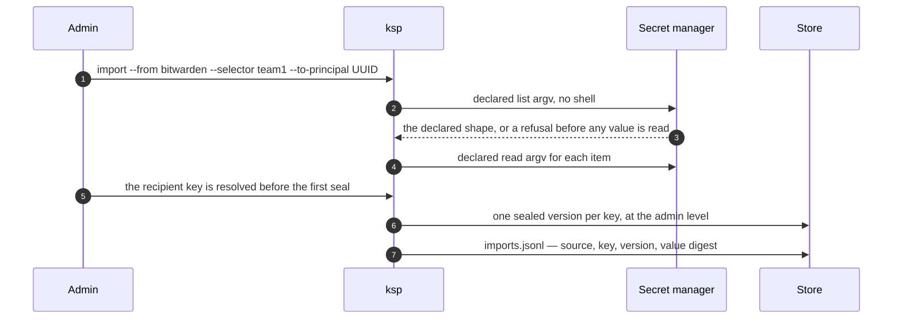

# Architecture Overview

## System Context — C4 Level 1

Keyspout sits between the people who own secrets and the processes that need them.
It has no server component: the "system" is a CLI plus a directory tree the
operator owns.

**What the store never sees.** Plaintext. Every record is sealed to a recipient
key before it is written, so a fully compromised store yields ciphertext, and a
token yields a reference rather than a content key.

**What the admin cannot do.** Read a user-created secret. The administrator holds
a signing key, not a decryption key — that asymmetry is the product, not a
limitation of it.

**What nobody can do.** Recall a value already read. A saved key and ciphertext
pair stays decryptable, and every document that mentions deletion says so.

## Container Architecture — C4 Level 2

Eight crates, one binary. The layering exists so that the crypto never depends on
the storage, and neither depends on the CLI.

Read from the manifests, not from the layer names: `ksp-backend` depends on
`ksp-deletion` and `ksp-posture` (admission needs the evidence types and the
capability measurement), and `ksp-key-lifecycle` depends on `ksp-identity` rather
than the reverse — it reloads the identity that identity defines. Drawing the
arrows from the intended layering instead produces a graph that looks tidier and
is wrong.

| Container | Responsibility | It must not |
|---|---|---|
| `ksp-types` | identifiers, levels, canonical encoding, signature domains | perform I/O |
| `ksp-record` | seal and open a record; bind path and version as AAD | know what a record means |
| `ksp-identity` | who is speaking, may they have this, what is sealed to whom | touch the filesystem directly |
| `ksp-key-lifecycle` | persist and reload key material without exposing private halves | decide policy |
| — note | it depends on `ksp-identity`, not the reverse: it reloads the identity that crate defines | — |
| `ksp-backend` | store abstraction, admission, arming, sweep proofs | name a specific store in shared code |
| `ksp-deletion` | what is actually known about a version; who said so | invent a deletion time |
| `ksp-posture` | measure the host, disclose what it established | claim a control it did not verify |
| `ksp` | verbs, exit codes, redaction, wiring | hold a domain rule the library could own |

**A boundary that is enforced, not documented.** `ksp-core`-style purity is
checked by the workspace lints: a crate that reaches for a capability its layer
does not own fails to build, rather than failing review.

## Component Architecture — C4 Level 3

### The record path

The AAD is what makes a record non-relocatable. Move the file, or present it as
another version, and the open fails instead of returning another record's
plaintext.

### Two delivery mechanisms

**Leased** needs a proven sweep before it is admitted, because a deadline it
cannot enforce is a claim it cannot make. **Grant** needs no sweep, because there
is no copy: withdrawal stops the next run, and the publication stays.

The two are not interchangeable. A value the admin cannot open cannot be
published, which is why `admin put --own` exists — the publication is made from the
admin's own record.

### Admission and the sweep

A declaration is not evidence. The floor is `2 ×` the **proven** interval, and
that is admission policy rather than a promise about when a copy dies.

### Ingest — the only inbound path

Three properties of that path are worth naming, because each closes a way the
feature could go wrong.

**The target is resolved before the first seal, and it cannot come from data.**
The destination is `--own` or `--to-principal <UUID>`, never a vault name — not
in a flag and not in a declaration. A destination read from a file is a decision
made by data, so a declaration that names one is refused. Every refusal before
the seal leaves the store untouched.

**A declaration is data, and data here is a capability.** It names a binary and
an argv, so writing one is as good as running the command as the operator. It is
validated and its binary probed on every use, it can express no destination, and
it carries a credential **variable name** rather than a value. A declaration
takes effect without a recompile, which is the openness the feature exists for,
and it is treated with the suspicion that property deserves.

**The ledger is what makes a re-import honest.** A sealed blob uses a random
nonce, so equal plaintext seals to different ciphertext and the record itself
cannot answer "is this the same value". `imports.jsonl` records a digest per key,
so the next import reports `new`, `changed`, `unchanged` or one of the two
`absent` words instead of re-writing everything. A seal that fails partway
records what it already wrote before it refuses, because a store holding values
with no ledger row makes the next run report them `new` and duplicate them.

**The direction is one way.** `ksp export` refuses in every form. Handing a
plaintext value to a service the admin does not control spends the
admin-zero-knowledge property §1.0 exists to hold, so the refusal is a position
rather than unfinished work.

## Data Flow — one value, end to end

No step in that sequence exposes plaintext to the store, and the user never holds
a key for the value she delivers — she holds a token that authorises one agent to
read one entry.

### The other entry point: ingest

This is the only path on which a value crosses into a deployment from outside
it, and it crosses inward only. The store still receives ciphertext; the manager
still holds the team and group model; and the report names the vault it wrote to
so a wrong `KSP_HOME` is visible in the answer rather than only in the tree.

## Where the design puts the boundary

| Boundary | Enforced by | Not by |
|---|---|---|
| admin signing key vs user records | file mode `0700` and ownership | a policy check |
| a record vs its path and version | AAD on the envelope | a validating read |
| a grant vs the agent it names | the agent's own key opens the publication | a name comparison |
| an import's destination | `--own` or `--to-principal`, resolved before any seal | a vault name in a flag or in a declaration |
| an adapter's reach | a probed binary and an argv, with no shell | a trusted declaration file |
| the audit chain vs a deleted tail | an external head digest | the log itself |
| a lease vs its deadline | a proven sweep, `2 ×` interval | the declared schedule |

The right-hand column is the interesting one: each is something the design
deliberately does **not** rely on, because it would produce a claim the system
cannot substantiate.

Detailed workflow in [3. Workflow Overview](3.%20Workflow%20Overview.md).
