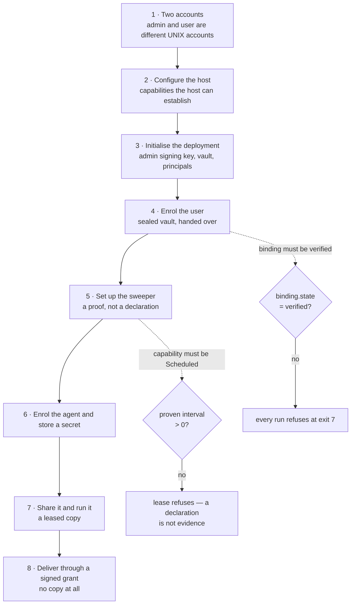
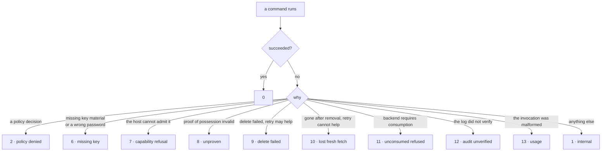

# Workflow Overview

The operator's path from a bare machine to a value inside a child process. Eight
steps, in the order the product requires — each one produces something the next
needs, and a step that succeeds without producing it is the failure mode this
document exists to make visible.

The commands are in [`USER_MANUAL.md`](../USER_MANUAL.md). This page is the *why*:
what each step establishes, what it refuses, and what would silently break.

## The whole path



## Step by step

### 1 · Two accounts

**Establishes:** that the boundary is filesystem permissions, so the admin and the
user cannot be the same UNIX account.

**Refuses:** nothing directly. It fails later, in step 4, when the handover cannot
`chown` a file to another account.

**What would silently break:** the two accounts not sharing a group. The store
keeps its shared material at `0640` and `0750` in one group; a pair with no common
group produces a user who cannot read the token her agent needs, and the message
she gets is *"no delivery token was issued"* about a file that exists.

### 2 · Configure the host

**Establishes:** the capability configuration — which confinement and memory
barrier adapters to try, and whether a run continues without them.

**Refuses:** a secret command run on macOS with no configuration, at exit `7`.

**What would silently break:** leaving the file at `0600`. It is right for one
account and wrong for two: the user's commands read it, and she cannot open a
`0600` file the admin owns. The guard objects to a file another principal can
*write*, not one she can read, so `0644` is the shape — the directory above it is
`0711` and only the admin can write that.

**The store goes in the home.** `$KSP_HOME/store`, created on first use.
`KSP_STORE` exists and is honoured, but setting it is the mistake: a configured
root is opened and never created, so a stale value refuses at exit `7` rather than
quietly writing the deployment somewhere else.

### 3 · Initialise the deployment

**Establishes:** the admin signing key (mode `0700`), the anchor every later
verification pins, and the vault's identity.

**Refuses:** a second `admin init` on the same home.

**What the output means:** two UUIDs are printed and they are different things.
`principal=` is the admin. `user=` is a *provisional* user principal — the record
names one user before anybody is enrolled.

### 4 · Enrol the user

**Establishes:** the sealed vault, the policy naming her keys, and the binding
between the vault and a UNIX account.

**Refuses:** an enrolment that would overwrite an existing vault with keys already
recorded, because a new password over a live vault locks its principal out of
everything sealed to her.

**Which principal to keep.** For the *first* enrolment, `admin user add` **adopts**
the provisional principal, so its `principal=` equals step 3's `user=`. Every
enrolment after the first gets a new principal, and the deployment record keeps
naming the first. Take the UUID from `admin user add`, whichever case you are in —
a grant naming a principal the deployment does not hold is refused by name.

**What would silently break:** an interrupted handover. The home stays owned by the
admin; the enrolment hands over `vault.cbor`, `enrolments/` and `agent/` one path
at a time. A `root`-owned one of those three means it stopped halfway, and
`find /Users/keyspout/.ksp \! -user keyspout -print` is how you see it.

### 5 · Set up the sweeper

**Establishes:** a **proof** that a cleanup runs — which is what admits a lease.

**Refuses:** every lease before that proof exists, at exit `7`.

**What would silently break:** trusting the declaration. `arm-sweep` records a
schedule and immediately reports `capability = None`, because a declaration is not
evidence. Only `secret gc` running writes the proof, and the admission floor is
`2 ×` the proven interval.

**This step is the one people skip**, and the refusal it produces is loud: `no
sweep proof exists under sweeper/proofs: nothing has proven this cleanup runs`.

### 6 · Enrol the agent and store a secret

**Establishes:** the agent's own two keypairs — it is not a copy of the user's —
and a record at the user's level.

**Refuses:** an empty value. `read_value` strips exactly one trailing newline and
then refuses an empty buffer, so a `.env` line of `KEY=` cannot be sealed. That is
the guard, not a failure.

**What would silently break:** passing the value in `argv`. It is visible in `ps`.
The value goes in on stdin; the name goes in `--name`.

#### 6a · Or ingest it, if it already lives somewhere

Steps 6 to 8 assume the value is typed in. If it already exists — in a `.env`
file, or in a Bitwarden or Vaultwarden vault your team uses — `ksp import` reads
it and seals it instead, and the rest of the path is unchanged.

```bash
# A file. The parser is a named subset, all or nothing.
ksp import --from-file .env --own
ksp import --from-file .env --to-principal <UUID>

# A manager, through a declaration in $KSP_HOME/integrations/*.toml.
ksp import --from bitwarden --selector team1 --to-principal <UUID>

# What this host can do, and what a declaration has to look like.
ksp import --list-adapters
ksp import --schema
```

**Establishes:** one sealed record per key, and a row in `imports.jsonl` for
each. The report names the vault it wrote to, so a wrong `KSP_HOME` is visible in
the answer rather than only in the tree.

**Refuses:** a file that contains any construct outside the subset — one refused
line refuses the whole file, and nothing is written for any key in it. It also
refuses a destination it cannot resolve: an unenrolled principal, a principal
with no recipient key, or no `--own`/`--to-principal` at all. Every one of those
happens **before the first seal**, so a refusal leaves the store untouched.

**What would silently break:** putting the vault in the declaration. A vault name
read from a file is a destination chosen by data, so a declaration that names one
is refused rather than honoured. The destination is always `--own` or
`--to-principal`.

**What it deliberately does not do.** It does not export. `ksp export` refuses in
every form, because handing a plaintext value to a service the admin does not
control spends the admin-zero-knowledge property the design exists to hold. It
also does not keep the two in step: there is no sync and no mirror back to the
source, since each of those would be an export primitive arriving by another
door. Re-importing is the update, and the ledger makes it honest — a key whose
value did not move is reported `unchanged` and not written again.

### 7 · Share it and run it

**Establishes:** an agent-level copy sealed to the agent's key, and a token that
carries a content key and a deadline.

**Refuses:** a lease above the admission floor, and a re-mint for the same
`(secret, agent, version)` triple, because the operation identity already names a
different deletion intent.

**What `--consume` does and does not do:** it deletes the exact version after the
child runs. It does not recall a copy taken earlier, and it does not prevent a
concurrent read.

### 8 · Deliver through a signed grant

**Establishes:** one publication entry and a **keyless** token. The admin signs a
grant naming one user, one secret, one version, one agent and a window.

**Refuses:** `--name`, `--uses`, `--ttl` and `--passphrase-file`, each by name,
because the grant already fixed all four and there is no vault to open.

**What changed with feature 015:** `admin list` now enumerates the Principal
Registry, so it names every principal's records and reports a directory it may not
read instead of failing. On a two-account deployment it exits `0` where it used to
refuse, and it reports the `admin`-level records `admin put --own` writes. Use
`admin policy list` to ask whether a value is *delivered*; `admin list` answers
whether a record *exists*.

## Refusal paths

Every refusal in the product maps to one of nine exit codes, and the code is part
of the contract because a caller branches on it.



`9` and `10` are separate on purpose: one says *try again*, the other says *ask for
a new delivery*. `13` is separate from `1` and `2` for the same reason — a typo, a
crash and a policy decision need three different responses, and one integer cannot
say all three.

## The two facts a reader must not lose

**Deletion is best effort.** No sweep, expiry or withdrawal recalls a copy someone
already saved. The system states this wherever it mentions cleanup rather than
implying a guarantee it cannot keep.

**A marker is a claim about the merged tree.** A status in the design spec says what
exists on `main`, not what a branch intends. That is why the five fixed defects
were removed from `docs/known-defects.md` only after the merge, and why the design
spec's status markers were left alone until the code was there.
