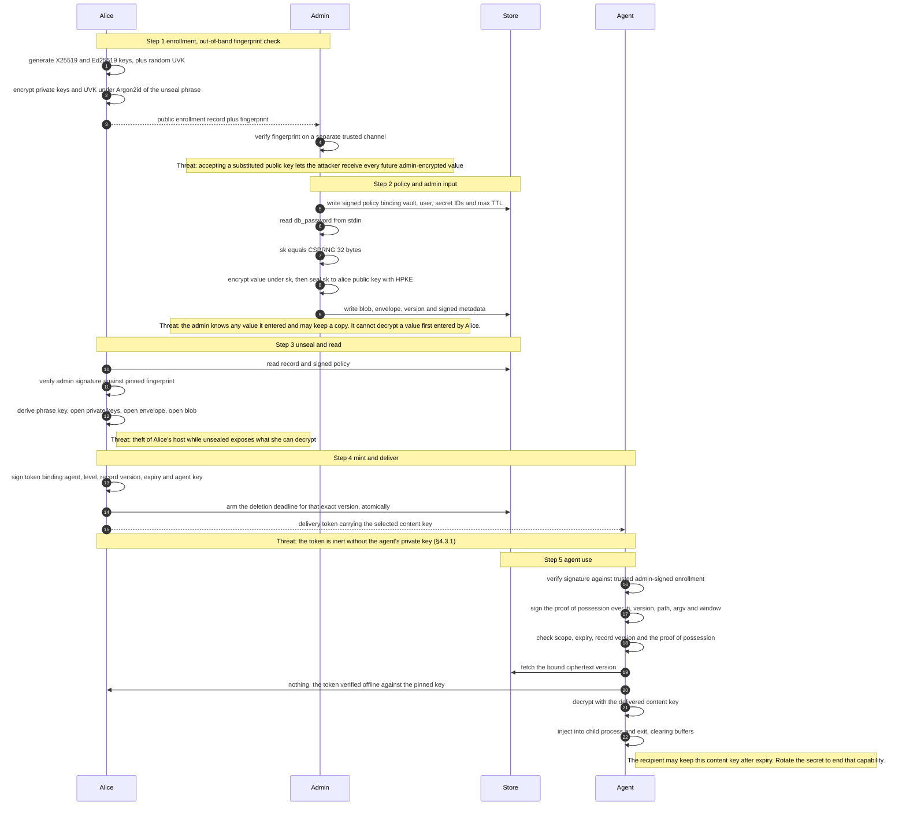
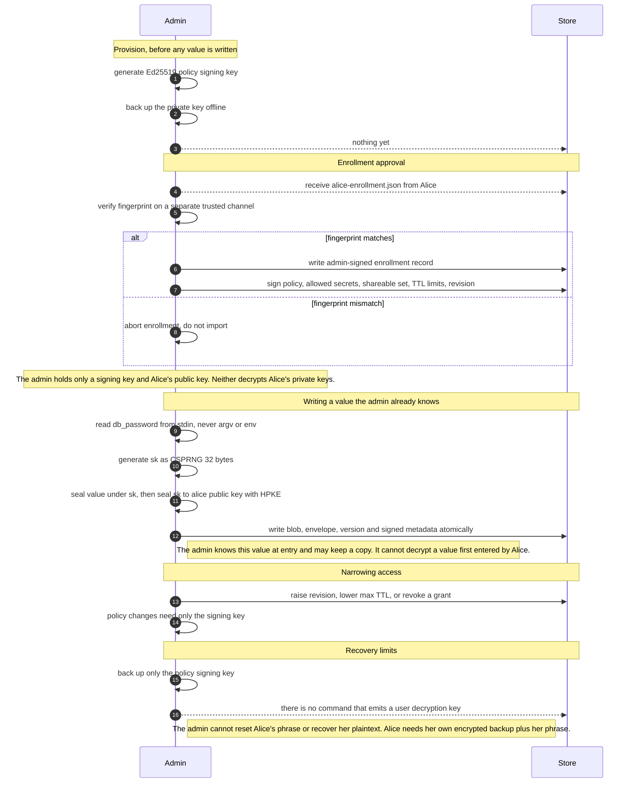
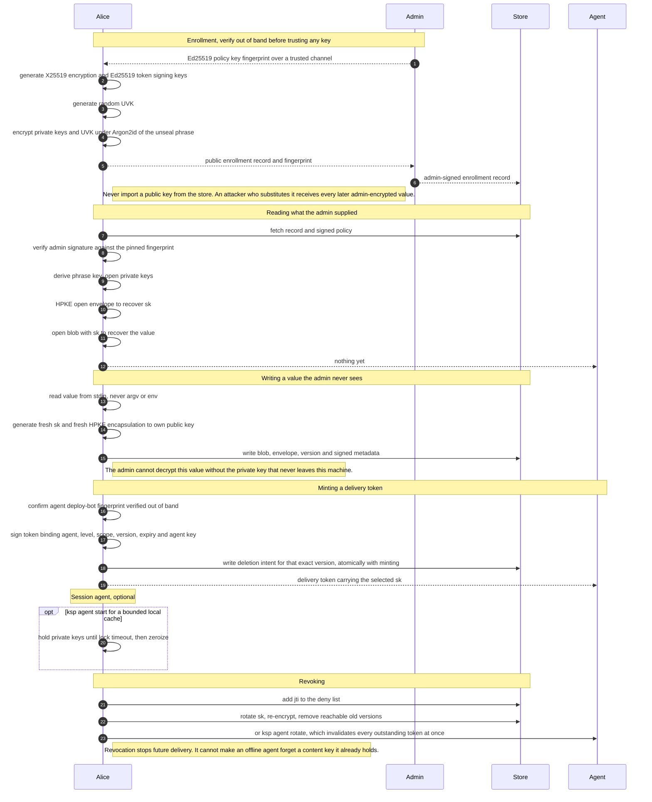
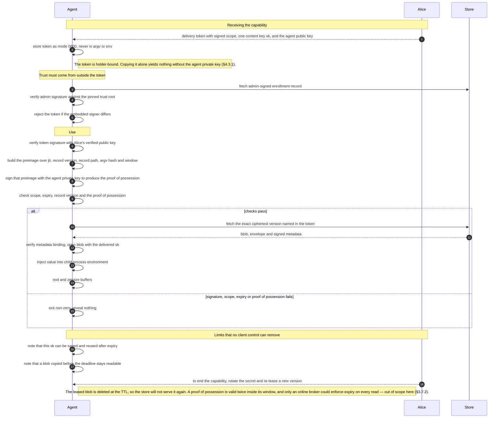
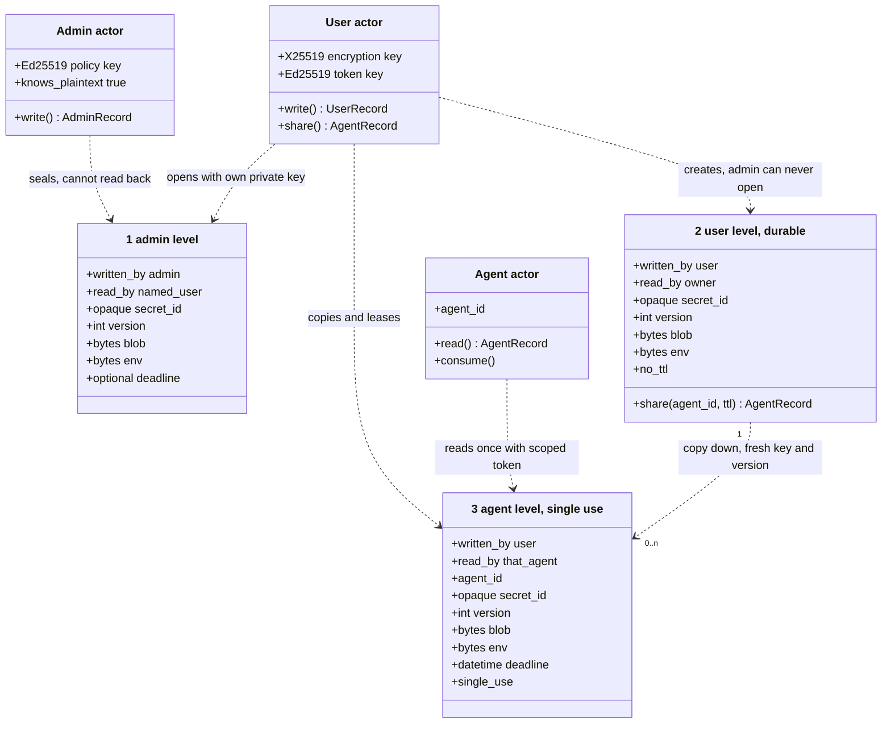

# Keyspout — design spec

**Status:** design revised 2026-10-21; command surface amended 2026-10-24 (authorized
by the operator, see §6) to carry `ksp audit` and `backend arm-sweep`. Two features
merged to `main` by 2026-10-26: `001-keyspout-mvp` and
`002-file-os-split-sweeper`. This is a specification, not evidence of implemented
controls — read the **Status legend** below for what the code actually does.

Derived from the "If building the missing thing: a design spec" section of
[2026-10-18-001-research-agent-secret-manager-access.md](./2026-10-18-001-research-agent-secret-manager-access.md),
extended with the feature set specified by the operator on 2026-10-18.

---

**Where the rules live.** Every normative rule sits in the section that owns its
subject: the feature set in §3, keys, tokens and storage in §4, the memory
barrier in §4A, the threat model in §5, and the acceptance inventory in
§10. The sections in this file are §1–§11, §13, §14 and §15.
**There is no §12**, and the gap is not a sign that one was lost. The narrative
those rules replaced has been removed; this file is the whole of the design.

---

## Status legend — read this first

This document is the **design**. It is not a progress report, and a reader who
treats it as one will believe in controls that do not exist. The status markers
below record what the code does today, measured against the merged work
packages, so the two documents can be read together without a third one.

| Marker | Meaning |
|---|---|
| **[Implemented]** | The mechanism exists in the merged tree and is exercised by a test. The cited path is where the code lives. |
| **[Partial]** | Part of the mechanism exists. The marker names **which part**, because "partly done" without that is the same as "unknown". |
| **[Not implemented]** | The design calls for it and no code exists. Nothing in the tree provides it. |
| **[Absent by decision]** | The design deliberately omits it, and the omission is a decision rather than a gap. |
| **[Design only]** | The text describes an idea, a diagram or a table. No control and no code backs it. |

Three rules keep these markers honest:

1. **A marker is a claim about the merged tree, not about a plan.** A change
   that exists only on a branch, in an open pull request or in a plan is not
   implemented, whatever its status says.
2. **A marker never changes a normative rule.** Each normative rule lives in the
   section that owns its subject, and that section wins over any historical text
   wherever the two disagree.
3. **A marker is dated.** The snapshot below was taken on **2026-11-14**, after
   features `001`–`009` merged into `main`.

### Implementation snapshot — 2026-11-14

Verified against the merged tree on `main`. Features `001`–`011` are implemented;
`003` is research only and shipped no code.

| Area | Marker | Evidence |
|---|---|---|
| Record cryptography: HPKE envelope, bound context, version integrity, KEM validation gate | **[Implemented]** | `crates/ksp-record/src/`, `crates/ksp-record/src/kem.rs` |
| User-owned cleanup: a use bound in the arm record, a user-signed arming, and a user sweep that signs as the user and needs no admin key | **[Implemented]** | `crates/ksp-backend/src/usebound.rs`, `crates/ksp/src/arm.rs`, `sweep.rs`, `run.rs`, `consume.rs`; test `crates/ksp/tests/use_bound.rs`. Feature `009-user-owned-cleanup-with-use-count`. |
| Record provenance and run-time policy authority: `admin put` writes at the `admin` level, the delivery header carries the source level (version 2), and an `admin`-sourced run re-checks the policy before decryption while a `user`-sourced run reads none | **[Implemented]** | `crates/ksp/src/admin.rs`, `run.rs`, `secret.rs`, `token.rs`; `crates/ksp-identity/src/header.rs`, `policy.rs`; test `crates/ksp/tests/policy_provenance.rs`. Feature `008-policy-provenance-and-run-time-verification`. |
| `file` and `valkey` backends; admission classification; durable arming | **[Implemented]** | `crates/ksp-backend/src/file.rs`, `valkey.rs`, `admission.rs`, `arming.rs` |
| Scheduled cleanup arming: the arming kind per platform, the `launchd` property list as an installable artifact, and `--install` writing it under the operator's own home and loading it — configuration, never proof that a sweep ran, and an install is a declaration, not evidence | **[Implemented]** | `crates/ksp-backend/src/sweeper.rs`; `crates/ksp/src/arm.rs`; `crates/ksp/src/install.rs` |
| `s3` backend | **[Partial]** | `crates/ksp-backend/src/s3.rs` implements the store and its classification, but the CLI cannot select it: `SELECTABLE` in `crates/ksp/src/backend.rs` names `file` and `valkey` only. Not reachable from the command surface. |
| `sftp` backend | **[Not implemented]** | No store type exists. It appears only as a crontab hint in `crates/ksp-backend/src/sweeper.rs`. |
| Landlock confinement, descriptor sanitation, `memfd_secret` barrier, posture reporting | **[Implemented]** | `crates/ksp-posture/src/`, reached through a configured adapter: `crates/ksp/src/establish.rs` selects it and `crates/ksp-posture/src/adapters/` holds the five. Every record names the adapter that ran and the guarantee level it established, so a host that enforces nothing says `none` rather than going quiet. The crate builds on Linux and macOS; only Linux can provide `landlock`, `memfd_secret` and `sealed_memfd`. |
| Enrolment, fingerprint binding, admin/user key separation, Shamir recovery primitives, `rekey` | **[Implemented]** | `crates/ksp-identity/src/enrolment.rs`, `fingerprint.rs`, `recovery.rs`; `crates/ksp/src/vault.rs` |
| Per-account store group on macOS: the group resolved with `dscacheutil` and joined with `dseditgroup`, mode set by `fchmod` because `open(2)`'s mode is masked by the caller's `umask` | **[Implemented]** | `crates/ksp/src/storegroup/darwin.rs`, `mod.rs`; `join_store_group` in `crates/ksp/src/admin.rs` |
| Policy verification, trusted checkpoint, rollback detection, rotation | **[Implemented]** | `crates/ksp-identity/src/policy.rs`, `checkpoint.rs` |
| Sealed delivery artifact, recipient sealing, issuer signature | **[Implemented]** | `crates/ksp-identity/src/delivery.rs`, `header.rs`, `signature.rs` |
| Proof of possession, deterministic preimage, time buckets, compliant run path | **[Implemented]** | `crates/ksp-identity/src/pop.rs`, `run.rs`; `crates/ksp/src/run_gate.rs` |
| Mint sequence: admission, arm-before-publication, fingerprint refusal | **[Implemented]** | `crates/ksp-identity/src/mint.rs`; `crates/ksp/src/token.rs` |
| Issuance ledger: one row per minted lease, appended by `publish_recorded` so `token list` and `token revoke` have a subject. Two files, one writer each — the principal's `issuance.jsonl` and the admin's `withdrawals.jsonl`, both `0640` in the store's group so each account reads what the other wrote and writes only its own. On `file`, a lease is admitted only once a sweep proof exists, so `token mint` and `secret share` refuse until the schedule has run | **[Implemented]** | `crates/ksp-identity/src/issuance.rs`, `mint.rs`; `crates/ksp/src/token.rs`; the handover is `crates/ksp/src/admin.rs`; the refusal is `crates/ksp-backend/src/admission.rs` |
| Deletion intent, actor report, absence observation, acknowledgement journal | **[Implemented]** | `crates/ksp-deletion/src/` |
| Consume ordering, delete-after-read, honest outcome | **[Implemented]** | `crates/ksp-deletion/src/consume.rs`; `crates/ksp/src/consume.rs` |
| Per-writer audit chain, append-before-effect, chain verification | **[Implemented]** | `crates/ksp-deletion/src/audit.rs`; `crates/ksp/src/audit_verify.rs` |
| Scoped audit view: the caller's own records, another principal refused | **[Implemented]** | `crates/ksp/src/audit_view.rs`; test `crates/ksp/tests/audit_scope.rs` |
| Machine-readable output: one JSON object per invocation, a documented exit code per refusal, and a usage code that names the accepted form | **[Implemented]** | `crates/ksp/src/output.rs`, `exit.rs`; tests `crates/ksp/tests/agent_contract.rs`, `wired_surface.rs`. Feature `010-agent-parseable-output-and-exit-codes`. |
| Bounded audit retrieval: `--limit` bounds the record lines and `--since` filters by each record's own `observed_at`, with the header reporting the total after the window and before the bound | **[Implemented]** | `crates/ksp/src/audit_view.rs`, `app.rs`; test `crates/ksp/tests/audit_scope.rs`. Feature `011-audit-retrieval-for-agents`. |
| Policy read-back: `ksp admin policy --show` prints the revision, issuer key id, validity window, anchor verification and one line per grant, without the policy-signing key | **[Implemented]** | `crates/ksp/src/admin.rs` (`show_policy`), `output.rs` (`PolicyView`); test `crates/ksp/tests/policy_read_back.rs`. |
| Policy write merges by default and reports the diff; `--replace` withdraws un-named grants, and an existing policy that does not verify is refused rather than re-signed | **[Implemented]** | `crates/ksp/src/admin.rs` (`policy`, `union`, `difference`), `commands.rs` (`--replace`), `output.rs` (`PolicyGrantedView`); test `crates/ksp/tests/policy_merge.rs`. Feature `012-upstream-defect-fixes`. |
| Agent enumeration: `ksp agent list` names every agent this host holds — principal UUID, display name when recorded, both key IDs and the fingerprint — and never a private half | **[Implemented]** | `crates/ksp/src/agent.rs` (`list`), `commands.rs` (`AgentCommand::List`), `output.rs` (`AgentListing`); test `crates/ksp/tests/agent_list.rs`. Feature `012-upstream-defect-fixes`. |
| Refusal surface: every password-reading command prints the sentence the error carries and exits `6`; `secret set` keeps `13`; `secret share` refuses before sealing when the caller cannot append to the ledger | **[Implemented]** | `crates/ksp/src/app.rs` (`password`, the five arms), `admin.rs` (`NoPassword`, `PassphraseFile`), `secret.rs` (`check_ledger_account`); test `crates/ksp/tests/refusals.rs`. Feature `012-upstream-defect-fixes`. |
| Sweep arming record, `backend arm-sweep`, signed sweep proof, proof gate, freshness and grace | **[Implemented]** | `crates/ksp-backend/src/proof.rs`, `sweeper.rs`; `crates/ksp/src/sweep.rs`, `arm.rs` |
| Sweep scope is a level, never a record: a deeper `--scope` or `--grant` is refused and the refusal names the accepted shape | **[Implemented]** | `crates/ksp-backend/src/sweeper.rs` (`SweepScope::parse`, `within`); tests `crates/ksp-backend/src/sweeper.rs`, `crates/ksp/tests/arming.rs`. Feature `012-upstream-defect-fixes`. |
| Principal UUIDs, per-principal roots, cross-UID vault binding | **[Implemented]** | `crates/ksp/src/layout.rs`, `admin.rs`; test `crates/ksp/tests/principals.rs` |
| Durable owner-only key lifecycle for agent and admin identities | **[Implemented]** | `crates/ksp-key-lifecycle/src/` |
| Local session agent (§3.6) | **[Not implemented]** | The subcommands are **absent, not hidden**: `agent start`, `agent stop`, `agent status`, `agent lock-timeout`. A test in `crates/ksp/src/commands.rs` asserts their absence. |
| `ksp vault unseal` and `ksp vault seal` | **[Absent by decision]** | Every operation unseals inside its own process and exits. The command list has no such verbs: `crates/ksp/src/commands.rs`. |
| `ksp vault init` | **[Absent by decision]** | The command exists but refuses with exit `7`: a vault is created by `admin user add`, which records the binding that opens it. Refusal: `crates/ksp/src/vault.rs`. |
| `ksp token lease` | **[Partial]** — `crates/ksp/src/token.rs` | The verb exists and refuses with the reason: opening an existing agent-level record needs the content key its envelope sealed to that agent, and unwrapping it there would be the escrow the levels exist to prevent. A lease is produced by `token mint` or `secret share`. |
| `ksp user enroll` (§3.3's spelling) | **[Not implemented]** — the surface is `crates/ksp/src/commands.rs` | Enrolment is `ksp admin user add`, run by the admin. The spec's `ksp user enroll --user alice --store …` is a proposal, not the command surface. |
| Shamir shares printed at enrolment | **[Not implemented]** — `crates/ksp/src/vault.rs` | `admin user add` seals the vault and writes the sealed file. It does not cut a share set or print a phrase; the split exists only in `vault rekey`, which takes `--recovery-threshold` and `--recovery-shares`. |
| Exit codes `3` (token expired), `4` (backend unreachable), `5` (vault sealed) | **[Not implemented]** | `crates/ksp/src/exit.rs` defines `0`, `1`, `2`, `6`, `7`, `8`, `9`, `10`, `11`, `12` and `13`. |
| Log forwarding to `syslog://`, `http(s)://` or file sinks (§7) | **[Not implemented]** — no such sink in `crates/ksp-deletion/src/audit.rs` | The audit chain is local and append-only. No forwarding sink exists. |
| `--redact-values` flag (§7) | **[Absent by decision]** — the writer is `crates/ksp-deletion/src/audit.rs` | Values and secret names are never logged at all, so there is nothing for a flag to redact. The redaction is the writer's behaviour, not an option. |
| macOS as a supported platform | **[Implemented]** — `crates/ksp-posture/src/sys.rs`, `crates/ksp/src/storegroup/mod.rs`, `scripts/ksp-gate.sh` | The workspace builds and the suite runs on Darwin, with the Linux-only adapters target-gated. macOS enforces **no path confinement**: the confinement capability is reported unenforced and the child runs unconfined, in its own output as well as in `ksp status`. The barrier falls back to `mlock`, reported as `weakened`, never as `memfd_secret`. See [§2.4](#09-macos-is-supported-with-a-smaller-guarantee). |
| Secure Enclave or Keychain as a local key protector | **[Not implemented]** — no file: the mechanism was researched and measured, and no code adopts it. See [§2.4](#09-macos-is-supported-with-a-smaller-guarantee) |
| HSM or TPM key custody (§4A.5) | **[Not implemented]** — no file: the design excludes it by argument, not by omission | Out of scope by the design's own admission. |
| Seatbelt SBPL confinement on macOS | **[Absent by decision]** — no file: the research measured it working and the build does not adopt it; out of scope by operator decision 2026-11-06, and the risk it leaves is recorded in §5.2 |
| Offline revocation of old agent key pairs | **[Absent by decision]** — no file: rotation changes future minting and new trust state; a captured pair stays usable and rotation cannot reach it |
| Guaranteed single use of a leased version | **[Absent by decision]** — no file: consume deletes after the read, so later fetches fail, but a copy taken before the delete stays readable (`crates/ksp-deletion/src/consume.rs`) |
| Timed self-destruction of a saved key/ciphertext pair | **[Absent by decision]** — no file: a captured key/ciphertext pair cannot be recalled, and deletion does not invalidate copies |

---

## 1. What this is
> **Status: [Design only].** This section and its subsections describe the
> product's shape and audience. No file implements a "what this is" statement:
> the control-bearing claims live in §3, §4, §4A and §5, and each of those
> carries its own marker.


Keyspout is a CLI for encrypted storage and deliberate delivery of secrets to
agents. It does not require a central secret-manager service. An optional local
session agent caches one user's decrypted private keys for a short period.

- Alice creates her own encryption and token-signing key pairs, and protects their
  private halves with an unseal phrase. No administrator receives those halves.
- The administrator verifies Alice's public enrollment keys, signs policy, and
  encrypts values the administrator already knows for Alice.
- Alice can also create values unknown to the administrator. She grants an agent
   access by delivering a signed token containing only a recipient-sealed map of
   selected content keys (§4.7).

**Security scope:** the store alone cannot decrypt user-created secrets. An
administrator cannot decrypt values entered only by the user. The administrator
*does* know any plaintext it supplied before encryption, can change grants, and
may replace or remove data on storage it controls. Offline delivery cannot force
a recipient to forget keys already disclosed. These limits are part of the design,
not exceptions to it.

### 1.0 Zero-trust boundaries
> **Status: [Design only].** The framing is a design statement. The
> boundaries it names are enforced elsewhere — §3.8 for the levels, §4.0 for
> the key separation, §4.3.1 for the PoP — and each of those carries a marker.
> No file implements the framing itself.


Use separate keys for encryption and authorization. The admin holds a policy
signing key; Alice holds a private decryption key and a token-signing key. The
admin uses Alice's **public** encryption key to seal a value. Alice can open it;
the public key cannot open it. Alice verifies signed admin policy against the
admin public key she pinned during enrollment. Both sides verify fingerprints
out of band before trusting exchanged public keys.

A secret has two layers: its value is encrypted under a fresh random content key;
that key is separately sealed to Alice's public encryption key. Neither layer
makes an admin-entered plaintext unknown to the admin. A stolen storage copy
alone contains no private decryption key. See §§3.2 and 4 for the exact flow.

### 1.1 Why "contract", not "plugin"
> **Status: [Implemented].** The plugin contract is
> `crates/ksp-backend/src/store.rs`: three opaque methods, no shelling out,
> and a backend that cannot satisfy them is refused at admission rather than
> degraded.


The differentiation is not that Keyspout stores secrets differently. It is that it
defines a **narrow, auditable storage contract** and refuses to be anything more:

> **The contract.** A backend stores and returns opaque, integrity-protected
> blobs keyed by path. A backend never sees a plaintext secret, never
> authenticates a user, and never decides who may read what. All policy lives in
> the client's key material.

This is what makes the project swappable, and what keeps a *remote* backend —
an S3 bucket, a WebDAV share, someone else's file server — from becoming the crown
jewel. A backend that could see plaintext would make the whole design equivalent
to trusting that service with everything, which is the situation the design exists
to avoid.

#### 1.1.1 What already exists, and why none of it is this

The "local broker that keeps secrets out of an agent's context" category is
crowded, and a survey of it is in
[keyspout-prior-art-research.md](./keyspout-prior-art-research.md). The honest
positioning is a **conjunction of three properties**, none of which any single
prior project holds:

| Property | Status in prior art |
|---|---|
| **A. A storage *contract*** — the backend receives opaque blobs, has no `decrypt`, never authenticates a user, never decides authorization | **Uncontested.** Every competitor hardcodes a local SQLite or JSON file store |
| **B. Admin cannot decrypt user-entered secrets** — asymmetric X25519/HPKE, with the admin holding a signing key only | **Novel as a policy split.** E2EE primitives are standard (Bitwarden, Passbolt, Phase); none of them is an "admin settles policy, user holds secrets" model |
| **C. Expiry deletes the ciphertext, and the client refuses to mint when it cannot** | **Partially novel.** Every competitor's TTL revokes *permission*. Only burn-after-read tools (`SayNoMore`, FadeKey) delete bytes, and neither is agent-facing |

The competitors to know, and what each already does better or differently:

| Project | What it does | Why it is not Keyspout |
|---|---|---|
| [strongroom](https://github.com/askalf/strongroom) | Scoped, single-use, TTL leases with egress-only reveal. Archived, 0★ | Its own docs: "expiry revokes lease redemption, **not** the underlying API key." That is precisely the gap §4.5 closes |
| [warden](https://github.com/parmsam/warden) | age-encrypted SQLite, OS-keychain key, hash-chained audit, TTL leases | Returns plaintext to the caller, and its CLI bypasses its own lease checks. A live counterexample for §3.8 and §6 |
| [arca](https://github.com/arenzana/arca) | The most feature-complete: per-value age, fail-closed audit, `--require-grant`, capability handles | Its TTL is a cooperative access check, not a deletion |
| [tenuo](https://github.com/tenuo-ai/tenuo) | Offline-verifiable, holder-bound capability tokens with monotonic attenuation | Carries **authorization, never secret material**. §4.4 borrows its holder-binding (§4.3.1) |
| [Infisical Agent Vault](https://github.com/Infisical/agent-vault), [secretless-broker](https://github.com/cyberark/secretless-broker) | Egress proxies: the agent holds a placeholder, the proxy substitutes the real credential on the wire | Requires a network service, which §2.3 rules out. Deliberately the other side of a line |

Two conclusions follow, and both are argued rather than asserted:

1. **Leases are not the differentiator.** Three competitors have them. The
   differentiator is *what a lease deletes* — bytes, not permission — plus the
   refusal to mint when the backend cannot guarantee erasure (§4.5), which is a
   behaviour the whole category degrades instead of.
2. **The `agent-<id>` level split is the real contribution.** Nobody else
   separates a durable user record from a per-agent leased copy in *separate
   namespaces with different expiry rules*. See §3.8.

The category is validated but unoccupied: `hasp` has 472★, `psst` 226★, `tenuo`
101★, while `strongroom`, `warden` and `blindkey` sit at 0★ and one of them is
archived. Nothing has stuck. The reason to build Keyspout is not the crypto —
that is standard — it is the refusal to become a service.

### 1.2 Who it is for

An operator who wants to hand a coding agent scoped, short-lived access to a
handful of credentials — without standing up, securing, patching and backing up a
secret store.

The credentials may come from anywhere: an existing password vault, a config
management system, a paper record. **Keyspout does not care where they came
from.** They are imported once into a sealed store, and from that point the store
is the only place they exist — readable only with keys that never leave the
operator's machine.

**Explicitly not for:** replacing a password manager, team password sharing,
breach monitoring, or compliance regimes requiring a centralised audit datastore.

**Also not for:** operators who want zero migration work. If your secrets already
live in a Bitwarden or Vaultwarden vault and you want them to *stay* there, this is
the wrong tool — `vaultwarden-secrets-api` does that, and Keyspout requires you to
import and re-seal.

---

## 2. Architecture
> **Status: [Implemented].** The three roles and the trust boundaries are
> implemented in `crates/ksp-identity/src/scope.rs` and `key_bundle.rs`: a
> command from one surface is rejected on another, and the error names the
> missing credential. §2.3's "no long-lived runtime" property is implemented;
> its one described exception, the session agent, is **[Not implemented]**.


### 2.1 The three roles
> **Status: [Implemented].** The three roles are enforced by
> `crates/ksp-identity/src/scope.rs` and the typed key bundles in
> `key_bundle.rs`. A command from one surface is rejected on another and the
> error names which credential is missing.


```text
Alice (first, on her own machine)
  creates X25519 encryption and Ed25519 token-signing key pairs
  encrypts private keys under an Argon2id-derived unseal key
  gives only public enrollment keys and a fingerprint to admin
                ↓
Admin verifies fingerprint, signs policy and encrypts known input to Alice's
public key. Storage holds signed policy and sealed records, never private keys.
                ↓
Alice unseals locally, decrypts granted records, signs agent tokens and
selectively includes content keys. Agents get only those delivered capabilities.
```

An optional local session agent may cache Alice's private keys. Agents do not
connect to it. No TCP service is needed for local-file storage.

### 2.2 Trust boundaries

| Boundary | What crosses it | What stays local |
|---|---|---|
| Alice → admin | Public enrollment keys and verified fingerprint | Alice's unseal phrase and private keys |
| Admin → storage | Signed policy and records encrypted to Alice's public key | Admin signing private key; any submitted plaintext after entry |
| Alice → agent | Signed scoped token and selected content keys | Alice's decryption and signing private keys |
| **Agent → agent host** | **A proof of possession over `jti`, record version, record path and `argv`** | **The agent's Ed25519 private key.** It never reaches Alice, the store, or the admin (§4.3.1, §4.3.2) |
| Client → storage | Ciphertext, envelopes and public metadata | Private keys and plaintext |
| **Agent → storage** | **Ciphertext only, as a distinct per-agent account** | **The other levels.** On an `sftp` backend the agent's account cannot traverse or read a sibling level — enforced by the remote kernel. On `file`, Landlock confines the agent process to its own level directory (§3.8), enforced by the local kernel without any account |
| **Alice → own recovery** | **`k`-of-`n` Shamir shares of the sealed key bundle** | **The unseal phrase, which shares supplement and do not replace (§4.1.1)** |

Recipient encryption makes a copied token unusable for decryption without the
agent's X25519 private key. PoP separately authenticates compliant invocation.
Rotation changes future minting and new trust state; it does not invalidate old
private-key/artifact pairs offline. Full agent-host compromise may expose both
private keys (§4.3.2).

A malicious storage operator can deny access, delete files and replay old signed
records. Authenticated encryption detects modification; a signature alone does
not detect rollback. Clients compare versions to trusted local checkpoints where
available. Fresh clients without a trusted checkpoint cannot detect replay.

### 2.3 Zero long-lived runtime

> **Status: [Implemented], with the session agent [Not implemented].** The
> "no listener, foreground invocation that exits" property holds in the merged
> tree: the CLI opens no socket and starts no daemon. The **optional session
> agent** described in §3.6 is **[Not implemented]** — its subcommands are
> absent from the surface defined in `crates/ksp/src/commands.rs`, and
> `crates/ksp/tests/wired_surface.rs` asserts their absence. The
> exception below is therefore described, not built.

**Keyspout itself runs no service.** No Keyspout component listens on TCP, on the
admin machine, the user machine, or any agent host. Every operation on the
secret path is a foreground CLI invocation that exits. Private vault keys do not
leave Alice's machine. A selected content key does reach
an agent inside a delivery token; that transfer is intentional and cannot be undone.

One deliberate exception exists, and it is scoped tightly: an optional
**session agent** (§3.6) that lets a user avoid retyping their unseal phrase. It
is a local, socket-only, bounded-lifetime process holding one user's keys — in
the `gpg-agent` / `ssh-agent` tradition — not a secret-management service. The
agent-token path never uses it, because tokens verify offline.

**What "no service" claims, precisely.** *Keyspout adds nothing of its own to
patch at 03:00.* It does **not** claim the operator's machine runs no services —
an operator who selects a `valkey`/`redis` or `s3` backend (§3.1) does have a
network listener on that host. That listener belongs to their existing
infrastructure, and they choose its exposure: a local unix socket, a private
network, or a managed endpoint. The `file` backend is the genuinely
zero-infrastructure path and remains the default.

**A background process is not a service.** A **sweeper** holds no session state
and no authority: it reads an armed deadline from storage, deletes what is past
it, keeps the tombstone, and exits. It authenticates nobody, grants nothing, has
no API to consult, and is not on the read path. A sweeper may be the store's own
collector (S3 lifecycle, Garage), Keyspout's `ksp gc --batch` under a system
timer, or the §3.6 session agent idling out. All are permitted (§4.5). A
**service** holds a session, answers a query, or can be asked a question while it
runs. Keyspout ships none.

The distinguishing test is **where the authority lives**. A sweeper exercises
none: the permission to delete was already written, as a signed deletion intent,
by the user at mint time (§4.5). The sweeper only carries it out. If removing the
sweeper from the system would hand someone a capability they do not already hold
in the signed record, then it was a service all along.

The security argument never depended on the absence of a service, so it is
unaffected: **the storage backend cannot decrypt anything** (§1.1), so even a
full compromise of that listener yields only ciphertext. What a service-backed
store changes is the *availability* surface — it can be down, and it can withhold
records — never the confidentiality surface.

Consequences, stated plainly:

- Nothing of Keyspout's own to patch at 03:00, nothing to keep alive, nothing to
  back up beyond the sealed store.
- No Keyspout-owned network service to expose, so no attack surface of its own.
- No Keyspout process holds authority on behalf of *another* party. The session
  agent, where used, serves only the user who unsealed it.
- Audit is distributed: each client logs its own access, and logs are forwarded
  wherever the operator chooses. There is no central audit store — an accepted
  and stated trade-off, not an oversight (§11).

### 2.4 macOS is supported, with a smaller guarantee

> **Status: [Implemented].** This section records the boundary between the two
> supported platforms, so a reader knows which mechanisms exist on each rather
> than inferring support from the fact that the code is Rust. The gates are
> `crates/ksp-posture/src/sys.rs` and `crates/ksp/src/storegroup/mod.rs`.
>
> The dump controls are the exception the table below used to deny. Darwin has
> no `prctl` and no `MADV_DONTDUMP`, and it refuses both attachments anyway:
> `exclude_core_dumps()` sets the soft and hard `RLIMIT_CORE` to `0`, and
> `deny_ptrace_attach()` calls `ptrace(PT_DENY_ATTACH)`. Both live in
> `crates/ksp-posture/src/sys.rs`; `UndumpablePosture` in
> `crates/ksp-posture/src/memlock.rs` carries the outcome to `ksp status`.

**Linux and macOS are both supported.** The workspace builds and the suite runs
on both. What differs is what each host can establish, and every surface says
which: the adapter that ran, and the guarantee level it produced.

Four mechanisms in §3.8 and §4A have no Darwin implementation. Two of them,
the dump controls, are replaced on Darwin by a different mechanism, named in
the row. `mlock` is listed beside them because it is the one that survives
unchanged.

| Mechanism | Why it is Linux-only | Effect off Linux |
|---|---|---|
| `landlock` | `libc` exposes no `SYS_landlock_*` on Darwin | The crate builds, with the Landlock adapter target-gated out. The capability is **unavailable**, so a configured `portable_confinement` adapter runs and establishes **nothing**: the guarantee level is `none`, and the child runs unconfined. Every command that establishes a confinement says so in its own output, not only in `ksp status` |
| `memfd_secret(2)` | Linux ≥ 5.14 syscall; no Darwin equivalent | The strong memory barrier is unavailable. `mlock` is the weakest adapter this build offers there, and it reports the guarantee level `weakened` |
| `PR_SET_DUMPABLE` | A Linux `prctl` call; Darwin has no equivalent | The Linux mechanism is unavailable, and the refusal is not: `deny_ptrace_attach()` calls `ptrace(PT_DENY_ATTACH)` in `crates/ksp-posture/src/sys.rs`, and `ksp status` reports `refused with PT_DENY_ATTACH` |
| `MADV_DONTDUMP` | Absent from the Darwin `madvise(2)` | The madvise form is unavailable, and dumps are excluded anyway: `exclude_core_dumps()` sets the soft and hard `RLIMIT_CORE` to `0` in `crates/ksp-posture/src/sys.rs`, reported as `core dumps: excluded (RLIMIT_CORE = 0)` |
| `mlock` | **Not** Linux-only — it exists on Darwin and works | The pages stay resident. It is the one layer of §4A.4 that survives, and it is the weakest one |

`mlock` is listed because §4A.4's stack is a stack: on a non-Linux host most
of it disappears, and the reader should know which part remains rather than
assume the whole thing is absent. What `mlock` buys is residency, not secrecy —
Apple's own `mlock(2)` page says locked pages can still be mapped by another
process.

`memfd` 0.6.6 **compiles** on macOS but is inert: its `lib.rs` is gated on
`#![cfg(any(target_os = "android", target_os = "linux"))]`, so on Darwin the
crate exports nothing at all. A build that links it proves nothing.

This was measured on 2026-10-26 against macOS 27.0.1 on an Apple M5 Pro. The
probes that produced these facts, and the rejected alternatives, are recorded in
§2.4 and §5.2.

**What macOS does offer, and what it costs.** The research measured three
candidate mechanisms on the host rather than inferring them:

| Requirement | macOS candidate | Measured result |
|---|---|---|
| Confine a child to one level subtree | Seatbelt SBPL via `sandbox_init(3)` | Works from an unsigned CLI. A sibling read and write were both denied; the sandbox survived `fork`; the policy could not be widened from inside. Two costs: the SDK header marks `sandbox_init` deprecated, and path rules must name the **resolved** path, because `/tmp` is a symlink to `/private/tmp`. |
| Protect key material in memory | `mlock` + `RLIMIT_CORE=0` + `ptrace(PT_DENY_ATTACH)` | All three work. This is **weaker** than §4A's stack and must be reported as a different barrier, never as `memfd_secret`. `MADV_DONTDUMP` and `MADV_WIPEONFORK` do not exist on Darwin. |
| Hold a non-exportable root key | Secure Enclave, P-256 | Works: signing, ECDH and HPKE to an enclave key all succeed, and the private key cannot be exported. Two costs: the enclave is **P-256 only**, so using it as the HPKE recipient would change the wire format from `DhKem25519`; and a permanent enclave key or a data-protection keychain item requires a provisioning profile, returning `errSecMissingEntitlement` (-34018) without one. |

**The recommendation, which is not a decision.** The research recommends a
three-part macOS posture — Seatbelt for confinement, `mlock` for the barrier,
and the Secure Enclave as an optional local protector for the X25519 private
key — and explicitly keeps the wire format unchanged. Adopting it is a design
change, and design changes require explicit authorization. Nothing in this
section authorizes it. What shipped instead is the configuration-driven adapter
set: macOS runs, reports that it confines nothing, and reaches the barrier it
does have.

**Accepted risk: an unconfined child on macOS.** This is a risk the project
carries, not one it has reduced. Seatbelt could confine the child — the research
measured it working — and this build does not adopt it, so on Darwin a child
that `ksp run` spawns inherits the caller's whole file access.

- **Reach.** Every child spawned through the confinement path on macOS. The
  child is not restricted to its level subtree: it can read and write anything
  the calling account can, including records sealed to other levels under the
  same principal and the sealed vault file. The exposure is the account's, not
  the level's. `crates/ksp/src/establish.rs` selects the adapter, and on
  macOS the configured `portable_confinement` adapter establishes nothing.
- **What bounds it, which is not the same as confining it.** The process runs as
  one principal's account, and the store's kernel permissions still separate
  accounts from each other: `crates/ksp/src/layout.rs` sets `0711` on a
  principal's home and on each level parent, and `0700` on a level, so another
  account can traverse to what it is named on but cannot list the store. The
  memory barrier limits what another process can read out of a live one: `mlock`
  plus the `RLIMIT_CORE` and `ptrace` refusals in
  `crates/ksp-posture/src/sys.rs`. That restricts dumping, not paths. The audit
  chain records what the child did. None of that stops the child reading a
  sibling level.
- **Reopening condition.** Seatbelt adoption is **out of scope by operator
  decision on 2026-11-06**, and the design does not authorize it. Reopen this
  risk if that decision is revisited, or if a deployment starts relying on level
  confinement on macOS rather than on the account boundary. Until then, an
  operator who needs level confinement needs a Linux host.

**Neither build proves anything about the other.** A macOS build cannot show
that Landlock works, and a Linux build cannot show that the portable adapter is
reported honestly on a host that has no mechanism. The gate script therefore
runs its host part on macOS and re-executes itself through the Linux VM for the
adapters only Linux provides — one script, two parts, so a green run means both
were run.


---

## 3. Feature set

### 3.1 Storage backends (plugin contract)

> **Status: [Partial].** The plugin contract, the capability enum and the
> evidence-based classification are **[Implemented]** in
> `crates/ksp-backend/src/store.rs` and `admission.rs`. `file` and `valkey` are
> **[Implemented]** and selectable from the CLI. `s3` is **[Partial]**: the
> store and its classification exist, but `SELECTABLE` in
> `crates/ksp/src/backend.rs` names only the first two, so the backend
> cannot be chosen. `sftp` is **[Not implemented]**.

**Current capability rules: §4.6 and the capability table below.** The historical
backend rationale in this section is retained as research context, not evidence
of exact erasure, bounded lag or correct CAS construction. §4.8 corrects the
SFTP concurrency sketch; §5.2 corrects principal and Landlock claims.

Backends are plugins implementing one contract. Three ship in the MVP, each
earning its place by exercising a different part of the design — the contract,
the lease model, and the remote-store argument:

| Backend | Mechanism | Leases (§4.5) | Why it is in the MVP | Status |
|---|---|---|---|---|
| `file` — `crates/ksp-backend/src/admission.rs` | Local filesystem | **`None`** unless a recorded schedule plus a fresh signed sweep proof make it `Scheduled` (§4.6) | Zero install. The reference implementation of the contract, and the natural negative case that proves the refusal path works | **[Implemented]** |
| `valkey` / `redis` — `crates/ksp-backend/src/admission.rs` | Redis protocol over TCP, unix socket | `NativeExpiry`, subject to durable arming/configuration gates | Short logical expiry; persistence and replication require configuration | **[Implemented]** |
| `s3` — `crates/ksp-backend/src/admission.rs`, `crates/ksp-backend/src/s3.rs` | S3 API (compatible implementations require evidence) | `Scheduled` only with configured cleanup and declared cadence; otherwise `None` | Durable multi-machine store; versioned/soft-delete configurations are `None` in MVP | **[Partial]** — not selectable from the CLI |
| `sftp` — no file: refused, and the reason is in §8.5 of the storage research | SSH filesystem | — | Long-term; the remote-store argument | **[Not implemented]** |

The decision that shapes this table is in
[keyspout-storage-backends.md](./keyspout-storage-backends.md): **no object store
can enforce a per-record delete deadline.** Every S3-compatible lifecycle is an
asynchronous batch scan whose execution time is not guaranteed, and on a
versioned bucket `Expiration` writes a *delete marker* rather than erasing bytes
— both disqualifying under §4.5. MinIO is no better: its own source requires
`Days` to be a positive integer or `Date` to be **midnight GMT**. A 20-minute
lease is below the resolution of the mechanism.

Valkey/Redis records expiry as absolute timestamps and propagates logical
deletion. Neither timestamp resolution nor `DEL` propagation proves physical
erasure or arming durability under every configuration. Validate the configured
persistence and acknowledgement behavior before publication (§4.8). Conditional
writes still need their own concurrency tests.

Redis's one weakness is that it has no directories. §3.8's tree maps to
slash-delimited keys (`p/acme/alice/agent-deploy-bot/7b1d40/1`) and is listed
with `SCAN MATCH`. The consequence is that **the path grammar is client-enforced
on this backend** — §3.1 rule 4 and the sibling-levels invariant of §3.8 must be
validated in the client, not assumed of the store.

> **Valkey, not Redis.** Redis moved to a source-available licence in 2024;
> Valkey is the Linux Foundation fork under BSD-3. Accept either endpoint, prefer
> Valkey.

Backend selection is per-deployment config. A user does not mix backends for one
vault; the vault lives in exactly one.

#### Install effort, stated honestly

The MVP criterion is not only what a backend does for leases but **what the
operator must run before the first `ksp put`**, and the two axes do not agree:

| Backend | Install cost | Steady-state process | Leases |
|---|---|---|---|
| `file` | **None** — it is a directory, not a program | None; the OS owns the inode lifecycle | `None` |
| `s3` | None for a bucket (account + keys); MinIO/Garage in a container if self-hosted | None — a network dependency instead | `Batched` |
| `valkey` / `redis` | One binary, no config file needed to start | **Yes — one supervised daemon** | **`Exact`** |

> **The cheapest backend and the only `Exact` backend are different backends.**
> `file` costs nothing and cannot host a lease; `valkey` costs a daemon and is
> the only thing that can. Do not let the default imply otherwise: **`ksp status`
> must print the active backend's `LeaseCapability` and the shortest TTL it can
> honour**, so the operator learns the constraint from the tool rather than from
> a refusal at mint time.

Long-term backends added on reuse grounds, both `Batched` or `None` — see
[keyspout-storage-backends.md](keyspout-storage-backends.md) §7–§9:

- **`sql`** — when the vault must live in a database the operator already runs.
  No mainstream SQL engine deletes a row at a per-row deadline: SQLite,
  PostgreSQL and MySQL have no native TTL, and CockroachDB's `TTL` **job** is
  asynchronous physical cleanup that leaves expired rows *query-visible*. Every
  engine therefore filters expiry on read, making all of them `Batched
  { max_gc_interval }` — the operator's sweeper cadence — and never `Exact`.
- **`webdav`** — when the operator wants their existing file share. Durable
  records only; RFC 4918 defines no expiry (§5 of that document).
- **`sftp`** — when the operator has SSH to a host and nothing else. Lowest
  effort of any remote backend (a library in the `ksp` binary, no FUSE, no
  daemon, SFTP on by default), and **the only backend that can enforce §3.8's
  levels tree with per-agent accounts** instead of client-side convention
  (§3.1 rule 3). Durable records, `Batched` leases off a declared `ksp gc`, and
  refused outright if `posix-rename@openssh.com` is not advertised.

**Rejected, with evidence rather than assertion:** DNS as a storage backend,
static HTTP as a writable store, and **SSHFS**. For DNS: TTL is a *cache* hint
and does not bound removal (so there is no deadline to declare), a blob split
across records has no atomic write, and `AXFR` can hand an entire zone to any
requester — while DNS is inherently an exfiltration channel that every resolver
in the path logs. For static HTTP: reads of immutable blobs are free on
nginx/Caddy, but a static server accepts no `put` and offers no conditional
write, so it reduces to `webdav`/`file` rather than being a fourth backend. For
**SSHFS** — the most available remote filesystem, and the most tempting
"it's everywhere" answer — it is refused for four independently fatal reasons,
each read from `sshfs.c` on `master`: it registers **no `.lock` operation**, so
causal ordering has no mutex and concurrent writers race (upstream issue `#326`
is still open, and a PR forwarding `flock` over an SFTP extension was rejected
because servers without it return `ENOSYS` for every call); default `write()` is
asynchronous unless `-o sshfs_sync` is set, so a successful write does not mean
the bytes reached the remote host; `sshfs_fsync()` issues
`fsync@openssh.com` **only** when the server advertises the extension and
otherwise returns success after a bare `flush`, so arm-by-write can silently
degrade; and `-o workaround=rename` is a **documented non-atomic overwrite with a
lost-update window**. Because those failures are invisible at the API layer, the
client cannot detect and compensate for any of them. Where both are available,
**prefer `webdav`**, whose `LOCK` + `If` is a real CAS. The legitimate SSHFS use
is the inverse one: run `ksp` *on* the remote host against its local filesystem,
rather than mounting the remote storage and calling it local. Full citations in
[keyspout-storage-backends.md](keyspout-storage-backends.md) §8.5.

**But refusing SSHFS is not a verdict on SSH.** An **in-process SFTP client** —
a library inside the single `ksp` binary, no FUSE and no daemon — is the
lowest-effort remote backend in the research, and the protocol supplies what
SSHFS could not use. So it is a **long-term `sftp` backend**:

- SFTP v3 has **no lock operation and no compare-and-swap** (its complete
  operation list is `OPEN`/`READ`/`WRITE`/`RENAME`/`REMOVE`/… and nothing else),
  so causal ordering is **constructed, not borrowed**: create at a fresh version
  path with `O_CREAT | O_EXCL`, write it, `fsync`, then publish by
  `posix-rename`. Failure is total (the loser never writes) and retry is safe.
  This is per-record mutual exclusion, **not** `webdav`'s multi-record lock.
- **`posix-rename@openssh.com`** performs a real `rename(2)` — atomic overwrite —
  and **`fsync@openssh.com`** calls `fsync(2)` on the handle. Both are advertised
  in the `SSH_FXP_VERSION` hello, so the backend must **detect them at connect
  time and refuse if absent**, rather than assume. That check is precisely what
  SSHFS could not make.
- **Leases are `Batched`, never `Exact`**: SFTP has no TTL and no autonomous
  collector, and no SSH operation mentions time. `max_gc_interval` is therefore an
  **operator promise** from a scheduled `ksp gc`, and an undeclared sweep is
  `None`.

#### Lease capability is per-backend, not per-vault

**Current.** Capability is determined by configuration and available evidence,
not inferred from the backend's product name. See §4.6 for status requirements.

| Capability | Condition to mint a lease |
|---|---|
| `NativeExpiry` | Positive representable `D`; configured per-record logical expiry, durable arming and policy gates pass |
| `Scheduled { declared_interval }` | Configured cleanup and `D >= 2 × declared_interval`, plus durable arming and policy gates |
| `None`, including missing/unknown scheduled cadence | Never; exit `7` |

This is an admission policy, not a proof of deletion timing. A declared daily
cadence gives a 48-hour admission floor, not a maximum cleanup lag. `file` stays
`None` in MVP. Versioning disabled alone does not admit S3. Known configuration
mismatches fail admission; unknown lag or retention must be disclosed.

#### The storage contract

A backend is anything that can:

```rust
trait StorageBackend {
    /// Fetch an opaque blob. Returns ciphertext, never plaintext.
    async fn get(&self, path: &Path) -> Result<Blob>;
    /// Store an opaque blob. The backend MUST NOT inspect its contents.
    async fn put(&self, path: &Path, blob: Blob) -> Result<()>;
    /// List paths under a prefix.
    async fn list(&self, prefix: &Path) -> Result<Vec<Path>>;
}
```

Four rules, each testable:

1. **Opaque.** A backend receives ciphertext. It has no `decrypt` method, so it
   *cannot* see plaintext even by accident.
2. **Integrity-protected.** Every blob carries an AEAD tag bound to its path. A
   backend that returns a swapped or truncated blob fails authentication at the
   client, and the tampering is detected rather than decrypted.
3. **Signed policy, separate writer controls.** Only the admin policy key can
   sign policy; Alice can create secret records. **This requirement is
   backend-dependent, and the difference is material.** For `file` and `s3`, a
   local file backend **cannot authenticate its writers**: every agent runs as
   the operator's own principal, so §3.8's level tree would be a convention that
   holds only as long as nothing tries to break it — **unless the agent confines
   itself**, which it can do unprivileged with Landlock (§3.8). Verify policy and
   enrollment signatures on every read, and do not claim signatures prevent a
   storage operator from replaying older valid records. For `sftp`, authorisation
   is delegated to **per-agent accounts** on a remote host: the agent
   authenticates as its own principal, so §3.8's levels become kernel-enforced
   permissions on every `open`/`write`/`rename`/`unlink` across a network
   boundary. The backend contract states the expected layout (one directory per
   level, one account per agent, shared parent traversable but not enumerable at
   `0711`) without requiring Keyspout to create or verify it.

> **Authentication and confinement are different properties, and they compose.**
> Landlock (or per-agent accounts) can confine *which paths* a writer may touch;
> only a signature can establish *which key* is speaking. Neither substitutes for
> the other, and a backend that offers only the first is still weaker.
4. **No secrets in paths or metadata.** Paths are `p/<vault>/<secret-id>`; secret
   *names* live inside the encrypted payload, never in the path, so a backend
   listing gives away nothing.

> **The `file` backend is the only implementation.** The contract above is
> deliberately narrow enough that a remote backend — an S3 bucket, a WebDAV share
> — can satisfy it without ever holding plaintext, which is what keeps a shared
> store from becoming the crown jewel.

### 3.2 Administration: public-key enrollment and writes

> **Status: [Implemented], with one spelling change.** Enrolment, the admin
> signing key, the policy, `admin put`, `admin list`, `admin audit` and
> `admin revoke` are implemented in `crates/ksp/src/admin.rs` and
> `crates/ksp-identity/src/enrolment.rs`. The command is `ksp admin user add`,
> not `ksp user enroll`, and the enrolled principal's identifier is a UUID
> (feature 002).

**Security invariant:** the administrator has no decryption key for user-created
secrets. A symmetric VWK cannot be an encrypt-only key: whoever can derive an AEAD
wrapping key can also unwrap its envelopes. The former §3.2.1 construction and
`UVK = VWK` are invalid. Do not implement them.

First the administrator creates an Ed25519 *policy-signing* key and sends Alice
its public-key fingerprint through a trusted channel. Alice then creates an
X25519 encryption key pair and an Ed25519 token-signing key pair **on her own
machine**. She encrypts their private keys and a random user vault key (UVK)
with a key derived from her unseal phrase (Argon2id with a unique salt). She
exports only public keys, her user ID, and their fingerprint. The administrator
verifies that fingerprint through a separate trusted channel before approving
enrollment. Neither party may accept an unverified public key from the store.

The administrator can write *only after* this exchange:

```bash
# Admin machine: generate and back up the policy key, share its fingerprint.
ksp admin init --store ~/.local/share/ksp/alice.ksp --out admin-policy.key

# Alice's machine: verify that fingerprint out of band; prompt for her phrase.
ksp user enroll --user alice --store ~/.local/share/ksp/alice.ksp \
  --admin-key-fingerprint <verified-admin-fingerprint> \
  --export alice-enrollment.json

# Admin machine: verify Alice's fingerprint out of band before import.
ksp admin user add --enrollment alice-enrollment.json \
  --expect-fingerprint <verified-alice-fingerprint>
ksp admin policy set --user alice --allow-secret db_password \
  --max-agent-ttl 24h --allow-share personal_api_key

# Admin knows THIS value while entering it; encryption cannot erase that fact.
ksp admin put --user alice --secret db_password --stdin
```

`admin put` works because **anyone can encrypt to Alice's public key, but only Alice
can decrypt with her private key**. Use a reviewed HPKE implementation (RFC 9180,
X25519/HKDF-SHA256 with an authenticated AEAD). Generate a fresh 256-bit data key
`sk` and nonce for each version; use the public key to seal `sk`, and use `sk`
to encrypt the value:

```text
path = p/alice/admin/<opaque-id>/<version>
sk   = CSPRNG(32 bytes)
blob = AEAD_Seal(sk, value, AD=(vault_id, user_id, secret_id, version))
env  = HPKE_Seal(alice_public_key, sk, info="keyspout-secret-v1",
                 aad=(vault_id, user_id, secret_id, version))
store_atomically(path, {blob, env, version, writer_id, policy_revision})
```

#### 3.2.0 The HPKE implementation is not interchangeable — pin it

**Do not accept any HPKE library version without checking its DH validation.**
The obvious Rust choice, `hpke-rs-rust-crypto`, shipped
[RUSTSEC-2026-0072](https://rustsec.org/advisories/RUSTSEC-2026-0072) /
[GHSA-g433-pq76-6cmf](https://github.com/advisories/GHSA-g433-pq76-6cmf):
*missing check for an all-zero X25519 shared secret*, affecting `<= 0.5.0`,
patched in `0.6.0`.

`x25519_dalek::StaticSecret::diffie_hellman` does not by itself enforce a
contributory exchange. An attacker who supplies a low-order recipient public key
— the identity element `[0x00; 32]`, or a point of order 8 — makes the shared
secret all-zero for *every* private key, which makes the entire HPKE key schedule
deterministic and readable. RFC 9180 §7.1.4 requires the recipient to reject it;
the crate claimed RFC 9180 compliance and did not implement the check.

> **Requirements:**
> 1. Pin `hpke-rs-rust-crypto >= 0.6.0`, or use the `libcrux` provider, which was
>    never affected. Record the choice and its version in `Cargo.lock`.
> 2. Add a test that seals to each low-order point and asserts the operation
>    returns `KemInvalidPublicKey` rather than an envelope.
> 3. Add the same negative test for *decapsulation*, not only encapsulation.

Acceptance check 3 in §3.2 ("swapping recipients fails") does **not** cover this
attack, because nothing is swapped — the attacker's key is a valid-looking key
that produces a predictable result. This needs its own test, and it needs to fail
if the dependency is ever downgraded.

Use random, opaque secret IDs in paths. Names belong inside the encrypted payload
or in a separately authorized manifest. Bind the authenticated metadata and
version to both ciphertexts to prevent swapping one envelope or blob with another.
Do not log plaintext, accept it in argv, or place it in an environment variable.

**What each party can actually read:**

| Party | Admin-submitted value | User-submitted value | Capability |
|---|---|---|---|
| Admin | **Known at entry**; may retain a copy | No, if never given its plaintext or private key | Can set policy and encrypt to Alice's public key; can replace records on storage it controls |
| Alice | Yes, after unsealing her private key | Yes | Can decrypt authorized records and mint scoped agent credentials |
| Storage operator | No, unless also the original submitter or given a key | No | Can deny, delete, replay, or replace blobs; encryption alone cannot stop this |
| Agent | Only values deliberately included in its grant | Only values deliberately included in its grant | Can use a delivered content key; cannot derive Alice's private keys |

The administrator **cannot decrypt an existing user-submitted secret** from the
stored ciphertext. An admin-submitted value is not confidential from the admin:
they saw it before encryption. Never claim that the admin “cannot read what it
wrote.” The administrator also cannot create a user vault or seed secrets that
only Alice can open *before receiving her authentic public enrollment key*.

### 3.2.1 User writes and reads back an admin-wrapped secret
> **Status: [Implemented].** `ksp admin put` seals a value to the user's
> recorded recipient public key and `ksp secret get --reveal` opens it in the
> user's process. Both handlers are in `crates/ksp/src/app.rs`. The admin can neither read what the user wrote nor learn
> that a value exists at the user's level from the value itself.


A user write uses the same record format, with a fresh `sk` and fresh HPKE
encapsulation to Alice's own public key. The user's CLI must verify the
administrator-signed grant before writing, then rely on filesystem or remote
backend permissions for write enforcement. An opaque `file` backend **cannot**
authorize writers by itself; giving Alice write access also lets a compromised
Alice replace or remove bytes. Signed policy is necessary but not sufficient for
integrity against a malicious writer.

```bash
# Alice unseals her private key; optional local session agent caches it briefly.
ksp vault unseal
ksp secret set personal_api_key --stdin

# Admin has already submitted db_password to Alice's public enrollment key.
ksp secret get db_password --reveal  # interactive only; prefer ksp run
```

The read path for the admin-submitted value is:

```text
record = store.read(p/alice/admin/<opaque-id>/<version>)
verify_record_binding(record, expected_user, secret_id, version)
sk    = HPKE_Open(alice_private_key, record.env,
                  info="keyspout-secret-v1", aad=bound_metadata)
value = AEAD_Open(sk, record.blob, AD=bound_metadata)
```

Only Alice's device has `alice_private_key`. The administrator cannot run
`HPKE_Open`; the administrator still knew the value originally entered. For a
user-created value, the administrator lacks **both** the plaintext at entry and
the private key afterward. This is the precise zero-knowledge property.

### 3.2.2 Policy, recovery and limits of a file backend
> **Status: [Implemented].** The policy is written and re-signed by
> `crates/ksp/src/admin.rs`; the backend limits it names — the declared
> `LeaseCapability`, the minimum TTL and the cadence — are reported by
> `ksp status` from `crates/ksp/src/admission.rs`.


Policy is **signed by the admin**, not encrypted under an admin-held symmetric key.
Alice verifies the admin public key pinned at enrollment; an optional HPKE
recipient envelope keeps policy details private from storage. A signature
prevents Alice or storage from *widening* a grant without the admin key. It does
not prevent an admin from changing policy, or a storage operator from replaying an
older signed policy. Bind each policy to the vault, user, revision and secret IDs;
compare the revision against a trusted local checkpoint. A new device with no
checkpoint **cannot detect rollback using an untrusted file backend alone**.

**The revision must advance on every write, because the checkpoint comparison
above depends on it.** A revision names the whole grant set it carries, so a
write that adds one grant re-signs all of them at revision `n + 1`. Two
consequences follow, and both were defects before they were rules:

- **A write merges by default.** Building the body from the flags on one
  invocation withdrew every grant that invocation did not name, and reported
  success. `admin policy` now reads the policy this host holds, verifies it
  against the pinned anchor, and unions the named grants into it. `--replace`
  writes the named grants as the whole set and is the only way to withdraw
  several in one step; `admin revoke` remains the way to withdraw one and record
  the decision in the withdrawal ledger (§4.10). See §6 for the report.
- **A revision that does not advance is a rollback the checkpoint cannot see.**
  `write_policy` hardcoded revision `1`, so the enrolment policy and the first
  grant both carried revision 1 and a client comparing revisions saw no change.
  Every write now signs `existing.revision() + 1`, and the first write on a host
  with no policy is revision 1.

An existing policy that does not verify against the pinned anchor is **refused**
rather than re-signed. Re-signing it would make the admin key vouch for whatever
the file says; overwriting it would silently discard the grants the operator
meant to keep.

There is no `ksp admin recover` that emits a decryption key. Admin policy-signing
key backup is separate from Alice's recovery. Alice must securely back up her
encrypted private keys, their Argon2id metadata, and her unseal phrase; losing
both usable backups and the phrase makes her secrets unrecoverable. An admin
cannot reset the phrase or recover user plaintext without Alice's participation.

**Acceptance checks for §3.2:**

1. With admin policy key, Alice's public key and a copy of storage, admin cannot
   decrypt a value entered only by Alice.
2. Admin can HPKE-seal a known value to Alice; she can decrypt it with her private
   key. Admin's prior knowledge of that value is stated in the test.
3. Swapping envelopes, versions, recipients, vault IDs or secret IDs fails
   authenticated decryption.
4. Replacing a signed policy or enrollment public key with a forged one fails
   signature or fingerprint verification.
5. An old *valid* signed policy replay is detected if a trusted checkpoint exists;
   without one, the client refuses to promise rollback detection.

### 3.3 User operations

> **Status: [Partial] — the commands below are proposals, not the command
> surface.** Enrolment is `ksp admin user add`, run by the admin, not
> `ksp user enroll`. There is no `--store` flag, no
> `--admin-key-fingerprint` flag and no `--export` flag. The `--stdin` spelling
> in the examples below is also not the surface: the value is read from stdin
> without a flag. The agent fingerprint is **not** a `mint` flag either; the pin
> is recomputed from the enrolled key and compared against the confirmed value
> inside the mint. The parts that are implemented — the vault, the enrolment
> binding, the sealing, the share, the mint — live in
> `crates/ksp/src/admin.rs`, `vault.rs`, `secret.rs` and `token.rs`.

Alice enrolls **before** the admin encrypts any data to her. At enrollment, she
creates an X25519 encryption key pair, an Ed25519 token-signing key pair, and a
random UVK. Her phrase-derived key encrypts these private values at rest. Alice
verifies the administrator's policy key fingerprint out of band.

```bash
ksp user enroll --user alice --store ~/.local/share/ksp/alice.ksp \
  --admin-key-fingerprint <verified-admin-fingerprint> \
  --recovery-threshold 2 --recovery-shares 3 \
  --export alice-enrollment.json
# Prints 3 Shamir shares of the sealed key bundle (§4.1.1). Store them
# separately from the backup. They do NOT replace the phrase.
ksp vault unseal                       # prompts for Alice's phrase
ksp agent start                        # optional 15-minute local cache
ksp secret set personal_api_key --stdin
ksp secret get db_password --reveal    # admin-supplied value, known to admin
# Before minting, Alice verifies the agent's fingerprint over a separate channel.
ksp token mint --agent deploy-bot --secret db_password --ttl 8h \
  --agent-key-fingerprint <verified-agent-fingerprint> \
  --out deploy-bot.token
ksp agent stop
```

The agent fingerprint is mandatory on `mint` for the same reason the admin
fingerprint is mandatory on `enroll`: a substituted agent key means every future
lease to that agent is readable by whoever substituted it. It is checked against
the key already named in the token, so rotating the agent key (§4.3.2) cannot be
done by editing a token.

`ksp secret set` uses fresh content keys sealed to Alice's own public key. The
admin cannot decrypt values first entered by Alice. A signed policy grants Alice
the right to mint a token but cannot stop a compromised user who already has her
private keys and decrypted values. The local agent is a convenience cache, not a
separate trust boundary from other processes running as Alice.

### 3.4 Agent operations
> **Status: [Implemented].** The agent's half of the workflow — receive a
> signed token, prove possession, confine, deliver — is
> `crates/ksp/src/run.rs`, `run_gate.rs` and `process.rs`. The gate
> verifies the proof of possession **before** anything is confined or
> launched, and confinement is applied before the child exists.


**Current.** An agent receives a signed token whose selected content-key map is
HPKE-sealed to its independently enrolled X25519 key (§4.7). Raw content keys
never appear in the saved or transferred artifact. Ed25519 PoP authenticates
compliant invocation; recipient encryption, not PoP, protects a stolen artifact
from off-CLI decryption.

```bash
ksp run --token ./deploy-bot.token --agent deploy-bot \
  --env DB_PASSWORD=db_password -- ./deploy.sh
ksp token inspect --token ./deploy-bot.token  # metadata only; never print keys
```

The CLI checks the issuer's public signing key against a **trusted,
admin-signed enrollment record**, verifies the token signature, checks the token
scope and expiration, and decrypts only selected record versions. An embedded
public key is not itself a trust anchor; an attacker can generate a new key pair
and self-sign. The agent must possess a verified trust root and enrollment record.

`exp` is checked by compliant clients and is a cleanup target. It does not bound
the ciphertext's existence. Deletion is best effort (§4.6), and a recipient who
saved the keys and ciphertext can read them indefinitely. Revocation affects new
issuance and clients that receive updated trust state, not old offline artifacts.

#### The token alone is not the credential

The agent needs its X25519 private key to unwrap the key map and its Ed25519
private key to produce PoP. Copying a token and ciphertext, even with captured
PoP material, does not reveal the recipient key. A compromised agent host may
expose both private keys and plaintext; rotation does not revoke old saved pairs.
An authorized recipient can bypass CLI checks, so PoP is not cryptographic
enforcement of the command, expiry or consume policy (§§3.9–0.6).

### 3.5 End-to-end workflow and threats

> **Historical diagrams and narrative.** The following four diagrams are retained
> unchanged for traceability. Their raw-key delivery, atomic mint/output, exact
> expiry and rotation claims are superseded by §3.9 and §4.6–§4.9. Do not
> implement those steps literally; §5 holds the current threat model.



1. **Enrollment.** Alice generates her key pairs and random UVK locally. Her
   unseal phrase encrypts the private material at rest. She gives the admin a
   public enrollment record and confirms its fingerprint over an independent
   channel. **Threat:** accepting a substituted public key lets the attacker
   receive every future admin-encrypted value.
2. **Policy and input.** Admin verifies Alice's fingerprint, signs a policy,
   then runs `ksp admin put --user alice --secret db_password --stdin`. The CLI
   encrypts the value under a random content key and seals that key to Alice's
   public key. **Threat:** admin already knows the value entered and may retain
   it; admin cannot decrypt Alice's *separately entered* secrets.
3. **Unseal and read.** Alice verifies the signed policy, enters her phrase and
   decrypts her private key. `ksp secret get db_password --reveal` opens the
   envelope with that key, then opens the value with the recovered content key.
   **Threat:** theft of Alice's host during unseal exposes her available secrets.
4. **Mint and deliver.** Alice signs a token that carries the selected content
   key and binds user, secret ID, record version, agent identity, the agent's
   **public key**, scope and expiry — and arms the deletion deadline (§4.5) as
   part of the same atomic step. She sends the token over a confidential channel.
   **Threat:** a copied token is inert without the agent's private key (§4.3.1).
   A token that *is* presented with a valid proof of possession is not
   cryptographically time-limited after delivery (§3.7.2).
5. **Agent use.** The agent validates the signature against the pinned trust
   chain, **signs a proof of possession over the token, the exact record version
   and the exact argv**, checks metadata, reads the bound ciphertext version and
   decrypts it for its child process. Verification is fully offline — no session
   agent and no network call are involved. **Threat:** an agent may keep plaintext
   or the key. `ksp agent rotate` (§4.3.2) invalidates every outstanding token at
   once; rotation and removal of old ciphertext end the capability.

The administrator cannot create Alice's private key, unseal phrase or signing key.
Alice cannot forge a new admin policy signature. Neither property prevents the
admin from changing policy, learning values it entered, or deleting stored data.

#### The same workflow from three sides

The diagram above shows all four participants at once, which hides whose decision
each step actually is. The same sequence redrawn per party makes the asymmetry
legible: the admin's whole contribution is two signatures, and the user's whole
contribution is everything that matters for secrecy.

**Administrator's view.** The admin acts twice — provision before any value
exists, and constrain policy — then writes only values it already knows.



**User's view.** Every secrecy-critical step is hers, and the two enrolment
transfers are the only places an unauthenticated substitution could succeed.



**Agent's view.** The agent verifies against a trust anchor it obtained
separately, and the last block is the part no client-side check can fix.



Read together, the three views expose the one asymmetry that matters. The admin
can *constrain* Alice and can *see* what it wrote, but every read decision rests
on a key that never crosses the network. The agent can verify, scope and expire —
and none of that reduces a key it already holds.

### 3.6 How the vault stays unsealed without retyping

> **Status: [Not implemented].** The whole section is a design for a component
> that does not exist in the merged tree. The four session-agent subcommands —
> `agent start`, `agent stop`, `agent status`, `agent lock-timeout` — are
> **absent, not hidden**: a hidden command still exists, and these are out of
> MVP scope rather than discouraged. A test in
> `crates/ksp/src/commands.rs`
> (`the_phase_four_session_agent_subcommands_are_absent`) asserts that absence.
> Everything below describes what the component would have to do if it were
> built; nothing in the tree provides it.
>
> The **No cache** option in the table below is what the code does today, and it
> is not a degraded mode: every operation that needs the vault unseals inside
> its own process and exits, so no key outlives the invocation that needed it.

The question this raises is real, and it directly confronts §2.3: if every
invocation is a foreground process that exits, who holds the key between
invocations?

Alice has two local choices. Remote automation does not need her phrase: it
receives a delivery token with selected content keys.

| Option | Consequence |
|---|---|
| **No cache** — Alice re-enters her phrase per user operation | No resident key agent. Valid for occasional interactive use. Agent hosts still use offline delivery tokens, not her phrase |
| **Local session agent** — a bounded socket process caches Alice's private keys | Avoids repeated prompts but exposes operations to other code with Alice's UID during the cache window |

**Recommended: a bounded-lifetime session agent, and nothing more.**

This looks like a daemon, so the tension with §2.3 must be stated plainly rather
than glossed. The distinction that keeps the promise is narrower and more useful
than "no long-lived process":

> **Keyspout has no long-lived process holding secrets on behalf of *anyone
> else*.** The agent holds keys in memory, bound to the local session, and its
> entire authority is to release a scoped, TTL-bounded value to a caller that can
> prove who it is.

The differences from Infisical or OpenBao are structural, not cosmetic:

| | Infisical / OpenBao | Keyspout session agent |
|---|---|---|
| Network listener | Yes — HTTPS, reachable by anything that can connect | **No.** Unix socket, `$XDG_RUNTIME_DIR`, mode `0600` |
| Whose secrets | Many tenants, many users | **One vault, one user** |
| Authority | Persistent service identity | Nothing beyond one user's own keys |
| Lifetime | Indefinite; survives reboots | Bounded by `lock_timeout` and TTL |
| Compromise blast radius | Depends on deployment | One user's unsealed private keys and accessible records during the cache window |
| Patch surface | A service you must patch and monitor | Local session process; §4A barrier applies to it too |

How it is made safe — following the [SSH agent protocol
(RFC 9987)](https://www.rfc-editor.org/info/rfc9987/):

1. **Unix socket only**, at `$XDG_RUNTIME_DIR/ksp.sock`, `0600`. Never TCP, never a
   network port. There is nothing to reach remotely.
2. **`SO_PEERCRED` on every request.** RFC 9987 names this explicitly: the kernel
   supplies the connecting process's PID/UID/GID and *"the information comes from
   the kernel, so can not be forged by the client."* The agent checks UID and rejects other users. **Same-UID code can still use the
   socket**, so require interactive confirmation for sensitive actions and never
   call UID verification a defense against a compromised user session.
3. **Bounded lifetime.** `SSH_AGENTC_ADD_ID_CONSTRAIN_LIFETIME` is the precedent:
   the agent holds a key for a stated duration and deletes it. Keyspout uses
   `lock_timeout` (default `15m`) as an absolute cap on how long the vault stays
   unsealed, independent of any token TTL.
4. **`confirm` for anything surprising** — the RFC's
   `SSH_AGENTC_ADD_ID_CONSTRAIN_CONFIRM` constraint, used for policy-relevant
   operations, so an unusual read is not silent.
5. **Sealed on idle, on logout, and on `SIGTERM`.** The barrier of §4A applies to
   the agent process too: `memfd_secret`, `PR_SET_DUMPABLE=0`, `zeroize` on drop.

**Interaction with tokens, which is the key design point.** The session agent
does *not* hold or mint agent tokens, and tokens are verified **offline** (§4.3).
So an agent using a token needs no session agent at all:

```text
Alice's workstation             agent host (possibly a different machine)
+------------------------+     +------------------------------+
| ksp-agent              |     | ksp --token ...              |
|  holds Alice's keys    |     |  verifies offline            |
|  memfd_secret          |     |  no socket, no network       |
|  unix socket           |     |  lock_timeout: N/A           |
|  15m lock_timeout      |     |  no session agent needed     |
+------------------------+     +------------------------------+
```

That is the payoff of offline token verification: **the agent path never touches
the session agent**, so the workflow in §3.5 Step 5 works on a machine where the
vault was never unsealed. The session agent exists so *Alice* need not retype her phrase. It is a cache,
not a defense against malicious code running as Alice. Same-UID processes can
usually connect to its socket; `SO_PEERCRED` proves UID, not intent. A short
absolute timeout reduces exposure but does not eliminate it.

**Honest limitation.** While the session agent holds Alice's private keys and
UVK, an attacker with code execution as Alice can obtain any secret in her grants
— including every `user` level record, since those are what the UVK and her X25519
key open. That is why `lock_timeout` defaults to 15 minutes, why it seals on idle,
and why the token path exists at all: for unattended agents, the *token* is the
credential, and the session agent is never in the picture. A user who wants no
in-memory key holding at all sets `lock_timeout` to 0 and accepts retyping.

---

### 3.7 The lease model

The lease contract is §4.5. An earlier argument for exact erasure, a
deadline-bound deletion and single use was withdrawn by the 2026-10-21
revision; none of those claims is a rule.

### 3.7.2 Why the holder-with-everything case is impossible, not merely unsolved
> **Status: [Design only] — an argument, not a control.** This section reasons
> about what a holder of every key can and cannot do. No file implements it and
> no code depends on it; the deletion and consume behaviour it describes is
> marked in §5.1 and §3.9.


The lease guarantees one revocable thing: **a holder who has the content key but
no ciphertext cannot read anything.** The case the operator asked about — a holder
who has *both* the key and the ciphertext after the deadline — cannot be fixed by
any scheme in which the holder is the only party involved. The argument is short
and it is worth having in writing, because otherwise someone will propose a fix.

Decryption is a deterministic function of the key and the ciphertext. There is no
third input:

```text
plaintext = AEAD_Open(sk, blob)     # sk and blob are both already in hand
```

Nothing the holder does at time *T* is an input to that expression. So:

1. The holder decrypts at $t_0$ and holds a **plaintext string**.
2. A string is copyable — to disk, a screenshot, a transcript, a core dump.
3. Re-encrypting that copy under any key yields a **new** ciphertext that no store
   ever held, so no deletion deadline covers it.

> **The residual is irreducible.** Keyspout can guarantee the secret is no longer
> *available*. It cannot guarantee a determined holder stops *knowing* it. Any
> system claiming otherwise is either hardware-backed — the key lives in a TEE the
> holder cannot dump, which §4A.5 rules out of scope — or not describing the
> threat model honestly.

Three constructions that look like answers, and why each is not one:

| Candidate | Why it does not apply |
|---|---|
| **Time-lock / timed-release crypto** (e.g. [RSW time-lock capsules](https://people.csail.mit.edu/rivest/pubs/RSW96.pdf)) | **Wrong polarity.** It enforces *not before* *T*, never *not after* *T*. Once the sequential work completes, the key is known forever. It also binds the *sender's* obligation, not the holder's |
| **Proxy re-encryption** ([Aono](https://web.cs.ucdavis.edu/~franklin/ecs228/pubs/proxy_reencrypt.pdf)) | **Works, and is rejected as a re-scope.** A proxy that re-encrypts at the deadline gives genuine *backward secrecy* — but it is a long-lived process holding re-encryption keys, which is exactly the 03:00 patch surface §2.3 exists to eliminate. If hard expiry ever outweighs the no-service property, that is a deliberate re-scope, not a feature to add quietly |
| **Hash chains / Merkle commitments** | Prevent *rollback of the store's view*, not use of a key the holder already holds |

The academic literature concedes the point directly. Directly revocable CP-ABE
([Yang et al. 2022](https://doi.org/10.1155/2022/6074322)) achieves *backward
secrecy* — old ciphertexts stop working — only by "delegat[ing] complete
workloads of re-encryption and ciphertext updating to a semi-trusted third
party." Forward secrecy, by contrast, is nearly free: just stop issuing.

Real-world systems are candid about the same limit. Signal's
[disappearing messages](https://signal.org/blog/disappearing-messages/) are
explicitly "**not for situations where your contact is your adversary**". DRM
achieves hard expiry only because the key never leaves a TEE the user does not
own.

**What Keyspout does provide, cumulatively.** Three independent mechanisms, which
together cover every realistic threat except a determined holder who captured
both halves before the deadline:

| Threat | Covered by |
|---|---|
| Leaked token file, no agent key | Holder-bound PoP (§4.3.1) — inert |
| Token + fetchable ciphertext racing the deadline | Lease deletion (§4.5) — nothing left to fetch |
| Agent host compromised after delivery | `ksp agent rotate` (§4.3.2) — invalidates every outstanding token at once |
| Attacker holding both halves *before* the deadline | **Not covered. Rotate the secret.** |

#### 3.7.1 Consume-once: the agent deletes its own copy

> **Historical name and rationale.** “Consume-once” does not mean exactly-once
> execution or one-reader semantics. §3.9 is normative; deletion and reporting
> can fail after the child has run. There is no guaranteed backstop or remint.

The TTL is an upper bound, not the expected window. After it has decrypted and
injected the value, the agent **itself** deletes that version from shared storage.
The record is single-use by construction, and the deadline only has to cover the
agent that never got that far.

```bash
ksp run --token ./deploy-bot.token --env DB_PASSWORD=db_password \
  --consume -- ./deploy.sh     # delete the leased version after reading
```

Two paths reach the same absence, and it does not matter which fires:

| Path | Trigger | Covers |
|---|---|---|
| **Consume** | The agent, immediately after a successful decrypt | The normal case. Window is the read, not the TTL |
| **Deadline** | The store, when the armed TTL expires: itself, under `NativeExpiry`, or on the cadence it declares, under `Scheduled` (§4.5) | An agent that never ran, crashed, or refused to delete |

**The window is now bounded by the read, not by the TTL.** In the ordinary case
the ciphertext stops existing at $t_0 + \varepsilon$ — a few seconds after
delivery — instead of at $t_0 + 20\text{min}$. A token leaked during a long
deployment therefore faces a record that was destroyed long ago. This is the
single most effective reduction available without changing the crypto.

**Consume-once is what makes batch GC tolerable.** On a `Batched` backend the
deadline path alone is weak: a leaked token could fetch a still-present blob for
up to `max_gc_interval` past its TTL. That is precisely the long tail §3.9
exists to remove. So on such a backend:

> **The honest deadline is the earlier of the two paths, but the *guaranteed*
> one is consume.** The delete is a client write that happens within seconds,
> while the deadline is a batch that may not run for a day. `ksp run --consume`
> is therefore **not optional on a `Batched` backend** — omitting it degrades the
> window from seconds to the full collection period, and `ksp status` must say so
> rather than showing the configured TTL.

An honest comparison of the two failure modes:

| | Consume fails | Batch deadline is late |
|---|---|---|
| Window | seconds | up to `max_gc_interval` |
| Who must cooperate | The agent, once | The collector, once |
| Worst case | blob stays until TTL + period | blob stays until TTL + period |

Same worst case, but consume-once makes the *expected* case seconds rather than
days. That asymmetry is the reason it is mandatory rather than advisory.

**Ordering matters, and the safe order is delete-then-inject.** The agent must
persist the plaintext it needs *before* issuing the delete, because deleting first
means a crash between the two leaves the value unrecoverable. So: read, decrypt,
hand the plaintext to the child process, then delete. If the delete fails, the
agent must still exit non-zero and report it — a successful run that quietly left
the ciphertext behind is exactly the failure this mechanism exists to prevent.

**The consequence that constrains design: a leased record is single-use.** This is
not a free win, and it has one hard requirement.

- **A record with `$n$ agents needs `$n$` records.** Per §3.8, the `user` level
  holds the durable original, and each `agent-<id>` level holds its own leased
  copy with its own content key. Sharing a secret to three agents creates three
  records, three tokens, and three deletions. Deleting after a read in one agent's
  namespace must not touch another's.
- **One read per lease.** A command that needs the value twice must either hold the
  plaintext in memory for the duration of the run, or re-mint a lease. There is no
  re-read; this is the semantic cost of consume-once.
- **Retry needs a new lease.** An agent whose run fails cannot re-read the record.
  It asks the user, or mints a new token — which is the correct outcome, since the
  old capability should not survive a failed attempt by default.

**This is a cooperating client, so it does not change the guarantee's strength.**
An agent that skips `--consume`, or a modified agent binary, simply behaves as
before and the deadline is the only backstop. Consume-once narrows the window for
*honest* agents and shrinks the window a token thief gets by accident. It is a
defence in depth, not a new boundary. A leaked **token** on its own decrypts
nothing either way — that was already true — and what consume-once removes is the
long tail in which an attacker holding a token can opportunistically fetch the
still-present blob at any point before the deadline.

**Audit.** Emit `secret.consumed` with the version and the actor, separately from
`secret.purged`. The difference is operationally meaningful: `purged` on its own
means only the deadline ran, which is the case worth investigating.

---

**Scheduling the deletion with no daemon.** §2.3 forbids a Keyspout service, not a
**sweeper**. Nothing in Keyspout ever waits on a timer: every CLI invocation is
foreground and exits, and the client that armed a lease is gone before the
deadline arrives. What is permitted is that the **storage backend** removes
expired records itself, in the background, on a schedule of its own.

Four mechanisms, in order of preference:

| Mechanism | How | Guarantee | Status |
|---|---|---|---|
| **Backend TTL** | `valkey`/`redis` `PX`, or a store-side TTL object. The store destroys it without help | Deadline **exactly**; outlives every client | **Preferred.** Permitted |
| **Backend batch GC** | The store's own background collector — an S3 lifecycle scanner, a Garage midnight job, or `ksp gc --batch` under a system timer | Deadline **within a bounded window**, not at *T* | **Permitted**, with the bound declared. See below |
| Bounded worker | A short-lived process scheduled at mint time, exits after the deadline, re-schedules on failure | Deadline only if the worker runs | Permitted; weaker than the two above |
| Lazy sweep | Every client sweeps expired leases opportunistically when it touches the store | Deadline **only when someone looks** | Permitted as a floor; see the warning below |

#### Batch garbage collection is in scope

A backend is allowed to destroy expired lease records from a **background batch
process**, provided the backend declares how long the collection period is and
Keyspout refuses to mint a lease whose TTL is shorter than one full period. The
capability enum is defined once, in §3.1; `Batched { max_gc_interval }` is the
variant this mechanism reports.

The rule that follows from this, and it is the whole of the change:

> **`mint --ttl D` requires `D >= 2 × max_gc_interval` of the selected backend.**
> The armed deadline must not be able to fall inside a collection window that has
> not happened yet. With a 24-hour S3 lifecycle period, the shortest usable lease
> is 48 hours — and `ksp token mint --ttl 20m` against `s3` exits `7`, naming the
> period and the minimum it can honour.

**Why this is not a stateful service, precisely.** A sweeper holds *no session
state and no authority*. It is a pure function of stored bytes: "read the armed
deadline, delete what is past it, keep the tombstone." It decides nothing, grants
nothing, authenticates nobody, and cannot be consulted while running — there is no
API to ask it a question mid-batch. The authority to arm a lease lives in the
**signed deletion intent the user wrote** (§4.5), not in the collector. Contrast
a real service: something that holds sessions, answers queries, or is on the read
path. A sweeper is not on the read path and holds nothing.

The distinction is also visible in what a sweeper can be abused for. It cannot
read a secret — blobs are opaque to the store (§1.1) — and the worst it can do is
delete records that were already past their deadline. An **over-eager** sweeper is
a data-loss bug; a **malicious** sweeper cannot leak a single plaintext byte.

**What is still refused.** Batch GC relaxes *timing*; it does not relax
*erasure*. A backend that writes a delete marker instead of deleting
(versioned S3), or that keeps snapshots, still declares `None` for leases, because
no collection period bounds the lifetime of the old copy. And a backend with
`max_gc_interval` unknown to Keyspout — an unversioned third-party implementation
— is not usable for leases, because the bound is exactly what the guarantee is
made of. Unknown bound means `None`.

> **The lazy sweep remains a warning, not a silent default.** A sweep triggered by
> whichever client happens to connect leaves the blob present until someone
> touches the store — and under a compromised store, possibly forever. It is
> permitted because §4.5's threat model already excludes that case (encryption is
> the defence there), but it must be selected explicitly, and `ksp status` must
> report the effective guarantee per backend rather than the requested one.

---

### 3.8 The three storage levels

> **Current level distinction; historical lifetime and diagram claims.** The
> `admin`, `user`, and `agent-<id>` siblings remain. The diagram below is unchanged
> historical illustration: “single use” and “cannot detect sharing” are not
> guarantees. §§3.9 and 0.7 govern deletion and containment. Public metadata can
> reveal that sharing occurred, even when values and names remain encrypted.

> **Status: [Implemented], with two authorized changes.** The three levels, the
> sibling structure, the path grammar and the confinement that makes them real
> are implemented in `crates/ksp/src/layout.rs`,
> `crates/ksp-posture/src/confinement.rs` and `crates/ksp-backend/src/file.rs`.
> Under feature `002-file-os-split-sweeper` (operator-authorized 2026-10-23)
> two things changed: the `<user-id>` segment is now a **principal UUID**, and
> the per-agent-accounts mechanism extends to the local `file` backend for the
> **admin ↔ user** boundary. The agent boundary is unchanged: it still runs as
> the user and is bounded by Landlock plus the lease.

Records live at one of three **levels**. The level is a property of the record,
recorded in its signed metadata, and it decides who can read, who wrote, and
whether a deadline applies. Levels are not separate vaults and not separate
stores — the same backend, the same path scheme, the same record format. Only the
authorization rule and the expiry rule differ.

| Segment | Value | Why | Status |
|---|---|---|---|
| `p/` | fixed prefix | Store namespace. Not security-relevant | **[Implemented]** — `crates/ksp-record/src/path.rs` |
| `<vault-id>` | e.g. `acme` | One org or tenant. All users share it | **[Implemented]** — `crates/ksp-record/src/path.rs` |
| `<principal-id>` | a **UUID** issued at enrolment | Every record belongs to exactly one principal. A display name is mutable metadata, so keying a path on one makes a rename indistinguishable from a rebind | **[Implemented]** — changed under feature 002; `crates/ksp-record/src/path.rs` refuses a path whose principal is not canonical |
| `<level>` | `admin`, `user` or `agent-<id>` | **The three levels of §3.8**, as siblings — never nested | **[Implemented]** — `crates/ksp-types/src/metadata.rs` |
| `<opaque-secret-id>` | e.g. `7b1d40` | Random. The real name lives inside the sealed payload, never in the path | **[Implemented]** — `crates/ksp-types/src/metadata.rs`, `crates/ksp-record/src/path.rs` |
| `<version>` | e.g. `2` | Monotonic per secret. The unit a lease deletes | **[Implemented]** — `crates/ksp-record/src/path.rs` |

Concretely, one user's store looks like this — the same three level names exist
under every vault:

```text
p/acme/<principal-uuid>/admin/9f3c2e/1              db_password, sealed by the admin
p/acme/<principal-uuid>/user/7b1d40/3               personal_api_key, no TTL, durable
p/acme/<principal-uuid>/agent-deploy-bot/7b1d40/1   a leased copy of personal_api_key
p/acme/<principal-uuid>/agent-deploy-bot/7b1d40/2   a second lease, newer key, older is a tombstone
```

> **The `<user-id>` segment became a UUID.** The examples above show
> `<principal-uuid>` where the text once read `alice`. The reason is not
> tidiness: a display name is mutable, so a path keyed on one cannot tell a
> rename from a rebind, and two principals that share a name become
> indistinguishable from each other. The UUID is issued at enrolment and never
> reissued; the display name is metadata that nothing security-relevant keys on.

Three properties are worth reading off those paths, because they are what the
level system is for:

1. **`admin`, `user` and `agent-*` are siblings, not a chain.** Nothing nests, so
   no path prefix grants read access to a whole subtree. An agent holding a token
   for `agent-deploy-bot` gains exactly that directory and nothing else, without
   a client-side filter having to be trusted.
2. **Two leases of one secret are siblings, not versions of each other.** The
   version is the *last* segment and is scoped to its own secret ID, so
   `…/agent-deploy-bot/7b1d40/2` cannot be reached by a token naming version 1,
   and purging version 2 leaves version 1's tombstone untouched.
3. **The secret ID repeats across levels, deliberately.** `7b1d40` is the same
   secret at `user` and `agent-deploy-bot`, so the user can correlate its leases.
   It is opaque, so the *name* (`personal_api_key`) never appears in a path and
   never leaks through directory listings or a store-side index.

| Level | Written by | Readable by | Lifetime | Admin controls |
|---|---|---|---|---|
| **`admin`** | Admin | The user it was addressed to | **No TTL by default**; optional TTL (§4.5) | Content, audience, max TTL, revocation |
| **`user`** | The user | The user | No TTL | Whether the secret may be **downstreamed** to an agent, and for how long |
| **`agent-<id>`** | The user | That agent, with its token **and its private key** (§4.3.1) | Optional TTL; a lease by default (§4.5) | Scope through the user's grants, not content |

**Confinement is what makes the levels real.** The tree above is only a naming
convention unless something enforces it, and on a local `file` backend an agent
process runs as *the operator's own principal* — so without help it can read any
level. Two mechanisms make it enforced, and they are independent of the backend:

1. **Landlock (preferred, local, no privileges).** An agent launched by
   `ksp run --agent <id>` queries the Landlock ABI version, builds a ruleset from
   `LANDLOCK_RULE_PATH_BENEATH` rules over `O_PATH` descriptors, and confines
   itself to that agent's directory — read/write there, **no access to any sibling
   level**, and nothing outside the vault root. This is in-process, unprivileged,
   and needs no account, no remote store and no daemon (§2.3 holds).
   **[Implemented]** — `crates/ksp-posture/src/confinement.rs`. The ordering is
   structural: `restrict_then_launch` yields the only value that can launch a
   child, so a launch that ran before a restriction finds nothing to launch with.
   **Linux only** — see §2.4.
2. **Per-agent accounts (remote).** On `sftp`, the agent authenticates as its own
   account and the server's Unix permissions enforce the same boundary across a
   network, with revocation by removing one `authorized_keys` line.
   **[Not implemented]** — the `sftp` backend does not exist.
3. **Different host identities, on the local `file` backend.** Authorized by the
   operator on 2026-10-23 under feature `002-file-os-split-sweeper`, this
   extends mechanism #2 to the **admin ↔ user** boundary: the admin principal
   and the user principal run as different UNIX accounts, and filesystem
   permissions enforce the separation between them. It does **not** extend to the
   agent, which still runs as the user and is bounded by mechanism #1 plus the
   lease. **[Implemented]** — `crates/ksp/src/layout.rs`,
   `crates/ksp/src/admin.rs`; test `crates/ksp/tests/principals.rs`.

Confinement and signature-based identity are separate. Landlock applies only to
the confined local process tree, not every same-UID process or remote keys.
Sanitize inherited descriptors. Query supported rights; warn about weakened
file posture if optional confinement is unavailable, and refuse claimed required
confinement if rights are missing. Do not gate remote native expiry on Landlock.

#### Level 1 — `admin`: the admin shares a secret with the user

> **Status: [Implemented].** `ksp admin put` writes at the `admin` level
> (`crates/ksp/src/admin.rs`), and the level is the record's **provenance**:
> it is what tells a delivery whether a policy is required. A run of an
> `admin`-sourced delivery re-checks the policy — present, issuer-verified,
> currently valid, and granting the exact secret and agent — before the record is
> opened (`crates/ksp/src/run.rs`); a `user`-sourced delivery reads no policy,
> because the user's own signature is its authority. Tests:
> `crates/ksp/tests/policy_provenance.rs`. Feature
> `008-policy-provenance-and-run-time-verification`.

The admin encrypts to the user's verified public key (HPKE, §3.2) and names the
user in the record's signed metadata. The admin knows the plaintext; the user is
the only other party who can open it.

```bash
ksp admin put --user alice --secret db_password --stdin
ksp admin put --user alice --secret jira_token --stdin --ttl 90d   # optional
```

**Optional TTL means something specific here, and it is weaker than an agent
lease.** When an `admin` record's TTL fires, the value the *admin wrote* is
destroyed — the admin's own knowledge does not go away, and neither does a copy
the admin retained. An admin TTL therefore expresses *withdrawal from the user's
store*, not secrecy from the admin. It is worth having, because a value that was
written for a rotation window should not linger in a user's vault forever, but it
must not be documented as revoking anything the admin knew. Admin-entered values
rotate by being replaced with a new version; they are not leased to anyone.

#### Level 2 — `user`: the user maintains their own secrets

The user writes here with the same mechanism, sealing `sk` to their own public
key. The admin has neither the plaintext nor the key, at any point. This is where
the user's own credentials live — personal API keys, tokens, anything the admin
has never seen and was never meant to.

```bash
ksp secret set personal_api_key --stdin       # user level, no TTL
```

**Sharing creates a separate level-3 record.** Generate a fresh content key and
nonce, encrypt under the new record context, and bind its own version. Seal the
selected key to the verified agent recipient in the delivery token. Never reuse
the durable source's `sk`. The original `user` record is untouched by lease
cleanup.

This is deliberate, and it is the reason the levels are worth separating. A user
should not have to destroy their own long-lived credential just because an agent
needed it for twenty minutes. `cp` semantics — read the source, write a separate
leased copy — give exactly that, and make the blast radius of a compromised agent
one record rather than an entire user vault.

```bash
ksp secret share personal_api_key --agent deploy-bot --ttl 20m
```

The admin's role here is *permission*, not content. Policy decides whether
`personal_api_key` may be shared at all, with which agents, and up to what maximum
TTL. The admin cannot see the value, cannot compel its disclosure, and cannot
detect that the sharing happened — the same limit that applies to any user-owned
secret. Auditing discloses the **fact** of a share to any receiver that gets the
record, but the record body stays sealed.

#### Level 3 — `agent-<id>`: a per-agent store of what the user chose to share

One namespace per agent. Nothing in it is reachable by another agent, and nothing
in it survives its lease. This is the only level where a TTL is the *primary*
mechanism rather than an option, because a token carrying `sk` plus a stored blob
is the actual attack surface the lease model (§4.5) exists to shrink.

The three levels and the actors that write and read them:



**The three numbered classes are the three storage levels, in order.** The
ordering is carried in the labels, not in the drawing, because a rendered
class-diagram layout is chosen by the renderer and will not reliably preserve
either axis — I checked the actual SVG and an earlier version put levels 1 and 2
sideways relative to each other. So read it by number and field, not by
position.

| | 1 — `AdminRecord` | 2 — `UserRecord` | 3 — `AgentRecord` |
|---|---|---|---|
| **Written by** | Admin | User | User, as a copy |
| **Readable by** | The named user, after unsealing | Only its owner | Only the one agent it is leased to |
| **Admin's visibility** | Knows the plaintext; cannot read it back after encryption | **None**, ever | **None**, and cannot even detect that a share happened |
| **Durability** | Durable unless a TTL is set | **Durable always**, no TTL | **Single-use**, self-destroying on read |
| **Who may act** | User (permission only) | User (content) | Named agent only, once |

Three things follow from the numbering. Durability decreases strictly from 1 to
3, so the admin's long-lived inputs are never more exposed than they must be and
the agent's copies are always the most ephemeral thing in the store. Admin
visibility drops to nothing at level 2 and stays there. And the only edge between
levels is `UserRecord -> AgentRecord` — `copy down, fresh key and version` —
which is why a user never has to destroy their own credential to lend it to an
agent for twenty minutes.

The lifetime timeline for one secret that reaches an agent, in order:

1. **Admin writes** `db_password` at `admin` level — durable, no TTL. Admin knows
   the plaintext forever regardless.
2. **User reads it back**, and separately writes `personal_api_key` at `user`
   level — durable, no TTL, admin can never read it.
3. **User shares** `personal_api_key` to `deploy-bot`: a *copy* becomes an
   `AgentRecord` at `agent-deploy-bot`, with its own content key and a 20-minute
   deadline. The `UserRecord` original is untouched.
4. **Agent reads once**, consumes, and the `AgentRecord` becomes a `Tombstone`.
   The `UserRecord` still exists, so Alice can re-lease it tomorrow without
   re-entering anything.

#### Why three levels rather than one with a flag

A single level with a `level` field and a TTL would be simpler, and the difference
matters only at the edges — which is exactly where the failures are. Three levels
make the following true by construction rather than by careful coding:

- **Leaked-path containment.** A compromised agent's blast radius is one
  `agent-<id>` namespace, leased. Level 2 and level 1 are unreachable without the
  user's private key, which no agent token carries.
- **Different expiry semantics stay honest.** Admin TTL is withdrawal; user TTL
  is not offered because a user owning a credential should not have to re-create
  it on a schedule; agent TTL is a lease. Collapsing these into one flag invites
  documenting all three as the strongest, which would be false for two of them.
- **Blast radius of policy.** The admin constrains level 3 (may this be shared,
  with whom, how long) without any ability to constrain level 2 content, which is
  the correct and intended limit.
- **Copy is a first-class operation.** Downstreaming is an explicit write, not an
  implicit widening of a grant, so it produces its own audit record and its own
  deletable version.

#### Rules that must hold across levels

1. **A record's level never changes.** Copying down creates a new record at a new
   level with its own version and its own lifetime. Rewriting an existing record's
   level in place would make the deletion deadline retroactively destroy or extend
   the wrong bytes.
2. **Downstream is one-way.** An `agent` record cannot be copied back to `user`
   or `admin`. The agent is not a participant that can promote data.
3. **The `agent-<id>` namespace is bound to the token's agent identity.** A token
   naming agent `a` cannot read records under `agent-b`, even when the user
   granted both. The agent ID is checked against the path prefix, not just the
   signature.
4. **Level is in the authenticated metadata**, so it is covered by the record
   binding (§4.4) and cannot be altered in transit without failing verification.
5. **Tombstones are per level and per version.** Purging an `agent` record must not
   answer for a `user` record of the same secret ID.
6. **A lease is armable at any level that allows TTL** — `admin` and `agent` —
   subject to the backend contract (§4.5). `user` records are permanent by design.

#### 3.8.1 Who can read what: the actors, and the boundary that separates them

> **Status: [Implemented].** The modes below are the constants in
> `crates/ksp/src/layout.rs` — `HOME_MODE`, `LEVEL_PARENT_MODE`,
> `LEVEL_MODE`, `AGENT_LEVEL_MODE`, `ADMIN_KEY_MODE`, `AGENT_KEY_MODE`,
> `POLICY_MODE`, `ISSUANCE_LEDGER_MODE` and `ARM_JOURNAL_MODE` — and they are
> measured against the disk by `audit` in the same file. The one-user-per-
> deployment rule is enforced by `admin user add` in `crates/ksp/src/admin.rs`
> (`AlreadyEnrolled`, exit `2`), and by `Deployment` naming exactly one `user` and
> one `admin` in `crates/ksp/src/deployment.rs`.

The levels table above says what a level *means*. This one says who actually
holds which key, which account, and therefore what they can reach. Read it before
answering "can Bob see Alice's secret" — the answer is not "no because the code
checks", it is "no because there is no path and no key".

**First, the constraint that decides most rows: one deployment holds one user.**
`Deployment` names a single `user` principal and a single `admin` principal, and a
second `admin user add` on the same host is refused:

```
ksp: this host already holds a sealed vault for 084cfed2-…: enrolling again would
replace it and lock that principal out of every record sealed to her; use
`ksp vault rekey` to change the password
ksp: refused (exit 2: policy denied the operation)
```

So Alice and Bob are **two deployments**, not two users of one. Each has its own
`KSP_HOME`, its own `store/`, its own vault and its own ledger. The path grammar
`p/<vault>/<principal-uuid>/…` can express many principals under one vault, and
the record type supports it, but no command creates a second one today.

| Actor | Holds | UNIX account | Can read | Cannot read | Enforced by |
|---|---|---|---|---|---|
| **Admin** | Ed25519 policy-signing **private** key (`admin/`, `0700`); Alice's **public** keys from `deployment.cbor` | the admin account | The policy it signed; `admin`-level records it wrote (it knew those values at entry); every level's *metadata* it can name; `withdrawals.jsonl` (write) and `issuance.jsonl` (read) | **Any `user`-level value.** It holds no X25519 private key, so it cannot open an envelope sealed to Alice | Asymmetric keys (§4.0). Plus `0711` on the deployment root and `0700` on `user/` |
| **Alice** (the user principal) | X25519 **private** key + Ed25519 token-signing **private** key, both sealed under her phrase in `vault.cbor` (`0600`) | her own account, bound at `admin user add --unix-user` | Her `user/` level (`0700`, she is the owner); `admin/` records addressed to her; every `agent-<id>/` copy she made; `issuance.jsonl` (write); `withdrawals.jsonl` (read) | Another principal's levels — there are none in her deployment; a sibling deployment's store entirely | `0700` on `user/`; the vault password; the store root's group membership |
| **Alice's agent** (`agent-alice-1`) | Its **own** Ed25519 + X25519 private keys (`agent/`, `0700`); a delivery token sealed to its recipient key | **the same account as Alice on `file`** — see the warning below | Only the exact record versions its token names, decrypted with the content key the token carried; `agent-alice-1/` (its own level, `0730`) | `user/`, `admin/`, `agent-alice-2/`, the vault, the admin key | **Landlock** (§3.8 mechanism 1) + the lease. **Not** a separate UNIX account |
| **Bob** (a second user) | His own vault, his own keys, his own store | his own account, in his own deployment | Everything in **his** deployment, exactly as Alice does in hers | **Everything in Alice's deployment.** Not one record, not one path | Separate `KSP_HOME` on disk. There is no shared store to attack |
| **Bob's agent** (`agent-bob-2`) | Its own keypairs; a token sealed to it | same account as Bob on `file` | Only what Bob's token names, inside Bob's deployment | Alice's deployment entirely; Bob's `user/` and `admin/` levels | Landlock + the lease, within Bob's store |

**The `agent-<id>` level is `0730`, not `0700`, and that is deliberate.** Group
write without group read: the admin (in the store's group) can unlink a version it
knows from the arming scope, and cannot list the level or read a copy. `user/` and
`admin/` stay `0700`. Nothing is widened to other.

**The warning that matters most.** On the `file` backend an agent launched by
`ksp run --agent <id>` runs as **the user's own UNIX account**. Its containment is
Landlock confining it to `agent-<id>/`, plus the lease — *not* a separate account.
Two consequences a reader must not miss:

- **On macOS there is no Landlock**, so the child runs unconfined and can read
  anything Alice's account can, including `user/` and the sealed vault. §2.4
  records this as an accepted risk. Level confinement on macOS requires a Linux
  host.
- **A same-account process that is not the confined child** — a shell Alice left
  open, a `cp`, a backup agent — is not bounded by Landlock at all. The level tree
  separates *principals* (admin / user / agent), not processes within one account.

**What is kernel-enforced and what is not.** This is the distinction the table
above cannot show in a cell:

| Boundary | Enforced by the kernel? | Where |
|---|---|---|
| Admin ↔ user (different accounts) | **Yes** — `0700` on `user/`, `0711` on the parent | `file`, and `sftp` |
| Alice ↔ Bob (different deployments) | **Yes** — separate directories, separate accounts | any backend |
| User ↔ agent (same account) | **Only by Landlock, and only on Linux** | `file` |
| Agent ↔ agent (same account) | **Only by Landlock, and only on Linux** | `file` |
| Agent ↔ agent (separate accounts) | **Yes** | `sftp` only, and `sftp` does not exist: no file implements it |
| Any actor ↔ a *copied* plaintext | **No mechanism exists** | §3.7.2 |

**Why the admin can read `issuance.jsonl` but not `user/`.** The ledger is `0640`
in the store's group because a withdrawal has to be visible to the principal it
withdraws from (§4.10). `user/` is `0700` because a record is sealed to Alice's
X25519 key and there is nothing for the admin to read there even if the mode
allowed it. The mode and the cryptography agree; neither is doing the other's job.

**Confinement is not authentication, and the table shows both.** `0700` and
Landlock restrict *paths*. Only a signature establishes *which key* is speaking —
the admin anchor for policy, Alice's enrolled key for her leases, the agent's
Ed25519 key for proof of possession. An actor that satisfies the path rules and
not the signature rules reaches nothing, and an actor that satisfies the signature
rules still cannot read a level its account cannot open.

### 3.9 Consume is not exactly-once delivery
> **Status: [Implemented].** `crates/ksp-deletion/src/consume.rs` implements the
> order — retrieve, decrypt, hand to the child, delete, report — and the
> honest outcome when a step fails. Only subsequent fresh fetches are
> prevented; a saved copy, a concurrent read or a copy taken before expiry
> survives, and nothing is automatically reminted.


The order is **retrieve → decrypt → hand to child → delete → report**. Keep
plaintext in memory for delivery; do not persist a plaintext recovery copy.
Delete/report failure produces a nonzero result and explicit audit even if the
child has already run. That result does not undo execution or its effects.

Successful removal prevents **subsequent fresh fetches** from that store, absent
restoration or replay. It does not stop concurrent readers, already-fetched
ciphertext, saved keys or plaintext. Neither a tombstone nor PoP converts this
sequence into exactly-once execution. Do not automatically remint after failure;
new issuance requires a separate authorized operation. Separate agents receive
separate records with fresh content keys, versions and intents; deleting a lease
does not delete its durable source or a sibling agent's record.

For `Scheduled` leases the MVP requires consume in the compliant run path as an
additional cleanup policy. It does not guarantee that cleanup succeeds or bound
the interval during which a modified client can fetch the record.


---

## 4. Keys, policy, tokens and storage

### 4.0 Enrollment and key hierarchy

> **Status: [Implemented].** Every row of the table below is backed by code in
> `crates/ksp-identity/src/enrolment.rs`, `fingerprint.rs` and `key_bundle.rs`,
> with durable storage in `crates/ksp-key-lifecycle/src/`. Two properties are
> worth stating because they are enforced in the type system rather than in a
> comment: there is no code path that converts an Ed25519 key to an X25519 key,
> derives one from the other, or accepts a `Vec<u8>` where a key is meant; and
> the agent's two private halves are separate keys, not one key used twice.

| Material | Creator | Stored or shared | Use |
|---|---|---|---|
| Admin Ed25519 signing private key | Admin | Admin-only encrypted backup | Signs policy and enrollment approval |
| Admin signing public key | Admin | Alice pins its fingerprint out of band | Verifies admin signatures |
| Alice X25519 decryption private key | Alice | Encrypted under Argon2id(phrase), never sent to admin | Opens HPKE content-key envelopes |
| Alice X25519 encryption public key | Alice | Verified admin enrollment record | Admin/user encrypt to Alice |
| Alice Ed25519 token private key | Alice | Encrypted under Argon2id(phrase) | Signs selected agent capabilities |
| Alice token public key | Alice | Admin-signed enrollment, pinned by agents | Verifies delivery tokens |
| Agent Ed25519 signing keypair | Agent host | Private key stays local; public key and key ID are fingerprint-verified by Alice | Authenticates compliant invocations through PoP |
| Agent X25519 recipient keypair | Agent host | Independent private key stays local; public key and key ID are fingerprint-verified by Alice | Opens the sealed delivery key map; prevents off-CLI token theft decryption |
| UVK (random 256-bit) | Alice | Encrypted with phrase-derived key | Derives the local record-wrapping key for `user` level records. Not shared with admin, and **not** what agents receive |
| `sk` (random per record version) | Record writer | HPKE envelope to Alice; selected keys HPKE-sealed to the agent in its token, never raw | Opens one content record |

The two keys are distinct on purpose. `UVK` never leaves Alice's machine and
wraps only her own `user` level material; `sk` is per record, is what travels in a
token, and is what a lease deletes the corresponding ciphertext for. A record at
`admin` or `agent-<id>` level is sealed to Alice's **X25519 public key**, not to
the UVK — which is what lets an agent hold `sk` and read only the copy it was
given. See §3.8.

Use a reviewed RFC 9180 HPKE implementation for public-key encapsulation and a
reviewed authenticated encryption implementation for the content blob. Bind vault
ID, user ID, level, opaque secret ID and version as authenticated associated data.
Do not derive a key from unrelated keys and claim both parties obtain the same
output. In particular, `HKDF(VWK, ...)` and `HKDF(UVK, ...)` are unrelated when
VWK and UVK differ. Do not reuse a symmetric key as an “encrypt-only” key.

**Why HPKE and not `age`.** The obvious alternative for the envelope is
[age](https://github.com/FiloSottile/age), which is excellent and *narrower* than
what this design needs. Its X25519 recipient derives the wrapping key with HKDF
whose `info` is the fixed string `age-encryption.org/v1/X25519` (`x25519.go:88`),
with no per-record input. **The file key is therefore a pure function of
`(ephemeral, recipient_public)`** — this historical inference is **incorrect**:
age generates a random file key. The relevant limitation is the cited interface's
lack of application-level record-context AAD, not file-key determinism.
age MACs its header for integrity, but
integrity is not context separation, so an envelope produced for one record is
indistinguishable from one produced for another. That defeats the record binding
required above. HPKE's `info` and `aad` parameters exist precisely for this, so
HPKE stays.

Also **do not wrap `age` as a storage backend**: §3.1's contract is three opaque
methods, and a backend that shells out to `age`/`rage` would break §2.3's
no-process property for no gain. What *is* worth borrowing from the age ecosystem
is in [keyspout-age-restricted-encryption.md](./keyspout-age-restricted-encryption.md)
— Shamir recovery (§4.1.1) and the `SOPS_AGE_KEY_CMD` pattern for letting the §3.6
session agent serve as an external key provider.

### 4.1 Unseal and recovery

`ksp vault unseal` derives a local key from Alice's phrase with Argon2id. It
opens Alice's encrypted private keys and UVK. The administrator cannot reset or
recover them. Alice needs both a backup of the encrypted key bundle and her
phrase. An explicit keyfile mode can be added for unattended users, but the file
then becomes the whole decryption credential and must be protected accordingly.

### 4.1.1 Shamir recovery of the sealed key bundle

> **Status: [Partial].** The Shamir construction itself is **[Implemented]** —
> `crates/ksp-identity/src/recovery.rs` splits and combines over GF(256), and
> `crates/ksp/src/vault.rs` wires `ksp vault rekey --recovery-threshold K
> --recovery-shares N` to it, retiring the old share set.
>
> What is **[Not implemented]** is the enrolment-time half: `admin user add`
> seals the vault and writes the sealed file, but it does not cut a share set or
> print a phrase. §3.3's `ksp user enroll … --recovery-threshold 2
> --recovery-shares 3` block, which describes the shares being printed at
> enrolment, describes an interface that does not exist. The split exists only
> on `rekey`.

Shamir sharing provides redundant recovery of a lost **sealed bundle**, not a
lost phrase. Recovery still needs the phrase and either a usable backup or at
least `k` shares. This is the recovery feature adopted from the age ecosystem (see
[keyspout-age-restricted-encryption.md](./keyspout-age-restricted-encryption.md)).

```bash
ksp vault init --recovery-threshold 2 --recovery-shares 3
```

At enrollment the sealed key bundle — Alice's private X25519 and Ed25519 keys plus
her UVK, already encrypted under Argon2id(phrase) — is split into *n* shares over
GF(256). Any *k* of them reconstruct it. Shares are printed to paper, or sealed
to distinct enrolled recipients' X25519 keys, which **reuses the existing
enrollment machinery from §3.2 at no protocol cost**.

Implementation note: the split is Shamir over GF(256) with one random polynomial
per byte, each share carrying a recovery tag. This is the exact construction in
[sops](https://github.com/getsops/sops) (`shamir/shamir.go`, `Split` /
`Combine`), which is the production-grade implementation to port.

Four properties, stated so they are not inferred:

1. **The unseal phrase is still required.** The split protects the *bundle*, not
   the unseal step. Recovery is "shares → bundle → phrase". An attacker holding
   *k* shares still faces Argon2id.
2. **Fewer than `k` shares do not reconstruct the bundle.** Loss tolerance is
   `n − k` shares. For `k = 2`, `n = 5`, loss tolerance is `5 − 2 = 3` shares.
   Protect shares as sensitive recovery material even though one is insufficient.
3. **This is not distributed key custody.** The secret is reconstructed on one
   machine. The honest phrase is "no single backup is fatal", **not** "no single
   admin can recover".
4. **It must never wrap an admin-supplied value.** Splitting a value the admin
   already knows would distribute copies of admin-known plaintext to share
   holders and break the zero-knowledge property of §3.2. Scope is the user's own
   sealed key bundle, exclusively.

Rotating shares is a `ksp vault rekey` operation: regenerate, re-seal, re-print.
The old shares must be explicitly destroyed — there is no way to invalidate a
paper share.

### 4.2 Policy and trusted identity
> **Status: [Implemented].** `crates/ksp-identity/src/policy.rs` verifies the
> admin-signed policy, `checkpoint.rs` provides the trusted checkpoint for
> rollback detection, and `crates/ksp-identity/src/enrolment.rs` holds the
> `TrustStore` that admits a key **only** against a fingerprint the user
> confirmed out of band. A fresh client without a trusted checkpoint reports
> that rollback detection is unavailable rather than inferring freshness from
> a valid signature.


Admin-signed policy contains user ID, trusted enrollment public keys, **allowed
source levels and per-secret sharing permissions**, maximum agent TTL, a
monotonically increasing revision and a validity period. Because the levels
(§3.8) differ in what they mean, policy carries two distinct TTL limits:

| Limit | Applies to | Meaning |
|---|---|---|
| `max_user_ttl` | `admin` level records | Withdrawal from the user's store. **Not** secrecy from the admin, which already knows those values |
| `max_agent_ttl` | `agent-<id>` level records | Ceiling on compliant delivery and cleanup target; no timing guarantee. Admin TTL can also request cleanup |
| a **use bound** | `agent-<id>` level records | `ksp secret share --uses N` bounds a copy by deliveries rather than time. The counter is armed in the arm record and spent on each delivery; a plain run spends one and leaves the version, `--consume` spends one and deletes. The user may record her own arming and run her own `ksp secret gc`, which signs as her and needs no admin key. **[Implemented]** — `crates/ksp-backend/src/usebound.rs`, `crates/ksp/src/arm.rs`, `crates/ksp/src/sweep.rs`, `crates/ksp/src/run.rs`, `crates/ksp/src/consume.rs`; test `crates/ksp/tests/use_bound.rs`. Feature `009-user-owned-cleanup-with-use-count`. |

Policy also says which `user` level secrets may be shared at all, and with which
agents. It cannot see a `user` record's contents, so it constrains **permission**,
not data — the correct limit. A policy that lists `db_password` as shareable is
naming a secret the admin cannot read.

Admin receives only public keys. Alice and agents pin the admin public key
fingerprint independently; signatures prove who wrote policy, not that the latest
policy has reached a client. A malicious file backend can replay an older valid
signed policy. Use a trusted checkpoint for rollback detection or report that this
guarantee is unavailable on a fresh client.

### 4.3 Offline agent delivery
> **Status: [Implemented].** `crates/ksp-identity/src/delivery.rs` seals the
> selected key map to the verified agent X25519 public key with the
> `keyspout-delivery-v1` context and the header as AAD, and signs the
> canonical header and envelope with the user's key. The artifact stays sealed
> in storage and in transit; it is unwrapped only locally.


**Current.** Follow §4.7's wire construction: a complete canonical header, selected
key map HPKE-sealed to the verified agent X25519 public key with
`keyspout-delivery-v1` and header AAD, and Alice's `keyspout-token-v1` signature
over canonical header and envelope. Keep the artifact sealed in storage and
transit; unwrap only locally. The header binds both independent agent public
keys and key IDs. Issuer trust comes from verified admin-signed enrollment,
never from an embedded key alone.

The bound level is not decoration. An `agent-<id>` token names its own namespace,
so a token minted for `deploy-bot` cannot open a record under a different
`agent-<id>`, and can never reach `user` or `admin` level records because those
were sealed to Alice's X25519 key rather than delivered as `sk` (§4.0). The agent
checks the level against the path prefix, not only against the signature.

The recipient can retain `sk` and copied ciphertext after expiry. Cleanup is best
effort, not recall. Revocation lists affect compliant clients that receive them;
new content keys protect new versions, never old saved pairs. Agent rotation
changes future issuance and new trust state only. Upstream credential revocation
is a separate operation (§4.9).

### 4.3.1 Proof of possession: authenticating compliant invocation

**Current construction: §4.9.** Ed25519 signs `keyspout-pop-v1` followed by the
deterministic CBOR array `[jti, record_version, record_path, argv_hash, window_ts]`.
Hash the deterministic CBOR array of ordered argv byte strings; do not sort argv.
Use bucket starts at `floor(now / 30) × 30` with offsets `0`, `±30`, `±60`.
Pin golden bytes and boundary fixtures. Exit `6` means a required key is absent;
exit `8` means PoP is missing, malformed, invalid or outside accepted buckets.
Neither PoP nor consume guarantees one execution. Recipient encryption, not PoP,
prevents off-CLI decryption of a stolen token.

> **Historical comparison and pseudocode below.** Retained to show the origin of
> the PoP idea, not to specify its current security claim or encoding. The claims
> that PoP alone makes a raw-key token inert, that argv is sorted, that bucket
> acceptance is exact age ±60 seconds, and that tombstones prevent a second
> decrypt are withdrawn. Use §4.9 and the current construction above instead.

Adopted from [tenuo](https://github.com/tenuo-ai/tenuo) (Apache-2.0), whose
implementation is in `tenuo-core/src/warrant.rs` — `pop_preimage` and
`verify_pop_as_of` — with the wire format pinned by
`tenuo-core/tests/pop_canonical_fixture.rs`.

#### The property

A delivery token names an **agent public key**. Using it requires a signature made
with the matching private key. Therefore:

| Threat | Without PoP | With PoP |
|---|---|---|
| Token file copied from a backup, a synced dotfile, a container layer | Full decrypt | **Inert** — no private key |
| Token intercepted in transit | Full decrypt | Inert; sealing to the agent key closes this earlier still |
| Attacker substitutes the `agent_public_key` field in the token | Possible, if they re-sign — but re-signing needs Alice's key, so **already covered by §4.3's issuer signature** | Same, and the substitution is also caught by the PoP check |
| Agent host fully compromised, private key stolen | Decrypt | Decrypt — **not addressed by PoP** |

#### Construction

```text
# 1. The agent has an Ed25519 keypair, generated at enrollment (§4.3.2).
#    Its public key goes into the token; the private key never leaves the agent.

# 2. At use time, ksp run computes:
pop_window  = 30 seconds
window_ts   = floor(unix_now / pop_window) * pop_window     # floor to the window

preimage    = "keyspout-pop-v1"
              || CBOR((token_jti, record_version, record_path,
                       argv_hash, window_ts))
pop_sig     = Ed25519_sign(agent_private_key, preimage)
```

Three details are load-bearing, and each exists because omitting it breaks a
specific property:

1. **Domain separation.** The prefix `keyspout-pop-v1` makes the PoP signature
   cover a *distinct* message from the token signature. Without it, a PoP
   signature is a valid signature over attacker-chosen bytes and can be replayed
   *as a token signature* — the two would be interchangeable. Tenuo uses
   `b"tenuo-pop-v1"` for exactly this reason.

2. **Canonical ordering.** Every component is serialized in a fixed order with
   arguments sorted by key. A `HashMap` iterated in arbitrary order produces
   different bytes for the same logical request, and the signature simply fails
   intermittently. Tenuo recorded this as two distinct findings — the sort is
   needed on the *sign* path (`finding-pop-sign-sort`) and again on the *verify*
   path (`finding-pop-verify-sort`), because Python `dict` and Rust `HashMap`
   iterate differently and the same request must produce identical bytes on both
   sides. See `tenuo-core/docs/determinism-audit.md`. Pin the encoding, not just
   the field names.

3. **The preimage binds the request, not just the token.** `record_version`,
   `record_path` and `argv_hash` are inside it, so one PoP signature cannot be
   replayed against a different record version or a different command line.
   Signing only `(token_jti, timestamp)` would make it a bearer token with extra
   steps.

`argv_hash = SHA-256(argv)` over the exact byte sequence passed to the child
process, after `ksp run` has resolved `--env NAME=secret` references. This binds
the proof to what is about to run.

#### Verification

`ksp run` checks windows **bidirectionally** around now, so a modest clock skew
in either direction does not cause false rejection:

```text
for offset in [0, -1, +1, -2, +2]:          # 5 windows × 30s = ±60s
    window_ts = floor((now + offset*30) / 30) * 30
    if Ed25519_verify(agent_pubkey, preimage(window_ts), pop_sig):
        accept
reject                                        # exit 6
```

#### What proof of possession does not do — stated, not buried

**A valid PoP signature can be replayed inside the window.** Verification is
stateless: there is no nonce store and no server, so the same
`(preimage, signature)` pair presented twice within ±60s verifies twice. Tenuo
states this identically in `docs/security.md` as an intentional trade-off for
scalability.

Three consequences, and the mitigations:

| Consequence | Mitigation |
|---|---|
| An attacker who captures **both** a valid PoP signature and the ciphertext can decrypt **twice** within the window | Bound the window as tightly as clock skew allows. The window is the replay radius |
| A stolen token file with **no** matching private key is useless | This is the case PoP exists for, and it is fully closed |
| An agent that legitimately runs the same command twice in 60s is fine | Nothing to do — a second *identical* run is a legitimate use, not an attack |

For deployments that cannot tolerate a double-use window at all, the only fix is
an online dedup cache keyed on `SHA-256(preimage)`. That reintroduces the service
this design exists to avoid, so it is **out of scope** — but the operator should
know it is the one remaining gap, and a lease (§4.5) already bounds it: the
record is single-use and deleted on first read (§3.9), so a replayed PoP
signature finds a tombstone rather than a ciphertext.

#### What this replaces

§6 previously listed "optional agent recipient-key sealing" in Phase 4. That is
**sealing**: encrypting the token to the agent so an interceptor cannot read it.
Sealing and PoP solve different problems:

- **Sealing** limits *interception* in transit.
- **PoP** defeats *theft of a stored copy*.

Do both for transit, but do not treat sealing as a substitute. A `0600` token
file is still one `cp` away from an attacker.

### 4.3.2 Agent keypairs and rotation — Current

> **Status: [Implemented].** `ksp agent enroll` generates both keypairs and
> writes the protected key file; `ksp agent pubkey` prints them; `ksp agent
> list` names every agent this host holds; `ksp agent rotate` writes a new
> identity and keeps the previous bundle beside it. The code is in
> `crates/ksp/src/agent.rs`, `crates/ksp-identity/src/mint.rs`
> and `crates/ksp-key-lifecycle/src/`. Rotation changes what is **minted**; an
> artifact sealed to the old key still opens wherever the old private half is
> retained.

The agent generates independent Ed25519 signing and X25519 recipient keypairs on
its host, or explicitly reuses compatible existing pairs. There is no implicit
Ed25519-to-X25519 conversion. Alice verifies a fingerprint binding the agent ID,
both public keys and both key IDs through an independent trusted channel.

```bash
# On the agent host: generate and print the fingerprint. Nothing is sent anywhere.
ksp agent enroll --agent deploy-bot
#   -> writes ~/.config/ksp/agent/deploy-bot.key, mode 0600
#   -> prints "fingerprint: SHA256:7f3a…"

# Alice, on her own machine, after verifying that fingerprint out of band:
ksp token mint --agent deploy-bot --secret db_password --ttl 20m \
  --out deploy-bot.token
```

Both private keys remain on the agent host. Mode `0600` restricts file access;
it does not encrypt a key. Protect private material at rest and load it into
protected local memory only as needed. Full host compromise may expose both
keys. Memory hardening does not revoke a key already copied.

| Command | Effect |
|---|---|
| `ksp agent enroll --agent <id>` | Generate or explicitly reuse both compatible pairs; export public enrollment and its binding fingerprint |
| `ksp agent pubkey --agent <id>` | Export both public keys and key IDs, never private halves |
| `ksp agent list` | Name every agent this host holds: principal UUID, display name when one was recorded, both key IDs and the fingerprint. Never a private half |
| `ksp agent rotate --agent <id>` | Replace keys and reverify enrollment for future minting and new trust state |

`ksp agent list` reads `enrolments/<uuid>.cbor` and nothing else. The private
halves live under `agent/`, a directory the command never opens, and the row it
prints has no field that could carry one. Two states are deliberately not
errors: a host with no `enrolments/` directory lists nothing and exits `0`,
because a host with no agents is ordinary; and a display name that was never
recorded prints as `-` rather than a synthesised string, because a name the
operator did not choose is a name a report would print as fact. A file that
cannot be decoded is different: it is named, the rows that did decode are
printed, and the command exits `6`, because an omitted row reads as an agent
that does not exist and a caller cannot tell a complete answer from a partial
one without being told.

An old private key still signs for its old public key and opens its old sealed
artifacts. Rotation cannot revoke those offline. Stop new issuance, update trust
state, attempt cleanup, and separately revoke or rotate affected upstream
credentials when necessary. Test that old-key/old-artifact decryption still works.

### 4.4 Sealed storage record
> **Status: [Implemented].** `crates/ksp-record/src/` holds the record format:
> `blob.rs` the content blob, `envelope.rs` the HPKE envelope, `version.rs`
> the version binding and `provider_guard.rs` the provider boundary. The
> decoder sits beside the encoder in the same crate, so a stored record can be
> read back.


```text
p/<vault-id>/<user-id>/<level>/<opaque-secret-id>/<version>
  signed metadata: vault, user, level, secret ID, version, policy revision, writer
  blob: AEAD(sk, name || value, AD=bound metadata)
  env:  HPKE_Seal(Alice_public_key, sk, AD=bound metadata)
```

Commit each version atomically, or use a signed manifest whose version points to
one complete immutable record. Local paths use opaque IDs, not secret names.
`file` storage does not authenticate writers on its own. A client verifies signed
policy and enrollment, but filesystem access controls must prevent unauthorized
replacement when storage is trusted for write authorization. On a malicious
backend, the admin can deny service and roll back data; encryption alone cannot
supply availability or freshness.

`<level>` is one of `admin`, `user` or `agent-<agent-id>` (§3.8). It is part of the
authenticated metadata, so the record binding covers it. Delete the exact
ciphertext version, then separately retain an authorized actor report (§5.1).
Reports retain level and version so an agent deletion never answers for a user
record sharing an ID. Native absence alone is not a tombstone.

### 4.6 Lease capability describes configuration, not erasure

> **Status: [Implemented], with one authorized change.** The capability enum, the
> `2 ×` admission rule, the evidence-based classification and the disclosure
> requirements are all implemented in `crates/ksp-backend/src/admission.rs` and
> `crates/ksp/src/admission.rs`. The `file` row below has **changed** under
> feature `002-file-os-split-sweeper` (operator-authorized on 2026-10-23), and
> the `s3` row is **[Partial]** because the CLI cannot select that backend yet.

Deletion is **best effort**, whether attempted by the store, user or agent.
Keyspout promises neither physical erasure nor a deletion time. `exp` is a policy
deadline for compliant use and a target for cleanup, not a cryptographic clock.

| Capability | Meaning | MVP admission for requested duration `D` |
|---|---|---|
| `NativeExpiry` | Configured per-record logical expiry; replaces `Exact` | Positive, representable `D`, subject to policy, acknowledged durable arming and all other gates |
| `Scheduled { declared_interval }` | Configured cleanup with an operator/backend-declared cadence; replaces `Batched { max_gc_interval }` | `D >= 2 × declared_interval`, subject to policy and all other gates |
| `None` | Missing mechanism, or missing/unknown scheduled cadence | Refuse leases, exit `7` |

The `2 ×` rule is a **conservative MVP admission policy**, not a timing theorem.
For a declared 24-hour cadence:

- Minimum admitted duration: `2 × 24h = 48h`.
- `48h − 1s` is refused by policy.
- `48h` and `48h + 1s` pass this gate, not necessarily the other gates.
- None of these durations proves a sweep runs, bounds its lag, or erases copies.

| MVP backend | Capability and evidence required | Status |
|---|---|---|
| `file` | `None` unless a sweep schedule is **recorded** and a **signed sweep proof** verifies as fresh against the pinned admin key; then `Scheduled { declared_interval }`. A declaration alone is not evidence. | **[Implemented]** — `classify_file` in `crates/ksp-backend/src/admission.rs`; the proof gate is `crates/ksp-backend/src/proof.rs` |
| `valkey` / `redis` | `NativeExpiry` only with configured logical expiry and acknowledged arming durability appropriate to persistence/replication configuration; timestamp resolution and `DEL` propagation do not prove physical erasure | **[Implemented]** — `classify_valkey`, `crates/ksp-backend/src/valkey.rs` |
| `s3` | `Scheduled` only with configured cleanup and a declared cadence. An unversioned bucket alone is insufficient. Versioned/soft-delete configurations remain `None` as an MVP safety rule | **[Partial]** — `classify_s3` exists in `crates/ksp-backend/src/admission.rs` and `S3Store` exists in `s3.rs`, but the CLI's `SELECTABLE` list names only `file` and `valkey`, so the backend is unreachable from the command surface |

> **The `file` row changed under feature 002.** It used to read "`None` in MVP,
> even if the operator runs an ad hoc sweep." It now reads as the table above:
> `None` **unless** a sweep schedule is recorded and a signed proof verifies as
> fresh, in which case `Scheduled { declared_interval }`. The
> "a declaration is not evidence" rule survives the change, because a
> declaration still does not make `file` admit a lease — a *proof* does.

Known configuration/evidence mismatches fail admission. Unknown cleanup lag or
retention must be disclosed; do not convert it into an invented bound. Missing
scheduled cadence means `None`. `status` reports mechanism, configuration,
evidence and its limits, cadence and admission floor where applicable, unknown
lag, known or unknown retention, and **no erasure or timing guarantee**. A canary
can reveal a mismatch; no probe proves that all copies, backups, replicas, WAL
segments or snapshots are gone. The MVP retention exclusions are safety policy,
not a universal proof that admitted stores erase.

### 4.5 Backend contract for leased records
> **Status: [Implemented].** `crates/ksp-backend/src/store.rs` defines the
> three-method contract, `admission.rs` the capability classification and
> `proof.rs` the evidence gate. `ksp backend test` probes a backend and
> reports what it can and cannot do.


**Current — §§4.6–4.9, 3.9 define this contract.** A leased version requires:

| Requirement | Required behavior |
|---|---|
| Capability admission | `NativeExpiry`, or configured `Scheduled` cleanup with a declared cadence; `None` refuses leases |
| Policy admission | Verify grants, identities, scope, versions, policy validity, maximum TTL and expiry |
| Durable arming | Confirm the exact version/deadline before publishing any token bytes; reconcile lost acknowledgements idempotently |
| Concurrency | Test real atomic publication and conditional update semantics; cryptographic integrity is not CAS |
| Cleanup | Best-effort deletion by the authorized actor or store; no timing or physical-erasure guarantee |
| Reports | Prefer a version-authorized deleting-actor signature after acknowledgement; retain reports separately and disclose report failures |
| Absence | No valid report means missing/unconfirmed; a later observer signs `observed_at`, not a deletion time |
| Evidence | Report configuration, cadence, retention, known mismatches and unknown lag; a probe cannot prove all-copy erasure |

The `Scheduled` floor `D >= 2 × declared_interval` is MVP admission policy only.
Known configuration mismatches fail admission; missing cadence is `None`.
Versioned/soft-delete stores remain `None` under MVP safety policy. `file` is
`None`; Valkey native expiry needs acknowledged durability/configuration gates;
unversioned S3 additionally needs configured cleanup and declared cadence.

Delete and report are separate operations. Failed report persistence does not
restore ciphertext. Use a durable acknowledged-operation journal for recovery of
an actor report; otherwise report only a later absence observation. A store
cannot sign as Alice, an agent or a collector merely because its native timer
expired. Neither intent nor absence alone proves deletion.


A requirement table that named a withdrawal deadline was withdrawn by the
2026-10-21 revision. **The current contract is this section.**

### 4A.1 The problem, stated precisely

Keyspout's design says every operation on the secret path is a foreground
invocation that exits. That is a genuine advantage — nothing listening, no
service to patch. But it creates a puzzle:

- If the vault key lives **only** on disk encrypted, every invocation needs the
  passphrase. The barrier is the passphrase, and it is re-entered constantly.
- If the vault key is cached **anywhere longer-lived**, the design has reintroduced
  a long-lived holder of key material — and with it the 03:00 patch window.

The practical question is how to limit accidental disclosure while keys are
resident. Linux [`memfd_secret(2)`](https://man7.org/linux/man-pages/man2/memfd_secret.2.html)
can protect selected pages against some cross-process and kernel read paths. It
is **not** an authorization boundary against a caller that can ask the session
agent to use its keys. The optional session agent (§3.6) remains a process with
access to Alice's private material until its timeout. Use a short absolute
lifetime, clear keys on exit, and treat code execution as Alice as a full
compromise of the unsealed vault.

### 4A.2 What `memfd_secret` actually guarantees
> **Status: [Implemented].** `crates/ksp-posture/src/sys.rs` issues the
> syscall and `barrier.rs` builds the region on it. The properties below are
> the kernel's, and the code reports which mechanism it got rather than
> assuming.


From the kernel documentation, verbatim in substance:

> The `memfd_secret()` system call is designed to allow a user-space process to
> create a range of memory that is inaccessible to anybody else — kernel
> included.

Three properties, and the third is the one that matters:

| Property | Mechanism |
|---|---|
| **Removed from the kernel direct map** | The pages are *not* mapped in the kernel's direct mapping, so `get_user_pages` and `/proc/self/mem`-style kernel reads do not reach them |
| **MLocked automatically** | Pages are locked into RAM like `mlock(2)`; they can never reach swap, and **hibernation is inhibited** while any descriptor exists |
| **Not accessible by the kernel itself** | "The memory region is removed from the kernel page tables and only the page tables of the processes holding the file descriptor map the corresponding physical memory" |

This raises the cost of some passive reads; it does not make the process immune
to root, a compromised kernel, an in-process attacker, or a malicious caller
allowed to request decryption. The private key may also exist temporarily in
ordinary buffers during input or cryptographic library calls. Do not claim that
all key material is isolated merely because one mapping uses `memfd_secret`.

The region is released when its last descriptor closes. A foreground command can
use it for one invocation; the optional local session agent keeps it mapped until
its configured timeout.

### 4A.3 The constraint on this estate: RLIMIT_MEMLOCK
> **Status: [Implemented].** `crates/ksp-posture/src/memlock.rs` reads the
> limit, refuses to operate when the region cannot be locked, and names the
> setting that would raise it. It never falls back to unlocked memory
> silently, because a degraded barrier looks identical from the outside
> until it is too late.


`memfd_secret` obeys `mlock`'s accounting:

> The amount of memory allowed for memory mappings of the file descriptor obeys
> the same rules as `mlock(2)` and cannot exceed `RLIMIT_MEMLOCK`.

Measured on the actual targets:

| Host | Kernel | `ulimit -l` (soft) | Hard | Notes |
| --- | --- | --- | --- | --- |
| `kvm3` (Vaultwarden host) | 6.8.0-139 | 2 046 596 KB | — | Ample |
| **LXC guests 117 / 118** (the `proxmox-lxc-ansible` targets) | 7.0.6-2-pve | **8 192 KB** | **8 192 KB** | **8 MB, and the hard limit cannot be raised without privilege** |

**This is a real constraint and it must be designed around, not discovered later.**
The measured guest limit is 8 MB, not an unlimited allocation. Reserve only the
small key buffers needed for one operation. Do not load hundreds of decrypted
values into the locked region at once. If allocation fails, stop the operation
without exposing a partially decrypted value.

Two mitigations, both required:

1. **Request the hard limit at startup and fail loudly.** Read `RLIMIT_MEMLOCK`,
   and if the region cannot be locked, **refuse to operate** rather than silently
   falling back to unlocked memory. A degraded barrier is worse than an error,
   because it looks identical from the outside until it is too late.
2. **Set a realistic limit.** If deployment uses a systemd user service for the
   optional agent, configure `LimitMEMLOCK=` only after verifying that the
   manager's hard limit and container policy allow it. Do not assume an
   unprivileged LXC process can raise an 8 MB hard limit or that the user unit
   has `CAP_SYS_RESOURCE`. Otherwise stay within the measured limit or arrange
   a host-level limit change with the operator.

### 4A.4 The defence-in-depth stack
> **Status: [Implemented].** Each layer in the table below is in
> `crates/ksp-posture/src/`: the restricted mapping and `FD_CLOEXEC` in
> `barrier.rs`, the guard pages and `MADV_DONTDUMP` in `sys.rs`,
> `PR_SET_DUMPABLE=0` in `sys.rs`, and the `zeroize` on drop in the crate's
> `Zeroizing` use. All of them are Linux-only except `mlock` — see §2.4.


`memfd_secret` is the barrier, not the whole defence. Layered:

| Layer | Mechanism | Defeats |
| --- | --- | --- |
| **1. Restricted mapping** | `memfd_secret` + `FD_CLOEXEC` where supported | Limits selected passive memory reads; does not stop a process authorized to use the key |
| **2. Guard pages** | `mmap` a region, `mprotect` `PROT_NONE` before and after | Sequential over-read, buffer overrun past the region |
| **3. Sealing** | `F_SEAL_SEAL` \| `F_SEAL_FUTURE_WRITE` via `memfd_create` where `memfd_secret` is unavailable | A later mapping being written to after unlock |
| **4. `MADV_DONTDUMP`** | `madvise` on the mapping | Core dumps from a *different* code path than the sealed region |
| **5. `PR_SET_DUMPABLE=0`** | `prctl` | `ptrace` attach by same-UID processes |
| **6. `zeroize` on drop** | Rust `Zeroizing`, and explicit wipe before close | Residue in freed heap or a stale core |
| **7. Short lifetime** | Seal on exit, `lock_timeout`, no persistence | The window in which any of the above is relevant |

`FD_CLOEXEC` matters more than it looks: it destroys the region on `execve`, so a
child process cannot inherit the descriptor. That is what stops an agent that
Keyspout `run`s from inheriting the parent's key material.

### 4A.5 Why not the alternatives
> **Status: [Implemented].** The rejections below are the code's behaviour, not
> a reading list. `keyctl` is not used because the kernel keyring is
> UID-scoped and survives `execve`; the plain heap is not used because the
> barrier exists; and the file-backed sealed store is the **fallback**, reported
> as `BarrierKind::SealedMemfd` and never as equivalent to the primary. The
> rejections are enforced in `crates/ksp-posture/src/barrier.rs`.


Researched and rejected, with the reason each fails:

| Approach | Why not |
| --- | --- |
| **A daemon / agent holding the key** | Reintroduces the long-lived privileged process. Defeats the entire premise, and reintroduces the patch window |
| **`keyctl` / kernel keyring** | Closest alternative, and genuinely interesting — but possession is **UID-scoped, not process-scoped**. The session keyring persists across `fork` and `execve`, and any process of the same user can reach it. It does not give a per-invocation barrier |
| **`mlock` + `mprotect` alone** | Necessary but not sufficient. Does not remove the pages from the direct map, so a kernel-side read or a ROP chain can still reach them |
| **Plain heap, no barrier** | The default, and the thing being fixed. Secrets reachable by `ptrace`, core dumps and `/proc/*/mem` by any same-UID process |
| **A file-backed sealed store, unlocked per invocation** | Reasonable, and the *fallback* if `memfd_secret` is unavailable. But it means re-deriving from the passphrase every time — acceptable, and honest about what is lost |
| **HSM / TPM** | The strongest answer, and out of scope for a single-operator tool. Would require hardware and a PKCS#11 stack |

The `keyctl` finding is worth stating carefully because it is the option that
looks most promising and is most often mis-assumed: kernel keyrings are keyed to
**UID**, and the docs are explicit that the session keyring "is persistent across
`clone`, `fork`, `vfork` and `execve`, even when the latter executes a set-UID
binary." Possession means holding a reference — not being a specific process. For
a tool whose security argument rests on per-invocation isolation, that is a
category error.

### 4A.6 Recommendation
> **Status: [Implemented].** The recommendation below is what
> `crates/ksp-posture/src/barrier.rs` and `memlock.rs` do: the barrier is an
> optional hardening measure and never an access-control boundary, the startup
> gate refuses rather than degrades, guard pages and `MADV_DONTDUMP` surround
> every mapping, `seal_on_exit` unmaps and zeroes on every exit path, and
> `keyctl` is deliberately not used.


**Use `memfd_secret` as an optional memory-hardening measure, not as an
access-control boundary.** Specifically:

1. On supported hosts, map sensitive buffers with `memfd_secret(FD_CLOEXEC)`
   where the cryptographic libraries can use them without copying into ordinary
   heap memory. Test that assumption; do not promise all key material remains
   there. Kernel version floor: 5.14; enabled by default since 6.5.
2. **Startup gate.** Verify `RLIMIT_MEMLOCK` is sufficient for the expected vault
   size. If not, **abort with a clear message** naming the systemd unit and the
   `LimitMEMLOCK=` setting. Never degrade silently.
3. **Guard pages** around every mapping, `MADV_DONTDUMP` on all of them, and
   `PR_SET_DUMPABLE=0` at startup.
4. **`seal_on_exit` by default** (§8): unmapping and `zeroize` on every exit path,
   including error paths and signals.
5. **`keyctl` deliberately not used** as the barrier. Recorded here because it is
   the option a future contributor will reach for, and the reason to reach past it.
6. **Document the honest limit.** `memfd_secret` is not a proof of security — the
   man page itself says "there is no 100% guarantee that the kernel won't be able
   to access memory ranges backed by `memfd_secret()` in any circumstances." It
   raises the cost of every passive attack substantially and defeats the cheap
   ones. It is not a defence against a determined kernel exploit, and the spec
   should not claim otherwise.

**Net effect on the design: none required.** The memory barrier is an
implementation detail of the unseal path, not an architectural change. It is
precisely *because* there is no daemon that this problem is soluble at all — a
single invocation can hold an unreadable region for exactly as long as it needs
one.

### 4.7 Identity and sealed delivery are separate from PoP
> **Status: [Implemented].** The separation is enforced in the type system and
> on the wire: `crates/ksp-identity/src/delivery.rs` builds the deterministic
> CBOR artifact, `header.rs` the canonical header, and `signature.rs` the
> issuer signature. The agent's Ed25519 signing key and X25519 recipient key
> are separate keys, both named in the header, and `crates/ksp-identity/src/pop.rs`
> implements the PoP over the canonicalized argv and the exact record version.
> Tests: `crates/ksp/tests/sc008_consume.rs`,
> `crates/ksp-identity/tests/issuance.rs`.


An agent identity has **two independent keypairs**: Ed25519 for signing and
X25519 for recipient encryption. Generate them on the agent host, or explicitly
reuse compatible existing pairs there. Do not implicitly convert Ed25519 keys to
X25519. Private keys stay on that host; file mode `0600` is access control, not
encryption at rest. Load private material only into protected local memory and
clear temporary buffers. These measures do not defeat full host compromise.

Before minting, Alice verifies an enrollment fingerprint through an independent
trusted channel. It binds the agent ID, **both public keys and both key IDs**.
Substitution of any of these fields fails enrollment. A public key embedded in a
token or fetched from storage is not a trust root.

The versioned token header contains: format version, vault, user, issuer, agent
identity, both key IDs and public keys, level, opaque scope and exact paths,
record versions, `exp`, and unique `jti`. Use deterministic CBOR for the complete
header. HPKE seals the selected content-key map to the verified agent X25519
public key, with `info = "keyspout-delivery-v1"` and the **complete canonical
header as AAD**. Alice signs the domain `keyspout-token-v1` followed by the
deterministic CBOR array `[header, HPKE envelope]`.

**Raw `sk` values and private keys never appear in a saved or transferred token.**
The artifact remains sealed on disk, in transit, and in backups. Only the agent
unwraps the selected key map locally in protected memory. Recipient sealing is
MVP work, not optional Phase 4 transport hardening. Confidential transport remains
useful but does not replace sealing at rest.

Ed25519 proof of possession (PoP) authenticates an invocation to a **compliant
verifier**. It does not encrypt content keys, enforce `argv` cryptographically,
or make offline decryption expire. Test token theft by bypassing the CLI: a
copied token plus record ciphertext, even with a captured PoP signature, must
not decrypt without the recipient private key. Conversely, a holder with that
private key and old artifacts can still decrypt after expiry or key rotation.

### 4.8 Arm before publication; do not claim a distributed transaction

Mint validates identity, grants, source/target levels, sharing permission, maximum
TTL, policy validity, expiry, versions and capability before publication. It
durably arms the exact version and deadline and confirms that arming before
releasing any token bytes. Best-effort deletion does **not** waive this ordering,
durability checks or failure reporting.

There is no distributed atomic transaction spanning storage and token output:

| Failure point | Required result |
|---|---|
| Before durable arm | No token publication; no claim that cleanup was armed |
| After durable arm, before successful output | Cleanup may run even though the token was never received; do not promise the record survives |
| Arming acknowledgement lost | Reconcile using the same idempotent operation identity and exact version; publish no token while durability is uncertain |
| Output acknowledgement lost | Report uncertainty; retries must not create another lease or undo an armed deadline implicitly |

Record publication and updates still require real atomic/CAS concurrency
semantics. HPKE KEM validation rejects invalid DH inputs; AAD binds context;
neither provides concurrency control. Atomic rename alone is not compare-and-swap
of a shared head. Long-term SFTP must prove a complete serialization protocol,
including crash recovery, rather than rely on the historical `O_EXCL`/rename
sketch as a proof. SSHFS, DNS and static HTTP remain excluded for the documented
durability, write or concurrency limitations.

### 4.9 Checks, deterministic PoP and rotation
> **Status: [Implemented].** The canonical CBOR and argv fixtures and the
> 30-second bucket boundaries are pinned in `crates/ksp-identity/src/pop.rs`
> and `crates/ksp-identity/src/mint.rs`. PoP verification is stateless by
> design, so a signature presented twice inside its window is valid twice —
> the spec says so, and the code does not pretend otherwise.


Before delivery, a compliant client verifies trusted enrollment and issuer,
signed policy and grants, policy validity and maximum TTL, agent identity and
both keys, level/path/scope/version binding, token expiry, and trusted checkpoint
revisions. A fresh client without a trusted checkpoint must report rollback
detection unavailable, not infer freshness from a valid signature. Revocation
lists affect clients that receive and honor them, not captured offline artifacts.

The PoP message is the bytes of `keyspout-pop-v1` followed by a deterministic CBOR
**array** in this exact order: `[jti, record_version, record_path, argv_hash,
window_ts]`. `argv_hash` is SHA-256 of the deterministic CBOR array of the ordered
argument **byte strings** passed to the child. Preserve argument boundaries and
order; never sort argv, concatenate ambiguous strings, or hash injected secret
values. Environment output is separate from argv and is not implicitly bound by
this hash. Protocol field types and encodings must be pinned by golden fixtures.

`window_ts = floor(now / 30) × 30`. Verification accepts the current bucket start
and offsets `0`, `−30`, `+30`, `−60`, `+60` seconds. This is five bucket starts,
**not exact signature age ±60 seconds**. For example, at `now = 89`, the current
bucket is `floor(89 / 30) × 30 = 60`; accepted starts are `0, 30, 60, 90, 120`.
At `now = 90`, the current bucket is `90`; accepted starts are
`30, 60, 90, 120, 150`. A signature for bucket `0` changes from accepted to
rejected at that boundary. Pin boundary and byte-level golden fixtures. Replays
inside an accepted bucket remain possible; they disclose no recipient key.

Agent rotation changes **future minting and new trust state**. It cannot revoke
an old private key plus an old sealed artifact offline. Content-key rotation and
removal of old reachable versions protect new records, not saved old pairs.
Revoke or rotate the credential at its upstream provider to stop future use of
that credential; this is distinct from Keyspout key rotation and still cannot
erase plaintext already learned.

### 4.10 The issuance ledger: what this host minted, and what it no longer honours
> **Status: [Implemented].** `crates/ksp-identity/src/issuance.rs` holds the
> whole mechanism; the CLI reaches it from `crates/ksp/src/token.rs`
> (mint, list, revoke), `run.rs` (the standing check), `admin.rs` (`admin
> revoke`) and `audit_verify.rs` (withdrawals). Tests:
> `crates/ksp-identity/tests/issuance.rs`, `crates/ksp/tests/issuance.rs`.

This section is written for a developer who has to change the ledger. It states
what the two files are, who may write each, what a reader may conclude from
them, and which of those conclusions the design deliberately refuses to make.

#### The problem it solves

An agent holds a token as a file. Nothing in that file records where it came
from, and every Keyspout command is a foreground process that exits. So after a
mint there is no process left that could answer two questions an operator will
ask:

1. **What did this machine issue?** `token list` has no subject without a record.
2. **Is that token still good?** `token revoke` has nothing to mark.

The ledger is that record. It is the minting host's own memory, and it is the
only state Keyspout keeps that is not derived from a sealed artifact.

#### Two files, one writer each

```
$KSP_HOME/issuance.jsonl      0640  owned by the user principal
$KSP_HOME/withdrawals.jsonl   0640  owned by the admin
```

Both are `0640` — owner read/write, **group read** — in the store's group, which
is the group both deployment accounts belong to. The parent directory is `0750`.

**Why two files and not one.** The ledger has three writers and they are not one
account:

| Event | Written by | Command | File |
|---|---|---|---|
| `issued` | the user principal | `secret share`, `token mint` | `issuance.jsonl` |
| `token_revoked` | the user principal | `token revoke` | `issuance.jsonl` |
| `grant_withdrawn` | the admin | `admin revoke` | `withdrawals.jsonl` |

A single shared file would have to be group-**writable**, and a mint history any
group member can rewrite is a history that member can forge: appending a
revocation is how a token stops working, and removing one is how it starts again.
Splitting the file keeps the write bit with exactly one account per file, so
`0640` is enough.

**Why not per-principal ledgers.** A withdrawal has to be visible to the
principal it withdraws from. If the admin wrote his decision into his own
principal's file, the user's `run` would not read it, revocation would stop
working, and every command would still report success. One shared view is the
only shape that keeps the two accounts' decisions mutually visible.

The routing is not the caller's choice. `IssuanceLedger::append` inspects the
event variant and picks the file, so no command can write into the file it does
not own.

#### The on-disk format

JSON Lines: one event per line, append-only. Three event shapes, discriminated by
`event`:

```jsonl
{"event":"issued","issuance":{"token_id":"s1-5539…-1","agent":"5539…","secret":"s1","version":1,"deadline":1794748454,"policy_revision":1}}
{"event":"token_revoked","mark":{"token_id":"s1-5539…-1","at":1794741261}}
```

```jsonl
{"event":"grant_withdrawn","withdrawal":{"withdrawal":{"agent":"5539…"},"policy_revision":2,"at":1794741267}}
```

`Issuance` carries **identifiers, a version, a deadline and a policy revision**.
There is deliberately no field that could hold a secret, a content key or a
value: the ledger is trust state, and a type that cannot carry a key cannot leak
one. `token_id` is the `jti` the token header carries — an opaque identifier,
never a name.

The file is a **log, not a mutable document**. A revocation appends a decision
rather than rewriting an entry, so a crash can only ever cut the tail, never
half-rewrite a token that was already recorded.

#### The write path: seal, then record, then hand back

`IssuanceLedger::publish_recorded` is the body a mint's publication closure runs,
and the order is the whole point:

```rust
pub fn publish_recorded<T, E>(&self, issuance: Issuance, seal: impl FnOnce() -> Result<T, E>)
    -> Result<T, PublishError<E>>
{
    let published = seal().map_err(PublishError::Seal)?;   // 1. seal
    self.append(&LedgerEvent::Issued { issuance })
        .map_err(PublishError::Ledger)?;                    // 2. record
    Ok(published)                                          // 3. hand back
}
```

- A **seal that fails records nothing**, so an entry never names an artifact that
  was never made.
- A **ledger that refuses the entry drops the artifact** instead of returning it,
  so a token cannot reach an agent with no record behind it.

A mint refused before its arm never reaches this call, which is why an
armed-but-unpublished mint leaves the ledger empty. `mint.rs` calls `arm(...)`
first and `publish_recorded` second, which is §4.8's arm-before-publication rule
expressed in code.

**The asymmetry is deliberate.** The caller's own output step can still fail
after `publish_recorded` returns, leaving an entry that names a token no agent
holds. That direction is benign — a record of something that did not reach an
agent. The reverse, a token that reached an agent with no record, is the one this
order makes impossible.

#### Durability and the torn tail

Each append is **one short `write_all` of one line**, then `sync_all`. One write
is the smallest window a crash can tear, which is why a torn tail is the only
damage the file can suffer.

If the append also **created** the file, the parent directory is `fsync`ed too: a
new file whose directory entry has not reached the disk can vanish in a power
loss, which would be a token without the record this module promises precedes it.
That is also why a directory `fsync` needs read permission on the directory — a
write-only journal cannot acknowledge durability.

Reading classifies a damaged line by position:

| Position | Classification | Response |
|---|---|---|
| Any line but the last | `LedgerError::Corrupt { line }` | Refused; a complete line was followed by a complete append, so damage there is corruption |
| The last line only | `torn_tail = true` | Reported, complete entries kept |

**Appending to a torn file is refused** (`LedgerError::TornTail`), not repaired.
Rewriting the file to drop the fragment would discard whatever it was, and
appending would glue a new decision onto a fragment the reader classifies as torn
and drops — a revocation that reports success and does not survive. The check
reads the **last byte** rather than trusting the parse: a complete line that lost
its newline parses fine and still cannot be appended to.

`withdrawals()` refuses to answer at all when the tail is torn, because a cut
line may have been a withdrawal and reporting an agent as current on the strength
of a decision the file cannot show is the one claim verification must never make.

#### Permissions are checked, not assumed

`open_for_append` refuses a file whose mode is writable by group or other
(`mode & 0o022 != 0` → `LedgerError::InsecurePermissions`). Group **read** is
required, not a widening: the other account has to read what this one wrote —
`run` must see a withdrawal, and the admin's `audit verify` must see an
issuance. A write bit for anyone else is a second writer, and a mint history with
a second writer is a history that writer can forge.

The file is opened `O_NOFOLLOW`, so the ledger is a file this host chose, never
whatever a symlink at that path points at. `ksp status` measures both files
against `ISSUANCE_LEDGER_MODE` as protected roots, and a drift is reported rather
than repaired.

#### The read path: three states, not two

`standing(token_id)` answers with `TokenStanding`:

| Variant | Meaning | `refuses_run()` | `can_judge()` |
|---|---|---|---|
| `Live(Issuance)` | this host minted it and holds no mark | no | yes |
| `Revoked { issuance, reason, at }` | this host minted it and something marks it | **yes** | yes |
| `Unknown { ledger_present }` | this host has no record of it | no | only if a ledger exists |

**`Unknown` is never "invalid".** A token presented on a host that never minted
it is unremarkable, and a host with no ledger at all cannot judge one. Refusing a
token because this host has no record of it would be a false accusation, and it
would break every deployment where the mint and the run are different machines.
`run` therefore continues on `Unknown` and prints a note saying it could not tell
whether the token was revoked.

`Revoked` has two causes, and they are different decisions:

- **`TokenMarked`** — `token revoke` marked this identifier directly.
- **`GrantWithdrawn { policy_revision }`** — `admin revoke` withdrew the grant the
  token was minted under.

The second is why `GrantWithdrawal::covers` compares revisions:

```rust
pub fn covers(&self, issuance: &Issuance) -> bool {
    let grant_removed = match &self.withdrawal {
        Withdrawal::Secret(secret) => secret == &issuance.secret,
        Withdrawal::Agent(agent)   => agent  == &issuance.agent,
    };
    grant_removed && self.policy_revision >= issuance.policy_revision
}
```

A withdrawal reaches every token minted under the grant **up to and including**
its own revision. A token minted later under a revision that re-granted the same
pair is **not** covered: a re-grant is a new trust state, and pretending the old
withdrawal still bites would make a legitimate grant unusable for the life of the
vault.

#### Who reads it, and when

| Reader | Call | Why it reads |
|---|---|---|
| `ksp run` | `standing(jti)` | Refuses a revoked token **before** the record is read or the key is used, so a revoked token stops before producing a plaintext |
| `ksp token list` | `listing()` | One row per minted token, with its standing and the honest scope sentence |
| `ksp token revoke` | `revoke(id, at)` | Refuses an id the ledger does not name; marking twice is a no-op returning the earlier mark |
| `ksp admin revoke` | `withdraw_grant(record)` | Records the withdrawal after signing the narrower policy |
| `ksp audit verify` | `withdrawals()` | A withdrawal is the only evidence a grant is gone; absence from the policy is not used, because an agent that was never shared with looks identical to one whose grant was withdrawn |

`token list`'s scope sentence is a claim about **this host**, never about tokens
in general:

```
1 token(s) minted on this host; a token minted elsewhere is unknown here
```

A host with no ledger says so instead, and that is a different answer from an
empty one.

#### Idempotency, so a retry is safe

Both write paths are safe to repeat, and each is idempotent on the **decision**,
not the timestamp:

- `revoke` returns the existing mark rather than appending a second one.
- `withdraw_grant` compares `same_decision` — the withdrawal and the policy
  revision, ignoring the clock — and reports the record already in force.

That is what makes a retried `admin revoke` safe after a crash between the mark
and the caller's policy write.

`admin_revoke` fixes the order: **sign the narrower policy first, record second**.
A withdrawal that withdraws nothing is refused before anything is written, and if
the ledger cannot record it the narrower policy is dropped rather than returned.
The residual is the other direction — a crash between the mark and the caller's
policy write leaves a record naming a revision no file contains, so a local
client refuses a token the still-current policy grants. That is a **false
refusal**, healed by running the command again, chosen over a token left live
locally against a grant the next mint already refuses.

#### What the ledger does not do

This is the part a new developer is most likely to over-claim, so it is stated as
the code states it. `REVOCATION_REACH` is the sentence every surface prints:

> revocation stops future mints and is honoured by every client that holds this
> ledger; it does not recall a copy taken earlier, which still opens with the
> agent's own key

- **It is trust state, not a recall.** A mark stops future mints and is honoured
  by clients holding this ledger. It cannot reach a token an agent already
  copied: those bytes are sealed to a recipient key this host never had.
  `tests/issuance.rs` opens a pre-revocation artifact with the agent's own key
  after the mark is written, so the limit is demonstrated rather than asserted.
- **It is local.** There is no registry service, no replication and no publishing
  command. A token minted on another host is `Unknown` here, not invalid.
- **It is not an audit log.** §7's signed chain records what happened; the ledger
  records what this host will still honour. They are separate files with separate
  guarantees, and neither substitutes for the other.
- **It carries no key material**, by construction of the types.

#### Changing it: the rules that must hold

1. **One writer per file.** A new event variant must be routed to exactly one
   account's file in `append`, and that account must be the one that runs the
   command producing it.
2. **Never rewrite, always append.** A mutation in place turns a crash into a
   half-written decision instead of a cut tail, and the reader's torn-tail
   classification no longer covers it.
3. **A new reader must handle `Unknown` as "cannot judge", not as "invalid".**
4. **A new event that can revoke must go through `Contents::standing_for`**, so
   `run` and `token list` cannot disagree about what a mark means.
5. **Keep the mode at `0640` and the check at `0o022`.** Widening it to
   group-write to make a third account work is the change that turns the ledger
   into a forgeable history; `docs/known-defects.md` D1 records the remaining
   case where a third account cannot append, and why the answer is a clearer
   refusal rather than a wider mode.


---

## 5. Authorization and threat model
> **Status: [Implemented]** in its normative parts, which live in §4.7–§4.9 and
> §5.1–§5.2 and are marked there. This section is the historical summary table
> those parts supersede; where the two disagree, they are the rule. No file
> implements this section directly: it is a summary of the sections that do.


> **Historical summary table.** Use §4.7–§4.9 and §5.1–§5.2 for the current
> threat model. Recipient
> encryption protects stored tokens; PoP authenticates compliant requests;
> deletion has no timing/erasure guarantee; rotation cannot recall old artifacts.

| Property | Actual guarantee and limit |
|---|---|
| Admin and user separation | **Asymmetric (X25519 + HPKE), not symmetric.** The admin holds an Ed25519 *signing* key only; it cannot derive Alice's X25519 decryption key or Ed25519 token key. It knows values it entered, can set policy and may control storage writes. |
| Admin-level TTL | A TTL on an `admin` record withdraws it from the user's store. It revokes nothing the admin knew at entry. Do not present it as a lease. |
| User confidentiality | User-entered values remain confidential from admin unless Alice shares a token or plaintext; verify enrollment fingerprints before accepting admin input. |
| Agent scope | A correctly issued token contains only selected content keys. A token naming agent `a` cannot open `agent-b` records (§3.8). |
| Agent token binding | The token is **holder-bound**: it names an agent public key and requires a proof of possession over the token, record version and `argv`. A copied token file is inert. A PoP signature is valid twice inside a ±60s window, and a compromised agent host defeats it (§4.3.1). |
| Storage levels | Admin, user and per-agent records are separate namespaces with different expiry rules (§3.8). A compromised agent reaches one leased namespace, not the user vault |
| Offline expiry | The store deletes the ciphertext at the deadline (§4.5), and an honest agent deletes it at first read (§3.9), so a leaked token cannot fetch it again. An agent that copied the blob beforehand keeps reading it indefinitely |
| Revocation | Stop future issuance, delete leased versions, and rotate affected content keys. No revocation of disclosed keys or ciphertext already copied. Deletion is enforced by an *honest* store: a malicious one can retain the blob, and encryption is what holds against that. |
| Lease enforcement | Needs a backend that honours deadlines and truly erases (§4.5). `file` cannot, so leasing against it is refused. A weak mode (`worker`, `lazy`) degrades the guarantee toward cooperative expiry and must be reported, never assumed. |
| Storage compromise | Storage alone cannot decrypt. It can delete, replace or replay data; trusted checkpoints detect rollback only where present. |
| User-host compromise | A process with Alice's unsealed private keys can read Alice's secrets. The optional session agent does not isolate same-UID code. |
| Admin and storage collusion | They cannot decrypt values entered only by Alice without her keys; they can delete, replay or replace data, and still know any admin-entered value. |

Do not claim cryptographic “zero trust” for any party that already received a
content key. The security claim is narrower: separation of encryption keys,
verified identity, scoped delivery, and explicit limits on offline revocation.

### 5.1 Deletion intent, actor report and absence observation
> **Status: [Implemented].** The three structures are separate types in
> `crates/ksp-deletion/src/` — `intent.rs` (a `SignedIntent` carrying no keys
> and no tombstone), `report.rs` (one actor's signed claim, written after a
> durable acknowledgement) and `observation.rs` (a version found absent, with
> `observed_at` and no invented deletion time). `journal.rs` holds the
> acknowledgement journal and the idempotent report retry. A version with no
> authenticated report is `VersionState::MissingUnconfirmed`, never "deleted".


Alice signs a deletion intent naming the exact vault, user, level, opaque record
ID, version, deadline, intent ID and authorized deleters. **It contains no content
key or private key.** An intent authorizes an attempt; it is not a tombstone and
does not prove deletion happened. A collector holds narrowly enrolled deletion
and report-signing authority, not Alice's decryption key or broad signing key.

Prefer a signed report from the actor that performed deletion: the agent on
consume, the user on manual purge, or a narrowly enrolled collector on sweep.
After the backend acknowledges the delete, that actor signs a report containing
`vault`, `user`, `level`, `id`, `version`, `intent_id`, `actor`, `signer_key_id`,
`reason`, `outcome`, and `reported_deleted_at`. This timestamp records the actor's
claim after acknowledgement, **not physical erasure time**. Failed attempts carry
their failure outcome and attempt time, never a fabricated deletion time.

Verify the signer's authority **for that version** through its grant, intent or
delegation. Separate signature domains are `keyspout-delete-intent-v1`,
`keyspout-delete-report-v1`, and `keyspout-absence-observation-v1`, each followed
by deterministic CBOR of its versioned body. A signature attributes a claim; it
does not prove that the backend erased bytes or that the actor's clock is correct.

Native expiry cannot sign on an actor's behalf. Absence without a valid report is
**missing/unconfirmed**, never a synthetic successful tombstone. An authorized
later observer may sign an absence observation with `observed_at`, not an
invented deletion timestamp. Preserve the distinction in CLI output and audit.

Reports are separately retained metadata, not ciphertext overwritten in place.
Deduplicate by intent/version/actor/event identity. Deletion and reporting are
non-atomic: a report write can fail after deletion succeeded. Report that failure
explicitly; retry without resurrecting the record. A durable operation journal
that retains the acknowledged result permits honest recovery of an actor report.
Without that evidence, recovery can report only a later absence observation.
Report retention and trusted checkpoints help compliant replay checks; neither
proves freshness when all state comes from untrusted storage.

### 5.2 Confinement, recovery, input and audit
> **Status: [Implemented].** Confinement is
> `crates/ksp-posture/src/confinement.rs` and `descriptors.rs`, reached through
> the adapter `crates/ksp/src/establish.rs` selects; the requirement level is
> the operator's, in `config.toml`. Recovery is
> `crates/ksp-identity/src/recovery.rs`; input validation is Zod-equivalent
> schema validation in each crate's public types; and audit is the per-writer
> chain in `crates/ksp-deletion/src/audit.rs`. See §2.4 for what each platform
> can establish.


- Landlock confines the opted-in `file` process tree. It does not confine every
  same-UID process or authorize remote object/key access. Sanitize inherited file
  descriptors before confinement and child execution. Close unrelated open
  descriptors rather than assume path rules remove existing access.
- **Required or optional confinement is the operator's decision, not the code
  path's.** `config.toml` names, per capability, an ordered adapter list and a
  requirement level. A capability marked `required` refuses the run when the
  host cannot establish its mechanism; one marked `optional` proceeds, and the
  guarantee level it actually established is reported by `ksp status` and, for
  a delivery, recorded in the audit log so an accepted absence is
  distinguishable from an unnoticed one. The refusal rule itself is unchanged —
  what changed is where the level comes from.
- Query supported rights. If unavailable, warn of weakened file posture; refuse
  execution that claims required confinement when those rights are absent.
  Never gate remote `NativeExpiry` solely on local Landlock availability.
- `0711` permits its owner to enumerate. Group/other principals may traverse
  known names but cannot list; write plus search on the parent is needed for
  unlink/rename. Distinct remote accounts and correctly provisioned permissions,
  not multiple keys for Alice's one account, create a per-agent boundary.
  Removing a key blocks new authentication; existing sessions need separate
  termination. Namespaces alone are not containment.
- UVK is a random **symmetric** key, not a keypair. Alice's X25519 pair opens
  public-key envelopes; no symmetric key can grant encrypt-only access.
- Shamir shares reconstruct the **sealed bundle**, not a lost phrase. A usable
  backup or at least `k` shares, **and** the phrase, are required. Losing the
  phrase remains fatal without another explicitly supported unseal method.
  Fewer than `k` shares give no reconstruction; loss tolerance is `n − k`
  shares, not `k − 1`. Treat shares as sensitive recovery material.
- Do not accept plaintext secrets in argv, logs or inherited input environment.
  Use protected input or stdin. Deliberate `ksp run --env` child delivery is an
  explicit output exception: the child can read and disclose that environment.
  Plaintext exists briefly in the delivering process; never claim otherwise.
- Audit enrollment, rotation, mint/admission, arming, delivery, consume, manual
  purge, sweep, failures, report recovery and absence observations. Identify
  opaque records, levels, versions, actors, outcomes and evidence limits. Never
  log values, private/content keys, raw tokens, or successful PoP material.
  Distributed audit is not proof of complete offline activity.


## 6. Command-line interface

> **Current semantics: §4.7–§4.9 and §5.1–§5.2.** Command spellings below remain proposals. Older
> descriptions of raw keys, atomic mint/output, guaranteed deletion, one-read
> semantics and “plaintext never transits the parent” are superseded. The agent
> surface needs both independent private keys. Capability/admission refusal is
> exit `7`, policy denial `2`, missing keys `6`, invalid PoP `8`. Child delivery
> precedes delete/report; a later nonzero exit cannot undo the child's actions.

> **Status: [Implemented], with a narrower surface than the list below.** The
> command tree in `crates/ksp/src/commands.rs` is the authority on what
> exists; the list in this section is the design. The differences that matter:
>
> | Spec spelling | What the code does | Marker |
> |---|---|---|
> | `ksp vault init` | The verb exists but refuses with exit `7`: a vault is created by `admin user add`, which records the binding that opens it | **[Absent by decision]** |
> | `ksp vault unseal`, `ksp vault seal` | No such verbs. Every operation unseals inside its own process and exits | **[Absent by decision]** |
> | `ksp agent start \| stop \| status \| lock-timeout` | Absent, not hidden. Out of MVP scope (§3.6) | **[Not implemented]** |
> | `ksp token lease` | The verb exists and refuses with the reason: unwrapping an existing agent-level record's content key would be the escrow the levels exist to prevent. A lease comes from `token mint` or `secret share` | **[Partial]** |
> | `ksp user enroll` (§3.3) | Enrolment is `ksp admin user add` | **[Not implemented]** |
> | `ksp get` (agent surface, in the table below) | There is no top-level `get`. The value reaches a process through `ksp run`; `ksp secret get --reveal` is the user surface | **[Not implemented]** |
> | `ksp audit verify` | **Implemented** — `crates/ksp/src/audit_verify.rs`. Not listed in the tree above | **[Implemented]** |
> | `ksp __deliver` | Implemented and **hidden**: the delivery half of `run --consume`, which must live in a process that does not go on to delete, because confinement is irreversible | **[Implemented]** |
> | `--stdin` on `secret set`, `admin put` | The value is read from stdin without a flag | **[Implemented]** — different spelling |
> | `--agent-key-fingerprint` on `token mint` | The pin is recomputed from the enrolled key and compared against the confirmed value inside the mint | **[Implemented]** — different spelling |
> | `keyspout` as an alias for `ksp` | Not installed. The binary is `ksp` | **[Not implemented]** |
>
> Exit codes `3` (token expired), `4` (backend unreachable) and `5` (vault
> sealed) are **[Not implemented]**; `crates/ksp/src/exit.rs` defines `0`,
> `1`, `2`, `6`, `7`, `8`, `9`, `10`, `11`, `12` and `13`. Code `13` is a
> malformed invocation: it is distinct from `1` (an internal failure) and `2` (a
> policy decision), because a caller responds differently to each.

```
ksp admin      init | user add | policy [--show] [--replace] | put | list | revoke | audit
                                        # admin audit = the deletion acknowledgement journal
                                        # policy --show = read the revision this host holds
ksp audit      [--admin] [--principal UUID] [--limit N] [--since D] [--json]
                                        # the signed log, scoped to the caller
                                        # --limit bounds the record lines; --limit 0 is unbounded
                                        # --since filters by each record's own observed_at
ksp vault      init | unseal | seal | status | rekey    # rekey = rotate Shamir shares (§4.1.1)
               init --recovery-threshold K --recovery-shares N
ksp agent      start | stop | status | lock-timeout     # optional session agent (§3.6)
               enroll | pubkey | list | rotate           # agent keypair for PoP (§4.3.2)
ksp token      mint | lease | list | inspect | revoke    # lease = arm a deletion deadline (§4.5)
ksp secret     ls | get | set | rm | share | purge-expired | gc
                                        # share = copy user to agent level (§3.8)
                                        # purge-expired = lazy sweep (§4.5)
                                        # gc = batch sweep, foreground, exits (§4.5)
ksp run        --token F | --agent ID | --env NAME=secret | --env-all | --consume -- <command>
ksp backend    list | test | arm-sweep
                                        # arm-sweep = record one sweep schedule per backend and
                                        # scope, and print the unit to install (§4.5)
ksp version
```

Every command takes `--json` where machine consumption is plausible.

> **`ksp backend arm-sweep` records; `--install` writes one file, and nothing
> escalates.** It writes one signed record per backend and scope — kind,
> identifier, interval, scope, credential — and prints the unit, crontab line or
> provider rule to install. With `--install` on `file` it also writes the
> `launchd` property list under the operator's own `~/Library/LaunchAgents` at
> mode `0600` and loads it with `launchctl bootstrap gui/<uid>`. It writes nothing
> into `/etc/systemd`, writes no `LaunchDaemon`, touches no crontab, and runs no
> privileged helper: a system-wide target is refused rather than escalated to.
> The record is **configuration**: it authorises no lease, and a scheduled backend
> stays unadmitted until the armed job has written a signed proof of a run. An
> install is a declaration, not evidence, and does not move the capability. A
> scope broader than the levels the sweep owns is refused, and so is a credential
> wider than delete and list on that scope plus write on the journal.

> **A sweep scope is a level, never a particular secret.** `p/<vault>/<uuid>/agent-*`
> is the accepted shape, and it is the whole of it. A sweep deletes versions inside
> a level; it is never told which record to delete, so a scope with a segment after
> the level names something it cannot act on. `SweepScope::parse` inspected the
> level segment and did not check the arity, so `agent-*/db-password` parsed to
> `EveryAgent` with the trailing segment silently dropped: `arm-sweep` exited `0`,
> the capability never moved, and `gc` then reported that no armed record was read
> while one existed. Three outputs misled at once, and the operator had no reason
> to doubt any of them.
>
> The same rule governs `--grant`: a grant naming a record is refused, not accepted
> as "within" the level. Both refusals name the accepted scope, so a reader can
> derive the shape from the message rather than from the documentation.

> **`ksp audit` and `ksp admin audit` are two reads, not two spellings.** `ksp
> admin audit` reports the deletion acknowledgement journal — intents, reports and
> observations — for the admin. `ksp audit` reads the signed, chained log every
> component appends to, and it is scoped: a principal sees the records it authored
> and the records that name its own level, another principal's scope is refused
> with exit `2`, and the admin's view is complete but says that the order between
> chains is each writer's timestamp claim. Merging them would answer "what did this
> deployment acknowledge" and "what did it do" with one view and one set of
> qualifications.

> **`ksp admin policy --show` is a read-back, and it needs no admin key.** It
> prints the revision, the issuing admin's key id, the validity window, the
> verification result against the loaded anchor, and one line per grant. It
> writes nothing and signs nothing, so it runs without the policy-signing private
> key; the anchor is still required, because a grant list is only meaningful when
> the signature over it verifies. `--show` and a write are mutually exclusive: an
> invocation that carries both is refused as a usage error rather than guessed
> at.

> **A write merges; `--replace` is what withdraws.** A revision names every grant
> it carries, so a write built only from the flags on one invocation withdrew
> every grant that invocation did not name. Two sequential
> `admin policy --agent X` calls left only the second agent granted, and both
> exited `0` — the loss was invisible until the first agent's next share was
> refused by a policy that named neither the grant nor the command that
> overwrote it. A write now reads the policy this host holds, verifies it against
> the pinned anchor, and unions the named grants into it. Four consequences:
>
> - **The report is the diff.** A write prints `added:` and `removed:` for agents
>   and secrets, and says whether it merged or replaced. A merge that removed
>   nothing says `removed: none` rather than staying silent, because silence
>   reads as "the question was not asked".
> - **A merge only adds.** Removing a grant is `admin revoke`, which records the
>   decision in the withdrawal ledger (§4.10). A merge that also removed would
>   put two operations behind one flag and leave the ledger without a record.
> - **`--replace` writes the named grants as the whole set**, and the report
>   lists what it dropped. It is the only way to drop several grants in one step.
> - **An existing policy that does not verify is refused, not overwritten.**
>   Re-signing it would make the admin key vouch for whatever the file says;
>   starting over would silently discard the grants the operator meant to keep.
>
> The revision advances on every write, including the first: `admin user add`
> writes revision 1, and the next `admin policy` writes revision 2. Before this
> change `write_policy` hardcoded `1`, so a grant overwrote the enrolment policy
> at the same revision and the revision never advanced — a client comparing
> revisions saw no change at all.

> **`ksp agent` carries two unrelated meanings.** `start | stop | status |
> lock-timeout` operate the *user's* session agent (§3.6); `enroll | pubkey |
> list | rotate` operate an *agent host's* PoP keypair (§4.3.2). They are on the
> same subcommand because an agent host is where you run the client — but they
> need different keys, so the error on a missing credential names which one. If
> this proves confusing in practice, `ksp agent enroll` should become `ksp
> identity enroll`; that is a naming decision to settle before Phase 3, not
> after.

**Three disjoint surfaces**, by the key they need:

| Surface | Commands | Credential | Runs on |
|---|---|---|---|
| **Admin** | `ksp admin *` | Admin policy-signing private key; Alice's verified public encryption key for `put` | The admin machine |
| **User** | `ksp vault` `ksp agent start` `ksp token mint` `ksp secret` | Unseal key / session agent | The user's machine |
| **Agent** | `ksp run` `ksp get` `ksp token inspect` `ksp agent enroll` | A scoped token **plus the agent's Ed25519 private key** (§4.3.1) | Any host |

A command from one surface is rejected on another, and the error says which
credential is missing. This is the CLI expression of §4.0: no surface can reach
the data the others hold. The agent surface now needs **two** credentials, and
`ksp run` without the private key exits `6` even when the token itself is
perfectly valid — that is the whole point of holder-binding.

Conventions:

- Binary `ksp` on `PATH`; long form `keyspout` as an alias.
- **Output to stdout is for humans and is the exception, not the path.** `get`
  prints only with `--reveal`, and prints `••••` otherwise. `run` is the primary
  interface precisely because the secret never transits the parent.
- `token inspect` shows scope, issuer and expiry — **never** a value.
- stderr for diagnostics; stdout for results.
- Exit codes, so automation branches without parsing strings:

| Code | Meaning |
|---|---|
| `0` | ok |
| `1` | error |
| `2` | denied by policy |
| `3` | token expired |
| `4` | backend unreachable |
| `5` | vault sealed |
| `6` | credential missing for this surface — **including a valid token whose agent private key is absent** (§4.3.1) |
| `7` | lease cannot be enforced by this backend — **the error names the backend's declared capability and the minimum TTL it can honour** (§3.1, §4.5) |
| `8` | proof of possession missing, malformed, or outside its window (§4.3.1) |

`6` and `8` are deliberately distinct: `6` means "this host has no key at all",
`8` means "the key is present but could not prove it for this request". An
operator debugging a broken agent needs to tell those apart.

> **A password that could not be read is `6`, not `2`.** The vault password is a
> credential, and its absence is the same class as a missing key file: the caller
> can supply it, and the fix is an instruction rather than a policy change. Four
> command arms returned `2` for it — `secret get`, `secret rm`, `secret share` and
> `token mint` — which the table above defines as "denied by policy", so a caller
> could not tell a missing credential from a decision it must not retry. Each now
> prints the sentence the error carries, which names `--passphrase-file`, and exits
> `6`. `secret set` keeps `13` and its own message: there the value and the password
> would both come from stdin, so the invocation is malformed rather than missing a
> credential. Both branches of the stdin reader return the same error, so a closed
> pipe and an open one cannot disagree about the code.

- `ksp run` on the agent host needs **no session agent** — the delivery token
  includes selected record keys, and the proof of possession verifies entirely
  offline against the agent's own key (§4.3, §4.3.1). `ksp agent start` exists
  only so the *user* avoids retyping a phrase.
- `ksp token mint --ttl D` mints **and arms** the deletion deadline in one atomic
  step (§4.5). A user who wants a permanent secret simply omits `--ttl`; no lease
  intent is written and the record behaves like any other version.
- `ksp token mint --ttl D` fails with exit `2` if the selected backend cannot
  guarantee erasure at the deadline (§4.5). It must not silently fall back to a
  cooperative expiry.
- `ksp token mint --ttl D` fails with exit `7` when the backend's guarantee
  cannot cover `D`: `None` always refuses; `Batched` refuses unless
  `D >= 2 × max_gc_interval`. The message names the period and the minimum, e.g.
  *"backend s3 collects every 24h; shortest supported lease is 48h"*.
- `ksp run --consume` deletes each leased version after a successful read
  (§3.9). Persist the plaintext to the child process **before** deleting, and
  exit non-zero if the delete fails. Without `--consume`, the TTL is the only
  deadline.

---

## 7. Audit

> **Status: [Partial].** The signed, chained, per-writer audit log is
> **[Implemented]** — `crates/ksp-deletion/src/audit.rs` provides the record
> type, the chain, the append-before-effect discipline and the verification;
> `crates/ksp/src/audit_verify.rs` implements `ksp audit verify`; and
> `crates/ksp/src/audit_view.rs` implements the scoped read, where another
> principal's scope is refused. Tests: `crates/ksp/tests/audit_chain.rs`,
> `audit_scope.rs`, `audit_verify.rs`, `audit_projection.rs`.
>
> Two parts of this section are **[Not implemented]**:
>
> - **Log forwarding.** The line "forwarded to any `syslog://`, `http(s)://` or
>   file sink" has no code. The audit chain is local and append-only; there is
>   no forwarding sink.
> - **`--redact-values` as a flag.** There is no such flag, and there does not
>   need to be one: values and secret names are never written to the log at
>   all, so there is nothing for a flag to redact. The redaction is the
>   writer's behaviour, not an option a caller can turn off.

No central audit store exists (§2.3), so audit is per-client and forwarded.

```jsonc
{ "ts":"2026-10-18T14:44:14Z", "actor":"agent:deploy-bot", "action":"secret.consumed",
  "secret":"7b1d40", "level":"agent-deploy-bot", "version":1,
  "backend":"file", "result":"allow", "issuer":"alice", "jti":"01J8X…" }
```

`level` and `version` are not optional metadata — they are what make a purge
verifiable later. A `secret.purged` event that names a `level` and `version` can
be checked against the tombstone; without them you cannot tell whether the
deletion that supposedly happened was the one that mattered. Note that `secret`
here is the **opaque ID**, never the name, so the audit trail does not itself leak
secret names to a log sink.

- **Values and secret names are never logged**, only opaque IDs, levels,
  versions, actors and outcomes. Never log raw tokens or content/private keys.
- `--redact-values` is the default and cannot be disabled globally.
- **Lease lifecycle is auditable even though the value is not.** Record
  `secret.lease_armed`, `secret.consumed` (version, actor), and `secret.purged`
  with the version and deadline, plus `secret.purge_failed`. A purge that did not
  happen is the single most important event this system can emit after
   disclosure, and it must be visible rather than inferred from silence. A
   `purged` event must name the actual actor and reason; it does not imply the
   deadline ran. Native absence is missing/unconfirmed without an authorized
   report. Log report-write failures, journal-backed report recovery, and later
   absence observations separately (§5.1).
- **Holder-binding failures are auditable, and they are the interesting ones.**
  Record `agent.key_enrolled` and `agent.key_rotated` (agent ID and the new key
  fingerprint), plus `pop.rejected` carrying the reason — `missing`, `bad_window`,
  or `bad_signature` — with the agent ID, the `jti` and the record version, never
  the key material. A `pop.rejected` burst against one agent means either a
  misconfigured host or a stolen token being tried from elsewhere; both are
  actionable, and neither is visible anywhere else.
  *Deliberately not logged:* the successful preimage or signature. They are
  replayable inside the window (§4.3.1) and the audit sink may be less trusted
  than the agent host.
- Records are written locally (append-only) and forwarded to any
  `syslog://`, `http(s)://` or file sink.
- A malicious client or compromised user machine can omit local records, forge
  its own log output, or suppress forwarding. Only an independent, authenticated
  log receiver can preserve records it already received. A local log is not
  proof that every offline secret use was recorded.

---

## 8. Configuration

> **Status: [Implemented] for the MVP settings.** The config file, the backend
> selection and the layout are implemented in `crates/ksp/src/config.rs` and
> `crates/ksp/src/layout.rs`. Two settings in the example below are
> **[Not implemented]**: `lock_timeout` (the session agent does not exist, so
> there is no cache window to bound) and the `sftp` backend block (the backend
> does not exist). The `file` and `valkey` blocks are **[Implemented]**; the
> `s3` block is **[Partial]**, because `SELECTABLE` in
> `crates/ksp/src/backend.rs` does not name it.

> **Historical configuration example — not a current schema.** Do not copy this
> as an MVP security configuration. `Exact`, `Batched`, `max_gc_interval` and
> `require_erasure` describe withdrawn guarantees. Use `NativeExpiry` and
> `Scheduled { declared_interval }` with §4.6's evidence and admission rules.
> Sealing and PoP are required; no PoP downgrade is part of the agreed MVP.
> Local Landlock does not gate remote native expiry. A configuration file cannot
> establish a cleanup-lag bound or prove erasure.

```toml
# ~/.config/ksp/config.toml          (0600, never in version control)
# MVP backends (§3.1): "file", "valkey" | "redis", "s3".
backend = "file"

[backend.file]
path = "~/.local/share/ksp/alice.ksp"

[backend.valkey]                     # or [backend.redis]
url  = "unix:///run/ksp/valkey.sock"  # or "redis://127.0.0.1:6379/0"
# The only MVP backend that declares LeaseCapability::Exact, and therefore the
# only one that accepts `ksp token mint --ttl`.

[backend.s3]
bucket   = "https://s3.example/acme-alice"
region   = "auto"
# endpoint = "https://minio.internal:9000"   # MinIO / R2 / GCS
# No credential is ever stored here; remote auth is supplied at unseal.
# Declares LeaseCapability::Batched{24h} when versioning is OFF: day-scale
# leases (>= 48h) yes, 20-minute agent leases no, exit 7.
# With versioning ON it is LeaseCapability::None — a delete marker is not erasure.

[backend.sftp]                          # long-term; not MVP
host     = "vault.internal"
# path     = "/srv/keystore"             # remote directory holding the vault
# host_key = "/etc/keystore/ssh_host_ed25519_key"   # pinned; never TOFU
# No password or private key is stored here; auth uses the operator's existing
# ssh-agent / ~/.ssh/config. SSHFS is NOT this backend — see storage research 8.5.
#
# PRINCIPAL MODEL — the reason this backend exists. One account per agent, so the
# levels tree of 3.8 is enforced by the kernel rather than by Keyspout:
#   one directory per level; shared parent traversable but NOT enumerable (0711);
#   per-agent authorized_keys line:
#     restrict,from="10.0.0.0/24",command="internal-sftp" ssh-ed25519 AAAA… agent-deploy-bot
# `restrict` is required — without it the same key gets port forwarding and a PTY,
# which is a shell and defeats the boundary. Note that write on a level's directory
# also permits deleting/renaming any name in it, so per-level accounts are the
# granularity, not per-file modes.
#
# Requires BOTH extensions advertised in the SSH_FXP_VERSION hello:
#   posix-rename@openssh.com  -> atomic publish; absent means the backend is
#                                REFUSED (no atomic overwrite exists without it)
#   fsync@openssh.com         -> durable arm-by-write; absent means durable
#                                records only, no leases
# Declares LeaseCapability::Batched{gc_interval} ONLY if [lease] gc_interval is
# declared AND `ksp gc` is scheduled. SFTP has no TTL and no autonomous
# collector; the period is an operator promise, not a server property.

[vault]
# Upper bound on how long the vault may stay unsealed. 0 = never cache; every
# invocation re-derives from the unseal phrase. Applies to the session agent
# (§3.6) and is the real bound on in-memory key holding.
lock_timeout   = "15m"
seal_on_exit   = true
session_agent  = true                # false = always retype the phrase
# Shamir recovery of the sealed key bundle (§4.1.1). Shares do NOT replace the
# phrase: recovery is shares -> bundle -> phrase, and Argon2id still applies.
recovery_threshold = 0               # 0 = no shares, recovery needs backup + phrase
recovery_shares    = 0               # must be >= threshold, and both >= 2 when enabled

[token]
default_ttl    = "8h"
max_ttl        = "720h"              # local ceiling; admin policy may lower

[pop]
# Proof of possession (§4.3.1). Binds a delivery token to the agent's key, so
# a copied token file is inert. Verifies offline; no server is contacted.
required       = true                # false is a deliberate downgrade, logged at issue
window         = "30s"               # timestamp floor; one window either side of now
max_windows    = 5                   # 5 x 30s = +/-60s total clock-skew tolerance
# There is no "skip" setting on purpose. An operator who wants bearer tokens
# gets them by not shipping the agent key, which then fails loudly.

[lease]
# Agent-level records are leased (§4.5). The guarantee is the backend's, and it
# is reported per backend — `ksp status` shows the EFFECTIVE one, not this.
#   backend  : store enforces at T            (valkey/redis PX)
#   batched  : store sweeps every gc_interval (S3 lifecycle, Garage)
#   lazy     : whoever connects sweeps        (weakest; must be chosen explicitly)
mode           = "backend"
# Used by mode = "batched" and mode = "lazy".
# For "batched" this MUST match the backend's declared max_gc_interval
# (§3.1). A mismatch is a startup error, not a warning: mint --ttl requires
# D >= 2 * max_gc_interval, so an understated value silently shortens leases.
gc_interval    = "24h"
sweep_interval = "15m"               # only used when mode = "lazy"
# `ksp run --consume` is mandatory when mode = "batched" (§3.9) — it is what
# moves the expected window from days to seconds.
require_consume_on_batched = true
# A backend that hides rather than erases (versioned S3, soft-delete Azure/GCS)
# is LeaseCapability::None regardless of this setting. `ksp backend test` probes
# it (§4.5).
require_erasure = true

[levels]
# Sharing a user secret to an agent creates a copy at agent-<id> level (§3.8).
# The source record is never modified or destroyed by the share.
allow_agent_copy = true

[confinement]
# How `ksp run --agent <id>` confines itself to its OWN level directory, so the
# levels tree above is enforced rather than merely named (§3.8). Unprivileged and
# in-process: no account, no remote store, no daemon — §2.3 still holds.
#   landlock = "auto"   # use Landlock where available; warn in `ksp status`
#   landlock = "on"     # require it: `ksp run --agent` refuses if unavailable
#   landlock = "off"    # explicitly unconfined; the levels tree is then only a
#                       # convention (§3.1 rule 3), and `ksp status` must report
#                       # this as a WEAKENED posture rather than a clean one
#
# Landlock is best-effort BY KERNEL VERSION: rights the running kernel does not
# implement are silently dropped rather than refused. `ksp` must query the ABI
# (`landlock_create_ruleset(NULL, 0, LANDLOCK_CREATE_RULESET_VERSION)`), enable
# only what it got, and refuse to arm a lease when the rights arm-by-write needs
# are missing. Confinement never replaces the AEAD tag or the signature checks:
# it restricts PATHS, signatures establish the KEY.
landlock = "auto"

[audit]
forward_to   = "syslog://127.0.0.1:514"
redact_values = true
```

Secrets and private keys are not stored in this config. Alice's encrypted
private-key bundle lives in the protected vault file. Unsealing requires her
phrase through an interactive prompt (or the explicitly chosen keyfile mode);
a stolen config file alone cannot decrypt the bundle. An OS keyring is not the
security boundary for unseal.

`[token] max_ttl` is a **local** ceiling. The binding one is the admin's
`max_agent_ttl` in signed policy (§4.2), because a user cannot grant an agent a
longer lease than policy allows. Effective TTL is
`min(local default, local max, policy max_agent_ttl)`.

### 8.1 The `RLIMIT_MEMLOCK` requirement

The memory barrier of §4A requires `memfd_secret`, which obeys `mlock`
accounting. **LXC guests default to 8 MB and cannot raise their own hard limit
without privilege**, so a deployment that forgets this fails at unseal rather than
at install.

```ini
# systemd unit — required for the memory barrier to have room
[Service]
LimitMEMLOCK=infinity
```

Keyspout **fails loudly at startup** if the limit is below what the vault needs,
naming this setting. It never falls back to unlocked memory: a degraded barrier
looks identical from the outside right up until it is too late.

---

## 9. Implementation plan

> **Historical phasing, revised by the normative sections.** Recipient sealing is required in the MVP
> delivery phase, not optional Phase 4 work. Use independent enrolled agent keypairs,
> durable arm-before-publication (not atomic token output), best-effort deletion,
> actor reports, absence observations and revised admission tests. The status
> markers in this document carry the implemented state.

> **Status: [Implemented] for Phases 1–3; Phase 4 is [Not implemented].** The
> phasing below is historical and does not match the delivery order that actually
> happened: the work landed in increments that crossed the phase boundaries, so
> a phase number is a grouping of mechanisms rather than a release.
> Each row below names the crate that implements it, so the phase claim can be
> checked without reading the whole tree.
>
> | Phase | Marker | Notes |
> |---|---|---|
> | Phase 1 — trust and enrollment | **[Implemented]** — `crates/ksp-identity/src/` | Argon2id key bundles, X25519 enrolment keys, separate admin/user Ed25519 keys, fingerprint confirmation, admin-signed enrolment and policy, Shamir primitives |
> | Phase 2 — sealed records and storage levels | **[Implemented]** — `crates/ksp-record/src/`, `crates/ksp-backend/src/file.rs` | Opaque IDs, version-bound records, HPKE wrapping, the three levels, the `file` and `valkey` backends. The `s3` backend is **[Partial]** — present but not selectable |
> | Phase 3 — agent capabilities and leases | **[Implemented]** — `crates/ksp-identity/src/delivery.rs`, `crates/ksp-backend/src/sweep.rs`, `crates/ksp-deletion/src/consume.rs` | Signed scoped delivery, PoP, arm-before-publication, the backend deadline contract, the sweep proof gate, consume-once |
> | Phase 4 — optional local session cache and review | **[Not implemented]** — no file: the session agent does not exist | The session agent (§3.6) does not exist. Fuzzing and external security review have not been performed |
>
> Two items in the phase text are **[Not implemented]** as written: the Shamir
> shares are **not** printed at enrolment (§3.3), and `ksp vault init` no longer
> takes `--recovery-threshold`/`--recovery-shares` — those flags are on
> `ksp vault rekey`, and enrolment seals the vault without cutting a share set.

### Phase 1 — trust and enrollment
> **Status: [Implemented]** — `crates/ksp-identity/src/`. Delivered in feature
> `001-keyspout-mvp`.


Implement Argon2id-protected user key bundles; X25519 HPKE enrollment keys;
separate admin/user Ed25519 signing keys; out-of-band fingerprint confirmation;
admin-signed enrollment and policy. Reject unverified public keys and substituted
signers. Use audited libraries rather than custom cryptographic primitives.

Pin `hpke-rs-rust-crypto >= 0.6.0` or the `libcrux` provider, with the
low-order-point test of §3.2.0 — RUSTSEC-2026-0072 was a real HPKE vulnerability
in the obvious dependency, not a hypothetical.

Implement `k`-of-`n` Shamir recovery of the sealed key bundle (§4.1.1), ported
from sops' GF(256) construction, plus `ksp vault rekey`. Scope it to the user's
own bundle and never to an admin-supplied value.

### Phase 2 — sealed records and storage levels
> **Status: [Implemented], with the `s3` backend [Partial]** — `crates/ksp-backend/src/s3.rs`.
> Delivered in feature `001-keyspout-mvp`; the `s3` backend exists but is not
> selectable from the CLI.


Implement opaque IDs, version-bound authenticated records, HPKE wrapping of
fresh content keys, atomic version writes, encrypted private-key backup and the
`file` backend. Verify admin-submitted known values and Alice-submitted private
values separately. Test failure on mixed blob/envelope pairs.

Then implement the `valkey`/`redis` and `s3` backends (§3.1), with the
`LeaseCapability` enum. The `valkey` backend is not optional work: it is the only
one that satisfies the §4.5 lease contract, so without it the lease model of
Phase 3 has nothing to enforce against. Test that `s3` and `file` both refuse
`--ttl` with exit `7` and name a backend that would work.

Then implement the three levels (§3.8): the level segment in the path, level in
the authenticated metadata, one-way `user` -> `agent` copying with a fresh key
and version, level-scoped tombstones, and the rule that a token's bound level must
match its path prefix. The lease work in Phase 3 depends on all of this.

### Phase 3 — agent capabilities and leases
> **Status: [Implemented]** — `crates/ksp-identity/src/delivery.rs`. Delivered
> in feature `001-keyspout-mvp`.


Implement signed scoped delivery tokens with pinned issuer identity. Deliver only
selected record-version keys.

**Then implement proof of possession (§4.3.1) before the lease work**, because it
changes the token's wire format and retrofitting it means re-minting every
outstanding token. Agent keypair generation and enrollment (`ksp agent enroll`),
the `agent_public_key` field, the domain-separated preimage, bidirectional window
verification, and the canonicalization fixture.

Then implement the lease lifecycle (§4.5): atomic mint-and-arm, the backend
deadline contract (§4.5), true erasure, signed tombstones, and the
`purge-expired` lazy sweep. Then add consume-once (§3.9): delete-after-read
with the correct ordering, per-agent record isolation, and a hard failure when
the delete does not succeed. Test the adversarial cases directly: a token
captured before the deadline cannot fetch the blob after it; a blob copied
before the deadline *can* still be decrypted; a store that ignores the deadline
is detected and reported rather than assumed away; a crash between minting and
arming leaves the record intact; **a stolen token file without the agent's
private key cannot decrypt anything**; and a PoP signature presented against a
different `argv` or a different record version is rejected. Document rotation as
the mitigation for a disclosed blob-and-key pair.

### Phase 4 — optional local session cache and review

Add bounded-lifetime user session agent, memory hygiene, tamper/rollback tests,
fuzzing and external security review. The key cache must never be described as a
barrier against other code running as the same user.

Add optional agent recipient-key sealing for transit before Phase 4 review closes.
This is **in addition to** proof of possession, not a substitute for it (§4.3.1):
sealing limits interception, PoP defeats theft of a stored token.

## 10. Testing

> **Historical expectations.** §10.1 overrides incompatible rows below, including
> guaranteed second-read failure, exact erasure, tombstones from native expiry,
> immediate offline rotation revocation and Landlock gating remote leases. These
> rows are retained for review history, not as acceptance criteria for the MVP.

| Case | Expected outcome |
|---|---|
| Admin holds signing key, public enrollment and all storage | Cannot decrypt Alice-entered secret; can still know one admin entered |
| Admin presents only the policy key and tries to open a record | Fails: the record is sealed to Alice's X25519 key, and no symmetric shared key exists. This is the test that would have caught the original invalid design |
| Admin record has a TTL | The value leaves the user's store. The test **must** assert it is *not* treated as revoking the admin's own knowledge |
| Admin seals a value to Alice's verified public key | Alice opens envelope and value; unrelated key fails |
| Attacker substitutes Alice public key during enrollment | Fingerprint verification rejects it |
| Attacker changes vault ID, secret ID, version or envelope | Authentication or signature fails |
| Attacker swaps in old valid policy | Trusted checkpoint rejects; a fresh client without one reports rollback detection unavailable |
| Agent substitutes public signer in its token | Verified trust chain rejects it |
| Token bound to `agent-a` presented against an `agent-b` path | Rejected on level/prefix mismatch, not only on signature |
| Token bound to `agent-<id>` presented against a `user` record | Rejected; the user record is sealed to Alice's X25519 key and carries no delivered `sk` |
| `ksp secret share` then `ksp secret rm` on the source | The share succeeds and the agent record is unaffected; the user record is removed only by its own action |
| Agent receives scoped key | Can decrypt bound record; cannot decrypt other records without their keys |
| **Token file copied, agent private key not held** | **Rejected with exit 6. A stolen token is inert** |
| **PoP signature replayed against a different `argv`** | **Rejected — the preimage binds `argv_hash`** |
| **PoP signature replayed against a different record version** | **Rejected — the preimage binds `record_version` and `record_path`** |
| **PoP signature outside the ±60s window** | **Rejected — and the test must show the boundary, not just the far case** |
| **PoP signature presented twice inside the window** | **Accepted twice. This is a documented limit (§4.3.1), not a bug; the test must assert the lease tombstone stops the second *decrypt*** |
| **PoP signature reused as a token signature** | **Rejected — domain separation (`keyspout-pop-v1`) must make the two non-interchangeable** |
| **Sealing without PoP configured** | Still fails closed if PoP is mandatory; the test proves PoP is not optional for a delivered token |
| **HPKE sealed to a low-order recipient point** | **`KemInvalidPublicKey`, both for encapsulate and decapsulate (§3.2.0). Fails if `hpke-rs-rust-crypto` is downgraded below 0.6.0** |
| **Shamir: `k` of `n` shares** | **Reconstructs the sealed key bundle (§4.1.1); the recovered bundle opens with the phrase exactly as an unrecovered one does** |
| **Shamir: `k-1` of `n` shares** | **Fails to reconstruct. This is the property, so the test must assert the failure and not skip it** |
| **Shamir: shares without the phrase** | **Reconstructs the bundle but cannot unseal it — Argon2id still applies. The test must show recovery needs both** |
| **Agent copies content key before token expires** | Can still decrypt copied ciphertext afterward; the test **must** demonstrate this limit |
| Leased blob past its deadline | Store returns a tombstone and no ciphertext; a token captured before the deadline cannot fetch it again |
| `ksp run --consume` after a successful read | Version is deleted immediately; a later retry with the same token gets a tombstone |
| `ksp run --consume` where the delete fails | Exits non-zero and reports; must not report success while the ciphertext remains |
| Second read within one lease | Must fail. A single-use record cannot be re-read; re-minting a lease is required |
| One agent deletes its version | Another agent's record at its own `agent-<id>` level is unaffected |
| Client crashes between minting and arming | Record survives intact; no deletion without a durable arming intent |
| Backend retains snapshots on delete | Test **must** fail loudly, since the backend cannot satisfy §4.5 |
| **`ksp token mint --ttl` against `file` or `webdav`** | **Exits 7 and names a backend that would work.** Both declare `LeaseCapability::None` (§3.1). The test must assert an explicit refusal, not a warning |
| **`Batched` backend with `--ttl` shorter than `2 × max_gc_interval`** | **Exits 7 naming the period and the minimum.** This is the rule that makes batch GC safe, so the boundary is asserted at `2×-1`, `2×`, and `2×+1` |
| **`ksp gc` batch sweep past a deadline** | Deletes the blob and writes the tombstone. The test must show it is **idempotent** and safe to run concurrently with a client |
| **S3 `Expiration` on a **versioned** bucket** | Writes a delete marker; bytes survive until `NoncurrentVersionExpiration`. The erasure probe of §4.5 must classify this backend as `None`, not `Batched` |
| **S3 `Expiration` on a **non-versioned** bucket** | Erases. Classified `Batched { max_gc_interval: 1 day }`; a 20-minute mint is refused, a 48-hour mint succeeds |
| **`max_gc_interval` understated in config vs. backend** | **Startup error**, not a warning. An understated value would let `mint` pass a TTL the backend cannot honour |
| **`ksp run` without `--consume` on a `Batched` backend** | **Refused**, per `require_consume_on_batched`. The test must show the window degrading to the full collection period when the flag is bypassed |
| **`ksp status` on a `Batched` backend** | Reports the **effective** guarantee (period and worst-case lag), not the configured TTL |
| **`ksp status` on a `file` or `s3` backend** | **Prints `LeaseCapability` and the shortest TTL it can honour** (§3.1). The test must show the operator learns "no short leases here" from `status`, not only from a mint refusal |
| **SQL backend with an expired row and no sweeper run** | The read still filters `expires_at > now()` and returns a tombstone. Engine-side TTL (incl. CockroachDB's `TTL` job) is **physical cleanup, not read-invisibility** — a missing sweeper must never widen visibility |
| **`webdav` mount offered as a lease backend** | Exits 7 naming `Batched`/`None`. RFC 4918 defines no expiry, so no `max_gc_interval` may be invented for it |
| **A vault directory placed on an `sshfs` mount** | **Refused at startup**, not warned about. Over SSHFS there is no `.lock` op, default `write()` is async, and `fsync` can degrade to `flush`; the test must show a concurrent write is refused rather than silently racing (§3.1, storage research §8.5) |
| **Arming a lease over a mount with no working `fsync`** | **Refused.** If `fsync` returns success without reaching the remote host, the client believes it armed intent it never durably wrote — this must fail closed |
| **SFTP server that does not advertise `posix-rename@openssh.com`** | **Backend refused at startup.** Standard `SSH_FXP_RENAME` must not overwrite an existing destination, so there is no atomic publish and the `O_EXCL` + rename construction cannot be built |
| **SFTP server that does not advertise `fsync@openssh.com`** | **Durable records only**; leases and armed writes refused. The absence must be detected in the version hello, never assumed |
| **Two clients publishing the same SFTP record concurrently** | Exactly one wins. The loser gets a failed `O_EXCL` create, never a torn write, and a re-read of `HEAD` yields the correct current version |
| **Agent account attempting to traverse into a sibling level on `sftp`** | **Denied by the filesystem**, before any Keyspout code runs. This is the property §3.8 depends on and `file` cannot provide |
| **Agent account attempting to *enumerate* the shared parent** | Denied (traversable, not readable at `0711`): the agent may open a level it can name, but cannot list siblings. If it could enumerate, the level boundary would leak structure |
| **Revoking an agent by removing its `authorized_keys` line** | Total loss of access immediately, with no vault state change, no re-keying and no token sweep |
| **Same revocation attempted against the `file` backend** | **Not possible.** There is no per-agent principal to revoke, so the test must show the token-revocation path instead — which is a different and weaker mechanism |
| **Landlock unavailable or ABI too old on the host** | **`ksp run --agent` refuses to arm a lease** and names the missing rights. It must not silently fall back to an unconfined agent, which is the same as no levels tree at all |
| **Confined agent attempting to open a sibling level's path** | **Denied by the kernel before `ksp` code runs.** The test must show the `EACCES`, not a client-side check that could be bypassed |
| **Confined agent writing outside its own level via a bind mount of it** | Denied. Landlock propagates through bind mounts, so a rule on the source hierarchy still applies |
| **`valkey` key armed with `PX`, then the client exits** | The key still expires server-side. This is the property the lease model rests on — the test must **kill the client**, not merely disconnect |
| **A secret name appearing in a `valkey` key** | Rejected by the client. On this backend the store does not enforce §3.1 rule 4, so the client must |
| Store ignores the deadline | Detected and reported as `purge_failed`; never silently treated as revoked |
| Agent skips `--consume` | Deadline still deletes the record; the test **must** show the window degrading to the full TTL rather than failing |
| User process holds keys during session | Key material is cleared on timeout; do not claim this defends against same-UID code execution |

Do not proceed to production with only unit tests. Review the full threat model,
including public-key substitution, replay, token disclosure, backup restore and
attacker-controlled storage.

### 10.1 Acceptance inventory overrides historical §10 outcomes
> **Status: [Implemented] as a test suite, with gaps the snapshot names.** The
> inventory below is what the merged tree tests, in the files named in the
> snapshot: `crates/ksp/tests/` holds 20 integration files and the crates
> hold 56 test files in total. Items 3, 8 and 10 depend on the file backend's
> `Scheduled` capability and on Landlock, so they are **Linux-only**. §2.4
> records the platform boundary. Items 10's required/optional half is now
> covered on both platforms: the level comes from `config.toml`, and
> `crates/ksp/tests/capability_wiring.rs` asserts the refusal a required
> capability produces.


Keep tests for enrollment substitution, signed grants, record-context tampering,
low-order KEM rejection, version concurrency, durability and sibling-level
containment. Add or correct tests for:

1. Off-CLI token-plus-ciphertext theft without the X25519 private key; changing
   either enrollment key or header/envelope binding; captured PoP is insufficient.
2. Old private key plus old artifact still decrypting after rotation/expiry.
3. `Scheduled` admission at `2 × interval − 1`, `2 × interval`, and
   `2 × interval + 1` representable units; no inferred cleanup-lag guarantee.
4. Native logical expiry without a fabricated report; missing versus confirmed
   deletion; unauthorized/mismatched-version report rejection and domain separation.
5. Delete acknowledgement followed by report failure; idempotent retry with and
   without durable journal evidence; no resurrection.
6. Consume ordering, concurrent fetches, saved copies, child execution followed
   by deletion failure, and no automatic remint.
7. Crashes before/after durable arm and lost acknowledgements; no token on
   uncertainty and no invented atomic token-output transaction.
8. Unknown cadence, known configuration mismatch, unknown retention/lag, and
   canary evidence that cannot prove all-copy erasure.
9. Exact deterministic CBOR/argv fixtures and 30-second bucket boundaries;
   repeat PoP verification without an exactly-once assertion.
10. Landlock required/optional behavior, inherited descriptors, same-UID outsiders,
    `0711` owner versus non-owner behavior, and remote expiry independence.
11. Shamir `k`/`k−1` reconstruction and lost-phrase failure; secret-free audit.


## 11. Known trade-offs

**Historical table, corrected by the normative sections.** It must not be used to promise erasure,
bounded cleanup lag, exactly-once use, offline rotation revocation or recovery
from a lost phrase. The current limits are explicit in §§4.6, 0.5–0.7.

| Trade-off | Why accepted |
|---|---|
| **No authoritative offline audit** | Local clients can suppress logs. A separate authenticated receiver can preserve only events it has already received |
| **Offline disclosure cannot be revoked, only orphaned** | Deleting the blob (§4.5) stops a leaked token decrypting anything, but a recipient who copied the blob before the deadline still holds a readable pair. Rotate and re-lease to end that |
| **A compromised user machine is undefendable** | That machine holds the unseal key. The admin's grants are the control |
| **The session agent holds private keys in memory** while unsealed | Optional 15-minute cache. Same-UID code may use the socket; `SO_PEERCRED` only rejects other UIDs. Set `lock_timeout = 0` to disable it |
| **Sealed store must be backed up, and is now the only copy** | The cost of removing Bitwarden storage. Mitigated by the store being readable only with the user's keys, so an offline backup is not a plaintext risk. Single point of total failure is reduced by Shamir recovery (§4.1.1): no single backup plus phrase loss is unrecoverable. |
| **Vaults must be migrated into Keyspout format** | Accepted. Secrets are sealed once on import; after that the store is the only copy |
| **`memfd_secret` obeys `RLIMIT_MEMLOCK`**, which is 8 MB in LXC guests and cannot be raised unprivileged | Fail-loud startup gate plus a documented `LimitMEMLOCK=` requirement (§4A.3) |
| **Polling backends** | Inherent to zero-daemon. Fine for the target scale |
| **Token theft** | A copied token file is inert without the agent's private key (§4.3.1). Scope limits which records it opens, and the leased blob is deleted at the TTL (§4.5). A token plus a captured PoP signature still opens anything the attacker also copied before the deadline |
| **A PoP signature replays inside its window** | Verification is stateless by design — that is what removes the server. A signature is valid twice within ±60s. The lease tombstone (§3.9) then stops the second *decrypt*, since the record is single-use. Closing the window entirely requires an online dedup cache, which is out of scope (§4.3.1) |
| **A compromised agent host defeats PoP** | The attacker holds the agent private key. `ksp agent rotate` invalidates every outstanding token immediately, with no revocation list and no store write (§4.3.2) |
| **HPKE library downgrade silently weakens the envelope** | [RUSTSEC-2026-0072](https://rustsec.org/advisories/RUSTSEC-2026-0072) shipped in `hpke-rs-rust-crypto <= 0.5.0`: no all-zero X25519 check, so a low-order recipient key makes the whole key schedule predictable. Pinned `>= 0.6.0` with a negative test that fails on downgrade (§3.2.0) |
| **Lease deletion needs backend support** | Revocation is only as strong as the store's erase semantics and its collection period. `Batched` backends make a lease a *bounded* window rather than an exact deadline (§4.5); `None` backends are refused outright. Encryption remains what holds against a hostile store |
| **A batch collector is not a service** | A sweeper holds no session state and no authority — it carries out a permission the user already signed at mint time, and cannot be queried. It is not on the read path and cannot decrypt anything. The distinguishing test is whether removing it would grant a capability the signed record does not already carry (§2.3) |
| **A `Batched` backend can be late by up to `max_gc_interval`** | Accepted, because the TTL floor (`D >= 2 × interval`) guarantees at least one full sweep happens after expiry, and because `--consume` makes the *expected* window seconds rather than days. The bound is declared, not assumed; an undeclared bound is treated as `None` (§4.5) |
| **Consume-once makes a leased record single-use** | One read per lease, and `$n$` agents need `$n$` records. Cuts the exposure window to the read itself at the cost of re-minting a lease after a failed run (§3.9) |
| **Consume-once relies on an honest agent** | A modified client skips the delete and the window degrades to the full TTL. Defence in depth, not a new boundary |


## 13. Naming
> **Status: [Design only].** A naming decision, not a control. The binary is
> `ksp`, as declared in `crates/ksp/Cargo.toml`; the `keyspout` long-form
> alias in §6 is **[Not implemented]**.


Naming is the least reversible decision in a new project — it lands in the repo
URL, the package registry, the binary on `PATH`, every doc, and every future
issue. So it is settled here, alongside the design.

### 13.1 What the name has to say

1. **The mechanism, not the goal.** Everyone builds secret managers. The
   differentiator is *how*: a contract against storage, no service to run.
2. **"Key", not "secret".** "Secret" is the category, so it is uninformative and
   collides with everything in the space.
3. **A tap, not a vault.** A spigot is fitted to a container that holds the
   water; it holds none itself, and what comes out is metered. This implies flow
   and metering without promising storage — which matters, because the tool has
   no vault of its own. It also avoids "vault", which would be actively wrong: the
   backend belongs to someone else.
4. **Serverless needs saying.** The single largest differentiator from OpenBao
   and Infisical is that nothing runs. A name should not imply a daemon.
5. **Pronounceable and typeable.** One word, unambiguous when read aloud.

### 13.2 Candidates

Availability verified 2026-10-18 against GitHub (exact repo name), `bruj0/<name>`,
crates.io, PyPI and npm.

| # | Short | Full | Binary | Rationale | Availability |
|---|---|---|---|---|---|
| 1 | **`keyspout`** | **Keyspout** | **`ksp`** | A spigot on a cistern: holds no water, is fitted to something that does, and what comes out is metered. Names the mechanism, avoids "vault", one word | **clear everywhere** |
| 2 | **`keyspile`** | **Keypile** | `ksp` | A *pile* is storage the tool does not own — emphasises that Keyspout holds nothing. Slightly weaker: a pile suggests accumulation, not scoped flow | **clear everywhere** |
| 3 | **`keyfount`** | **Keyfount** | `ksf` | "Fount" is an ornamental tap. Elegant, and clear — but reads decorative rather than mechanical, and is hard to spell on first hearing | **clear everywhere** |
| 4 | **`keyladder`** | **Keyladder** | `kl` | Names the hierarchy directly: admin → user → agent. Very good on meaning, poor on distinctiveness — "ladder" is common in software names | **clear everywhere** |
| 5 | **`petcock`** | **Petcock** | `kc` | Short, memorable, unmistakably a valve. Drops "key" entirely, so it says nothing about the domain — a real cost for a security tool | **clear everywhere** |
| 6 | **`keyspigot`** | **Keyspigot** | `ksp` | The most literal fit for the concept. Two syllables too many, and harder to say and spell than `keyspout` | **clear everywhere** |
| 7 | **`keyrill`** | Keyrill | `kr` | Alliterative and compact. Cute, but the metaphor is thin and the spelling ambiguous in speech | **clear everywhere** |
| 8 | **`tapwarden`** | Tapwarden | — | Reads well, but **taken** by `7a6163/tapwarden`, and implies Vaultwarden ownership it does not have | taken |
| 9 | **`keytap`** | Keytap | — | Excellent meaning, but **taken** by `jamiepine/keytap` (24★), which is also a keyboard tool — confusing adjacency | taken |
| 10 | **`keymesh`** | Keymesh | — | Captures "multiple backends", but **taken** by `nickberckley/keymesh` (12★) and implies federation, which this does not do | taken |
| 11 | **`keypipe`** | Keypipe | — | Decent, but **taken** (`hashbrowncipher/keypipe`, 8★); "pipe" also implies flowing data rather than scoped reads | taken |
| 12 | **`keyrack`** | Keyrack | — | **Taken** (`KeyRack-io/keyrack`); also implies storage, which is the opposite of the design | taken |

### 13.3 Recommendation
> **Status: [Implemented]** — `crates/ksp/Cargo.toml`. The name in use is
> `ksp`.


| | |
|---|---|
| **Short** | `keyspout` |
| **Full** | `Keyspout` |
| **Command** | `ksp` |
| **Repo** | `bruj0/keyspout` |
| **Package** | `keyspout` |
| **Tagline** | *Sealed secrets for machines, without a central server.* |

A keyspout is a spigot fitted to a cistern: it holds no water, it is fitted to
something that does, and what comes out is metered. It is the architecture
exactly — no vault of its own, the backend is the cistern, the tap is the
scoping and TTL, and the flow is the audit log. It also satisfies criterion 4
implicitly: a spigot is a fitting, not a pump, so the name does not imply a
daemon.

**Runner-up:** `keyspile`, if a stronger "holds nothing of its own" reading is
preferred over the mechanical one.

### 13.4 Conventions

Lowercase and unhyphenated for binary and package; capitalised only at the start
of a sentence; `ksp` as the short form on `PATH`, following the `bw` / `bws`
precedent; "spout" never abbreviated. Reserve `keyspout.dev` if ever published.

**Caution:** availability is a point-in-time check. Re-verify before publishing.
Prefer the `bruj0/` namespace if adoption is uncertain — an org-scoped repo is
renameable; a crates.io name claimed in haste is not.

---

## 14. Relationship to the parent plan

> **Historical positioning.** The deletion-enforced and namespace-enforced
> claims below are superseded by §5.1 and §5.2: best-effort removal is not
> erasure, and namespaces need actual confinement. The parent research file is
> not included in this repository; its link records provenance, not a current
> dependency.

This spec implements the gap identified in
[2026-10-18-001-research-agent-secret-manager-access.md](./2026-10-18-001-research-agent-secret-manager-access.md),
whose research concluded:

- **Infisical** — the recommendation if short-lived credentials and audit are the
  binding requirements. Self-hosted in an LXC via `proxmox-lxc-ansible`.
- **`vaultwarden-secrets-api`** (MIT) — the recommendation if the goal is narrower:
  secrets out of `.env` into zero-knowledge storage. One binary, no
  infrastructure. No TTL, no read-audit, no injection primitive.
- **Agent Access** — Apache-2.0, no Enterprise required; talks to `bw`, not to
  Secrets Manager. Cheapest possible pilot, still early preview.

**Keyspout explores a different trade-off**: public-key enrollment, scoped
content-key delivery, **deletion-enforced leases** and local injection with no
central service.

Where its controls are genuinely strong, and where they are not:

| Control | Strength |
|---|---|
| Admin cannot read user secrets | **Enforced by cryptography.** Asymmetric keys make it structural, not a policy choice |
| Leaked token cannot decrypt later | **Enforced by storage state.** The blob is deleted at the deadline, or at first read for an honest agent (§4.5) |
| Per-agent containment | **Enforced by namespace.** Separate `agent-<id>` levels, token bound to level and prefix |
| TTL on a token *alone* | **Cooperative.** Only matters because a lease is what backs it |
| Recall of a disclosed `sk` | **Impossible.** Rotate and re-lease; no client control can do better |
| Central audit datastore | **None.** Per-client and forwarded; a compromised host can suppress it (§7) |

An online broker is the only way to enforce per-read policy. That remains out of
scope, and it is the honest boundary of this design.

It does not replace Infisical for a team that wants a central policy engine and a
central audit datastore today. It also no longer shares storage with a password
vault, which is a real trade: **migration work for a cleaner security model.** For
an operator who wants "secrets out of `.env`, still in my password vault",
`vaultwarden-secrets-api` remains the shorter path and Keyspout is the wrong
recommendation.

What Keyspout is uniquely suited to is a single operator who will not run a secret
service at all — and who accepts sealing their own store.

---

## 15. Sources
> **Status: [Design only]** — no file: a bibliography, not a control. The
> documents it lists are the external sources the design was argued against; the
> verdicts are summarised in the sections that cite them.


1. [bitwarden/agent-access](https://github.com/bitwarden/agent-access) — Apache-2.0; provider pattern (`bw unlock`, `bw get item`); provider-agnostic protocol
2. [Bitwarden SDK License](https://github.com/bitwarden/sdk-sm/blob/main/LICENSE) — §3.4, the constraint behind §12
3. [Turbootzz/vaultwarden-secrets-api](https://github.com/Turbootzz/vaultwarden-secrets-api) — MIT reference implementation; dedicated-user pattern; scoped keys
4. [Bitwarden Secrets Manager CLI](https://bitwarden.com/help/secrets-manager-cli/) — `bws`, `BWS_ACCESS_TOKEN`
5. [Infisical security architecture](https://infisical.com/docs/internals/security) — envelope encryption and the server-decrypts property
6. [Infisical machine identities](https://infisical.com/docs/documentation/platform/identities/machine-identities) — short-lived token model
7. [OpenBao](https://github.com/OpenBao/openbao) — MPL-2.0, no enterprise tier; the plugin model and the absent Bitwarden engine
8. [dani-garcia/vaultwarden discussion #3278](https://github.com/dani-garcia/vaultwarden/discussions/3278) — maintainer position on extending Vaultwarden
9. [1Password: where MCP fits and where it doesn't](https://1password.com/blog/where-mcp-fits-and-where-it-doesnt) — access without exposure
10. [OWASP: AI Agent and MCP Security](https://owasp.github.io/DevSecOpsGuideline/2-Process/2-2-Develop/2-2-5-AI-Agent-and-MCP-Security/) — agent identity, least privilege
11. [RFC 5869 — HKDF](https://datatracker.ietf.org/doc/html/rfc5869); [NIST SP 800-38D](https://nvlpubs.nist.gov/nistpubs/Legacy/SP/nistspecialpublication800-38d.pdf) — GCM; [RFC 8032](https://datatracker.ietf.org/doc/html/rfc8032) — Ed25519
12. [Argon2 RFC 9106](https://datatracker.ietf.org/doc/html/rfc9106) — passphrase KDF

**Memory barrier research (2026-10-18)**
13. [memfd_secret(2)](https://man7.org/linux/man-pages/man2/memfd_secret.2.html) — the primary barrier; kernel 5.14, enabled by default since 6.5; `RLIMIT_MEMLOCK` accounting; the explicit "no 100% guarantee" caveat
14. [Kernel Key Retention Service](https://docs.kernel.org/security/keys/core.html) — why `keyctl` is not used: possession is UID-scoped, and the session keyring "is persistent across `clone`, `fork`, `vfork` and `execve`"
15. [memfd_create(2)](https://man7.org/linux/man-pages/man2/memfd_create.2.html) and [fcntl(2) sealing](https://man7.org/linux/man-pages/man2/fcntl.2.html) — `F_SEAL_SEAL`, `F_SEAL_FUTURE_WRITE` as the fallback barrier
16. [mlock(2)](https://man7.org/linux/man-pages/man2/mlock.2.html) — `RLIMIT_MEMLOCK` semantics; [prctl(2)](https://man7.org/linux/man-pages/man2/prctl.2.html) — `PR_SET_DUMPABLE`
17. Measured on this estate: `kvm3` (kernel 6.8.0-139, `ulimit -l` 2 046 596 KB) and LXC guests 117/118 (kernel 7.0.6-2-pve, `ulimit -l` **8 192 KB**, hard limit not raisable unprivileged)

**Session agent research (2026-10-18)**
18. [RFC 9987 — Secure Shell (SSH) Agent Protocol](https://www.rfc-editor.org/info/rfc9987/) — the current standard for a local key agent; `SSH_AGENTC_ADD_ID_CONSTRAIN_LIFETIME`, `..._CONSTRAIN_CONFIRM`, and the explicit `SO_PEERCRED` guidance: the peer credential "comes from the kernel, so can not be forged by the client"
19. [gpg-agent](https://www.gnupg.org/documentation/gpg-agent.html) / `ssh-agent` — the working precedent for holding keys in memory on the user's behalf, with a configurable cache lifetime and no network listener