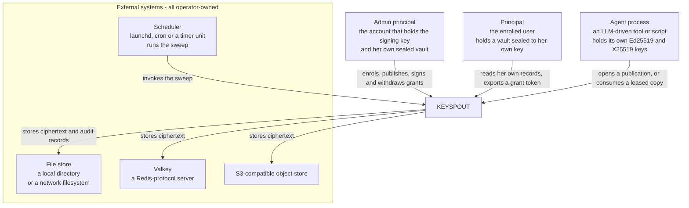
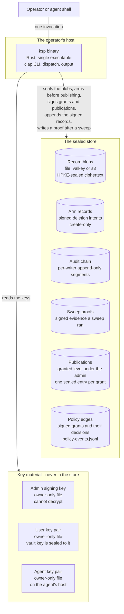
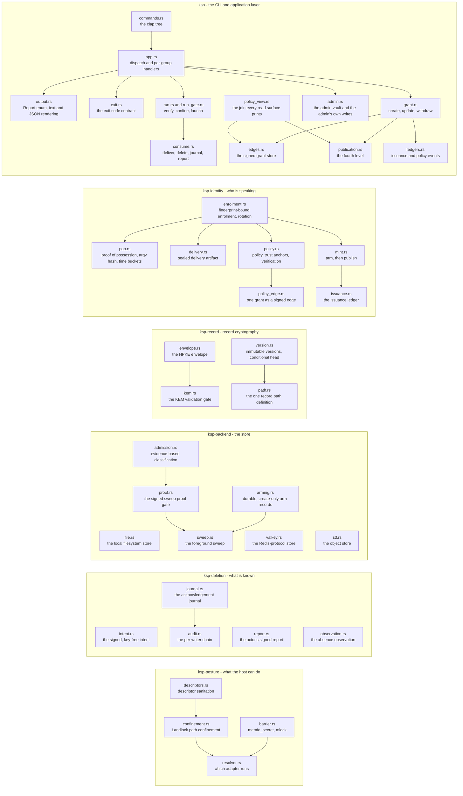

# Architecture Overview

This document develops the three-zone picture from the
[project overview](../index.md) into the three C4 levels: what the system is in
relation to the world, what it is made of, and how the crates relate.

## System Context - C4 Level 1

Keyspout is a **contract-based** secret manager. There is no Keyspout service.
The only parties are the people who hold keys and the agent processes that
consume leased copies.

**The trust boundary is the store.** Keyspout holds no service, so the store is
the only thing an attacker needs to reach. Everything the store holds is
sealed to a named key, and the audit chain is signed by the writer.

**One deployment holds one vault and N principals.** The admin and the users
are separate UNIX accounts behind filesystem permissions, and they are not
interchangeable: the admin signs grants and cannot read a user's records, the
user reads her own records and cannot sign. A **grant** is the one object that
crosses between them - the admin signs it, the user exports the token it
authorised, and the agent opens the publication it names.

**The scheduler is configuration, not trust.** A schedule decides *when* the
sweep runs. Whether it *did* run is answered by a signed proof the sweep
writes, and a lease is admitted only against a fresh proof.

## Container Architecture - C4 Level 2

There is exactly one deployable container: the `ksp` binary. It is invoked in
the foreground, does one job and exits. The other containers are the store and
the operator's own machine.

Three properties of this diagram are load-bearing:

- **The admin key cannot decrypt.** It is an Ed25519 signing key only. There is
  no code path that converts it to an X25519 key.
- **The store never holds a private key.** It holds ciphertext, signed intents
  and signed audit records. Every private half lives in an owner-only file on
  a host the operator chose.
- **The proof directory is outside the store.** A reader must be able to reach
  a proof without entering the store's level hierarchy, because a proof is
  what authorises a lease.

## Component Architecture - C4 Level 3

Eight crates. The CLI is the only place they are wired together.

The diagram stacks the crates in dependency order, and the chain edges are
the dependency edges. The edges *within* a crate are the ones that matter
inside it.

The grant path is the newest seam, and it is the only one that writes into two
places whose owners differ: the **edge** is a signed artifact at the admin's
principal, and the **publication** is a sealed entry in the fourth level beside
it. `grant.rs` owns the order - ledger, artifact, publication, token - and
`policy_view.rs` owns the join that every read surface prints. A read never
re-derives the order; it calls the same join the write used.

Three cross-crate calls are worth naming, because the diagram's chain cannot
show them without becoming unreadably wide:

- **`ksp-identity` calls `ksp-record`**, to seal a delivery. The delivery
  seal uses `ksp-record`'s HPKE adapter, so the low-order-point rejection is
  one implementation and not a second copy.
- **`ksp-identity` calls `ksp-backend`**, because the **mint path** needs the
  admission decision and the arming store. The dependency does not run the
  other way.
- **`ksp-backend` calls `ksp-deletion`**, because the **sweep** must journal
  its acknowledgement and write its report. Deletion does not depend on the
  backend.
- **`crates/ksp` reads `ksp-identity`'s edge type rather than re-declaring it**,
  so the artifact the admin signs and the artifact a verifier reads are one
  definition. The target, the identifier and the canonical encoding live in the
  identity crate; the store, the publication and the token live in the CLI.

A diagram that draws every edge is not a diagram that can be read; these
three are the ones a reader would otherwise have to read the source for.

## Architectural Patterns

### A contract with three opaque methods

The storage backend is a contract, not a plugin host. A backend implements
three opaque operations - put, get, delete - and Keyspout adds the parts that
make a lease safe: admission, arming and sweeping. The backend never learns
what it is storing.

**Why it matters:** a backend that understood keys or policy would become a
trust decision it has no business making. The `s3` backend cannot tell the
difference between "expired" and "not yet expired"; Keyspout decides that
outside the backend, from evidence.

### Evidence, not declaration

This is the pattern the whole system is built around, and it appears in three
places:

| Domain | Declaration (not evidence) | Evidence |
|---|---|---|
| Backend expiry | A configured lifecycle rule, a declared sweep interval | A signed, fresh sweep proof |
| Host confinement | A configured adapter order | The adapter that ran and the guarantee it established |
| Deletion | An intent that authorises an attempt | An actor's signed report, or an absence observation |

The rule is the same each time: **a declaration is not evidence.** The code
says so in a comment at the point where the distinction is decided.

### Arm before publish

A lease is published only after its deletion intent is durably recorded. The
mint path is a two-step sequence with no atomic transaction between them, and
the sequence is deliberately ordered so the failure mode is safe: an uncertain
arming publishes no token.

**Trade-off:** there is a window in which a record exists with no token. The
sweep finds it and removes it. The opposite ordering would publish a token
whose cleanup was never armed.

### One grant is one signed edge

A policy used to be one document naming a set of grants, so a write rewrote the
whole set and two writers raced on one file. A grant is now its own artifact: a
`PolicyEdge` names one (user, secret, version, target), carries a revision and a
validity window, and is signed by the admin. A write adds one, and `--replace` is
the only operation that touches the others.

The consequence is that read-back works on one grant at a time. `admin policy
show` prints the edge, its verification, its tokens, the agent's keys, the
publication it names and the withdrawal that ended it - and a grant whose
publication is missing reads `dangling` rather than `active`. A join that
reported health for a grant that cannot deliver would be the read surface lying
about the write surface.

### Publish the reference, never the value

A leased copy is a real record at the agent's level: a fresh content key, a
sealed blob, an arm record and a deadline. It is deletable because it exists. A
grant delivers something else - one artifact under the admin's principal, and a
token that names it and carries no key.

The artifact holds the blob once and its content key twice: sealed to each
grant's target, and sealed to the admin vault so a second grant against the
same publication recovers the key instead of re-sealing the blob. Neither seal
travels in the token, which is why exporting one needs no password: there is
nothing in it to unlock.

That is why the two deliveries have different verbs. `secret share --agent`
mints a copy and needs the vault; `secret share --policy` exports a token and
needs nothing, because the agent opens the publication with its own recipient
key. And it is why `--consume` is refused for a policy token: there is no copy
to delete, and pretending otherwise would delete nothing while reporting
success.

### One output point

Every command's result is a `Report` variant. The JSON form and the text form
are two renderings of the same value, so they cannot disagree.

**Why it matters:** the output shape *is* the redaction boundary. There is no
`Report` variant that carries a plaintext value, so a secret cannot reach the
audit path or a JSON response without someone adding a variant that does. The
one command that must print a value - `secret get --reveal` - deliberately
bypasses `Report` and builds its own document, so the exception is visible in
one place.

### Fail closed, disclose honestly

Every check in the key and permission paths fails closed. And every
disclosure distinguishes three things that are easy to conflate:

- a capability that was **not selected**,
- a capability that was **selected but unavailable**, with the host's reason,
- a capability that was **selected and established**, with its guarantee level.

A host that enforces nothing says `none`. It does not go quiet.

## Key Design Decisions

### 1. No service, no daemon, no session

Every operation is one foreground invocation.

- **Rationale:** a secret manager with a long-lived process is a secret manager
  with a long-lived attack surface. There is no session to lock, no unsealed
  vault to keep in memory between commands, and no socket to authenticate.
- **Trade-off:** every command re-derives its context, re-reads its
  configuration and re-unseals what it needs. It costs milliseconds and buys
  the absence of a resident secret.

### 2. Independent Ed25519 and X25519 pairs

Every agent and every user has a signing key and a recipient key, generated
separately. They are never derived from one another.

- **Rationale:** a single key pair serving both roles means a signing
  compromise becomes a decryption compromise. The distinct Rust types make the
  substitution a compile error, enforced by `compile_fail` doctests.
- **Trade-off:** two keys per identity to store, back up and rotate.

### 3. Confinement is separate from authentication

Landlock restricts *paths*. A signature establishes *which key* is speaking.
The two are independent controls and the code keeps them in separate crates.

- **Rationale:** conflating them produces a system where a signature inside the
  confined tree could be forged, or where confinement is assumed to imply
  authorisation.
- **Trade-off:** a run must do both, and the failure modes are reported
  separately so a reader can tell a confinement refusal from a signature
  refusal.

### 4. Best-effort deletion, stated as such

The sweep removes a record. It does not erase a copy that was taken earlier.

- **Rationale:** the research is unambiguous - a saved key/ciphertext pair
  cannot be recalled, and neither deletion nor a cryptographic primitive
  invalidates a copy already in someone else's hands. A system that promised
  otherwise would be lying about its own guarantees.
- **Trade-off:** the guarantee is weaker than operators expect from "secret
  with an expiry". The documentation compensates by stating it everywhere.

### 5. Arming is create-only

An arm record is written once. A retry with the same identity finds the
existing record and continues; it never replaces it.

- **Rationale:** the arm record's identity is the idempotency key. Replacing it
  would let a second mint for the same lease replace the first lease's cleanup
  authorisation.

### 6. The use counter lives inside the signed preimage

The remaining-uses counter is signed as part of the arm record, not stored
next to it.

- **Rationale:** a counter *outside* the signature could be raised by anyone
  who can write the journal. Inside the preimage, raising it requires the
  private key.

### 7. macOS is supported with a smaller guarantee

The workspace builds and the suite runs on Darwin. macOS provides no path
confinement and no `memfd_secret`.

- **Rationale:** refusing macOS would exclude a large share of the operators
  who would use this. Reporting a smaller guarantee honestly is better than
  either pretending or refusing.
- **Trade-off:** on macOS the confinement capability is reported as `none` and
  the child runs unconfined, in its own output as well as in `ksp status`. The
  barrier falls back to `mlock`, reported as `weakened`.

## Module Breakdown

### `ksp` - the CLI and application layer

- **Purpose:** the foreground entry point; owns the command surface, the exit
  codes, the output shapes and the redaction rule.
- **Key components:** `commands.rs` (the clap tree), `app.rs` (dispatch),
  `output.rs` (rendering), `exit.rs` (the exit-code contract), `run.rs` and
  `run_gate.rs` (verify, confine, launch), `consume.rs` (deliver, delete,
  journal, report), `layout.rs` (the protected-root table), `establish.rs`
  (adapter selection).
- **Dependencies:** all seven other crates.
- **Deep dive:** [ksp - the command-line interface](../components/ksp-cli.md)

The crate gained the grant path in feature 014, and the files are worth naming
because the order between them is the control:

- **`grant.rs`** - create, update and withdraw. One ordering: the ledger entry,
  then the artifact, then the publication, then the token. A withdrawal records
  the decision before it removes anything, so a retry can finish it and an
  operator can tell a withdrawn grant from one that never existed.
- **`edges.rs`** - the signed-edge store. It verifies the issuer against the
  pinned anchor on every load, so a grant this host cannot attribute is absent
  rather than trusted.
- **`publication.rs`** - the fourth level: one derived path per
  (vault, admin, secret, version), `0750` directories, a sealed entry per policy
  and a reference set that keeps an entry alive while any grant names it.
- **`policy_view.rs`** - the join. Every surface that renders a grant calls it,
  including the write commands' read-back, so a write cannot describe itself
  differently from how a reader prints it.
- **`lifecycle.rs`** - the record-then-write transaction over the admin ledger.
- **`admin.rs`** - the admin vault (`seal-vault`), the admin's own record writer
  (`put --own`) and the transfer to a user. Two verbs, one key decision: which
  recipient the record is sealed to.
- **`registry.rs`** and **`agent_index.rs`** - who is in the deployment, and
  which agent identities a principal has published. Both are public material:
  the registry names principals and their public halves, never a private one.
- **`ledgers.rs`** - the two ledgers and their owners: `issuance.jsonl` for the
  principal, `policy-events.jsonl` for the admin, each with one writer.

### `ksp-identity` - who is speaking

- **Purpose:** enrolment, key pairs, proof of possession, policy verification,
  sealed delivery and the mint sequence.
- **Key components:** `enrolment.rs`, `fingerprint.rs`, `pop.rs`, `delivery.rs`,
  `policy.rs`, `mint.rs`, `issuance.rs`, `key_bundle.rs`.
- **Dependencies:** `ksp-types`, `ksp-record`, `ksp-backend`.
- **Deep dive:** [ksp-identity](../components/ksp-identity.md)

`policy_edge.rs` is feature 014's other half: the `PolicyEdge` type, the
canonical target (`agent:<uuid>` or the cooperative `any-enrolled`), the
identifier that names a path, and the digest that binds a ledger entry to the
exact bytes the admin signed. The CLI stores and publishes it; the identity crate
defines what it means.

### `ksp-backend` - the store and its admission

- **Purpose:** the three storage backends, evidence-based admission, durable
  arming and the foreground sweep.
- **Key components:** `file.rs`, `valkey.rs`, `s3.rs`, `admission.rs`,
  `arming.rs`, `proof.rs`, `sweep.rs`, `sweeper.rs`, `usbound.rs`.
- **Dependencies:** `ksp-types`, `ksp-record`, `ksp-posture`, `ksp-deletion`.
- **Deep dive:** [ksp-backend](../components/ksp-backend.md)

### `ksp-posture` - what the host can enforce

- **Purpose:** state, before a run, what the host can actually enforce - path
  confinement, descriptor sanitation and a memory barrier - and report both
  facts honestly.
- **Key components:** `confinement.rs`, `barrier.rs`, `memlock.rs`,
  `descriptors.rs`, `permissions.rs`, `rights.rs`, `resolver.rs`, `adapters/`.
- **Dependencies:** `ksp-types` only.
- **Deep dive:** [ksp-posture](../components/ksp-posture.md)

### `ksp-deletion` - what is actually known

- **Purpose:** keep deletion *evidence* apart from deletion *knowledge*: a
  signed key-free intent, an actor's signed report, an absence observation, a
  durable acknowledgement journal and the per-writer audit chain.
- **Key components:** `intent.rs`, `report.rs`, `observation.rs`, `journal.rs`,
  `audit.rs`, `consume.rs`, `signing.rs`, `verify.rs`.
- **Dependencies:** `ksp-types` only.
- **Deep dive:** [ksp-deletion](../components/ksp-deletion.md)

### `ksp-record` - record cryptography

- **Purpose:** the KEM validation gate, the bound context, the content blob,
  the HPKE envelope and conditional publication.
- **Key components:** `envelope.rs`, `blob.rs`, `kem.rs`, `path.rs`,
  `version.rs`, `provider_guard.rs`.
- **Dependencies:** `ksp-types`.
- **Deep dive:** [ksp-record](../components/ksp-record.md)

### `ksp-types` - the shared vocabulary

- **Purpose:** the identifiers, encodings, domain strings and evidence
  structures that subsystems must agree on byte for byte. No behaviour, no
  policy, no I/O.
- **Key components:** `metadata.rs`, `cbor.rs`, `domains.rs`, `evidence.rs`,
  `capability.rs`, `capability_config.rs`, `content_key.rs`, `shamir.rs`.
- **Dependencies:** none internal.
- **Deep dive:** [ksp-types](../components/ksp-types.md)

### `ksp-key-lifecycle` - the durable key file

- **Purpose:** keep one enrolled identity available across foreground
  invocations, without giving the CLI raw private keys.
- **Key components:** `file.rs` (the filesystem mechanics) and the `KeyStore`
  in `lib.rs`.
- **Dependencies:** `ksp-types`, `ksp-identity`.
- **Deep dive:** [ksp-key-lifecycle](../components/ksp-key-lifecycle.md)

## The Layout Table

The protected roots are one table, not a set of per-call-site modes. Creation
reads the table; measurement compares against it. Each row carries the mode
*and* the reason it is not more open.

| Path | Mode | Why it is not more open |
|---|---|---|
| `$KSP_HOME` | `0711` | Non-owners traverse known paths but cannot enumerate the deployment |
| `admin/` | `0700` | Holds the admin signing identity |
| `agent/` | `0700` | Holds agent key bundles; a sibling account must not read them |
| `enrolments/` | `0755` | Public pins a reload is verified against; readable without a key file |
| `store/` | `0755` | Traversable by every principal; each level carries its own owner |
| `store/intents/` | `1770` | The arm journal; the sticky bit keeps a sibling from removing a record it did not write |
| `sweeper/` and `sweeper/proofs/` | `0755` | One writer, every principal a reader: a proof authorises a lease |
| `audit/` | `0711` | Append-only writer segments; another principal must not rewrite them |
| `journal/` | `0700` | This host's own deletion acknowledgements |
| `admin-anchor.cbor`, `deployment.cbor` | `0644` | Public material every principal must read |
| `vault.cbor` | `0600` | The sealed vault; readable only by its owner |
| `policy.cbor` | `0644` | Signed policy; replaceable only with the admin key |
| `admin-vault.cbor` | `0600` | The key every publication entry's content key is sealed to |
| `issuance.jsonl`, `policy-events.jsonl` | `0640` | One writer each; a ledger a third party can rewrite is a mint history that party can forge |
| `store/p/<vault>/` | `0711` | The vault's principals: nameable, not enumerable |
| `store/p/<vault>/<principal>/` | `0711` | One principal's root; the levels beside it are hers |
| `principals.cbor` | `0644` | The registry: names and public halves, nothing private |
| level `user/` | `0700` | One principal's records |
| level `admin/` | `0700` | The admin's own records, sealed to her vault |
| level `agent-<id>/` | `0730` | The sweep group may unlink a copy it cannot list |
| level `granted/` | `0750` | The publication a grant delivers from: the store group reads it, nobody else |
| level `policies/` | `0755` | The token a grant minted is `0640` inside it, so the user exports what the admin wrote |

Two rows deserve attention:

- **`store/intents/` is `1770`, sticky.** A group member who can rewrite the
  journal can forge a history: appending a revocation is how a token stops
  working, and removing one is how it starts again. The sticky bit keeps a
  sibling from removing a record it did not write.
- **A level directory `fsync` needs read permission.** The arm journal is
  group-writable and world-readable precisely because a write-only journal
  cannot acknowledge durability.

## See Also

- [Workflow Overview](../workflows/overview.md) - the eight workflows, step by step
- [Deep Dive: ksp - the command-line interface](../components/ksp-cli.md)
- [Design specification](../reference/design-spec.md)
