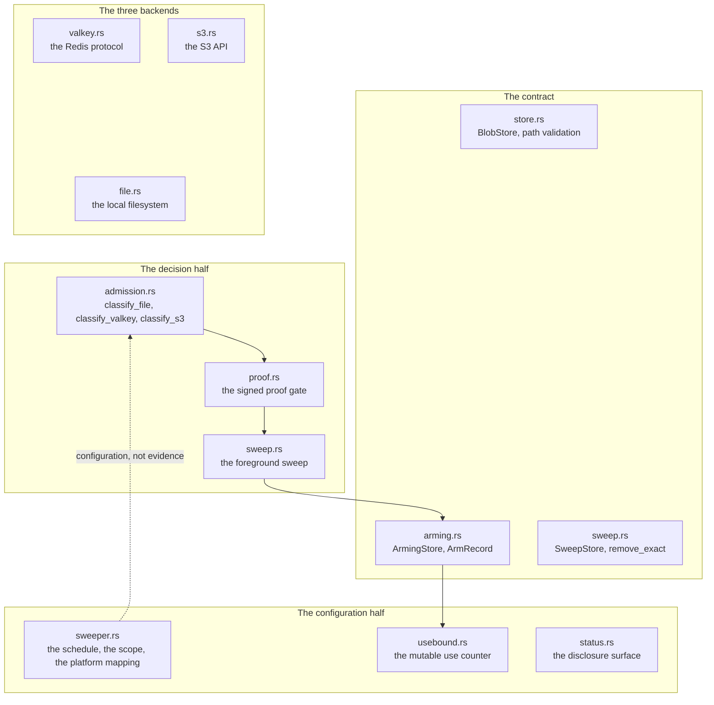
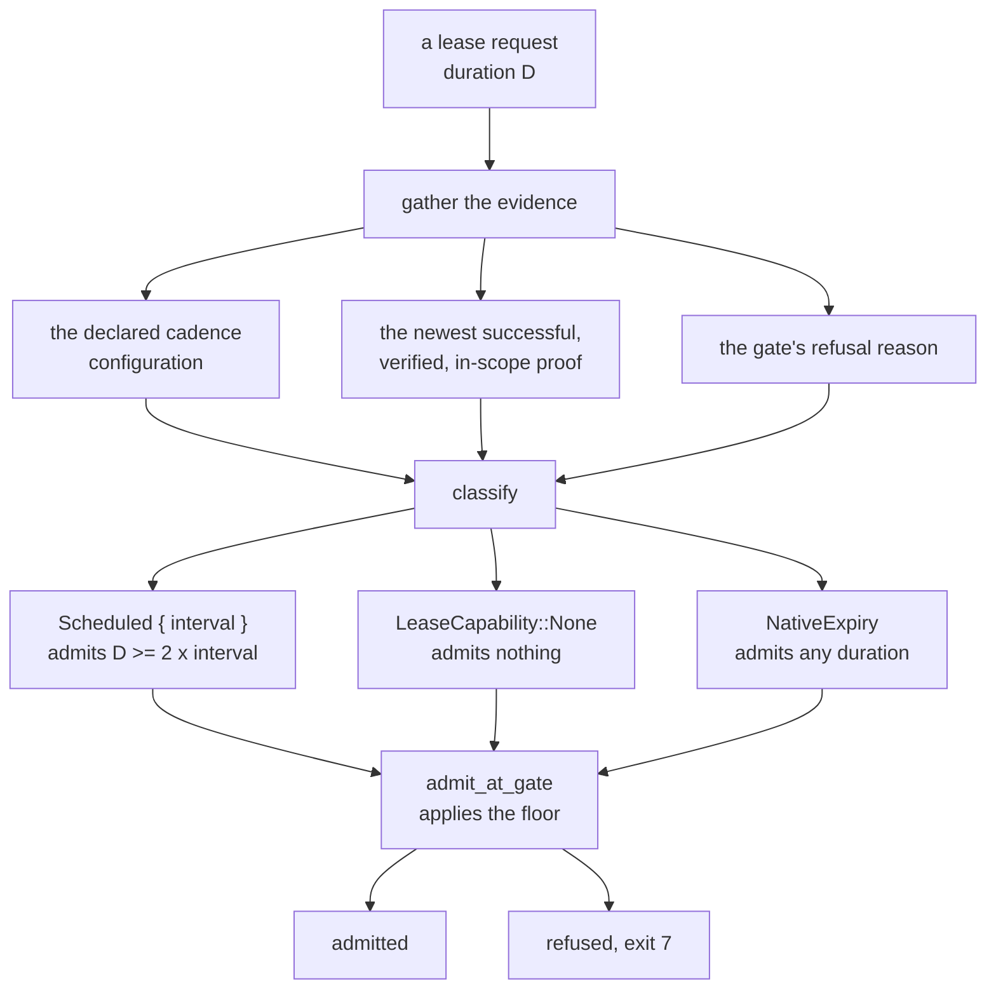
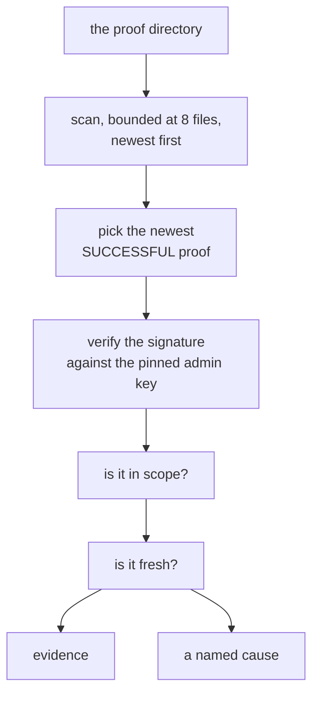
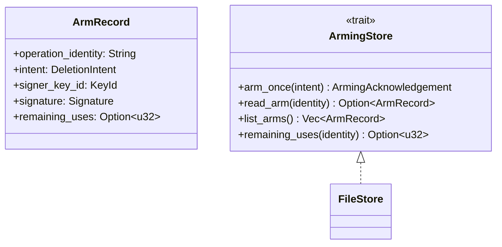
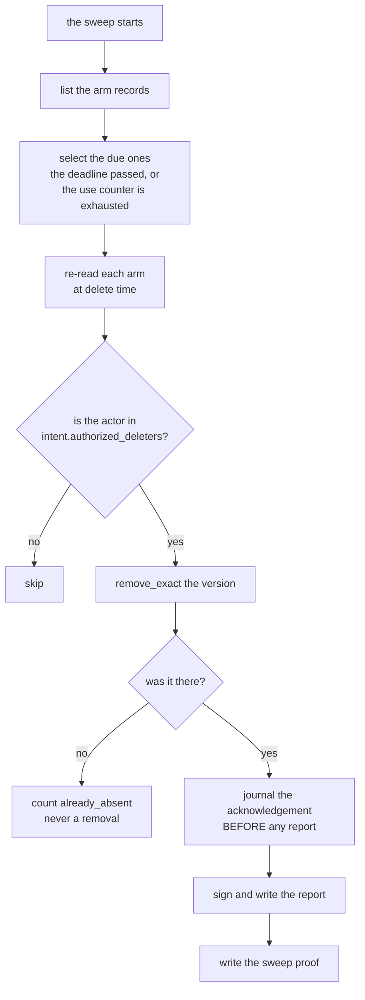
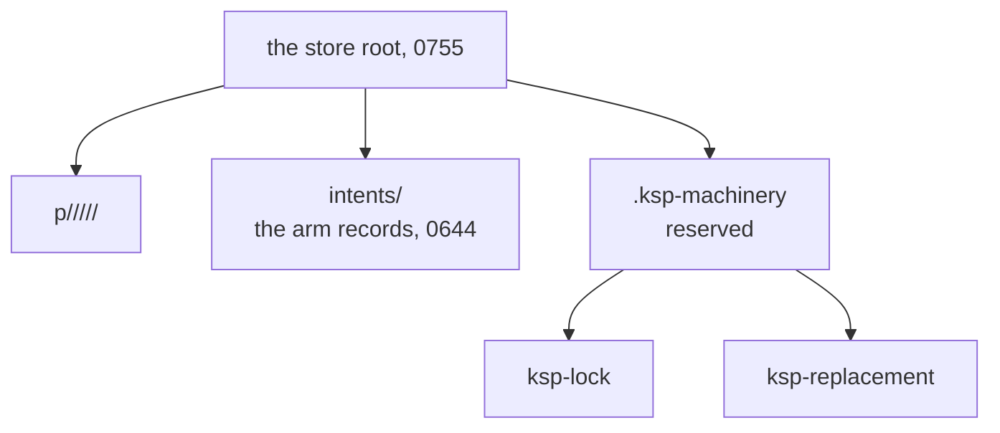
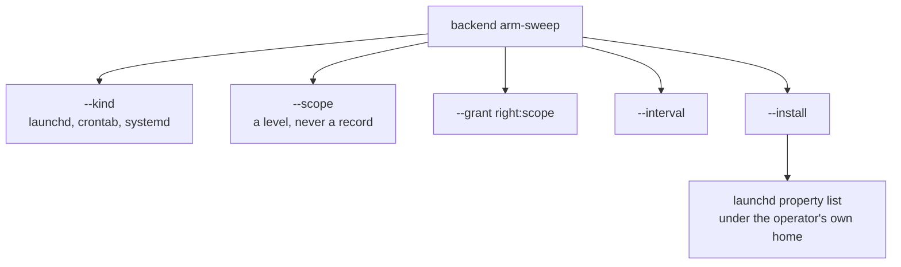

# Deep Dive: ksp-backend

## Overview

`crates/ksp-backend` answers two questions:

1. **May this store hold this lease?** - admission, decided from evidence.
2. **Is the cleanup armed?** - durable arming, and the proof that a sweep
   actually ran.

It also implements the three storage backends. A backend is a contract with
three opaque methods; it never learns what it is storing.

## Responsibilities

- Implement the `BlobStore` contract for `file`, `valkey` and `s3`.
- Classify each backend's capability from *evidence*, not configuration.
- Apply the conservative admission floor.
- Write and read the durable, create-only arm records.
- Run the foreground sweep.
- Write and verify the signed sweep proof.
- Maintain the use counter bound to a lease.

## Architecture

The last edge is dashed on purpose. The sweeper arming is what the operator
*configured*. The proof is what the sweep *did*. Only the second one admits a
lease.

## The Backend Contract

| Trait | Method | What it does |
|---|---|---|
| `BlobStore` | `put(key, bytes) -> Result` | Write a blob |
| | `get(key) -> Result<Option>` | Read a blob |
| | `delete(key) -> Result` | Remove a blob |
| `ArmingStore` | `arm_once(intent) -> Result<ArmingAcknowledgement>` | Write the arm record, once |
| | `read_arm(identity) -> Result<Option<ArmRecord>>` | Read one arm record |
| | `list_arms() -> Result<Vec<ArmRecord>>` | Every arm record, for the sweep |
| | `remaining_uses(identity) -> Result<Option<u32>>` | The use counter |
| `SweepStore` | `remove_exact(metadata) -> Result<Option<String>>` | Remove exactly one version |

Each backend implements the first two, and `file` implements the third:

| Backend | `BlobStore` | `ArmingStore` | `SweepStore` |
|---|---|---|---|
| `FileStore` | yes | yes | yes |
| `ValkeyStore` | yes | yes | - |
| `S3Store` | yes | yes | - |

A class diagram of six classes and six inheritance edges is a diagram that
cannot be read in a column. The table says the same thing and can be.

`remove_exact` takes the **bound metadata** rather than a key, because the
sweep must remove exactly one version of one secret at one level. A
`delete(key)` that removed "the newest thing at this prefix" would be a
different, and much weaker, operation.

## Admission: evidence, not declaration

This is the crate's central rule, and it has three separate implementations.

### The admission floor

`Scheduled { interval }` admits a lease only when

$$D \geq 2 \times \text{interval}$$

The multiplication is `checked_mul`, so an absurd interval **refuses** rather
than wraps into a small number that would admit everything.

The factor of two is a **conservative MVP admission policy**, not a proof of a
sweep and not a maximum lag. It says: if the sweep runs every `interval`, two
intervals of grace means a lease that outlives one missed sweep is still
admitted. The status disclosure separately reports the unknown lag and the
retention.

### The `file` backend

`file` has **no native expiry mechanism**, so its capability is `None` by
configuration alone. The only thing that can move it to `Scheduled` is a
signed sweep proof that is:

- **present**,
- **verified** against the pinned admin key,
- **in scope** for this backend and scope,
- **fresh** within the declared interval.

The classification names exactly one cause, so a reader is never left guessing
which of several things failed:

| Cause | Meaning |
|---|---|
| `NoArming` | No schedule was ever recorded |
| `DeclaredNoProof` | A schedule exists, but no sweep has run |
| `InstalledNoProof` | The job is installed, but no sweep has run |
| `StaleProof { age, bound }` | The newest proof is older than the interval |
| `UnverifiedProof` | The proof's signature does not verify |
| `MalformedProof` | The proof cannot be parsed - **the fix is the file, not the anchor** |
| `ScopeMismatchProof` | The proof covers a different scope |
| `FutureSkewProof` | The proof is dated in the future - its own cause, not staleness |
| `NoCadence` | No interval was declared |
| `UnreadableProofs` | The proof directory exists but cannot be read |
| `Proven` | Everything checks out |

`next_action()` derives the operator's next step from the state alone, so
the guidance cannot drift from the diagnosis.

### The `valkey` backend

`NativeExpiry` only when **all three** configuration gates hold:

- `append_only`,
- `append_fsync_always`,
- `waitaof_supported`.

Otherwise the classification is `ConfigurationMismatch` and the lease is
refused. Logical expiry in a Redis-compatible server is a configuration
promise; without the durability settings, a crash can lose the deadline.

### The `s3` backend

The `s3` classification is the most restrictive, and it is worth stating
plainly why:

- A **versioned** bucket is `None`. Expiration writes a *delete marker*, not
  erasure; the previous version is still there and still readable.
- A **soft-delete** configuration is `None`, for the same reason.
- A **lifecycle mismatch** is `ConfigurationMismatch`.
- S3's age-based lifecycle **can never arm a per-intent deadline**. Every
  S3-compatible lifecycle is an asynchronous batch scan whose execution time
  is not guaranteed, and it operates on an age, not on a per-record deadline.

The `s3` backend is **[Partial]** in the design spec's terms: the store and
its classification exist, but the CLI cannot select it. `SELECTABLE` in
`crates/ksp/src/backend.rs` names `file` and `valkey` only.

## The Proof Gate

The gate decides whether a sweep proof is admissible evidence.

Three rules make the gate trustworthy:

- **It never picks the newest *file*.** It picks the newest *successful* proof.
  A newer failure must not extend the clock.
- **Unreadable is not absent.** A present-but-unreadable proof directory is
  `Unreadable`, not `NoProof`. The difference matters: one means "no
  evidence", the other means "evidence exists and cannot be read", and only
  the second is worth an alarm.
- **The scan is bounded** at eight files, newest first, so a rolled-back head
  pointer cannot be used to hide a newer proof.

## Durable Arming

An arm record is the signed, **key-free** authorisation to delete.

Four properties:

- **Create-only.** A retry with the same identity finds the existing record
  and continues. It never replaces it. The arm record's identity is the
  idempotency key, and replacing it would let a second mint for the same
  lease replace the first lease's cleanup authorisation.
- **The use counter is inside the signed preimage.** A counter stored
  *outside* the signature could be raised by anyone who can write the
  journal. Inside the preimage, raising it requires the private key.
- **A planted record can only make the sweep *attempt* a removal the kernel
  refuses.** The arm journal's signature is "for the operator, not a gate".
- **The journal is `1770`, sticky.** The sticky bit keeps a sibling principal
  from removing an arming record it did not write.

The acknowledgement distinguishes three durability levels, and an arming whose
durability is uncertain is **not** acknowledged as durable. The mint path
publishes no token in that case.

## The Sweep

The ordering is the safety property:

- **The acknowledgement is journalled before the report is written.** A
  journal failure stops the sweep; a report failure does not. The
  acknowledgement is the durable fact; the report is the communication.
- **An already-absent version is counted as `already_absent`,** never as a
  removal. A sweep that reports removals it did not perform is worse than one
  that reports fewer.
- **The bound limits deletions, not records examined.** A bound on the wrong
  one would let an attacker fill the store with unreachable records and
  starve the sweep.

When the backend's capability is `None`, the sweep reports zero counts **and
says nothing about surviving copies**. The note it attaches is the honest
answer: it did not remove anything, and it makes no claim about what remains.

## The `file` Backend's Layout

Four traps this layout is built around:

- **The mode is set with `chmod` after creation,** because `DirBuilder::mode`
  is masked by the caller's `umask`.
- **Ancestor symlinks are refused,** and every open uses `O_NOFOLLOW`. A
  planted symlink must not escape the root.
- **`.ksp-machinery` is reserved.** A blob named `head.ksp-replacement` would
  otherwise overwrite the machinery. No blob path may contain that component.
- **The lock lives *beside* the target,** so a rename does not release it.

And two more:

- **A listing must descend in both directions.** Above the prefix, to reach
  it; below the prefix, when the prefix names a directory. A one-directional
  listing makes `secret ls` print nothing.
- **An `agent-<id>` level is `0730`.** The sweep group may unlink a copy it
  cannot list - which is exactly the intent.

## The Sweeper Arming

The *configuration* half: what the operator declared, and what platform
mapping applies.

The scope rules are strict, and the strictness is the point:

- **A scope is a level, never a record.** A deeper `--scope` or `--grant` is
  **refused**, and the refusal names the accepted shape. A deeper scope was
  once parsed with its trailing segment silently dropped, so the command
  exited 0 while the capability never moved.
- **Scope predicates refuse, never rewrite.** Normalising `agent-<uuid>` to
  `agent-*` would silently widen what a sweep may delete.
- **`HostPlatform` is a parameter, not a `cfg`,** so both the Linux and the
  Darwin mappings are testable on either host.
- **An installed job must carry the real binary path.** A hardcoded
  `/usr/local/bin/ksp` once produced a plist that failed with `ENOENT` while
  the install reported success.
- **A system-wide target is refused,** never escalated.

## Dependencies

| Direction | Why |
|---|---|
| `ksp-backend` to `ksp-record` | The `BlobStore` contract extends the record crate's version trait |
| `ksp-backend` to `ksp-deletion` | The sweep journals its acknowledgement and writes its report |
| `ksp-backend` to `ksp-posture` | The status surface reports the host posture |
| `ksp-backend` to `ksp-types` | The shared vocabulary |

## Testing

- **Admission boundaries.** `2x-1` refuses, `2x` admits, `2x+1` admits. The
  boundary is asserted, not just the far case.
- **Every classification cause** has a test that produces it, so a new cause
  cannot be added without a test.
- **The file backend's traps**, each with its own test: the umask, the
  ancestor symlink, the reserved machinery component, the two-directional
  listing.
- **The proof gate's rules:** newest successful, unreadable is not absent,
  the bounded scan.
- **The arming's create-only property** and the use counter's presence inside
  the signed preimage.
- **The sweeper's scope rules,** including the refusal that names the
  accepted shape.

## Potential Improvements

- `s3` is implemented but not selectable from the CLI. The gap is one entry in
  `SELECTABLE` plus the configuration plumbing; the harder part is that an
  unversioned bucket still needs a configured cleanup and a declared cadence
  before it admits anything.
- The `sftp` backend does not exist. The research refused it with specific
  evidence - no `.lock` operation, asynchronous default writes, a
  non-atomic rename - and re-admitting it needs a mechanism that addresses
  those reasons, not a different argument.
- The proof scan is bounded at eight files. A deployment with many concurrent
  sweepers would want a real head pointer.

## See Also

- [Deep Dive: ksp-deletion](ksp-deletion.md) - the evidence the sweep produces
- [Deep Dive: ksp-posture](ksp-posture.md) - the host capability disclosure
- [Design specification](../reference/design-spec.md)
