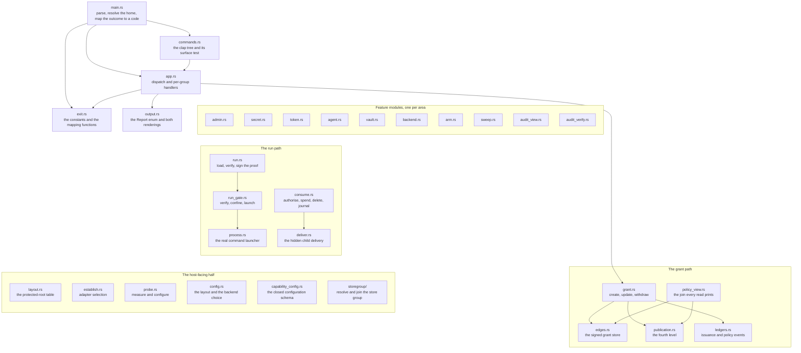
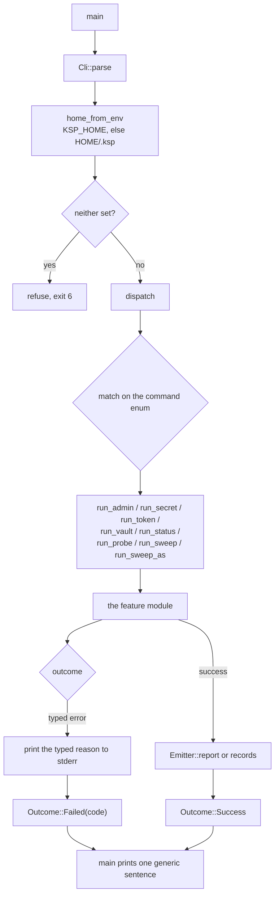
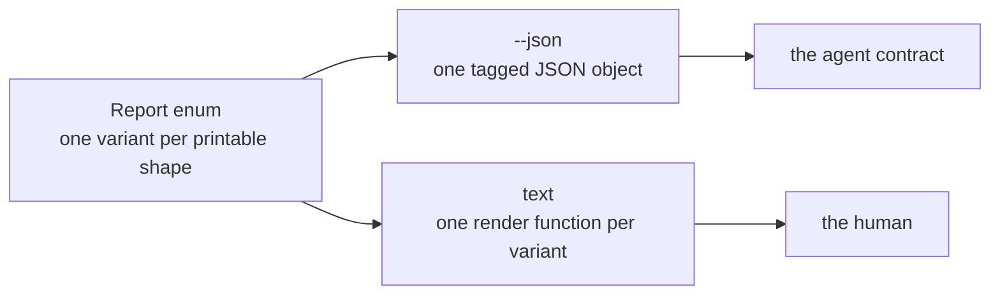
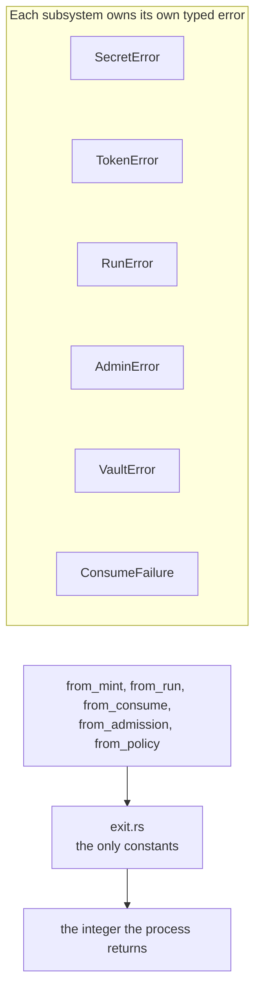
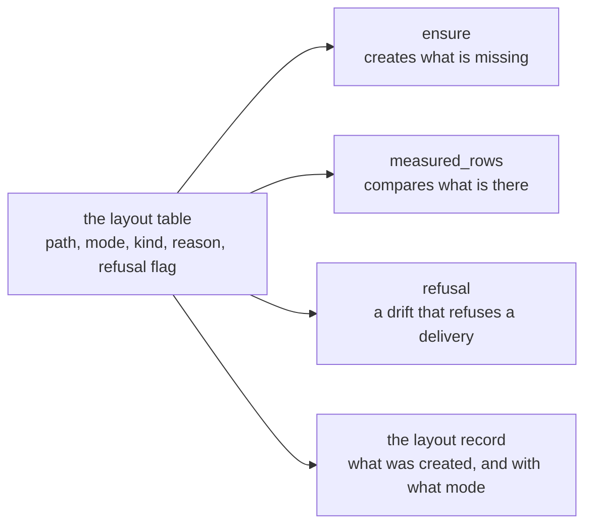

# Deep Dive: ksp - the command-line interface

## Overview

`crates/ksp` is the foreground entry point of the whole system. Every
operation is one invocation that starts, does its work and exits. There is no
daemon, no listener and no session.

The crate has two halves:

- **`src/commands.rs`** - the clap tree. It defines the *surface*: which
  commands exist and which flags they take. Nothing else decides that.
- **`src/app.rs` and the per-feature modules** - the *implementation*. Each
  feature owns its own module with its own typed error and its own rendering.

That split is enforced by a test. `commands.rs` carries a test that walks the
clap tree and compares it against a hand-written list of every expected path.
A command that is missing is a capability the product does not have; one that
is extra is a surface nobody specified.

## Responsibilities

- Own the complete command surface, and keep it pinned by a test.
- Own the exit-code vocabulary, in one file, with no other module allowed to
  choose an integer.
- Own the output shapes: one `Report` enum, two renderings, one data source.
- Own the redaction rule: a plaintext value has no route into the report or
  the audit path.
- Own the protected-root table and the probe that measures it.
- Wire the seven domain crates together, and refuse rather than improvise.

## Architecture



## The Command Surface

Forty-six public paths, plus one hidden internal command. The complete list is
pinned by `the_command_surface_matches_the_design_specification`.

### Setup and status

| Command | What it does |
|---|---|
| `ksp init` | The first-run path: probe the host and write the capability configuration |
| `ksp config init [--force]` | The same probe, as a repair path |
| `ksp status` | Disclose the effective backend, the host posture and the layout drift |
| `ksp version` | The version |

### Administration

| Command | What it does |
|---|---|
| `ksp admin init --vault <id> --user <name>` | Create the deployment, the admin key and the layout |
| `ksp admin user add [--signing-key-id] [--recipient-key-id] [--unix-user] [--passphrase-file]` | Enrol the user, seal her vault, optionally bind a UNIX account |
| `ksp admin policy [--agent <id>] [--secret <id>] [--replace] [--show]` | Merge, replace or read back the grant set |
| `ksp admin policy create --user <uuid> --secret <id> [--version N] (--agent <id> \| --any)` | Sign one grant as its own edge: the decision, the publication entry and the token |
| `ksp admin policy update <id> [--agent <id> \| --any] [--expires-at <secs>]` | Re-sign one grant at the next revision; a target change re-publishes, a window move does not |
| `ksp admin policy delete <id>` | Withdraw one grant: record the decision, remove the artifact, release the entry |
| `ksp admin policy list [--user] [--secret] [--state] [--limit]` | Every policy, filtered and bounded, with the unprinted total |
| `ksp admin policy show <id>` | One policy joined with its verification, tokens, agent keys, publication and withdrawal |
| `ksp admin seal-vault` | Create the admin's own sealed vault, which every publication entry's content key is sealed to |
| `ksp admin put <id> --name <name> [--own]` | Write a secret at the `admin` level; the value on stdin. `--own` seals to the admin vault, otherwise to the user's key |
| `ksp admin list` | List the records this deployment holds |
| `ksp admin audit` | Report the deletion acknowledgement journal - a different store from `ksp audit` |
| `ksp admin revoke [--secret <id> \| --agent <id>]` | Withdraw a grant |

### Vault and agents

| Command | What it does |
|---|---|
| `ksp vault init` | Exists and **refuses** with exit `7`; a vault is created by `admin user add` |
| `ksp vault status` | The vault's state |
| `ksp vault rekey [--threshold N] [--shares N]` | Re-seal the vault and cut a Shamir share set |
| `ksp agent enroll --agent <name>` | Generate the agent's two keys and write its enrolment record |
| `ksp agent pubkey --agent <name>` | Print the public material for out-of-band verification |
| `ksp agent list` | Every agent this host holds: principal UUID, display name, both key IDs, fingerprint |
| `ksp agent rotate --agent <name> --signing-key-id <id> --recipient-key-id <id>` | Rotate the agent's identity |

### Secrets and leases

| Command | What it does |
|---|---|
| `ksp secret set <id> --name <name>` | Store a secret; the value on stdin |
| `ksp secret get <id> [--version N] [--reveal]` | Read it back; redacted unless `--reveal` |
| `ksp secret rm <id> [--version N]` | Remove a version |
| `ksp secret ls` | List the secrets at this level |
| `ksp secret share <id> --agent <name> --name <name> [--ttl] [--uses N] --out <path>` | Mint a lease for an agent |
| `ksp secret share <id> --policy <id> --out <path>` | Export the token a grant authorised: no password, because the token carries no content key |
| `ksp secret purge-expired [--limit N]` | The admin-signed sweep |
| `ksp secret gc [--user-arming] [--passphrase-file]` | The user-signed sweep |

### The scoped grant read

| Command | What it does |
|---|---|
| `ksp policy list` | The same join as `admin policy list`, scoped to the calling principal |
| `ksp policy show <id>` | The same join for one grant, as the caller may see it |

### Tokens and runs

| Command | What it does |
|---|---|
| `ksp token mint --agent --secret --name [--ttl] [--uses] --out <path>` | The mint path |
| `ksp token lease` | Exists and **refuses**; unwrapping an agent-level record at the user level is the escrow the levels exist to prevent |
| `ksp token list` | The issuance ledger |
| `ksp token inspect --token <path>` | What a lease says about itself |
| `ksp token revoke <token_id>` | Withdraw a lease |
| `ksp run [--token <path> \| --agent <name>] [--env NAME] [--env-all] [--consume] -- <child>...` | Verify, confine, launch |

### Backends and audit

| Command | What it does |
|---|---|
| `ksp backend list` | The selectable backends |
| `ksp backend test [--ttl <secs>]` | Test the store through the same admission gate a mint uses |
| `ksp backend arm-sweep --kind <kind> --interval <dur> --scope <scope> --credential <c> --grant <right>:<scope>... [--install]` | Record the cleanup schedule |
| `ksp audit [--admin] [--principal <uuid>] [--limit N] [--since 30m\|1h\|7d]` | The scoped log view |
| `ksp audit verify --head <64-hex>...` | Verify the chain against pinned public material |

### Ingest

| Command | What it does |
|---|---|
| `ksp import --from-file <path> [--format env\|json] (--own \| --to-principal <uuid>)` | Read a `.env` or JSON file and seal each value here |
| `ksp import --from <name> --selector <s> (--own \| --to-principal <uuid>)` | Read a declared manager through `$KSP_HOME/integrations/<name>.toml` |
| `ksp import --list-adapters` | Every declaration on this host, what each can do, and any file that failed to load |
| `ksp import --schema` | The declaration contract, derived from the type the parser deserialises |
| `ksp export <anything>` | Exists and **refuses** with exit `13` in every form |

`--schema` and `--list-adapters` are flags rather than subcommands, so the
surface guard sees one entry rather than three: a reader asking what shape a
declaration takes does not need to know the command tree to find the answer, and
neither flag reads any configuration or needs a deployment.

The read path is untouched. `ksp run` opens the sealed store and nothing else; an
import is a write that happens before any of this, and no adapter is reachable
from a delivery.

### The hidden command

`ksp __deliver --env NAME --level <path> -- <child>...` exists, is hidden,
and is the only `__`-prefixed name. A test asserts both that it exists and
that it stays hidden.

It exists because confinement is **irreversible**. The process that applies a
Landlock ruleset cannot un-confine itself, so it cannot also delete the
record afterwards. The delivery therefore runs in a second process.

## Dispatch



Two details in that diagram are deliberate:

- **The dispatch match has no catch-all arm.** A newly added command cannot
  silently succeed; the compiler forces a decision, and an unreachable path
  returns `1` rather than `0`.
- **The specific reason is printed by the handler, and `main` prints one
  generic sentence.** `main` prints `refused (exit {code}: {describe})`, and
  the typed reason was already on stderr. The generic sentence is the
  machine-readable part; the typed message is the human part.

## Output

### One report type, two renderings

`output.rs` defines a single `Report` enum, internally tagged with
`kind`. The JSON form is one object per report; the text form is a function
per variant.



Because both renderings read the same value, they cannot disagree. That is
the point of the design: an agent parsing `--json` and a person reading the
text see the same facts.

`Records` and `Agents` are struct variants rather than newtype variants,
because serde cannot tag a newtype over a sequence.

### The redaction boundary

There is **no `Report` variant that carries a plaintext value**. That is not
an omission; it is the mechanism. A secret cannot reach the audit path or a
JSON response without someone adding a variant that does.

The one command that must print a value, `secret get --reveal`, therefore
bypasses `Report` entirely and builds its own document:

```json
{"kind":"secret","record":"...","name":"api-key","version":1,"revealed":true,"value":"..."}
```

Without `--reveal`, the value is the four-character redaction `••••`. The
exception is visible in exactly one place, which is what makes it auditable.

### The audit records

`ksp audit` prints one JSON object per line, after a summary line that
reports the counts: total, emitted, unreadable, malformed, withheld, and
whether the read was truncated. A truncated read says so.

## The Exit-Code Contract

`exit.rs` holds every constant. Each subsystem maps its own typed failure to
one of them through a function in that module, so a command never chooses an
integer.



Three of the codes exist because collapsing them would tell a calling agent
the wrong thing:

- **`9` and `10`.** `9` means the delete failed and the record may still be
  there, so a retry may succeed. `10` means the child failed after a
  successful removal, so the record is gone and a retry cannot help.
- **`12` and `8`.** `12` means the audit log did not verify. `8` means a proof
  of possession was invalid. An agent debugging its key and an operator
  reading a tampered log need different next steps, and one integer cannot
  say both.
- **`13` and `1`/`2`.** `13` means the invocation was malformed, and the
  message names the accepted form. Collapsing a typo into `1` told a caller to
  report a crash; collapsing it into `2` told it a policy had decided
  something.

## The Layout Table

`layout.rs` holds one table of protected roots. Creation reads it;
measurement compares against it. Each row carries the mode *and* the reason it
is not more open.



The modes are set with `fchmod` and `set_permissions`, **never** with
`open(2)`'s `mode` or `DirBuilder::mode`. Both are masked by the caller's
`umask`, and a principal running under `umask 077` once made the shared arm
record unreadable, so the sweep refused every lease.

## Configuration

The capability configuration is a **closed schema**: `StoredConfiguration` is
`#[serde(deny_unknown_fields)]`, and `validated()` converts it into the
closed `CapabilityConfiguration` while reporting an unknown adapter or a
capability mismatch with the exact key.

The file is opened with `O_NONBLOCK`. A FIFO at the configuration path would
otherwise block forever, and a configuration read that hangs is worse than one
that refuses.

Reading the configuration is deliberately unrestricted; it holds no secret.
The mode check rejects group and other *write* bits, so an unprivileged
process cannot change what the next run will enforce.

## Key Files

| File | What it owns |
|---|---|
| `main.rs` | Parse, resolve the home, map the outcome to a code |
| `commands.rs` | The clap tree and the surface test that pins it |
| `app.rs` | Dispatch, the per-group handlers, the password reader |
| `exit.rs` | The exit-code contract |
| `output.rs` | The `Report` enum and both renderings |
| `layout.rs` | The protected-root table, the layout record, the drift measurement |
| `capability_config.rs` | The closed configuration schema and its refusals |
| `config.rs` | The `Layout` struct and the backend selection |
| `establish.rs` | Adapter selection and the capability disclosures |
| `probe.rs` | The host probe, the write policy, the configuration writer |
| `grant.rs` | One grant's lifecycle: the decision, the artifact, the publication, the token |
| `edges.rs` | The signed grant store: load, write, withdraw, never re-derive a decision |
| `publication.rs` | The `granted` level: one artifact per (admin, secret, version), sealed per grant |
| `policy_view.rs` | The join every read surface prints, so a read cannot disagree with the write |
| `ledgers.rs` | `issuance.jsonl` and `policy-events.jsonl`, the two append-only decisions |
| `run.rs` | Loading a lease, verifying it, signing the proof of possession |
| `consume.rs` | Authorising the intent, spending a use, the delete, the journal |
| `deliver.rs` | The hidden delivery process |
| `process.rs` | The real `std::process::Command` launcher |
| `secret.rs`, `token.rs`, `agent.rs`, `vault.rs`, `admin.rs`, `backend.rs` | One module per command group |
| `sweep.rs`, `arm.rs`, `install.rs` | The sweep, the arming, the launchd installer |
| `audit.rs`, `audit_view.rs`, `audit_verify.rs` | Appending, viewing and verifying the chain |
| `storegroup/` | Resolving the store group and joining the account to it |
| `lifecycle.rs` | The order a withdrawal happens in, held in one place: ledger, artifact, publication |
| `registry.rs` | The principal registry - who belongs to this deployment, and which account is who |
| `agent_index.rs` | The public half of each agent's enrolment, where the admin can read it |
| `admission.rs` | The one place a recorded schedule and a proof become a capability |
| `deployment.rs` | The three identifiers every record path and every policy names |
| `keys.rs` | What this host pinned, and what a later process reloads against |

## Design Decisions

### The surface is pinned by a test

The expected list is written out by hand in `commands.rs`, not generated from
the implementation. A generated list would always agree with the
implementation, which is exactly what the test exists to catch.

### The hidden command is hidden by assertion

`the_internal_delivery_command_exists_and_stays_hidden` asserts that
`__deliver` exists, is hidden, and is the only `__`-prefixed name. A hidden
command still exists, so the test has to pin the property, not just the
presence.

### Absent commands are absent, not hidden

The phase-four session agent verbs - `agent start`, `agent stop`, `agent
status`, `agent lock-timeout` - are **absent from the parser**, and a test
asserts their absence. A hidden command still exists; these are out of scope
rather than discouraged.

### The home is resolved once

`home_from_env` resolves `KSP_HOME`, then `$HOME/.ksp`, and passes the
resolved path down. A step that re-reads the environment variable writes an
empty path into the plist. This is the "a resolved value re-read from its
source is a second answer" rule.

## Testing

The crate carries three kinds of test:

- **Surface tests** in `commands.rs` - the command tree, the hidden command,
  the absent commands, and that `--json` is accepted both before and after
  the subcommand.
- **Unit tests** beside the code, including a test that re-executes a
  throwaway child to ask the kernel a question the harness cannot.
- **Integration tests** under `crates/ksp/tests/`, one file per feature:
  `agent_contract.rs`, `wired_surface.rs`, `audit_scope.rs`, `use_bound.rs`,
  `policy_provenance.rs`, `arming.rs`, `refusals.rs`, `policy_read_back.rs`,
  `policy_merge.rs`, `agent_list.rs`, `principals.rs`.

The `principals.rs` test needs two UNIX accounts and refuses to run without
root **on purpose**. It is the only target that needs privilege, and the gate
script runs it separately with its own target directory, because a
root-owned `target/` breaks every later non-root build.

## Potential Improvements

- The `--json` shape is an internally tagged enum with about thirty
  variants. It is stable enough for the agents that consume it today, but
  there is no version field, so a future addition to the surface cannot be
  distinguished from a change in an existing shape.
- `secret ls` and `admin list` share a listing mechanism but not a
  presentation, so the two lists do not look alike.
- The password reader is duplicated across the five arms that need one, and
  the difference between "no password source" and "the named file could not
  be opened" is only in the message.

## See Also

- [Deep Dive: ksp-identity](ksp-identity.md) - enrolment, PoP, delivery
- [Deep Dive: ksp-backend](ksp-backend.md) - admission and arming
- [Workflow Overview](../workflows/overview.md)
