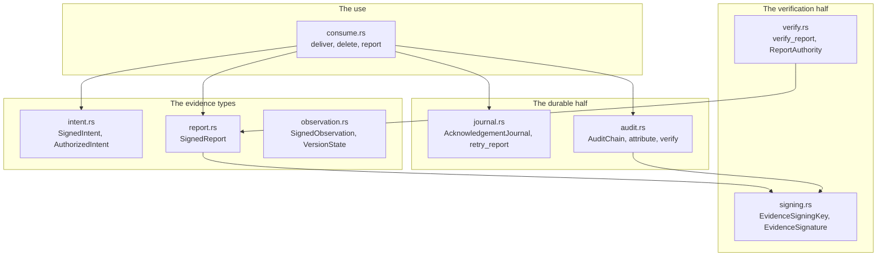
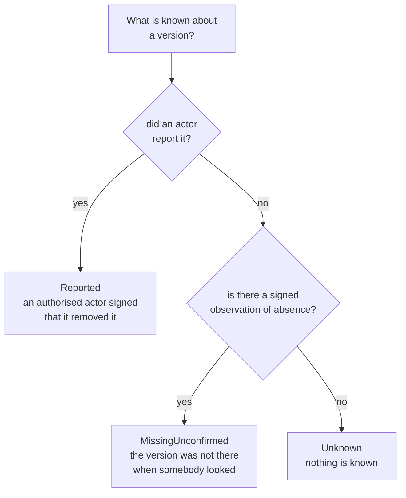
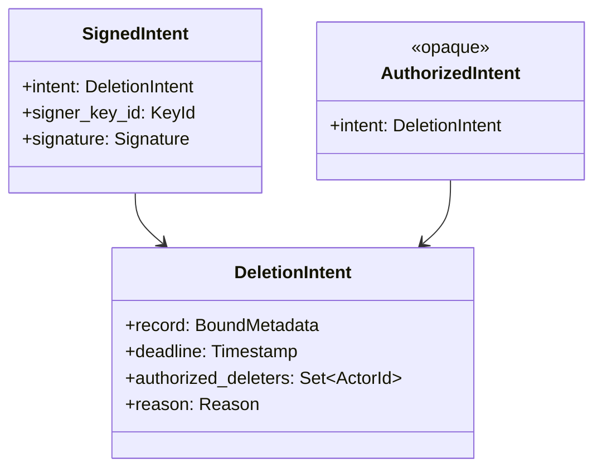
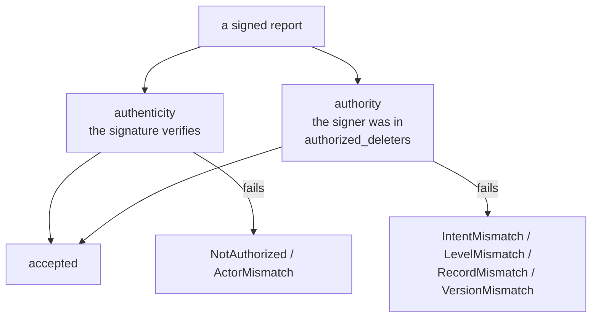
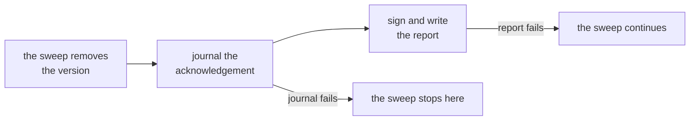
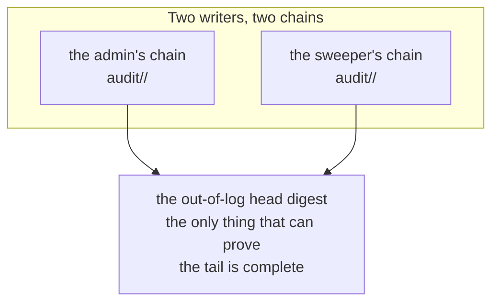
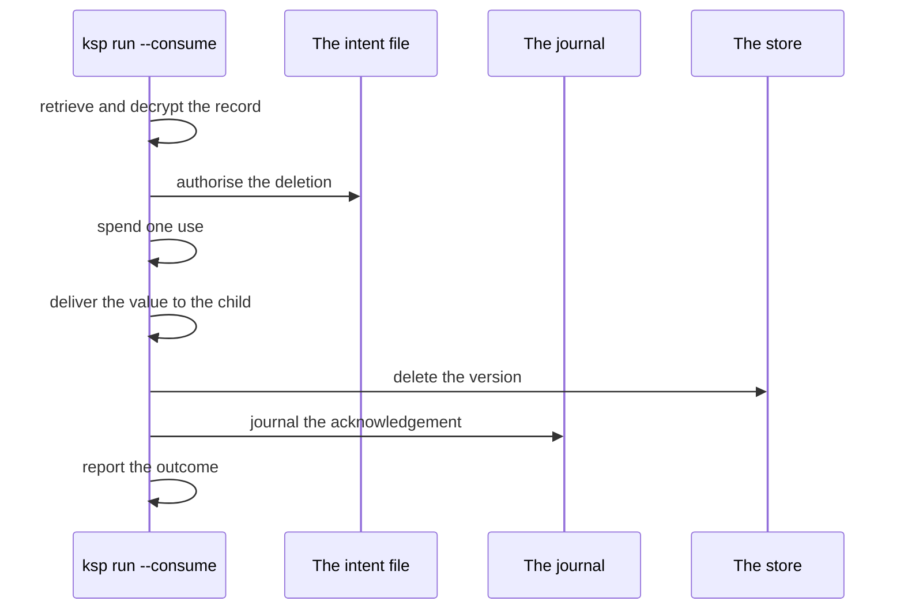

# Deep Dive: ksp-deletion

## Overview

`crates/ksp-deletion` keeps deletion **evidence** apart from deletion
**knowledge**. That separation is the crate's whole idea:

- An **intent** authorises an *attempt*.
- An **actor's report** says what the actor did.
- An **observation** says what was *not* there.
- An **acknowledgement journal** makes the deletion durable.
- An **audit chain** makes the actor accountable.

None of these is a tombstone, and none of them contains a key.

## Responsibilities

- Define the signed, key-free deletion intent.
- Define the actor's signed report and verify its authority.
- Define the absence observation, which has no deletion-time accessor.
- Maintain the durable acknowledgement journal.
- Maintain the per-writer audit chain and verify it.
- Implement the consume ordering: retrieve, decrypt, hand to the child,
  delete, report.

## Architecture

## The Three Facts

The crate exists because "was it deleted?" has three genuinely different
answers, and a system that collapses them either over-claims or
under-claims.

The critical constraint is in the code:

> There is deliberately no accessor for a deletion time on an observation.

An observation records **when it was observed**, not when the version was
deleted. The two are different instants, and conflating them would invent a
deletion time that nobody witnessed.

Likewise, there is **no `Deleted` variant without a report**. A version that
was merely absent is `MissingUnconfirmed`, which carries the observations
that support it.

## The Intent

The intent is signed and **contains no keys**. It is what the sweep consults
before it removes anything.

`AuthorizedIntent` is **opaque**. It can only be produced by the
verification path, so a caller cannot construct one by hand and hand it to
the sweep. The sweep's `intent.authorized_deleters.contains(actor)` check is
therefore a check against a *verified* authorisation, not against a
caller-supplied structure.

## Reports and Authority

An actor's report says what it did. Verifying it involves two independent
checks that are easy to conflate:

- **Authenticity** - the signature verifies against the pinned key.
- **Authority** - the signer was actually authorised to delete this record.

The `ReportAuthority.acknowledgement` field is a **private-field capability**,
obtainable only from `AcknowledgementJournal::require`. A report can only be
accepted if the journal holds the corresponding acknowledgement. That is how
the report and the journal are tied together without either being able to
forge the other.

The rejections are typed: `NotAuthorized`, `ActorMismatch`, `IntentMismatch`,
`LevelMismatch`, `RecordMismatch`, `VersionMismatch`,
`AcknowledgementMismatch`.

## The Acknowledgement Journal

The journal is the durable half. It records that a removal was acknowledged.

Two design details:

- **The journal key deliberately excludes the timestamp.** A retry lands on
  the same key, so a retried acknowledgement does not create a second entry.
- **A retry holds only a `ReportSink`,** which cannot write a record. The
  guarantee "a retry never restores ciphertext" therefore holds because no
  API could, not because the caller was careful.

## The Audit Chain

The audit chain is **per writer**. Admin and sweeper share no lock, so they
get separate chains rather than one contended chain.

Three rules:

- **A chain cannot prove its own tail is complete.** Only an out-of-log head
  digest can. The head is what `ksp audit verify --head` checks against.
- **The writer directory is `0700`** and follows the *signing* key, not the
  subject of the record. One writer's chain is not another writer's business.
- **Append happens before the effect.** A record is written before the
  operation it describes is reported as successful. A refusal is logged too -
  those entries are what prove a control fired.

### Attribution

`attribute(signed, pins) -> Attribution` resolves the signing key **from the
pins, never from the record**:

| Result | Meaning |
|---|---|
| `Verified { key_id, status }` | The key is pinned and the signature verifies |
| `Unpinned` | The key is not in the pin set |
| `Mismatch { signer }` | The record names a signer that does not match |
| `Invalid { signer }` | The signature does not verify |

The audit record uses a **separate domain** from the deletion report, so an
audit record can never verify as a deletion report. The two are different
kinds of statement and the code keeps them apart.

## Consume

The consume path is the one place where delivery, deletion and reporting
happen in sequence, and the order is deliberate.

The ordering rationale, from the module docs:

- **Retrieve, decrypt, hand to the child, delete, report.** The delete comes
  *after* the delivery, so a delivery failure does not destroy the secret.
- **Consume is not exactly-once.** The record is gone afterwards, so later
  fetches fail. A copy taken before the delete stays readable. There is no
  automatic remint and no restoration.
- **Concurrent reads and copies survive.** Nothing in this path prevents two
  processes from reading the same leased copy.

The exit codes distinguish the two failure directions:

| Code | Meaning | Retry? |
|---|---|---|
| `9` `DELETE_FAILED` | The delete failed; the record may still be there | Yes, a retry may succeed |
| `10` `LOST_FRESH_FETCH` | The child failed after a successful removal | No; ask for a new delivery |
| `11` `UNCONSUMED_REFUSED` | A compliant run was refused because the backend requires consumption | Add `--consume` |

## Domain Separation

The crate uses three of the shared domains:

| Domain | Covers |
|---|---|
| `DOMAIN_DELETE_INTENT` | The intent |
| `DOMAIN_DELETE_REPORT` | The report |
| `DOMAIN_ABSENCE_OBSERVATION` | The observation |

Plus `DOMAIN_AUDIT_RECORD` for the chain.

## Dependencies

`ksp-deletion` depends on `ksp-types` **only**. `ksp-identity` is a
**dev-dependency**, used by the consume-side proof-of-possession assertion.

That is not an accident. The production direction is
`ksp-identity` to `ksp-backend` to `ksp-deletion`, and it stays acyclic
because the scope decision that would otherwise create a cycle lives in
`ksp-identity`.

## Testing

- **Each state is reachable and distinguishable.** `Reported` and
  `MissingUnconfirmed` are separate, and there is no path from one to
  `Deleted` without a report.
- **The observation has no deletion-time accessor.** A test asserts the
  accessor does not exist.
- **Every report rejection** is produced by a test: authority, actor
  mismatch, intent mismatch, level mismatch, record mismatch, version
  mismatch, acknowledgement mismatch.
- **The journal's retry lands on the same key.**
- **The chain's torn tail** is classified as torn, not as broken, and a
  broken chain is classified as broken, not as tampered-with.
- **The consume ordering** is asserted: the delete happens after the
  delivery.
- **The `test-observer` feature** retains post-wipe plaintext in a
  thread-local, and the crate's `Cargo.toml` says it must never ship.

## Potential Improvements

- The audit chain is local and append-only. There is no forwarding sink to
  `syslog://`, an HTTP endpoint or a file, and the design spec records that
  as **[Not implemented]** rather than as a gap.
- The journal is a single-host store. A deployment that wants the
  acknowledgement to survive the host needs a different substrate.
- The absence observation is signed but not aggregated. A reader must verify
  each observation separately.

## See Also

- [Deep Dive: ksp-backend](ksp-backend.md) - the sweep that produces the evidence
- [Deep Dive: ksp-identity](ksp-identity.md) - the mint path that writes the intent
- [Workflow Overview](../workflows/overview.md)
