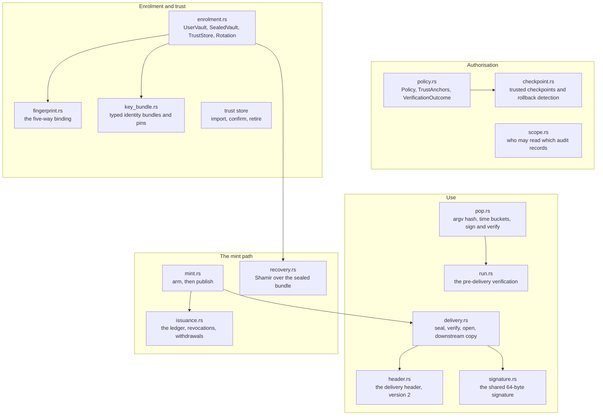
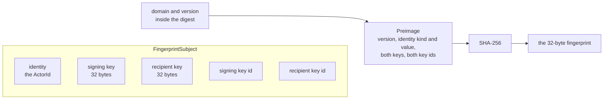
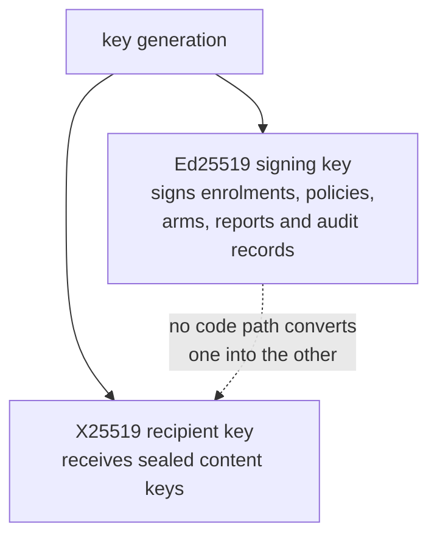
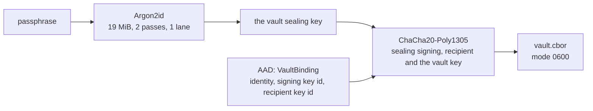
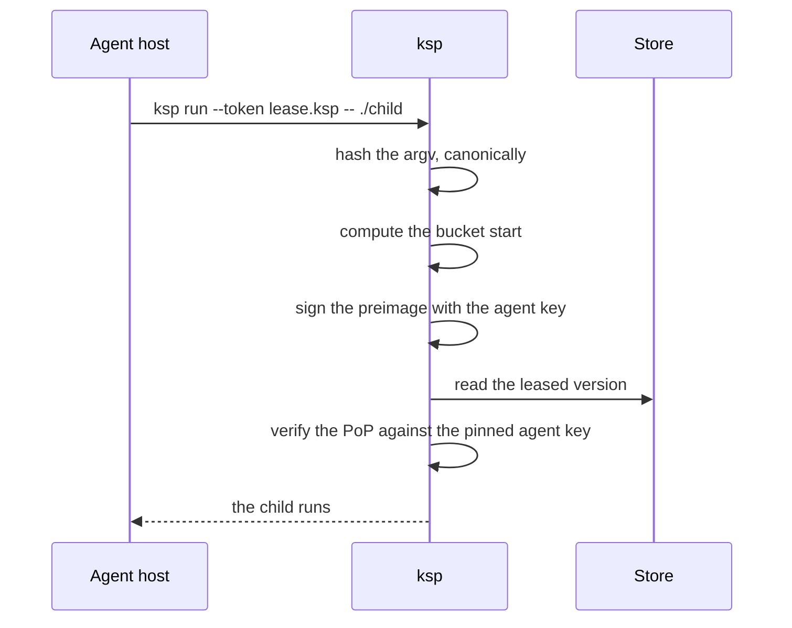
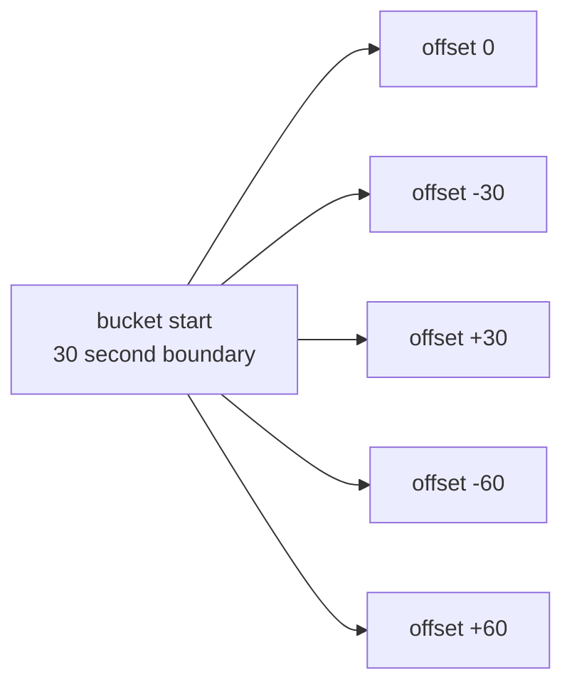
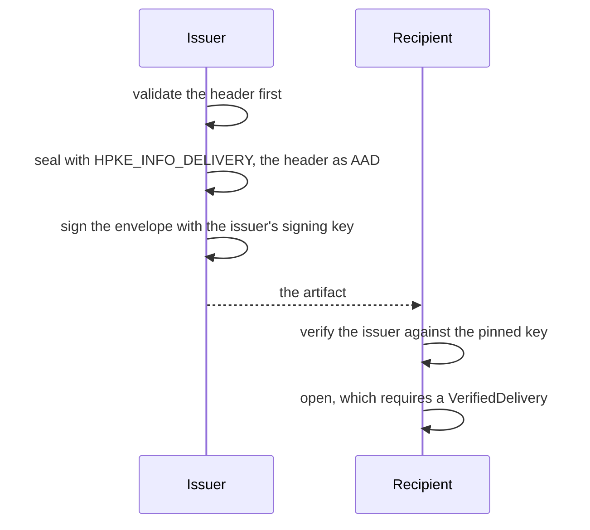
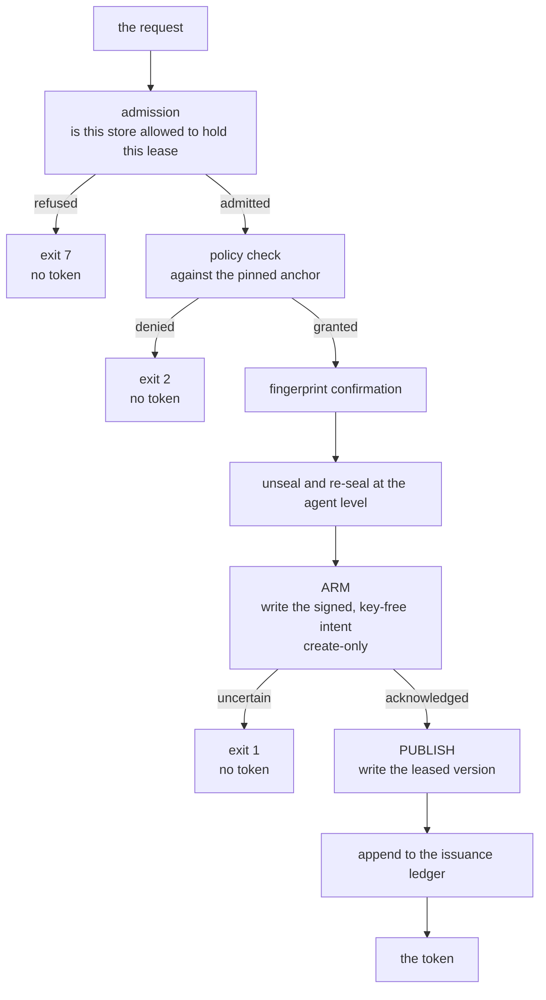
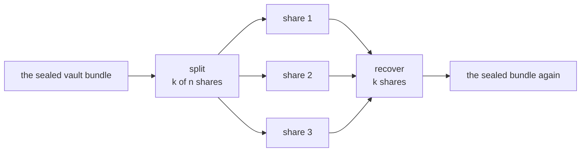
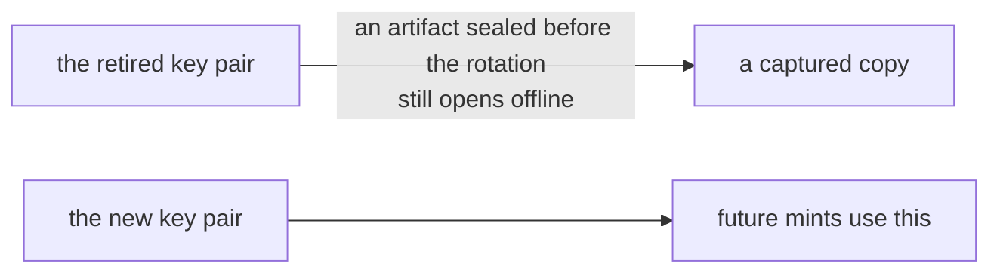

# Deep Dive: ksp-identity

## Overview

`crates/ksp-identity` answers three questions:

1. **Who is speaking?** - enrolment, key pairs, the fingerprint binding.
2. **May they have this?** - policy verification against pinned anchors.
3. **What is sealed to whom?** - the delivery artifact and the mint sequence.

Its module docs name the two misfits it closes: **Misfit H**, the trust
anchor being substituted, and **Misfit Q**, the key being substituted. The
crate exists to make both structurally impossible rather than merely checked.

## Responsibilities

- Generate and rotate independent Ed25519 and X25519 key pairs.
- Bind identity, both public keys and both key IDs into one fingerprint.
- Verify an enrolment against a **pinned** admin anchor.
- Verify a policy against pinned trust anchors.
- Prove possession of an agent key, deterministically.
- Seal a delivery to a named recipient and verify its issuer.
- Mint a lease: arm durably, then publish.
- Maintain the issuance ledger.

## Architecture



## The Fingerprint Binding

This is the mechanism the crate is named for. Five things are bound into one
SHA-256 digest:



Four properties make this binding worth having:

- **The domain and the version are inside the digest.** A format change makes
  old and new fingerprints incomparable, so a stale pin cannot silently
  validate against a new scheme.
- **The comparison is constant-time.**
- **The fingerprint is derived, never asserted.** `UnsignedEnrolment::bind`
  computes it; there is no constructor that takes a fingerprint.
- **The stored fingerprint is a claim.** The record's *derived* fingerprint -
  recomputed from the record's own keys - is a different value from the
  claimed one, and the verification path uses the derived one.

The admin's signing preimage is `DOMAIN_ENROLMENT || CBOR(record)`. When the
admin signs an enrolment, it **recomputes the fingerprint** and refuses a
mismatch, so an admin cannot sign a record whose claimed fingerprint
disagrees with its own keys.

## Two key pairs, never one

Every agent and every user has an Ed25519 signing key and an X25519
recipient key, generated separately. They are never derived from one
another.



The admin holds a signing key that **cannot decrypt anything**. This is
enforced by the type system and demonstrated by `compile_fail` doctests: a
function that tries to convert an Ed25519 key into an X25519 key, or that
accepts a `Vec<u8>` where a key is meant, does not compile.

The rule is not a convention. It is the difference between a signing
compromise and a decryption compromise.

## The Vault

A user's vault holds her signing key, her recipient key and the vault key,
sealed together.



Two details are load-bearing:

- **The sealing key is derived from the passphrase, and the parameters are
  part of the format.** They are recorded in the code as a configuration
  decision, not as a tunable, because a vault sealed under one set of
  parameters must open under the same set forever.
- **The unseal path returns one undifferentiated error** for a wrong password
  and for a transplanted binding. Reporting which would be an oracle.

The ciphertext length is checked *before* decryption, so a truncated file is
rejected without being fed to the cipher.

## Proof of Possession

The PoP is a deterministic signature over the invocation, and its stated
purpose is narrow: it authenticates a **compliant invocation**. It does not
prevent replay, does not provide exactly-once delivery, and does not protect
a content key.



### The preimage

```text
keyspout-pop-v1 || CBOR([jti, record_version, record_path, argv_hash, window_ts])
```

The **argv hash** is a SHA-256 over the canonical CBOR of the argv *array* -
never a concatenation, never a sorted form. Sorting would make two different
invocations hash the same, and concatenation would let a boundary move.

### The time window

The window is a **set of five instants**, not a tolerance:



`+60` is accepted. `-90` is not. The set is symmetric around the bucket, so
a clock that is slightly fast and one that is slightly slow both land
inside it. The arithmetic uses `saturating_sub`, so it cannot wrap to
`u64::MAX` and produce an instant that looks valid.

The offsets are relative to the bucket start, so a signature at `+60` of one
bucket is at `0` of the next. That is the intended behaviour.

## Sealed Delivery

The delivery artifact is a self-describing structure: the header says what
it is for, the ciphertext is the content key material, and the signature is
the issuer's.



Four properties make this safe:

- **The artifact alone is inert.** Sealing is not secret - the recipient's
  public key is a header field - so `verify` must precede `open`, and
  `open` takes a `VerifiedDelivery`, which makes the wrong order a compile
  error.
- **The issuer refuses to sign a structure its own constructor would
  reject.** The header is validated before the signature is made.
- **The recipient key is confirmed, not read.** `VerifiedRecipientKey::confirm`
  compares the **re-derived** binding fingerprint against the confirmed one,
  never the record's claim.
- **The plaintext is an explicit CBOR array** of `{secret, version, key}` in
  header order. Maps are forbidden in anything signed or hashed, because
  `ciborium` is not canonical CBOR and a map's key order would change the
  bytes a signature covers.

## The Mint Sequence

The mint is two steps, and the order is the safety property.



`MintAuthority` has **no public constructor**. Publication is unreachable
without an arm. The sequence has no atomic transaction between the two
steps, and that is deliberate: the failure mode of the chosen order is a
record with no token, which the sweep removes. The other order would publish
a token whose cleanup was never armed.

## The Issuance Ledger

Two files, one writer each:

| File | Writer | Readers |
|---|---|---|
| `issuance.jsonl` | The principal | The admin |
| `withdrawals.jsonl` | The admin | The principal's run |

Both are `0640` in the store's group. The argument for one writer each is in
the mode: a ledger a third party can rewrite is a mint history that party can
forge - appending a revocation is how a token stops working, and removing one
is how it starts again.

The ledger is opened `O_NOFOLLOW`. A torn tail makes appending refuse until
it is repaired, because a revocation that reports success and does not
survive is worse than a revocation that refuses.

`REVOCATION_REACH` states the limit in the code: revocation stops future
mints. It does not recall a copy taken earlier, which still opens with the
agent's own key.

## Recovery

Shamir over GF(2^8), with the AES polynomial `0x11b`.



Three properties matter:

- **The split operates on a `SealedBundle`, never on raw bytes.** A share
  cannot leak a key that was never sealed.
- **Re-sharing validates before persisting.** A failed split cannot orphan
  the old phrase set.
- **A duplicated share index is refused.** The second copy would silently turn
  a `k`-of-`n` set into a `(k-1)`-of-`n` one.

Recovery restores a **sealed bundle**, not a lost phrase. The phrase is still
needed, and so is either a usable backup or at least `k` shares.

## Rotation

Rotation changes what is minted next and what the trust state is. It does
**not** revoke anything already captured.



The mechanism: `TrustStore::rotate` requires the new record to verify against
the pinned admin, refuses an unchanged fingerprint, and **keeps** the previous
record in `retired`. The key-lifecycle crate archives the old bytes under the
old fingerprint.

## Scope

`scope.rs` decides who may read which audit records. It lives in
`ksp-identity` rather than `ksp-deletion` to avoid a dependency cycle, and a
refusal does not disclose whether a UUID exists.

## Domain Separation

Thirteen domains, each with its own string, each ending in `-v1`. A test
asserts that all thirteen are distinct.

| Domain | Covers |
|---|---|
| `DOMAIN_ENROLMENT` | The enrolment record |
| `DOMAIN_VAULT_AAD` | The vault's associated data |
| `DOMAIN_POLICY` | The policy body |
| `DOMAIN_TOKEN` | The delivery envelope |
| `DOMAIN_POP` | The proof of possession |
| `DOMAIN_DELETE_INTENT` | The deletion intent |
| `DOMAIN_DELETE_REPORT` | The deletion report |
| `DOMAIN_ABSENCE_OBSERVATION` | The absence observation |
| `DOMAIN_AUDIT_RECORD` | The audit record |
| `DOMAIN_SWEEPER_ARMING` | The sweeper arming |
| `DOMAIN_SWEEP_PROOF` | The sweep proof |

Plus two HPKE `info` strings: `keyspout-record-v1` and
`keyspout-delivery-v1`.

The audit record uses a **separate** domain from the deletion report, so an
audit record can never verify as a deletion report.

## Dependencies

| Direction | Why |
|---|---|
| `ksp-identity` to `ksp-record` | The delivery seal uses the record crate's HPKE adapter, so the low-order-point rejection is one implementation and not a second copy |
| `ksp-identity` to `ksp-backend` | The mint path needs the admission decision and the arming store |
| `ksp-identity` to `ksp-types` | The shared vocabulary |

## Testing

The crate's tests are concentrated on the properties that are easy to get
subtly wrong:

- The fingerprint binds exactly five things, and a change to any one of them
  changes the digest.
- The `compile_fail` doctests that keep the key conversion impossible.
- The PoP window boundaries: `+60` accepted, `-90` refused.
- The argv hash distinguishes two invocations that a sorted or concatenated
  hash would collide.
- The unseal path returns one error for both failure modes.
- The mint path refuses to publish without an acknowledged arm.

## Potential Improvements

- The `TrustStore` is a single-writer file with an in-memory index. It does
  not scale, and it does not need to: the deployment model is one operator or
  one team.
- The trusted checkpoint is optional. With no checkpoint, replay of an old
  policy is undetectable, and the code reports `Freshness::Unavailable`
  rather than pretending otherwise.
- `scope.rs` duplicates a little of the policy vocabulary that
  `policy.rs` owns.

## See Also

- [Deep Dive: ksp-record](ksp-record.md) - the HPKE envelope
- [Deep Dive: ksp-key-lifecycle](ksp-key-lifecycle.md) - the durable key file
- [Deep Dive: ksp-backend](ksp-backend.md) - admission and arming
