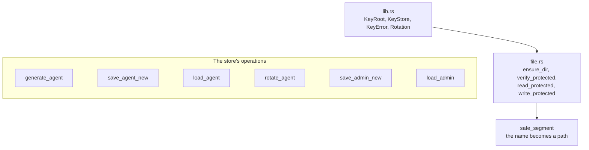
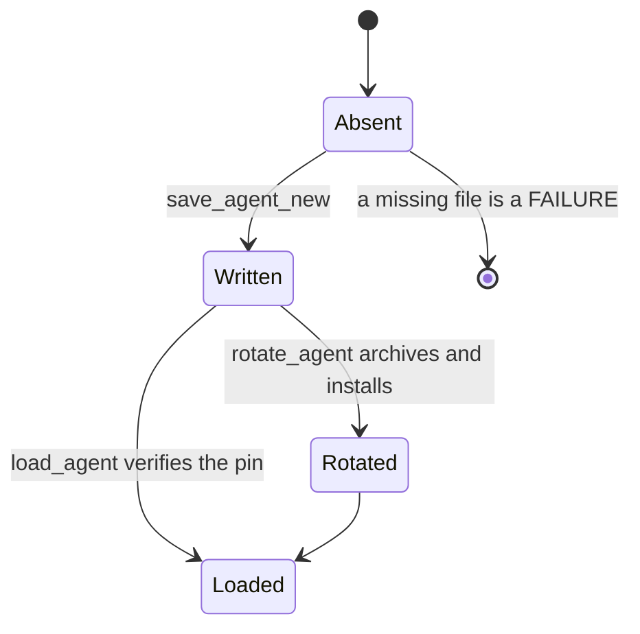
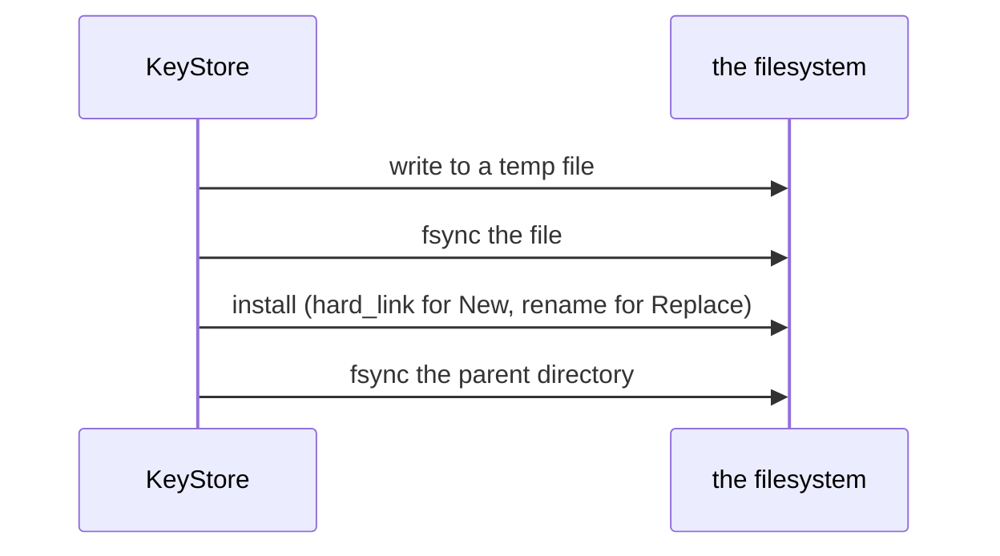
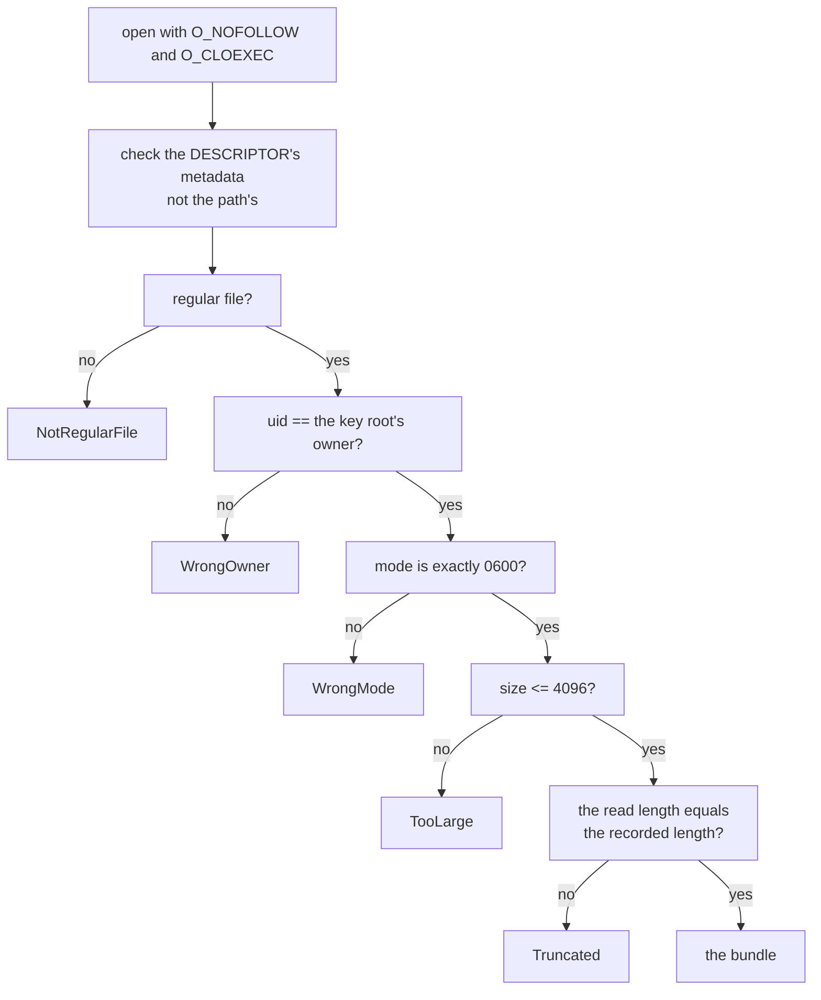
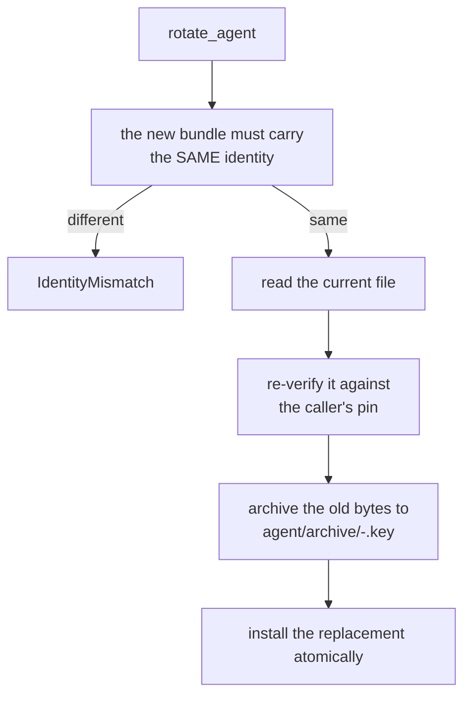
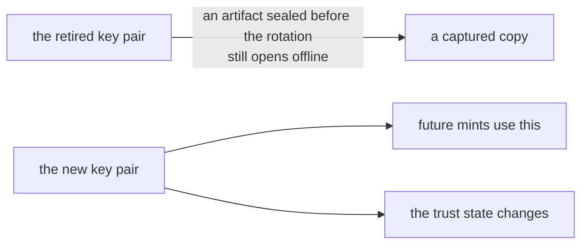

# Deep Dive: ksp-key-lifecycle

## Overview

`crates/ksp-key-lifecycle` is the smallest crate in the workspace, and it
owns one thing: **the file**.

Where it lives, who may read it, and how it is replaced without publishing a
half-written identity.

It exists for **Misfit R**: the identity that must survive across foreground
invocations without the CLI ever holding a raw private key.

## Responsibilities

- Create and validate the owner-only key roots.
- Write a key file atomically, with a synced directory.
- Read a key file back and verify it against the caller's pin before
  returning any authority.
- Rotate an identity without losing the old one, and without ever
  generating a replacement for a missing file.

## Architecture

## What This Crate Is Not

The crate's own module docs are blunt about the limits:

> It is **not** encryption at rest. Mode `0600` restricts access to the owning
> account; it cannot defend against a compromise of that account or of the
> host.

> There is no `private_bytes()` here, so the CLI never holds a private half
> it could format, log or pass in `argv`.

Two absences are the design:

- **No `private_bytes()`.** The crate returns *typed authority* to
  `ksp-identity`, never key bytes. The CLI therefore cannot print a key even
  by accident.
- **No epochs.** There is no epoch counter, no derivation tree and no
  epoch-based revocation anywhere in the crate. Keys are **rotated**, not
  derived. Key derivation happens one level up, in `ksp-identity`, which
  derives the *vault sealing key* from a password with Argon2id.

## The Protected Key File

The last edge is the important one. **A missing file is a failure, never an
invitation to generate a replacement.** A silent new key would make every
captured artifact unopenable while every command still reported success.

### The write path

The last step is the one that is easy to skip. A rename that has not been
followed by a directory sync can still be lost by a crash. Any failure past
the install step is therefore reported as `CommitUncertain`:

> The file may be a complete new identity or the previous one; the caller must
> report uncertainty rather than success.

`CommitUncertain` is a distinct variant precisely so that a caller cannot
read it as success.

### The read path

Three details:

- **The checks run against the descriptor's metadata, not the path's.** A
  path that was validated and then re-opened can be replaced in between.
- **The mode must be exactly `0600`.** Not "not group-readable" - exactly.
- **The read length must equal the recorded length,** so a truncated file is
  refused rather than parsed.

### The directories

| Rule | Reason |
|---|---|
| `0700` | Only the owner may traverse or list |
| `verify_dir` refuses a symlink | A symlinked `agent/` would let the reload leave the key root entirely |
| `verify_dir` refuses any group or other bit | "Refusing is the only safe answer; silently tightening someone else's directory would change state we were not asked to change" |
| `validate_dir` is the read-path variant | So a `0500` or read-only key root still reloads |

Every check in the module **fails closed**.

### `safe_segment`

The identity becomes a file name, so the name is validated: `[A-Za-z0-9._:-]`,
at most 96 bytes, no leading dot.

96 is below `NAME_MAX` because the archive name adds a hyphen, a 64-character
fingerprint and `.key`.

The crate's own comment on this seam: "this is where a value becomes a file
name, and a check that trusts its caller is not a check."

## Rotation

Four properties:

- **The replacement must be the same identity.** A rotation that changed the
  identity would be a different operation.
- **The current file is re-verified against the caller's pin before it is
  archived.** "A file that fails here is not the identity being rotated, and
  copying it aside would preserve an attacker's bundle under our archive
  name."
- **An identical existing archive counts as success,** so a transient failure
  does not permanently block rotation. A *different* archive under the same
  name is a conflict.
- **The installation is atomic.**

## What Rotation Does Not Do

This is stated in three places - the crate's docs, `ksp-identity`'s
enrolment module, and the design spec - because it is the most
over-claimed property in this class of product.

> It is not a revocation mechanism. Rotation writes a new identity and keeps
> the old one, so an artifact sealed before rotation still opens offline with
> the retained file. Rotation changes what is *minted*, not what has already
> been captured.

## The Error Type

`KeyError` has seventeen variants, and three properties they all share:

- **No variant carries file contents, key bytes or a raw OS error string.**
  A typed "could not be created" hid a plain `EACCES` on `mkdir` for hours
  during development, so the crate distinguishes `MissingKeyMaterial` from
  `UnusableHost` and reports the *class* of failure rather than a message
  that could leak a path.
- **A missing file is a failure, not an invitation to generate.** That is
  Misfit B and Misfit H, and it is why there is no `ensure_identity` API.
- **`CommitUncertain` is its own variant,** so uncertainty can never be read
  as success.

`KeyFileHooks` is a trait with seven fault-injection points, and `NoFailures`
is the production implementation. The hooks exist so the failure paths can
be tested rather than reasoned about.

## Dependencies

`ksp-key-lifecycle` depends on `ksp-types` and `ksp-identity`. It uses
`ksp-identity` for the typed `AgentKeyBundle` and `AdminKeyBundle` and their
pins, and it never interprets bundle bytes itself.

That is the whole boundary: **S2 alone interprets the typed key bundle; this
crate owns the file.**

## Testing

- **The write path's durability**, including that a failure after the
  install step produces `CommitUncertain` and not success.
- **The read path's checks**, each one: a symlink, a non-regular file, the
  wrong owner, the wrong mode, an oversized file, a truncated file.
- **The descriptor-not-path rule**, tested by replacing the file between the
  validation and the open.
- **Rotation**: the identity-mismatch refusal, the pin re-verification, the
  identical-archive case, the conflicting-archive case.
- **The missing-file case**, asserted to fail rather than regenerate.
- **`safe_segment`**, including the leading dot and the length bound.
- **The fault-injection hooks**, one test per failure point.

## Potential Improvements

- The key root is a fixed layout under `$KSP_HOME`. A deployment that wants
  the keys on a different filesystem - a hardware token, an HSM - would need
  the `KeyStore` to become a trait with more than one implementation, and
  the design currently excludes HSM custody by argument rather than by
  omission.
- `MAX_KEY_FILE_BYTES` is 4096, sized for one bundle. A bundle format with
  additional keys would need the bound raised, and the bound is a
  denial-of-service defence as well as a sanity check.
- The archive directory grows without bound. Nothing prunes it, and the
  archives are the very things that make an offline capture work.

## See Also

- [Deep Dive: ksp-identity](ksp-identity.md) - the trust store and the rotation
- [Deep Dive: ksp - the command-line interface](ksp-cli.md) - who calls this
