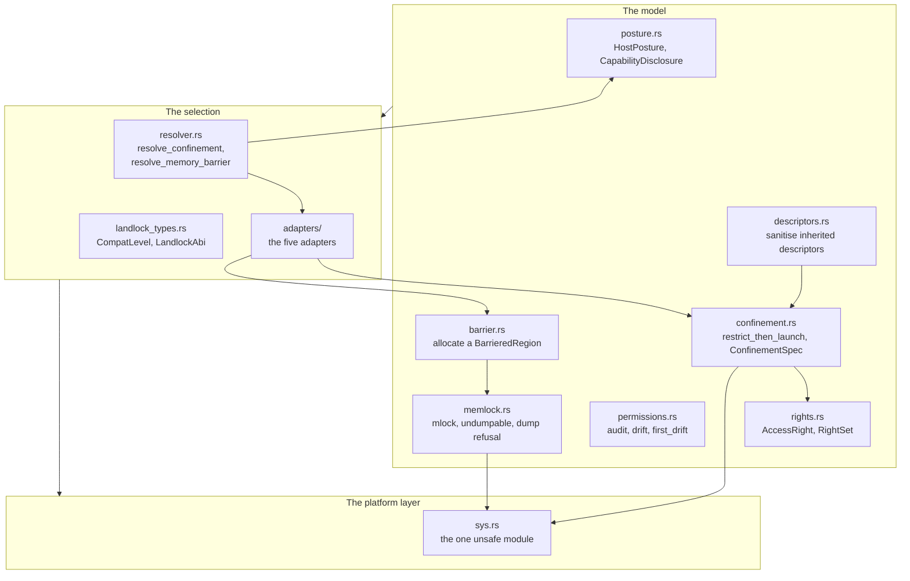
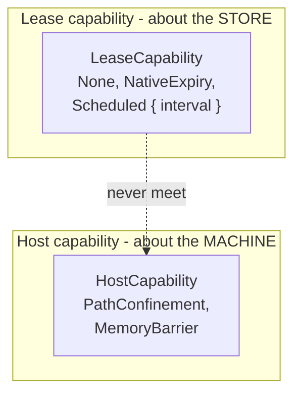
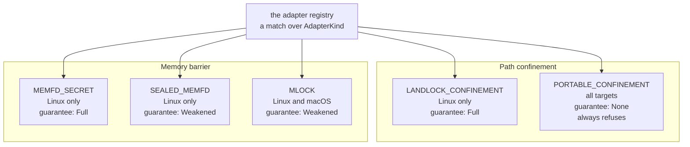
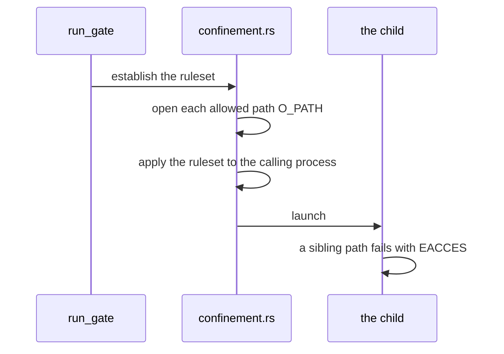
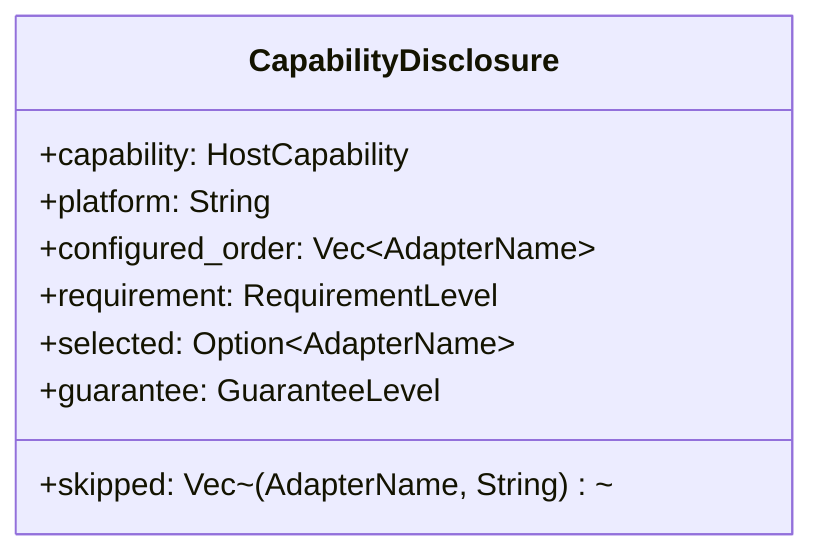

# Deep Dive: ksp-posture

## Overview

`crates/ksp-posture` states, **before a run**, what the host can actually
enforce. It applies kernel path confinement to the opted-in process tree,
keeps key material out of ordinary memory, and reports both facts honestly -
including when a fact is weaker than it should be.

The crate's first rule is in its own module docs:

> Confinement is not authentication. Landlock restricts *paths*; only a
> signature establishes *which key* is speaking. Both are required; neither
> substitutes for the other.

## Responsibilities

- Establish kernel path confinement for a process tree, or refuse.
- Establish a memory barrier for key material, or downgrade it visibly.
- Sanitise inherited descriptors so a sibling path fails under the kernel.
- Measure the protected roots' modes and owners, and report drift.
- Resolve which adapter runs, and disclose what it established.
- Report a capability that is *unavailable* with the host's reason.

## Architecture

## The Two Capability Vocabularies

The code keeps two things apart that read similarly and are not the same.

The `ksp-types` module that owns the host vocabulary says so in its own
header: **host capability is not lease capability**. A store's ability to
expire a record says nothing about whether the machine can confine a process.
Keeping them in one enum would let a reader assume that a `Scheduled` lease
implies a confined child, or that a `None` lease implies an unconfined one.

## The Five Adapters

An adapter is a mechanism, a guarantee, and an availability. The registry is
a `match` over the adapter kind, so it is compile-time exhaustive.

Three points about that table:

- **`PORTABLE_CONFINEMENT` guarantees `None`** and always refuses with
  `NoMechanism`. It exists so that a configuration naming it produces an
  honest answer on a platform that cannot provide one, rather than a silent
  downgrade. `GuaranteeLevel::None` means *no mechanism*, not a weaker form.
- **The guarantee is the adapter's own level,** never the level of a stronger
  adapter the operator preferred. If Landlock is configured first and
  unavailable, and `mlock` is chosen for the barrier, the disclosure reports
  the barrier as `Weakened` - which is what it is.
- **The Linux-only crates are target-gated** in `Cargo.toml`, under
  `[target.'cfg(target_os = "linux")'.dependencies]`. That turns "no
  Landlock" into an *adapter-availability fact* rather than a compile error,
  and it is why the workspace builds on macOS at all.

## Path Confinement

Confinement is applied with the Landlock `LANDLOCK_RULE_PATH_BENEATH` rules
over `O_PATH` descriptors, **before** the tree is launched.

### The rule that catches people out

> Applying a confinement ruleset confines the **calling** process,
> irreversibly, and a refusal is decided **after** the restriction is in
> force.

Two tests once reported "establishes nothing" by calling `establish()`
in-process, and had applied an empty ruleset to their own test harness. They
passed only because neither gate host has Landlock.

The consequence is structural: **a test that needs the kernel's answer
re-executes a throwaway child and calls it there.** That is also why the
delivery runs in a second process in the first place - a confined process
cannot un-confine itself, so it could not delete the record afterwards.

### Required versus optional

- **Required confinement** - a missing right causes a refusal. A run
  configured this way does not start the child.
- **Optional confinement** - a missing right produces a warning and a
  weakened posture in the status, but not a refusal.

A qualifying remote backend is never rejected solely for missing local
Landlock. And `CompatLevel::BestEffort` would silently downgrade, so a
required spec uses a hard requirement instead.

### What it does not cover

Confinement restricts *paths*. It does not confine:

- a same-UID outsider,
- the remote keys of a remote store,
- a process that was not in the tree.

The crate says so in its own module docs, and the status output reflects it.

## Descriptor Sanitation

Unrelated inherited descriptors are closed so that raw access to a sibling
path fails under the kernel, rather than being prevented by a client-side
check.

Descriptors are enumerated from `/proc/self/fd` on Linux and `/dev/fd`
elsewhere. The point is the difference between *the code declines to read
it* and *the kernel refuses the read*.

## The Memory Barrier

Three mechanisms, in descending order of guarantee:

| Adapter | Platform | Guarantee | What it does |
|---|---|---|---|
| `memfd_secret` | Linux | `Full` | The region is created with `MFD_SECRET`; it is never in the process's address space and never in a core dump |
| `sealed_memfd` | Linux | `Weakened` | A sealed `memfd`, without the secret flag |
| `mlock` | Linux, macOS | `Weakened` | The pages are locked against swapping, but they stay in the process's address space |

Three cautions the code states:

- **`mlock` does not remove pages from the kernel's direct map,** and it does
  not exclude them from a dump. It is weaker than `memfd_secret` and is
  reported as such.
- **A rejected `MFD_SECRET` flag is a defect,** never a reason to demote
  silently.
- **The barrier preference must be explicit,** because an implicit
  preference produces a silent degradation.

### Undumpable posture

On Linux the crate sets `PR_SET_DUMPABLE=0`; on macOS it uses
`ptrace(PT_DENY_ATTACH)`. `MADV_DONTDUMP` is Linux-only. The result is
reported as `UndumpablePosture`.

## Permissions and Drift

`permissions::audit` measures every protected root against the layout
table's expectation and reports `Verdict`s.

Two rules:

- **It never follows a symlink** and **never repairs a mode.** A silent
  repair would change state the caller was not asked to change, and a
  symlinked directory would make the measurement meaningless.
- **`Refusing is the only safe answer** for a directory that is not what the
  layout requires. The code says this about tightening someone else's
  directory.

`first_drift` returns the first offending root, so a refusal names one
concrete path rather than a list.

## The Disclosure

The disclosure record is what `ksp status` prints.

The `skipped` list carries **the host's reason** for each adapter that did
not run. That is the difference between a disclosure and a status line: a
reader who cannot tell an *accepted absence* from an *unnoticed one* has not
been told anything.

Two functions, deliberately separate:

- `resolve_confinement` and `resolve_memory_barrier` answer **which adapter
  runs**. Their parameters are disjoint.
- `satisfies(guarantee, requirement)` answers **may the run proceed**. It
  takes the guarantee and the requirement and nothing else.

Merging them would make "which adapter" and "may I proceed" the same
question, and the second is a policy decision that the first must not make.

## On macOS

The crate builds on macOS and reports honestly there:

| Capability | macOS | Reported as |
|---|---|---|
| Path confinement | None available | `none`, and the child runs unconfined |
| Memory barrier | `mlock` | `weakened`, never `memfd_secret` |

The `restrict_then_launch` path has a non-Linux stub, and
`PR_SET_DUMPABLE` has a Darwin equivalent through `ptrace`. The result is
that a macOS operator gets a **smaller guarantee**, stated in the command's
own output as well as in `ksp status` - not a silent difference.

## Dependencies

`ksp-posture` depends on `ksp-types` **only**, plus the target-gated
`landlock` and `memfd` crates on Linux.

The one `unsafe` module in the whole workspace is `sys.rs`, and it exists
because `libc` exposes `memfd_secret(2)` as a bare syscall number with no
wrapper. The workspace lint is `deny`, not `forbid`, precisely so that one
module-scoped `#[allow]` with a `// SAFETY:` comment on every block can
exist. Every other crate is unable to write `unsafe` at all.

## Testing

- **The kernel's answer, asked in a child.** The confinement tests re-execute
  a throwaway process, because the in-process call would confine the test
  harness.
- **Each adapter's availability** on the running platform, asserted.
- **Each guarantee level** asserted separately from each selection.
- **The drift detector** against a directory that was deliberately changed,
  including the symlink case and the "does not repair" case.
- **The disclosure's shape**, including that `skipped` carries a reason.

## Potential Improvements

- The adapter set is fixed at five. A Seatbelt (SBPL) adapter for macOS was
  researched, measured and **not adopted**; it is recorded as
  **[Absent by decision]**, with the risk it leaves stated in the design
  spec's threat model.
- The memory barrier is a single region. A workload holding several
  concurrent secrets would need several.
- The permission audit compares against the layout table, which is a
  development-time constant. A deployment that wants a different layout
  would need the table to become configuration, which is a larger change
  than it looks.

## See Also

- [Architecture Overview](../architecture/overview.md) - where posture sits
- [Workflow Overview](../workflows/overview.md) - the run path
- [Design specification](../reference/design-spec.md)
