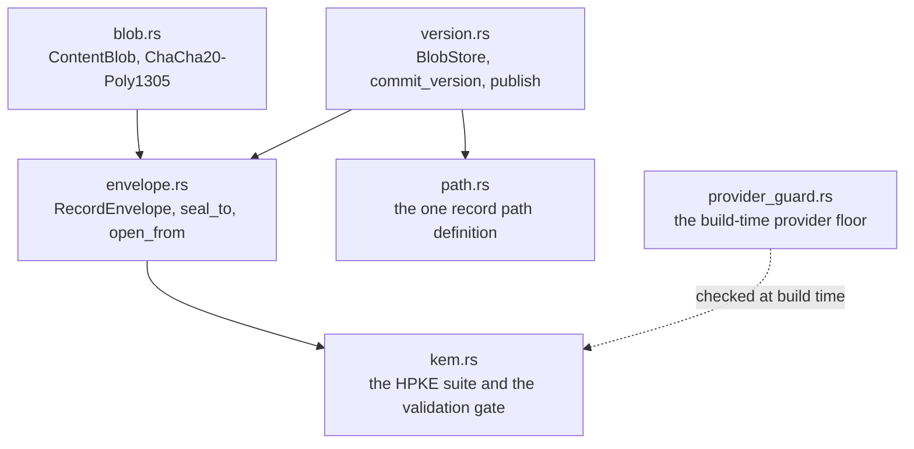
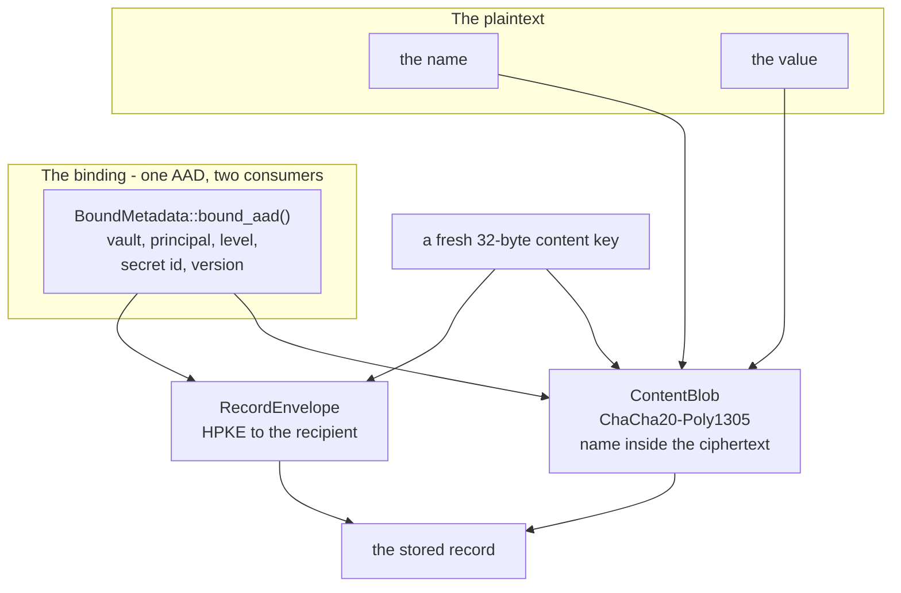
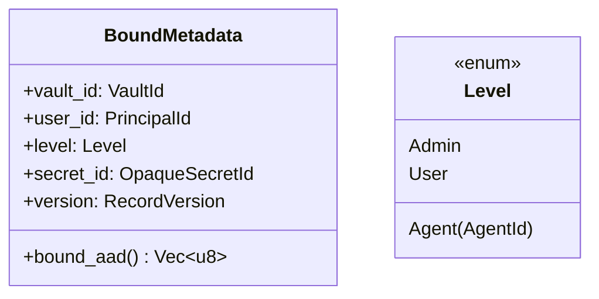
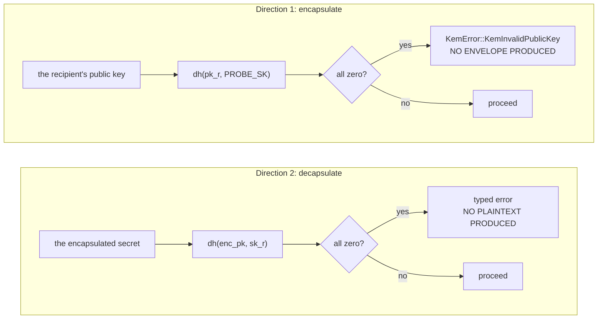
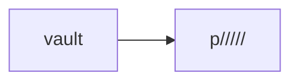
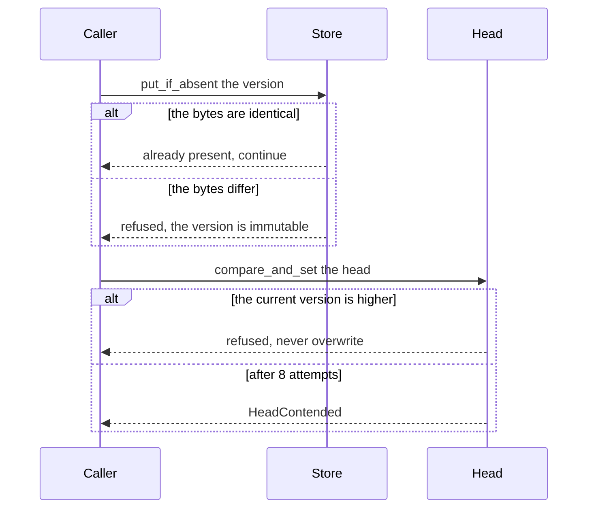

# Deep Dive: ksp-record

## Overview

`crates/ksp-record` is the record's cryptography: the KEM validation gate,
the bound context, the content blob, the HPKE envelope and conditional
publication.

Its scope is one sentence: **a record is immutable, sealed to a named
recipient, and bound to its identity.**

## Responsibilities

- Seal a content blob under a fresh content key.
- Seal the content key to a named recipient with HPKE.
- Bind the record's five-part identity as associated data.
- Reject a low-order or otherwise invalid KEM public key, in both directions.
- Write versions immutably and advance the head conditionally.
- Refuse a non-canonical encoding on the way back in.

## Architecture

## The Two-Layer Seal

A record is not one ciphertext. It is a ciphertext and the key that opens
it, sealed separately.

Two properties follow from this shape:

- **The name is inside the ciphertext.** A store listing discloses no secret
  name. A backend that returns keys cannot learn what they are called.
- **One binding, two consumers.** The same `bound_aad()` is used by the blob
  and by the envelope. A second, looser binding would reintroduce the
  record-swap misfit that the design set out to close.

## The Record Identity

`bound_aad()` is the deterministic CBOR of
`[vault_id, principal_uuid, level, secret_id, version]`. The crate's own
comment calls it "the single binding".

Two rules about the identity:

- **Levels are siblings, never nested.** `admin`, `user` and `agent-<id>` are
  three parallel namespaces. Sharing is one-way: an `agent-<id>` record is
  never copied back to `user` or `admin`.
- **A display name is mutable metadata, and no security decision may read
  it.** Every decision uses the UUID.

## The KEM Validation Gate

The HPKE provider exposes no `KemInvalidPublicKey` variant, so the gate calls
the provider trait **directly** rather than pattern-matching an error string.

The probe uses a **fixed non-zero** secret key. The check is on the *shared
secret*, not on the error the provider chose to return.

Two rules in the code:

- **Never pattern-match `HpkeError::CryptoError(String)` to recover the
  condition.** That string is not a stable upstream API; a provider upgrade
  would change the error and the check would stop firing.
- **Both directions are tested.** A gate that only checked encapsulation
  would accept an invalid key on the way back.

## The HPKE Suite

Fixed and not configurable:

| Component | Choice |
|---|---|
| KEM | `DhKem25519` |
| KDF | `HkdfSha256` |
| AEAD | `ChaCha20Poly1305` |
| Mode | RFC 9180 base mode |
| `info` (record) | `keyspout-record-v1` |
| `info` (delivery) | `keyspout-delivery-v1` |

The `info` string is what separates a record envelope from a delivery
envelope. The same HPKE key pair used for both would otherwise be able to
open the other.

The envelope's wire form is exactly two concatenated fields: the 32-byte
encapsulated secret and the sealed content key. The content payload is a
separate blob.

## The Record Path

`RecordPath::parse` round-trips through `BoundMetadata`, so a second
spelling of the same path - `007` and `7` - is rejected. A path that parses
two ways is a path two readers can disagree about.

## Version Integrity

Three rules:

- **Versions are immutable.** `put_if_absent` writes once. An identical retry
  continues, so a re-run after a crash is safe.
- **The head advances with a compare-and-set.** A higher current version is
  never overwritten. The attempt count is bounded at eight, after which the
  operation fails with `HeadContended` rather than spinning.
- **A version conflict may occur *after* the version bytes were written.** It
  means this version did not become the head, not that the operation left the
  store untouched. The error message says so, because the difference matters
  to a caller deciding whether to retry.

## Canonical Encoding

`ciborium` is **not** RFC 8949 §4.2.1 canonical CBOR. The hazard is removed
structurally rather than by relying on the library:

> Every signed structure is a **fixed-order Rust `struct`** or an explicit
> CBOR **array**. Maps are forbidden in signed structures.

`decode_record` re-encodes the decoded value and compares it with the input.
A non-canonical buffer is rejected, because a store could hold a
non-canonical encoding of a version and republish it later, which is a
different byte sequence for one immutable version.

The decoder's error type deliberately does not distinguish "truncated" from
"non-canonical". A caller that could tell them apart could probe the store's
contents.

## The Provider Floor

`provider_guard.rs` is included by `build.rs`, which fails the build if the
resolved `hpke-rs-rust-crypto` version is below `0.6.0` or cannot be
determined.

The reason is in the file's own comments: a `Cargo.toml` version requirement
is a *minimum*, not a guarantee. The lockfile is the thing that decides the
actual version, and a guard that reads the lockfile is the only one that
cannot be satisfied by a stale manifest.

## Dependencies

`ksp-record` depends on `ksp-types` only, plus the HPKE and AEAD crates.

`ksp-identity` depends on `ksp-record` so that the delivery seal uses **this
crate's** HPKE adapter. The low-order-point rejection is therefore one
implementation and not a second copy.

## Testing

- **Both KEM directions**, with a fixed probe key, asserting that no envelope
  and no plaintext is produced.
- **The binding**: the same AAD in the blob and the envelope, and a change to
  any of the five identity parts changing the AAD.
- **The name is inside the ciphertext:** a record's plaintext bytes do not
  contain the name.
- **Immutability:** a second `put` with different bytes is refused; with
  identical bytes it continues.
- **Canonical encoding:** a re-encoded non-canonical buffer is rejected.
- **The path round-trip:** `007` and `7` are the same path and only one
  parses.
- **The provider floor:** the build-time guard is exercised by the
  `provider_guard.rs` self-test.

## Potential Improvements

- The `RecordPath` format carries a UUID and an opaque id in the path. A
  store with many records in one directory would want a hash-sharded layout,
  which the `file` backend's own directory structure does not yet provide.
- `decode_value` exists for a reader that must show a record it cannot type -
  the audit view. Nothing re-encodes its result, but the type system does not
  enforce that, only a comment does.
- The envelope carries no explicit algorithm identifier. The suite is fixed
  in the code, so a future change would need a version bump, and the `info`
  strings already carry a `-v1`.

## See Also

- [Deep Dive: ksp-identity](ksp-identity.md) - the delivery that uses the same HPKE adapter
- [Deep Dive: ksp-types](ksp-types.md) - the shared encoding rules
