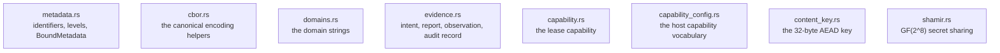
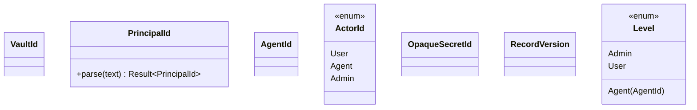
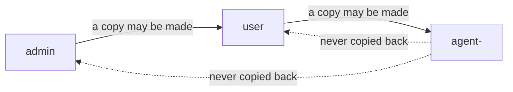
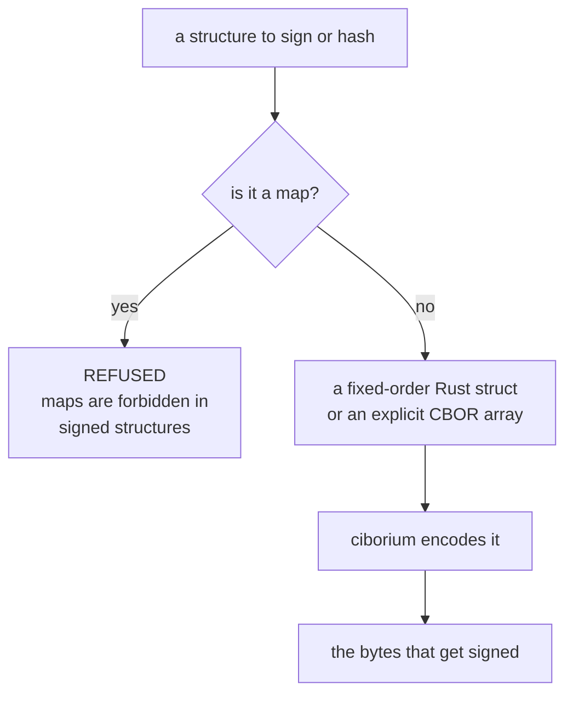
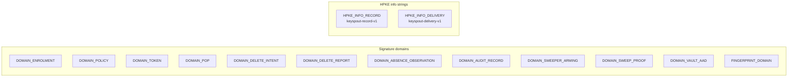
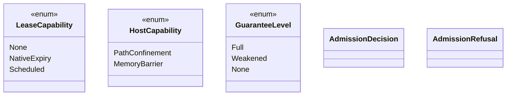
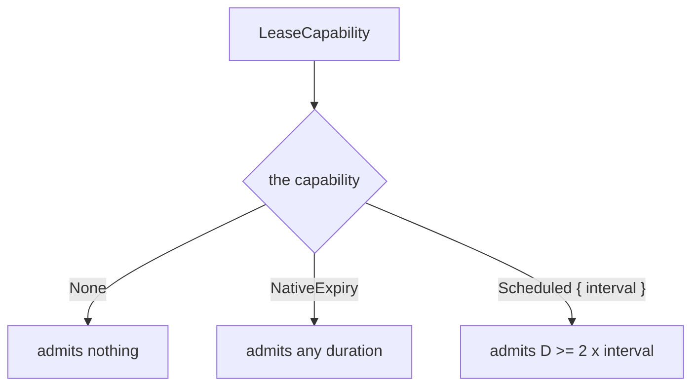
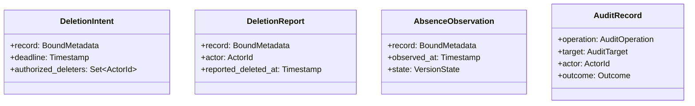

# Deep Dive: ksp-types

## Overview

`crates/ksp-types` holds the identifiers, encodings, domain strings and
evidence structures that subsystems must agree on **byte for byte**. Its own
module docs say it has "no behaviour, no policy and no I/O".

It is the bottom of the dependency pyramid: nothing internal depends on it,
and it depends on nothing internal.

## Responsibilities

- Define the identifiers: vaults, principals, agents, actors, secrets,
  versions and levels.
- Define the canonical encoding helpers, and the rule that keeps maps out of
  anything signed.
- Define the signature and HPKE domain strings.
- Define the evidence structures: intent, report, observation, audit record.
- Define the two capability vocabularies, and keep them apart.
- Provide the Shamir implementation over GF(2^8).

## Architecture

## Identifiers

### `PrincipalId` is strict

`PrincipalId::parse` checks:

- the exact length,
- the hyphen positions,
- lowercase hex only,
- the v4 version nibble,
- the RFC 4122 variant nibble.

This is deliberate. A principal UUID appears in a *path*, and a path is
security-relevant. The strictness is what makes `p/<vault>/<principal>/...`
unambiguous.

### `Level::parse` refuses a non-UUID agent level

`agent-<non-uuid>` is refused. A level that could be spelled two ways would
be a level two readers could disagree about.

### The actor prefix

`ActorId`'s `Display` is `user:`, `agent:` or `admin:`. The prefix is what
makes an actor's role visible in a signed record, and what stops a user
actor from being read as an admin one.

### Levels are siblings

Sharing is **one-way**. An `agent-<id>` record is never copied back up to
`user` or `admin`. The arrow that would allow it is drawn dashed because it
does not exist.

## The Canonical Encoding

This is the crate's most consequential rule.

The reason is in `cbor.rs`:

> `ciborium` is **not** RFC 8949 §4.2.1 canonical CBOR. The hazard is removed
> structurally: every signed structure is a fixed-order Rust `struct` or an
> explicit CBOR **array**. Maps are forbidden for signed structures.

A map's key order would change the bytes a signature covers. A fixed-order
struct or an explicit array cannot.

Two more rules from the same file:

- **An encoder change that widened integers would silently change every
  signature.** The types are chosen so the widths are pinned.
- **`decode_value` is only for a reader that must show a record it cannot
  type** - the audit view. Nothing re-encodes the result.

## Domain Strings

Thirteen domains, each ending in `-v1`, asserted distinct by a test.

Two of these carry a specific weight:

- **`DOMAIN_AUDIT_RECORD` is separate from `DOMAIN_DELETE_REPORT`,** so an
  audit record can never verify as a deletion report.
- **The two HPKE `info` strings separate the record envelope from the
  delivery envelope.** The same key pair used for both would otherwise open
  the other.

## The Two Capability Vocabularies

`GuaranteeLevel` is ordered `Full > Weakened > None`. `None` means *no
mechanism*, not a weaker form of one.

### The admission rule

The `2 x interval` floor is computed with `checked_mul`, so an absurd
interval **refuses** rather than wrapping into a small number that would
admit everything.

### Two vocabularies, never mixed

`capability_config.rs` opens with the sentence:

> **Host capability is not lease capability.**

They live in separate modules, with separate types, and they never meet. A
store's ability to expire a record says nothing about whether the machine can
confine a process.

## The Evidence Structures

`evidence.rs` defines the shapes that more than one subsystem must agree on.

`DeletionReport.reported_deleted_at` is documented in the code as "the
actor's claim about the deletion time. **Not evidence of erasure**". The
wording is deliberate, because the field is exactly where a reader would
otherwise over-read the guarantee.

## The Content Key

`ContentKey` is a 32-byte AEAD key with `zeroize` on drop.

Its erasure hooks are available **only** under the `test-observer` feature or
in tests:

> The `test-observer` feature retains a copy of the key bytes in a
> thread-local. It must never be enabled in a shipped build.

That feature is enabled as a dev-dependency of `ksp-record` and
`ksp-deletion`, and nowhere else. It exists so a test can assert that a key
was actually wiped.

## Shamir

Shamir over GF(2^8) with the AES polynomial `0x11b`. The workspace's
`Cargo.toml` says why it is in-crate:

> The one in-crate construction is Shamir over GF(256), a secret-sharing
> scheme and not a primitive.

The distinction matters: Shamir is a *scheme* built from field arithmetic,
not a cryptographic primitive that needs an audited implementation. Building
it in-crate means the security argument is in this repository's own code and
its own tests.

The implementation draws one polynomial per secret byte, with the
coefficients drawn once. Recovery uses Lagrange interpolation at zero and
refuses:

- duplicate evaluation points,
- shares that disagree.

## One Deliberate Dependency Absence

`toml` is a **dev-dependency only** of this crate. The module comment says
it: "this crate holds the types and must not learn what a file format is".

The TOML parser lives in `ksp`, which is where the file is read. `ksp-types`
takes the configuration type only in tests, so a test can prove the type
parses a real document without the published crate gaining a parser
dependency.

## Dependencies

`ksp-types` depends on **nothing internal**. Its external dependencies are
`ciborium`, `rand`, `serde`, `serde_json`, `sha2`, `subtle`, `thiserror` and
`zeroize`, plus `toml` as a dev-dependency.

## Testing

- **Every identifier's parser**, including the rejections: uppercase hex, a
  wrong hyphen position, a non-v4 version nibble, a wrong variant nibble, an
  `agent-` level that is not a UUID.
- **The domain strings are distinct** and all end in `-v1`.
- **The AAD is deterministic** and changes with any of the five parts.
- **The admission boundary**: `2x-1` refuses, `2x` admits.
- **Shamir**: `k-1` shares do not recover, `k` do, a duplicate index is
  refused, and disagreeing shares refuse.
- **The content key is zeroized** after erasure, under `test-observer`.

## Potential Improvements

- The `PrincipalId` parser is strict but hand-written. A generated parser
  would be shorter, but the hand-written one carries the reason for each
  check, which a generated one would not.
- `evidence.rs` holds four structures that share a shape but not a use. They
  could be generic over a target, but they are deliberately separate so that
  one cannot be serialised as another.
- The capability enums are closed sets with no extension mechanism. Adding a
  backend capability means a new variant and a compile-time fix everywhere
  it is matched, which is the intended cost.

## See Also

- [Deep Dive: ksp-record](ksp-record.md) - what consumes this encoding
- [Deep Dive: ksp-deletion](ksp-deletion.md) - what consumes these evidence types
