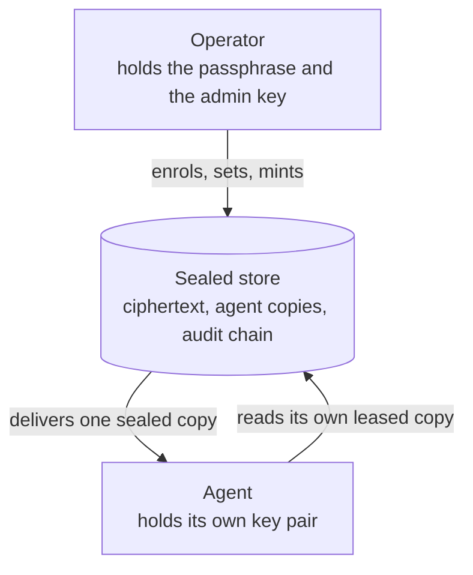
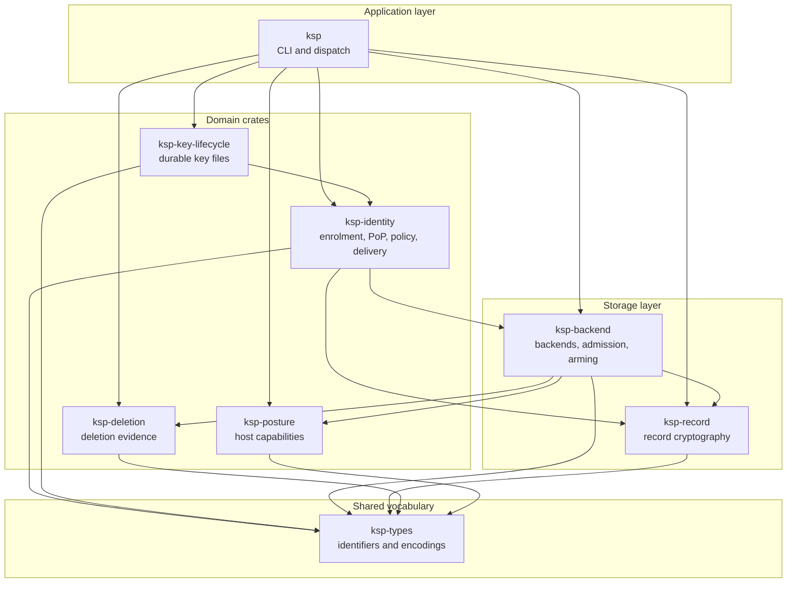

# Project Overview

## What is Keyspout?

**Keyspout is a serverless, contract-based secret manager for agents.** It
gives an agent a short-lived, sealed copy of a secret instead of a long-lived
credential, and it keeps no Keyspout service in the trust path.

The whole system is one binary. Every operation is a single foreground
invocation that starts, does its work and exits. There is no daemon, no
listener, no session and no control plane. The store is a directory or a
network backend the operator already owns.



## Core Purpose

Keyspout exists to close four gaps that a `.env` file leaves open:

| Gap | What Keyspout does |
|---|---|
| A plaintext file every process can read | Sealed records, encrypted to a named recipient key |
| A credential that never expires | A lease with a bounded lifetime and a cleanup schedule |
| A long-lived credential handed to an agent | A short-lived sealed copy the agent opens with its own key |
| No record of what happened | A signed, per-writer audit chain |

It is **not** a general-purpose secrets platform. There is no plugin host, no
server, no multi-tenancy control plane, and no promise of erasure. The design
[excludes erasure claims on purpose](reference/design-spec.md), and the
documentation keeps saying so out loud.

### What the design explicitly does not promise

These are decisions, not gaps, and the code carries them as such:

- **Deletion is best effort.** A sweep removes a record; a copy captured before
  the sweep stays readable. Nothing here can recall it.
- **Confinement is not authentication.** Landlock restricts *paths*. Only a
  signature establishes *which key* is speaking. Both are needed; neither
  substitutes for the other.
- **Rotation does not revoke.** It changes what is minted next and what the
  trust state is. A key pair captured offline stays usable.
- **Consume is not exactly-once.** The record is deleted after the read, so
  later fetches fail. A copy taken before the delete does not.

## Technology Stack

| Aspect | Choice |
|---|---|
| Language | Rust, edition 2024, minimum toolchain 1.99.1 |
| Build | Cargo workspace, 8 member crates; `cargo-dist` for releases |
| Binary | `ksp`, one executable, published as a tarball, `.deb`, `.rpm` and a Homebrew formula |
| Cryptography | `hpke-rs` (RFC 9180), `ed25519-dalek`, `x25519-dalek`, `argon2`, `chacha20poly1305`, `sha2` |
| Encoding | `ciborium` for CBOR; `serde` and `serde_json` for structure |
| CLI | `clap` with a derive tree; `thiserror` for typed failures |
| Host APIs | `libc` for `memfd_secret(2)`, `mlock(2)`, `ptrace(2)` and `PR_SET_DUMPABLE` |
| Confinement | `landlock` (Linux only, target-gated) |
| Storage | `file` (filesystem), `valkey` (Redis protocol), `s3` (AWS SDK, not yet selectable) |
| Platform | Linux and macOS; only Linux can provide Landlock and `memfd_secret` |

Two workspace-wide lint decisions shape the code more than any dependency:

- **`unsafe_code = "deny"`** in every crate, with one module-scoped exemption
  in `ksp-posture` that carries a `// SAFETY:` comment on every block. The
  exemption exists because `libc` exposes `memfd_secret(2)` as a bare syscall
  number and no wrapper.
- **`overflow-checks = true` in the release profile.** The threat model assumes
  the attacker may read the process image, so a wrapping length calculation is
  a bug the project would rather panic on than propagate.

## Key Features

- **Sealed records.** Every record is sealed with HPKE to a named recipient
  key, with the record's five-part identity bound as associated data. The
  secret *name* lives inside the ciphertext, so a store listing discloses no
  secret name.
- **Fingerprint-bound enrolment.** An enrolment binds the identity, both public
  keys and both key IDs into one SHA-256 fingerprint, verified out of band.
  The admin's signing key cannot decrypt anything; there is no code path that
  converts an Ed25519 key to an X25519 key.
- **Durable arming before publication.** A lease's deletion intent is signed
  and written to the store *before* the token is published. There is no
  distributed transaction, and no token is ever minted on an uncertain arming.
- **Policy-scoped sharing without a copy.** The second delivery shape: the admin
  publishes one sealed entry and signs a grant naming it, and what the user
  exports is a reference with no content key in it. Nothing is handed to the
  agent that would open the value, and a withdrawal is recorded before the
  artifact stops existing, so the decision and the tree cannot disagree.
- **Evidence-based admission.** A lease is admitted only when the backend has
  *proven* it can clean up. A declared cadence is a configuration; a signed,
  fresh sweep proof is evidence. The `file` backend admits nothing until the
  sweep has actually run.
- **Honest deletion attribution.** An intent authorises an attempt; an actor's
  signed report says what it did; an absence observation says what was not
  there. There is deliberately no accessor for a deletion time on an
  observation.
- **Host posture disclosed before the run.** The confinement adapter that ran,
  the guarantee it established and the reason another one did not run are
  reported before a child starts, including when the answer is "none".
- **Machine-readable output.** Every command accepts a global `--json`, and
  every refusal has a documented exit code that says what to do next.

## Project Structure

```text
keyspout/
├── crates/
│   ├── ksp/                 the CLI and the application layer (38 modules)
│   ├── ksp-identity/        enrolment, keys, PoP, policy, sealed delivery
│   ├── ksp-backend/         the three storage backends, admission, arming, sweep
│   ├── ksp-posture/         confinement and memory-barrier adapters, posture
│   ├── ksp-deletion/        deletion intent, reports, observations, audit chain
│   ├── ksp-record/          HPKE envelope, content blob, version integrity
│   ├── ksp-types/           identifiers, encodings, domain strings, evidence
│   └── ksp-key-lifecycle/   owner-only key files, verified reload, rotation
├── docs/
│   ├── keyspout-design-spec.md   the authoritative design
│   ├── known-defects.md          open defects, stated
│   ├── supply-chain-level.md     supply-chain guarantees
│   └── supply-chain-vetting.md   how those guarantees were reached
├── site/                    this documentation site
├── scripts/                 the gate, the VM runner, the public-sync tooling
└── skills/                  seven operator skills in the agentskills.io format
```

The crates form a strict dependency pyramid. `ksp-types` sits at the bottom
with no internal dependency at all; the CLI sits at the top and depends on all
seven.



The `ksp-deletion` to `ksp-identity` edge is **dev-only**, on purpose: the
production graph stays acyclic, and the consume-side proof-of-possession
assertion lives in a test.

## Getting Started

The operator path is four commands:

```bash
ksp init                    # probe the host, write the capability configuration
ksp admin init              # create the deployment, the admin key, the layout
ksp admin user add          # enrol the user, seal her vault
ksp secret set my-api-key   # store a secret, from stdin
```

From there, an agent gets a lease and consumes it:

```bash
ksp secret share my-api-key --agent deploy-bot --out /tmp/lease.ksp
ksp run --token /tmp/lease.ksp --consume -- ./deploy.sh
```

The [Quickstart](reference/QUICKSTART.md) walks the whole path with the
commands as they are run. The [design specification](reference/design-spec.md)
is the authority on what the system does and why.

## Architecture Summary

Three zones and nothing else:

1. **Your machine** holds your passphrase, your key pair and the `ksp`
   command. One deployment has an admin account, which signs and publishes, and
   one or more user accounts, each with its own sealed vault.
2. **The sealed store** is a directory or a network backend you own. It holds
   ciphertext, the per-agent copies, the publications a grant delivers from and
   the signed audit chain.
3. **The agent's machine or process** holds the agent's own key pair and turns a
   token into a real value - either by consuming one leased copy, or by opening
   the publication a grant names, which needs no copy at all.

The next document develops this into the C4 context, container and component
views. See [Architecture Overview](architecture/overview.md).

---

## Where to go next

| Document | What it answers |
|---|---|
| [Architecture Overview](architecture/overview.md) | How the zones, containers and crates fit together |
| [Workflow Overview](workflows/overview.md) | What happens, step by step, in the eight core workflows |
| [Deep Dives](components/ksp-cli.md) | How each crate works, in detail |
| [Design specification](reference/design-spec.md) | The authoritative design, with its status markers |
| [Known defects](reference/known-defects.md) | What does not work yet, stated plainly |
| [Security model](reference/SECURITY.md) | The controls, and what each one does not cover |
