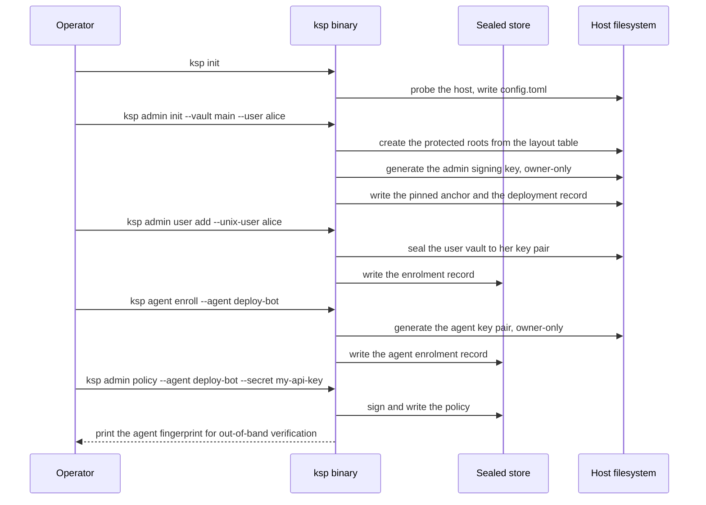
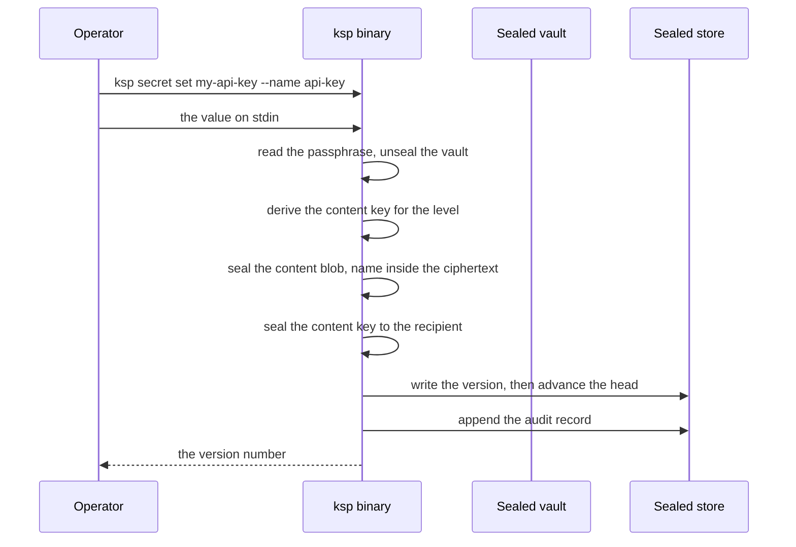
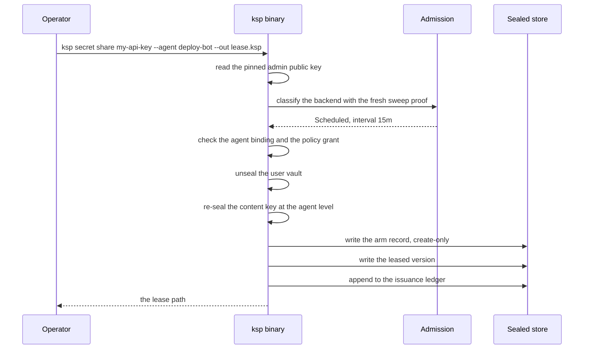
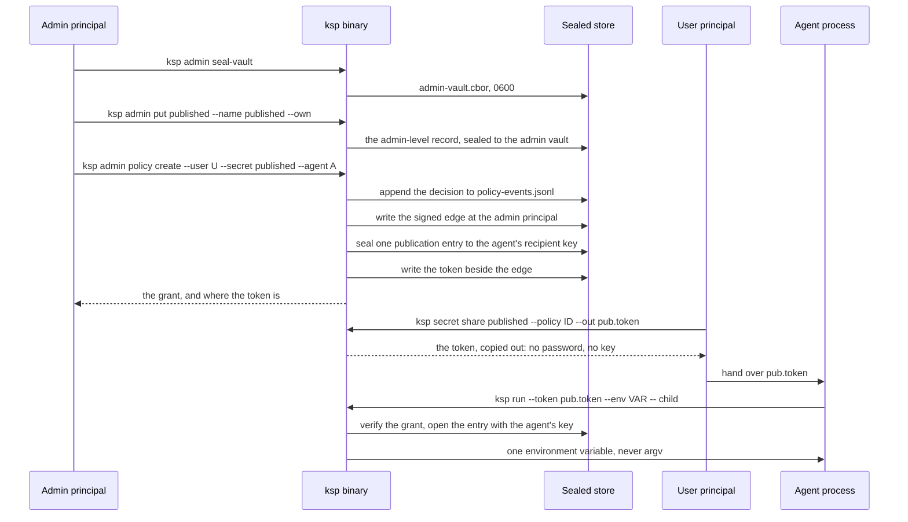
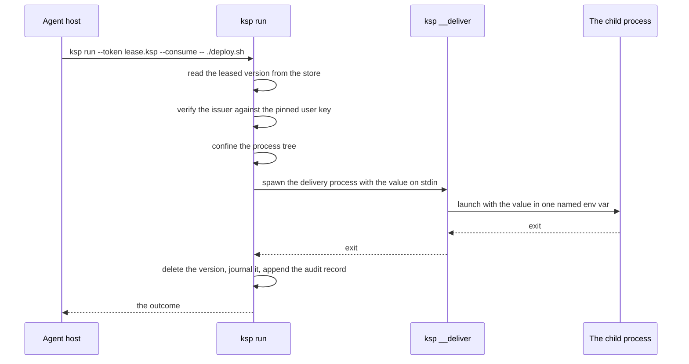
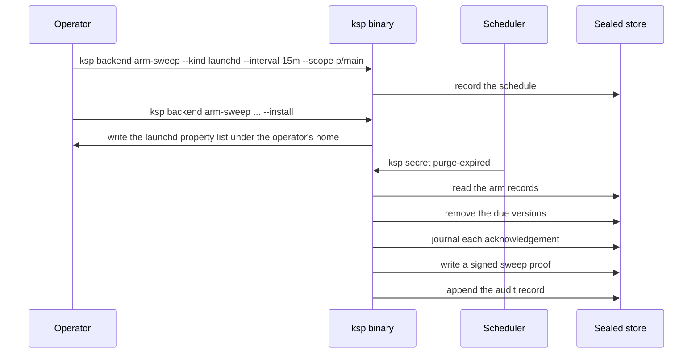
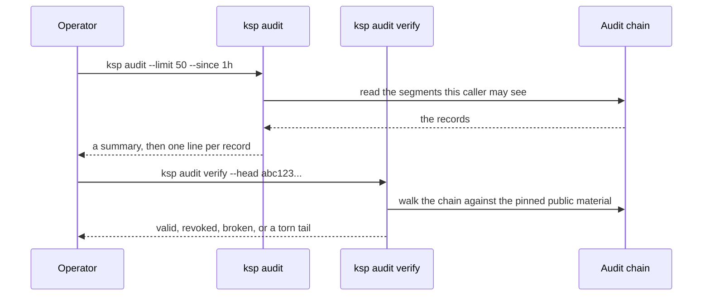
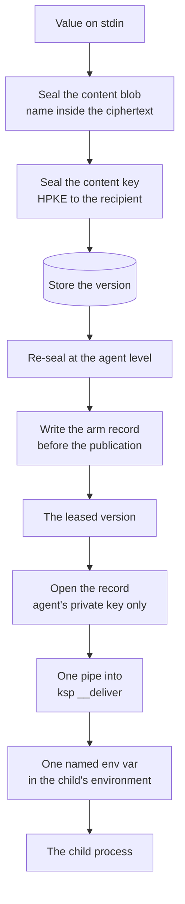
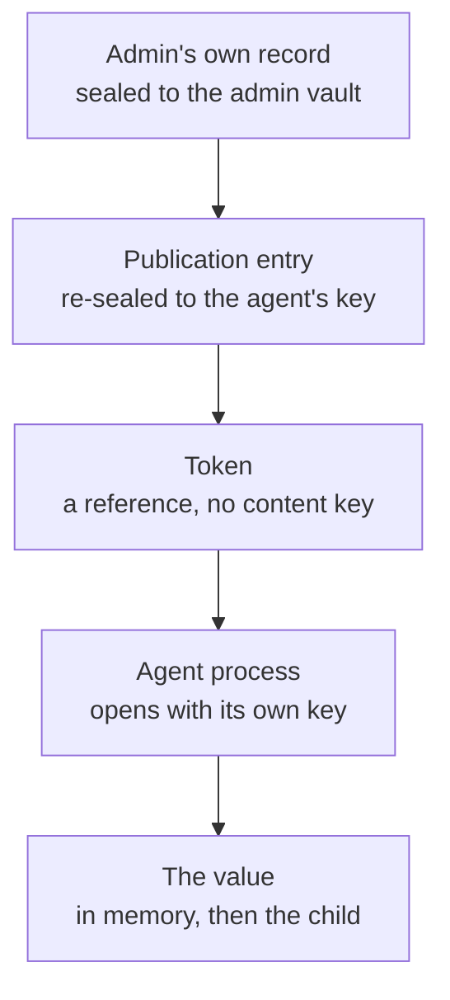

# Workflow Overview

Every workflow below is a sequence of **foreground invocations**. Nothing
runs in the background except the sweep, and the sweep is a batch job the
operator's own scheduler starts.

## Core Workflows

### Workflow 1: Enrol a user and an agent

The operator creates the deployment, enrols the user, enrols the agent, and
then grants the agent permission to read one secret. This is the setup phase
and it happens once per principal.

**Steps:**

1. **`ksp init`** probes the host. It measures what the host can enforce and
   writes a capability configuration. The probe validates in memory before it
   writes, so it cannot produce a file the reader would reject.
2. **`ksp admin init`** creates the deployment identifiers, the admin signing
   key, the pinned anchor and every protected root. The roots come from one
   table; the modes are set with `fchmod`, never with `open(2)`'s `mode`,
   because the caller's `umask` masks that.
3. **`ksp admin user add`** seals the user's vault. The vault holds her
   signing key, her recipient key and the vault key, encrypted under an
   Argon2id-derived key. The enrolment record is written with the fingerprint
   that binds her identity, both public keys and both key IDs.
4. **`ksp agent enroll`** generates the agent's two keys and writes its
   enrolment record. The private halves never leave the owner-only file.
5. **`ksp admin policy`** signs the grants. A write **merges**: the grants it
   names are added and the others are kept. `--replace` is the whole-set write
   that withdraws everything it does not name. The signed policy is read by every
   principal and replaceable only with the admin key.

   Two grant surfaces exist, and they answer different questions. The grant set
   above authorises a **leased copy** (`secret share --agent`). A **policy edge**
   (`admin policy create`) authorises one publication and is what workflow 4
   delivers through - one signed artifact per grant, so a read-back can report on
   that grant alone.

The last step of the policy is the important one: the operator reads the
agent's fingerprint aloud, or sends it over another channel, and the agent
side confirms it out of band. Nothing in the system substitutes for that
step.

### Workflow 2: Store a secret

**Steps:**

1. The value arrives on **stdin**, never in argv and never in an environment
   variable. A trailing newline is stripped and an empty value is refused.
2. The passphrase is read from stdin or from `--passphrase-file`. The vault is
   unsealed inside this process, used, and discarded when the process exits.
3. The content blob is sealed with ChaCha20-Poly1305 under a fresh content key.
   The **name is inside the ciphertext**, so a store listing discloses no
   secret name.
4. The content key is sealed with HPKE to the recipient, with the record's
   five-part identity - vault, principal, level, secret id, version - bound as
   associated data.
5. The version is written with a create-only put. An identical retry
   continues; a different body at the same version is refused.
6. The head advances with a compare-and-set, so a concurrent writer cannot
   silently lose an update.
7. The audit record is appended **before** the success report.

### Workflow 3: Mint a lease

This is the workflow with the most steps, because it is the one that has to be
safe under an uncertain failure.

**Steps:**

1. **Admission first.** The backend is classified against *evidence*, not
   configuration. On `file`, that means a signed sweep proof that is present,
   verified, in scope and fresh. A declared cadence on its own admits nothing.
2. **The anchor is pinned locally.** The admin's public key is read from the
   host's own pinned anchor file, never from the policy or the token.
3. **The policy grant is verified** against that anchor, and the agent's
   enrolment fingerprint is confirmed.
4. **The record is re-sealed at the agent level.** The content key is sealed to
   the agent's recipient key. The agent-level record is a *copy*, not the
   original: the user's durable record stays where it is.
5. **The arm is written before the publication.** The signed, key-free deletion
   intent goes into the store first, create-only. An uncertain arming publishes
   no token.
6. **The issuance ledger is appended.** One row per minted lease, by
   `publish_recorded`, so `token list` and `token revoke` have a subject.

### Workflow 4: Publish a grant and deliver without a copy

The second delivery shape, and the one that keeps the **admin's** secret out of
the user's reach. Nothing is copied: the admin publishes one sealed entry, signs
a grant that names it, and the token the user exports carries a reference instead
of a key.

**Steps:**

1. **`admin seal-vault`** creates the admin's own sealed vault. Every
   publication entry's content key is sealed to it, so it is created once and
   cannot be replaced: re-sealing would leave every existing entry naming a key
   nobody holds.
2. **`admin put --own`** writes the record the publication is made from, sealed
   to the admin's *public* recipient key - no password, because writing needs no
   private half. Without `--own` the same verb is the transfer to the user, which
   is a different record at a different principal.
3. **`admin policy create`** signs one edge. The order is the control: the
   decision is appended to `policy-events.jsonl`, then the edge is written, then
   the publication entry is sealed to the agent, then the token is minted last.
   A failure before the publication leaves an edge that reads `dangling`, not a
   token that names nothing.
4. **The grant is verified before anything is opened.** The anchor, the target,
   the secret version and both ends of the validity window are checked against
   the signed edge. A withdrawal removes the edge, so a withdrawn grant stops at
   "no such grant" rather than decrypting first.
5. **`secret share --policy`** copies the token out and reads no vault. The token
   has no content key, so there is nothing for the user to unlock - and nothing
   for her to hand on that would open the value.
6. **`run` opens the publication** with the agent's own recipient key. The
   delivery is recorded in *her* chain, because the agent acts for the principal
   the grant names.

Two refusals keep this delivery honest. `--consume` is refused: there is no
agent-level copy to delete, and deleting nothing while reporting a deletion would
be a false claim. And a grant whose publication is missing renders `dangling`
with the missing path, because a grant that cannot deliver is not a healthy one.

### Workflow 5: Consume a lease

The workflow an agent runs. It has two processes, and that is not an
accident.

**Steps:**

1. **Verify before anything else.** The issuer's signature is checked against
   the **pinned** user key on this host. A key inside the artifact under
   verification is data, never an anchor.
2. **Confine.** The Landlock ruleset is applied to the process tree before the
   child starts. Confinement is irreversible, so the confined process is a
   *different* process from the one that has to delete afterwards.
3. **Deliver through a second process.** The plaintext crosses one pipe into
   `ksp __deliver`, a hidden internal command, which reads it from stdin,
   re-resolves the capability configuration, applies the confinement and hands
   it to the child as one named environment variable. The plaintext is
   zeroized on every exit path.
4. **Delete after the read.** The version is removed from the store.
5. **Journal, then report.** The acknowledgement is journalled before the
   report is written. A journal failure stops the operation; a report failure
   does not.

**What this workflow does not promise.** The record is gone, so a later fetch
fails. A copy taken before the delete does not. The exit code distinguishes
the two cases: `9` means the delete failed and a retry may help, `10` means
the child failed after a successful removal and a retry cannot help.

### Workflow 6: Arm and run the sweep

**Steps:**

1. **Arming is configuration.** The schedule says when the sweep should run.
   It is never evidence that it did.
2. **`--install` writes under the operator's own home.** A system-wide target
   is refused rather than escalated. The property list carries the *real*
   binary path, because a hardcoded one once produced a plist that failed
   with `ENOENT` while the install reported success.
3. **The scope is a level, never a record.** A deeper `--scope` is refused, and
   the refusal names the accepted shape. Normalising `agent-<uuid>` to
   `agent-*` would silently widen what a sweep may delete.
4. **The proof is the output that matters.** After a successful sweep, the
   sweep writes a signed proof. A lease is admitted only against a fresh,
   verified, in-scope proof.

### Workflow 7: Read the audit log

Two commands, two different questions, over the same log.

**Steps:**

1. **The scope is the caller's own records.** An admin sees the admin's chain;
   a tenant sees her own, through her unsealed vault. A refusal does not
   disclose whether a UUID exists.
2. **The view is bounded.** `--limit` bounds the record lines and `--since`
   filters by each record's own `observed_at`. The header reports the total
   after the window and before the bound, so a truncated read is visible as a
   truncated read.
3. **Verification answers a different question.** The view projects what is
   there; verification checks who wrote it. The exit code `12` means the log
   did not verify, which is distinct from `8`, which means a proof of
   possession was invalid.

## Data Flow

The path a secret takes, from the operator's keystroke to the child's
environment variable. The dashed edges are the two boundaries where the
plaintext crosses into a process that must not be trusted.

The second delivery shape takes a shorter path, and the difference is the point:
the value never leaves the admin's side, and what travels is a reference.

Three things this diagram is designed to make visible:

- The **content key** is separated from the **content**. The store holds the
  sealed content key; only the recipient's private key can unwrap it.
- The **arm record** is written *before* the leased version, not after.
- The plaintext crosses **one pipe**, into a process whose only job is to hand
  it over, and it is zeroized on every exit path.

## State Management

There is no in-memory session state that outlives a command, and no cache of
an unsealed vault. The state lives in four places, all on disk:

| State | Where | Written by |
|---|---|---|
| Deployment identifiers | `deployment.cbor`, `admin-anchor.cbor` | `admin init` |
| The sealed vault | `vault.cbor` | `admin user add`, `vault rekey` |
| Records and versions | The store, under the level hierarchy | `secret set`, `admin put` |
| Arm records | `store/intents/<identity>` | The mint path |
| The grant set | `policy.cbor` | `admin policy` |
| Policy edges | `store/p/<vault>/<admin>/` beside `policy-events.jsonl` | `admin policy create`, `update`; `delete` removes one |
| Publications | The `granted/` level under the admin | `admin policy create`, `update`; a withdrawal releases that grant's entry beside it |
| Tokens | The `policies/` level under the admin | `admin policy create` |
| The principal registry | `store/p/<vault>/principals.cbor` | `admin init`, `admin user add` |
| Mint history | `issuance.jsonl`, `policy-events.jsonl` | The mint path, and the admin's decisions |
| The audit chain | `audit/` segments | Every operation |
| Key material | `admin/`, `agent/` | `admin init`, `agent enroll` |

The rule is that a **resolved value is taken from the resolution, never
re-read from its source.** The layout resolves `KSP_HOME` once; a step that
re-reads the environment variable writes an empty path into the plist. That
class of bug is why the layout is a single struct passed down.

## Error Handling

### Typed errors, one exit-code owner

Every subsystem defines its own `thiserror` enum with an `exit_code()` method.
The constants live in exactly one place, `exit.rs`, and a command never
chooses an integer.

| Code | Meaning | What the caller should do |
|---|---|---|
| `0` | Success | - |
| `1` | Internal failure | Report a bug |
| `2` | Policy denial | Ask for a grant |
| `6` | Missing key material | Enrol, or unlock |
| `7` | Capability or admission refusal | Change the configuration or the host |
| `8` | Proof of possession invalid or missing | Check the clock and the key |
| `9` | The delete failed; the record may still be there | Retry |
| `10` | The child failed after a successful removal; the record is gone | Request a new delivery |
| `11` | A compliant run was refused because the backend requires consumption | Add `--consume` |
| `12` | The audit log did not verify | Investigate the log |
| `13` | The invocation was malformed | Fix the invocation; the message names the accepted form |

Codes `3`, `4` and `5` are deliberately reserved by the design for token
expiry, an unreachable backend and a sealed vault. A future implementation of
those features must not contradict a shipped contract, so the current code
skips them.

### No catch-all success

The dispatch match over the command enum has no catch-all arm, on purpose: a
newly added command cannot silently succeed. Every unreachable path returns
`1`, not `0`.

### Refusals name the fix

A refusal message names the accepted shape, not just the rejected one. When
`arm-sweep` refuses a scope, the message names the shape it accepts. A family
of refusals that each read correctly but contradict one another leaves the
reader unable to derive the accepted form.

### Errors never suggest escalation

A tool's own error text can tell the reader to run as root. Passing that
through verbatim defeats a refusal that exists to prevent escalation, so any
surface that forwards another program's stderr strips the escalation hints
before it prints them.

### The redaction rule

A secret value, a key, a raw token or successful proof-of-possession material
never reaches stdout, stderr, an audit event or a JSON output. And a raw
error stack or message never reaches a response body.

## See Also

- [Architecture Overview](../architecture/overview.md) - the C4 views
- [Deep Dive: ksp - the command-line interface](../components/ksp-cli.md)
- [Deep Dive: ksp-deletion](../components/ksp-deletion.md) - the evidence model
